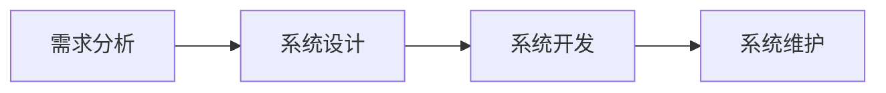
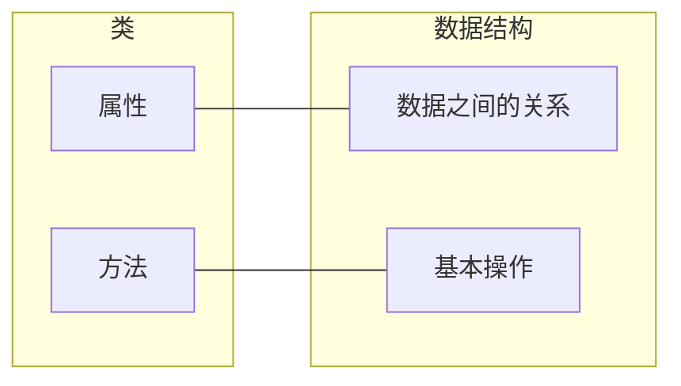
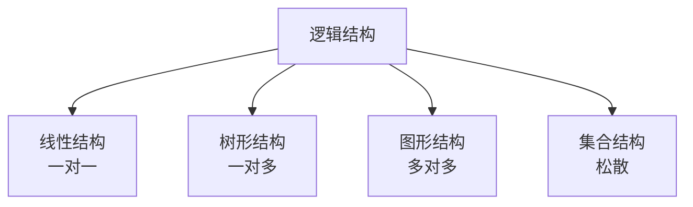
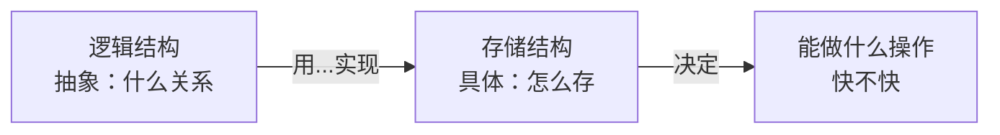
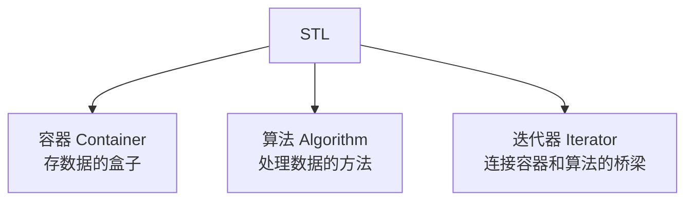
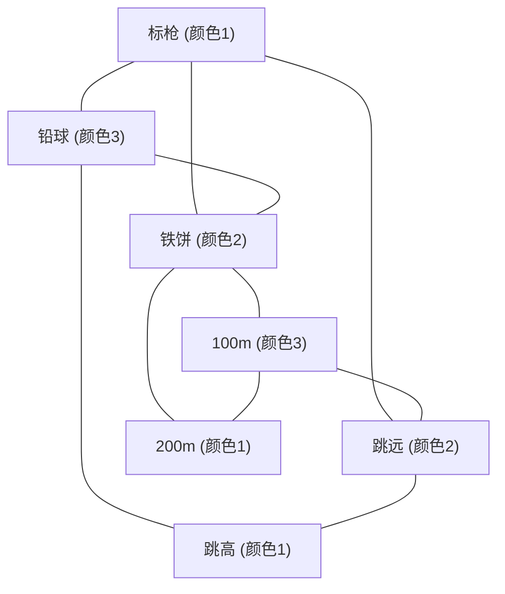
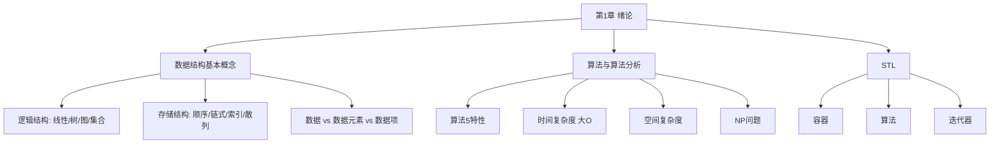

# 第 1 章　绪论

> **本章目标**：搞懂三件事——① 数据结构到底研究什么；② 怎么衡量一个算法的好坏（大 O 记法）；③ C++ 的 STL 是什么。
>
> **难度**：★★☆☆☆　**建议用时**：1 天
>
> **本章是全书的"地图"**。概念多但不难，一定要先理解再往下走，否则后面每章都会似懂非懂。

> **前置知识**：[第 0 章 C/C++ 基础回顾](00-C与C++基础回顾.md)（至少要懂数组和函数）
> **本章重点**：复杂度分析（大 O）——这是**后面每一章都要用**的工具
> **学完可去**：[速查表·表1 复杂度速查](速查表.md)

---

## 1.1　数据结构与算法的重要性

### 【一句话概括】

**数据结构 + 算法 = 程序的骨架**。它决定了你的程序是"跑得飞快"还是"卡到崩溃"。

### 【生活类比】

假设你要在一个 10 万人名册里找一个人：

- **笨办法**：从第 1 个名字开始，一个一个往下看。平均要看 5 万次。
- **聪明办法**：先按姓氏拼音排好序，然后直接翻到对应位置。只要几次。

**同样是"查名字"，效率差了上万倍。** 差别不在你打字快不快，而在**数据是怎么组织的**——这就是数据结构。

再比如：从北京到上海。

- 你可以走路去（算法 A）
- 可以坐高铁去（算法 B）

**路还是那条路（问题不变），选什么交通工具（算法）决定你多久到。**

### 【为什么它重要】

书中给出了软件开发的全过程：



数据结构与算法主要作用在 **系统设计** 和 **系统开发** 阶段。

**为什么很多人感觉不到它的重要性？**

因为平时写的小程序（几百行、处理几十条数据），用什么结构都能跑通。但一旦：
- 数据量变大（百万、亿级）
- 性能要求变高（GPS 导航要实时算路线）

数据结构与算法的差距就**暴露无遗**了。

### 【真实应用场景】（书里列举的）

| 系统 | 用到的数据结构与算法 |
|---|---|
| GPS 导航系统 | 图 + 最短路径算法（Dijkstra，第 5 章） |
| 路由器系统 | 查找树、散列表（第 6 章） |
| 搜索引擎 | 倒排索引、散列、排序（第 6、7 章） |
| 压缩软件（RAR） | 哈夫曼编码（第 4 章） |
| 视频编解码 | 树、动态规划（第 3、4 章） |

### 【数据结构与面向对象的关系】

这是本书的一个特色。书中给了这张对应图：



**翻译成人话**：

| 面向对象 | 数据结构 |
|---|---|
| 类的**属性**（成员变量） | 数据之间的**关系**（怎么存） |
| 类的**方法**（成员函数） | 针对这些关系的**基本操作**（怎么用） |

**所以本书用 C++ 的类来描述数据结构**：把"数据"和"操作数据的函数"打包在一起。

### 【C/C++ 知识回顾】类的基本写法

```cpp
class NaturalNumber {          // 定义一个"自然数"类
private:
    unsigned long int num;     // 属性：存这个自然数的值

public:
    // 方法：求两个自然数的最大公约数（欧几里得算法）
    unsigned long int EUCLID(NaturalNumber& nn) {
        unsigned long int m = num;      // 较大的数
        unsigned long int n = nn.num;   // 较小的数
        unsigned long int r = m % n;    // 余数
        while (r != 0) {
            m = n;
            n = r;
            r = m % n;
        }
        return n;              // 余数为 0 时的 n 就是最大公约数
    }
};
```

**看不懂没关系**，这里只是让你看到"类 = 属性 + 方法"长什么样。重点在后面几章。

### 【本节自测】

**1-1-1.** 用一句话解释：为什么"同一个问题用不同的数据结构，效率可能差很多倍"？
<details><summary>答案</summary>
<p>因为数据结构决定了<strong>你访问数据的方式</strong>。</p>
<p>比如查一个元素：</p>
<ul>
<li>存在无序数组里 → 只能从头一个个比，平均 n/2 次</li>
<li>存在散列表里 → 一次就能定位到</li>
</ul>
<p><strong>问题的规模没变，但&quot;组织数据的方式&quot;变了，操作次数就天差地别。</strong></p>
</details>

**1-1-2.** 数据结构与面向对象技术有什么对应关系？
<details><summary>答案</summary>
<ul>
<li>数据之间的<strong>关系</strong> ↔ 类的<strong>属性</strong>（成员变量）</li>
<li>数据的<strong>基本操作</strong> ↔ 类的<strong>方法</strong>（成员函数）</li>
</ul>
<p>所以&quot;设计一个数据结构&quot;= &quot;设计一个类，它的成员变量描述数据关系，成员函数提供操作&quot;。</p>
</details>

---

## 1.2　数据结构的基本概念

### 【一句话概括】

数据结构 = **数据** + **数据之间的关系** + **对数据的操作**。

### 【先分清三个词】

| 词 | 含义 | 举例 |
|---|---|---|
| **数据（Data）** | 能被计算机处理的信息 | 学生的成绩、一张图片、一段文字 |
| **数据元素（Data Element）** | 数据的基本单位，是"一个整体" | 一个学生记录 |
| **数据项（Data Item）** | 构成数据元素的最小单位 | 学生的学号、姓名、分数 |

**层层嵌套的关系**：

```
数据  >  数据元素  >  数据项
（一堆学生） （一个学生） （学号/姓名/分数）
```

> **类比**：一本书是"数据"，其中每一章是"数据元素"，章节里的每个字是"数据项"。

### 【核心：逻辑结构 vs 存储结构】

这是本章**最重要**的一对概念，一定要分清。

#### 逻辑结构：数据"看起来"是什么关系

逻辑结构是**抽象的**，跟你用不用计算机、怎么存没关系，只关心"谁和谁有关系"。

四种基本逻辑结构：



| 逻辑结构 | 关系 | 生活例子 | 对应章节 |
|---|---|---|---|
| **线性结构** | 一对一（一个接一个） | 排队买票、糖葫芦 | 第 2、3 章 |
| **树形结构** | 一对多（一个爸爸多个儿子） | 家族族谱、公司组织架构 | 第 4 章 |
| **图形结构** | 多对多（互相都可能有关系） | 地铁线路图、微信好友关系 | 第 5 章 |
| **集合结构** | 只是"凑在一起"，没别的 | 一筐水果 | 散列表（第 6 章） |

**图示对比**：

```
线性结构:    ① → ② → ③ → ④           （排成一队）

树形结构:         ①
                / | \
               ②  ③  ④              （一拖多）

图形结构:      ① ── ②
               │  ╳  │                （谁都能连谁）
               ③ ── ④

集合结构:    { ①, ②, ③, ④ }          （就是一堆）
```

#### 存储结构：数据"实际"怎么存在内存里

存储结构（也叫**物理结构**）是**具体的**，指的是数据在计算机内存里怎么摆。

四种基本存储方式：

| 存储结构 | 怎么存 | 优点 | 缺点 |
|---|---|---|---|
| **顺序存储** | 内存里连续挨着放（像数组） | 随机访问快（`a[i]` 一步到位） | 插入/删除要挪动一大片 |
| **链式存储** | 不连续，用指针串起来 | 插入/删除方便 | 不能随机访问，要找就得从头走 |
| **索引存储** | 建个"目录表"记录位置 | 查找快 | 目录本身占空间 |
| **散列存储** | 用函数直接算出位置 | 查找极快 | 可能冲突，要额外处理 |

> **关键理解**：
> - **同一种逻辑结构，可以有多种存储结构。**
>   比如"线性表"，既可以顺序存（数组），也可以链式存（链表）。
> - **逻辑结构是"我想表达什么关系"，存储结构是"我怎么实现它"。**
>   —— 就像"我要表达'排队'这个关系"（逻辑），可以用"站成一排"或"发号牌"来实现（存储）。

#### 两种结构的关系图



### 【数据的运算】

有了数据、有了结构，还要定义**能对它做什么**。

- 插入、删除、查找、修改、排序、遍历……
- **同一个操作，在不同存储结构上，效率完全不同**（这就是第 2 章要比较"顺序表 vs 链表"的原因）。

### 【本节自测】

**1-2-1.** 判断：逻辑结构和存储结构是一一对应的吗？
<details><summary>答案</summary>
<p><strong>不是。</strong></p>
<p>一种逻辑结构可以用多种存储结构实现。</p>
<p>例如&quot;线性表&quot;（逻辑结构）可以：</p>
<ul>
<li>用数组顺序存储 → <strong>顺序表</strong></li>
<li>用指针链式存储 → <strong>链表</strong></li>
</ul>
<p>反过来，同一种存储结构（比如数组）也可以实现不同的逻辑结构。</p>
<p><strong>记忆口诀</strong>：逻辑结构是&quot;想表达的关系&quot;，存储结构是&quot;实际实现的方式&quot;，多对多。</p>
</details>

**1-2-2.** 下面这些各属于哪种逻辑结构？
① 公司里的上下级关系　② 火车站排队　③ 城市之间的航线　④ 一个班的学生名单
<details><summary>答案</summary>
<p>① <strong>树形结构</strong>（一个经理管多个下属，一对多）
② <strong>线性结构</strong>（一个接一个，一对一）
③ <strong>图形结构</strong>（城市之间互相都有航线，多对多）
④ <strong>线性结构</strong>（名单是一个接一个排的）—— 注意：如果只是&quot;一个班的全体学生&quot;而不强调顺序，也可看作<strong>集合结构</strong>。题目强调&quot;名单&quot;，通常指有顺序的表。</p>
</details>

**1-2-3.** 为什么说"插入和删除"在顺序存储和链式存储上效率差别很大？
<details><summary>答案</summary>
<p><strong>顺序存储（数组）</strong>：数据紧挨着放。</p>
<ul>
<li>要在中间插入一个，得把它后面的所有元素<strong>整体往后挪一格</strong>。</li>
<li>最坏情况要挪 n 个元素 → <strong>O(n)</strong>。</li>
</ul>
<p><strong>链式存储（链表）</strong>：数据散落各处，用指针相连。</p>
<ul>
<li>插入只需改几个指针的指向，<strong>不用挪动任何数据</strong>。</li>
<li>只要找到了位置，插入就是 <strong>O(1)</strong>。</li>
</ul>
<p><strong>这就是&quot;逻辑结构相同、存储结构不同、操作效率天差地别&quot;的最好例子</strong>，也是第 2 章的核心内容。</p>
</details>

---

## 1.3　算法和算法分析

### 1.3.1　算法描述

#### 【一句话概括】

**算法 = 解决问题的步骤**。它是"方法"，不是"程序"。

#### 【算法的五个特性】（考试常考）

| 特性 | 含义 | 反例 |
|---|---|---|
| **有穷性** | 执行有限步后必须结束 | 死循环不是算法 |
| **确定性** | 每步含义明确，无歧义 | "随便取个合适的数"不行 |
| **可行性** | 每步都能实际执行 | "求出所有质数"（无限个）不行 |
| **输入** | 有 0 个或多个输入 | 可以没有输入 |
| **输出** | 有 1 个或多个输出 | 没有输出的算法没意义 |

> **注意**：输入可以是 0 个，但**输出必须至少 1 个**。这是常考细节。

#### 【算法的描述方法】

书中介绍了几种：

| 方法 | 说明 | 优点 | 缺点 |
|---|---|---|---|
| 自然语言 | 用中文/英文描述 | 好懂 | 啰嗦、易歧义 |
| 流程图 | 画框图 | 直观 | 复杂算法画不下 |
| 程序设计语言 | 直接写代码 | 精确、可运行 | 拘泥于语法细节 |
| **伪代码** ★ | 介于自然语言和代码之间 | **精确又不啰嗦** | 不能直接运行 |

**本书采用"基于 C++ 的伪代码"**——看起来像 C++，但省略了不必要的技术细节（比如不写 `#include`、不写 `using namespace std;`）。

**伪代码长这样**（求最大公约数）：

```
算法 Euclid(m, n)
输入：两个正整数 m, n
输出：m 和 n 的最大公约数
1. r ← m mod n
2. while r ≠ 0 do
3.     m ← n
4.     n ← r
5.     r ← m mod n
6. return n
```

> **看伪代码的技巧**：`←` 是赋值（相当于 `=`），`mod` 是取余（相当于 `%`）。别被符号吓到。

#### 【本节自测】

**1-3-1-1.** 算法的五个特性是什么？哪个可以"没有"？
<details><summary>答案</summary>
<p>五个特性：<strong>有穷性、确定性、可行性、输入、输出</strong>。</p>
<p>可以没有的是<strong>输入</strong>（输入可以是 0 个）。但<strong>输出必须至少有 1 个</strong>。</p>
</details>

**1-3-1-2.** 下面这个"算法"有什么问题？
```
算法 求平均分
1. 输入若干个学生成绩
2. 把成绩加起来除以人数
3. 如果除不尽，就四舍五入到一个合适的值
```
<details><summary>答案</summary>
<p>违反<strong>确定性</strong>。</p>
<p>&quot;四舍五入到一个<strong>合适的值</strong>&quot;——什么叫&quot;合适&quot;？不同的人理解不同，这就是<strong>歧义</strong>。</p>
<p>应该改成明确的规则，比如&quot;四舍五入保留两位小数&quot;。</p>
</details>

---

### 1.3.2　算法分析 ⭐（本章最重点）

#### 【一句话概括】

算法分析 = **估算算法要跑多久（时间复杂度）、占多少内存（空间复杂度）**。

#### 【为什么要"估算"而不是"实测"】

你可能会想：我直接运行一下，掐个秒表不就知道快慢了？

**不行**，因为：
1. **依赖机器**：同一个算法，在旧电脑和超级计算机上跑的时间完全不同。
2. **依赖数据**：排 10 个数和排 100 万个数，时间差几万倍。
3. **依赖语言/编译器**：C++ 和 Python 差很多。

所以我们要找一个**跟机器无关、只跟问题规模有关**的衡量方式——这就是**时间复杂度**。

#### 【问题规模 n】

**问题规模** = 要处理的数据量。

- 排序 100 个数 → n = 100
- 在一个 n 个节点的链表里查找 → 规模是 n

我们关心的是：**当 n 变大时，运行时间 T 怎么变**，记作 **T(n)**。

#### 【语句频度】

**语句频度 = 某条语句执行了多少次**。

因为每条语句执行时间都差不多，所以"总时间"≈"所有语句执行次数之和"。

**看个例子**：

```cpp
int sum = 0;                        // 执行 1 次
for (int i = 1; i <= n; i++) {      // i 判断执行 n+1 次
    sum += i;                       // 执行 n 次
}
```

| 语句 | 频度 |
|---|---|
| `int sum = 0;` | 1 |
| `for` 的判断 | n+1 |
| `sum += i;` | n |

总执行次数 ≈ `1 + (n+1) + n = 2n + 2`。

**当 n 很大时**，`2n + 2` 和 `n` 几乎没区别（2n+2 里的常数 2 和 2 可以忽略）。

**所以这个算法的时间复杂度是 O(n)。**

#### 【大 O 记法：三个规则】

**规则 1：只保留最高阶项。**

```
T(n) = 3n² + 5n + 100    →  O(n²)
```

为什么？因为 n 很大时，`n²` 一项就压倒一切：

| n | 3n² | 5n | 100 |
|---|---|---|---|
| 10 | 300 | 50 | 100 |
| 100 | 30000 | 500 | 100 |
| 10000 | 3×10⁸ | 50000 | 100 |

n=10000 时，`3n²` 是 3 亿，`5n` 才 5 万，`100` 可以忽略不计。

**规则 2：去掉常数系数。**

```
T(n) = 3n²    →  O(n²)     （不是 O(3n²)）
```

因为大 O 描述的是**增长趋势**，不是精确值。3n² 和 n² 都是"平方级"增长。

**规则 3：只关注"最坏情况"**（除非特别说明）。

- 在一个数组里找一个数：可能第 1 个就找到（最好），可能找遍全数组（最坏）。
- 我们通常报**最坏情况**，因为它是"保底承诺"。

#### 【常见时间复杂度对比】（务必背下来）

从快到慢：

| 复杂度 | 名称 | n=10 时 | n=1000 时 | 典型算法 |
|---|---|---|---|---|
| **O(1)** | 常数阶 | 1 | 1 | 数组按下标访问 `a[i]` |
| **O(log n)** | 对数阶 | 3.3 | 10 | 折半查找、平衡树查找 |
| **O(n)** | 线性阶 | 10 | 1000 | 遍历数组、顺序查找 |
| **O(n log n)** | 线性对数阶 | 33 | 10000 | 快速排序、归并排序、堆排序 |
| **O(n²)** | 平方阶 | 100 | 100万 | 冒泡排序、插入排序、选择排序 |
| **O(n³)** | 立方阶 | 1000 | 10亿 | 矩阵乘法（朴素） |
| **O(2ⁿ)** | 指数阶 | 1024 | 天文数字 | 汉诺塔、穷举子集 |
| **O(n!)** | 阶乘阶 | 362万 | 天文数字 | 全排列穷举 |

**这张表要刻进脑子里。** 后面每章都会用。

**感受一下差距**（假设一次操作 1 纳秒）：

| 复杂度 | n=50 耗时 | n=1000 耗时 |
|---|---|---|
| O(n) | 50 纳秒 | 1 微秒 |
| O(n log n) | 约 300 纳秒 | 10 微秒 |
| O(n²) | 2.5 微秒 | 1 毫秒 |
| O(2ⁿ) | **约 13 天** | 宇宙毁灭也算不完 |

**看到 O(2ⁿ) 和 O(n!) 有多恐怖了吧？** 这就是为什么第 1.3.3 节要讲"NP 问题"。

> **这个数字怎么算的**：`2⁵⁰ ≈ 1.13 × 10¹⁵` 次操作，每次 1 纳秒（10⁻⁹ 秒），
> 总共约 `1.13 × 10⁶` 秒 ≈ **13 天**。
> 如果每次操作要 1 微秒（慢 1000 倍），就变成约 **35 年**——可见"一次操作多快"对结论影响巨大。

#### 【怎么算时间复杂度：三个实用技巧】

**技巧 1：看循环嵌套了几层**

```cpp
// O(n)：一层循环
for (int i = 0; i < n; i++) { ... }

// O(n²)：两层嵌套
for (int i = 0; i < n; i++)
    for (int j = 0; j < n; j++) { ... }

// O(n³)：三层嵌套
for (int i = 0; i < n; i++)
    for (int j = 0; j < n; j++)
        for (int k = 0; k < n; k++) { ... }
```

**技巧 2：循环变量"翻倍"或"减半" → 对数阶**

```cpp
// O(log n)：i 每次乘 2，很快就超过 n
for (int i = 1; i < n; i *= 2) { ... }
// 执行次数：1, 2, 4, 8, ..., n  → 约 log₂n 次

// O(log n)：n 每次减半
while (n > 1) { n = n / 2; }
```

**技巧 3：循环次数不同的嵌套 → 相乘/相加要具体分析**

```cpp
// 外层 n 次，内层 i 次 → 总共 1+2+...+n = n(n+1)/2 → O(n²)
for (int i = 0; i < n; i++)
    for (int j = 0; j < i; j++) { ... }
```

#### 【空间复杂度】

**衡量算法额外占用的内存**，记作 **S(n)**。

```cpp
// 空间复杂度 O(1)：只用几个变量
int sum = 0;
for (int i = 0; i < n; i++) sum += a[i];

// 空间复杂度 O(n)：额外开了一个 n 长的数组
int* b = new int[n];
for (int i = 0; i < n; i++) b[i] = a[i];
```

> **实用原则**：**大多数情况下优先优化时间**。只有内存特别紧张（嵌入式设备）才重点抠空间。
> 有时可以用空间换时间（比如散列表：多花点内存，换取 O(1) 的查找）。

#### 【C/C++ 知识回顾】测量实际运行时间

虽然理论分析最重要，但实际验证也很有用：

```cpp
#include <iostream>
#include <chrono>
using namespace std;
using namespace std::chrono;

int main() {
    int n = 1000000;
    long long sum = 0;

    auto start = high_resolution_clock::now();   // 开始计时
    for (int i = 0; i < n; i++) {
        sum += i;
    }
    auto end = high_resolution_clock::now();     // 结束计时

    auto ms = duration_cast<milliseconds>(end - start).count();
    cout << "sum = " << sum << ", 耗时 " << ms << " 毫秒" << endl;
    return 0;
}
```

> 完整代码见 `code/01_复杂度演示.cpp`。

#### 【本节自测】

**1-3-2-1.** 把下列 T(n) 化简为大 O：
① `T(n) = 5n + 3`　② `T(n) = 2n² + 100n + 50`　③ `T(n) = n³ + n² + n`　④ `T(n) = 100`
<details><summary>答案</summary>
<p>① <strong>O(n)</strong>　（去掉系数 5 和常数 3）
② <strong>O(n²)</strong>　（只保留最高阶 n²）
③ <strong>O(n³)</strong>　（只保留最高阶 n³）
④ <strong>O(1)</strong>　（常数，跟 n 无关）</p>
<p><strong>口诀</strong>：去系数、去低阶、只留最高阶。</p>
</details>

**1-3-2-2.** 分析下面代码的时间复杂度：
```cpp
for (int i = 1; i <= n; i *= 2)
    for (int j = 0; j < n; j++)
        cout << i + j;
```
<details><summary>答案</summary>
<p><strong>O(n log n)</strong></p>
<p>分析：</p>
<ul>
<li><strong>外层</strong>：<code>i</code> 从 1 开始每次乘 2，直到超过 n。次数是 <code>1, 2, 4, 8, ...</code>，即 <strong>log₂n 次</strong>。</li>
<li><strong>内层</strong>：每次固定执行 n 次。</li>
<li>总次数 = <code>log₂n × n</code> → <strong>O(n log n)</strong></li>
</ul>
<p><strong>关键</strong>：外层是&quot;翻倍&quot;型循环 → 对数阶；两层嵌套 → 相乘。</p>
</details>

**1-3-2-3.** 下面两个算法都能求 1+2+...+n，哪个更快？为什么？
```cpp
// 算法 A
int sum = 0;
for (int i = 1; i <= n; i++) sum += i;

// 算法 B
int sum = n * (n + 1) / 2;
```
<details><summary>答案</summary>
<p><strong>算法 B 更快。</strong></p>
<ul>
<li>算法 A：循环 n 次 → <strong>O(n)</strong></li>
<li>算法 B：一次乘法一次除法，跟 n 无关 → <strong>O(1)</strong></li>
</ul>
<p><strong>这是&quot;算法改进&quot;的经典例子</strong>：同一个问题，换个思路，效率从 O(n) 提升到 O(1)。</p>
<p>（这也是为什么数学功底对算法很重要——知道求和公式，就能一步到位。）</p>
</details>

**1-3-2-4.** 判断：`O(2n)` 和 `O(n)` 哪个复杂度更高？
<details><summary>答案</summary>
<p><strong>一样高</strong>，都写作 <strong>O(n)</strong>。</p>
<p>因为大 O 忽略常数系数。<code>2n</code> 和 <code>n</code> 都是&quot;线性增长&quot;——n 翻倍，时间也翻倍，增长趋势完全相同。</p>
<p><strong>注意</strong>：虽然理论复杂度一样，但实际运行中 <code>2n</code> 确实比 <code>n</code> 慢一倍。大 O 只描述&quot;量级&quot;，不描述&quot;精确倍数&quot;。</p>
</details>

**1-3-2-5.** 已知三个算法的复杂度分别是 O(n²)、O(n log n)、O(log n)。当 n = 1024 时，它们各需要大约多少次操作？
<details><summary>答案</summary>
<ul>
<li><strong>O(log n)</strong>：log₂1024 = <strong>10 次</strong></li>
<li><strong>O(n log n)</strong>：1024 × 10 = <strong>10240 次</strong></li>
<li><strong>O(n²)</strong>：1024² = <strong>约 105 万次</strong></li>
</ul>
<p><strong>差距</strong>：从 10 次到 105 万次，差 10 万倍！</p>
<p>这就是为什么排序算法要拼命从 O(n²) 优化到 O(n log n)——数据量一大，差距是灾难性的。</p>
</details>

---

### 1.3.3　NP 问题

#### 【一句话概括】

有些问题，**"验证答案"很容易，但"找出答案"可能难到宇宙毁灭也算不完**。这类问题叫 **NP 问题**。

#### 【先理解 P 问题】

**P 问题（Polynomial，多项式时间）**：能在**多项式时间**内解决的问题。

翻译成人话：复杂度是 O(n)、O(n²)、O(n³) 这种，**n 变大时虽然变慢，但还在可接受范围**。

例如：排序、查找、求最大公约数——都是 P 问题。

#### 【再理解 NP 问题】

**NP 问题（Nondeterministic Polynomial）**：**给定一个答案，能在多项式时间内验证它对不对**的问题。

**关键区别**：

| | 找出答案 | 验证答案 |
|---|---|---|
| **P 问题** | 快（多项式时间） | 快 |
| **NP 问题** | **可能很慢（指数时间）** | 快（多项式时间） |

#### 【经典例子：数独】

- **验证**：给你一个填好的数独，检查是否符合规则 → **很快**（挨个检查一遍就行）
- **求解**：给你一个空数独，找出答案 → **可能很慢**（要试很多组合）

**这就是 NP 问题的特征：验证容易，求解难。**

#### 【P = NP？—— 千禧年难题】

**核心问题**：所有"验证起来容易"的问题，是不是也一定"求解起来容易"？

- 如果 **P = NP**：所有 NP 问题都能快速求解（世界会大乱——密码学全部失效！）
- 如果 **P ≠ NP**：确实存在"验证容易但求解极难"的问题

**目前没人证明出来**。这是克雷数学研究所悬赏 100 万美元的七大千禧年难题之一。

#### 【NPC 问题（NP 完全问题）】

**NPC 问题**：NP 问题里**最难的那一批**。

特性：**只要有一个 NPC 问题找到了多项式解法，那么所有 NP 问题都能多项式求解**（即 P = NP）。

**著名的 NPC 问题**：

| 问题 | 通俗解释 |
|---|---|
| 旅行商问题（TSP） | 走遍所有城市再回来，怎么走最短？ |
| 背包问题 | 背包容量有限，怎么装价值最大？ |
| 图着色问题 | 给地图染色，相邻区域不能同色，最少几种颜色？ |
| 哈密顿回路 | 找一条经过每个点恰好一次的路径 |

> **教材第 5 章的"工程实践"里就有"图着色问题"**，可以回头对照看。

#### 【遇到 NP 问题怎么办？】

实际工程中，我们**不求最优解，只求"足够好的解"**：

1. **近似算法**：给一个接近最优的答案（比如 TSP 的近似解）。
2. **启发式算法**：模拟自然过程找好解（遗传算法、模拟退火）。
3. **动态规划**：如果问题有"最优子结构"，可以降到多项式时间（第 3 章会讲）。
4. **缩小规模**：只在数据量小时求精确解。

#### 【本节自测】

**1-3-3-1.** P 问题和 NP 问题的区别是什么？
<details><summary>答案</summary>
<ul>
<li><strong>P 问题</strong>：<strong>求解</strong>和<strong>验证</strong>都能在多项式时间内完成。</li>
<li><strong>NP 问题</strong>：<strong>验证</strong>能在多项式时间内完成，但<strong>求解</strong>不一定。</li>
</ul>
<p><strong>记忆方法</strong>：P = Polynomial（多项式时间可解）；NP = 给定答案后能 Non-deterministically Polynomial 地验证。</p>
<p><strong>注意</strong>：所有 P 问题都是 NP 问题（能求解当然就能验证）。但反过来是否成立（NP 是否等于 P）至今未知。</p>
</details>

**1-3-3-2.** 为什么说"旅行商问题"是 NP 问题？
<details><summary>答案</summary>
<p>因为：</p>
<ul>
<li><strong>验证容易</strong>：给你一条路线，你只要把各段距离加起来，看看是不是比某个值短 → 多项式时间能验证。</li>
<li><strong>求解难</strong>：n 个城市有 (n-1)!/2 种走法，n=20 时就是天文数字 → 穷举不可能。</li>
</ul>
<p><strong>这正好符合 NP 问题的定义：验证容易、求解难。</strong></p>
</details>

---

## 1.4　STL 与数据结构

### 1.4.1　STL 简介

#### 【一句话概括】

**STL（Standard Template Library，标准模板库）= C++ 自带的"现成数据结构和算法工具箱"**。

#### 【为什么要用 STL】

想象一下：你要用链表，有两个选择：

1. 自己从零写一个链表类（几十行代码，还容易写错）
2. `#include <list>`，然后直接 `list<int> L;`（一行搞定）

**STL 就是第 2 种。** 它帮你把常用的数据结构都实现好了，还经过极致优化。

#### 【STL 的三大件】



| 部件 | 作用 | 例子 |
|---|---|---|
| **容器** | 存放数据的结构 | `vector`、`list`、`stack`、`queue`、`set`、`map` |
| **算法** | 对数据做的操作 | `sort`、`find`、`reverse`、`max` |
| **迭代器** | 遍历容器的"指针" | `v.begin()`、`v.end()` |

#### 【常见容器一览】（对应教材各章）

| 容器 | 中文 | 底层实现 | 教材章节 |
|---|---|---|---|
| `vector` | 动态数组 | 顺序表 | 2.2.4 |
| `list` | 双向链表 | 双向链表 | 2.5.3 |
| `stack` | 栈 | 默认用 deque | 3.2.3 |
| `queue` | 队列 | 默认用 deque | 3.3.3 |
| `string` | 字符串 | 字符数组 | 3.4.4 |
| `set` | 集合 | 红黑树（平衡二叉树） | 6.3.4 |
| `map` | 映射（键值对） | 红黑树 | 6.3.4 |
| `priority_queue` | 优先队列 | 堆 | 3.7 |

#### 【C/C++ 知识回顾】STL 使用示例

```cpp
#include <iostream>
#include <vector>
#include <algorithm>
using namespace std;

int main() {
    vector<int> v = {5, 2, 8, 1, 9};

    // ① 排序（算法）
    sort(v.begin(), v.end());        // 1 2 5 8 9

    // ② 遍历（迭代器）
    for (auto it = v.begin(); it != v.end(); ++it) {
        cout << *it << " ";
    }
    cout << endl;

    // ③ 用范围 for 更简洁（C++11）
    for (int x : v) cout << x << " ";
    cout << endl;

    // ④ 查找
    auto pos = find(v.begin(), v.end(), 8);
    if (pos != v.end())
        cout << "找到了 8，位置是 " << (pos - v.begin()) << endl;

    return 0;
}
```

> 完整代码见 `code/01_STL入门.cpp`。

**几个新手必知的点**：

| 写法 | 含义 |
|---|---|
| `v.begin()` | 指向第一个元素的迭代器 |
| `v.end()` | 指向**最后一个元素之后**的位置（不是最后一个元素！） |
| `*it` | 迭代器指向的值（像指针一样解引用） |
| `v.push_back(x)` | 尾部添加元素 |
| `v.size()` | 元素个数 |

### 1.4.2　STL 与数据结构的关系

#### 【核心观点】

**STL 是"数据结构的现成实现"，但学 STL ≠ 可以不学数据结构。**

原因：

1. **考试/面试要考原理**：让你手写链表、手写快排，你不能说"我调库"。
2. **要会选容器**：什么时候用 `vector`？什么时候用 `list`？——这需要你懂底层结构。
3. **要会分析性能**：`vector` 中间插入是 O(n)，`list` 中间插入是 O(1)。不懂原理就会用错。
4. **要能自己实现**：STL 没有的数据结构（比如哈夫曼树、图），还得自己写。

#### 【正确学习姿势】

```
第 1 步：自己手写一遍（搞懂原理）      ← 本笔记的重点
第 2 步：学会用 STL 的对应容器（提高效率）  ← 教材每章的"STL"小节
第 3 步：知道什么时候该用哪个（工程判断）
```

**教材的编排正是这样**：每讲完一个手写数据结构，就跟着一节"STL 中的 XX"。

#### 【一个对比示例】

```cpp
// 自己写：顺序表插入（第 2 章）
void insert(int a[], int& n, int pos, int x) {
    for (int i = n; i > pos; i--)   // 后面的元素整体后移
        a[i] = a[i-1];
    a[pos] = x;
    n++;
}

// 用 STL：vector 插入
v.insert(v.begin() + pos, x);       // 一行搞定
```

**功能一样，但一个要自己维护数组和长度，一个开箱即用。**

#### 【本节自测】

**1-4-1.** STL 的三大组件是什么？各起什么作用？
<details><summary>答案</summary>
<ul>
<li><strong>容器（Container）</strong>：存放数据的结构，如 <code>vector</code>、<code>list</code>、<code>map</code>。</li>
<li><strong>算法（Algorithm）</strong>：对容器中数据的操作，如 <code>sort</code>、<code>find</code>。</li>
<li><strong>迭代器（Iterator）</strong>：连接容器和算法的桥梁，像指针一样遍历容器。</li>
</ul>
<p><strong>类比</strong>：容器是&quot;书架&quot;，算法是&quot;整理书架的方法&quot;，迭代器是&quot;你用来指书的手指&quot;。</p>
</details>

**1-4-2.** `v.end()` 指向哪里？为什么 `for (it = v.begin(); it != v.end(); ++it)` 能正确遍历？
<details><summary>答案</summary>
<p><code>v.end()</code> 指向<strong>最后一个元素之后的位置</strong>（一个&quot;越界&quot;的哨兵位置），<strong>不是</strong>最后一个元素。</p>
<p>遍历逻辑：</p>
<ul>
<li><code>it</code> 从第一个元素开始</li>
<li>每轮 <code>++it</code> 往后移一个</li>
<li>当 <code>it</code> 到达 <code>end()</code> 时（即已经越过最后一个元素），循环停止</li>
</ul>
<p><strong>为什么这样设计？</strong> 因为这样&quot;空容器&quot;也能统一处理：空容器时 <code>begin() == end()</code>，循环体一次都不执行。</p>
</details>

**1-4-3.** 为什么说"学 STL 不等于可以跳过手写数据结构"？至少说出两个理由。
<details><summary>答案</summary>
<p>（任答两条即可）</p>
<ol>
<li><strong>考试和面试考原理</strong>：需要手写链表、手写排序，不能只调库。</li>
<li><strong>要会选容器</strong>：不同容器性能差异巨大，不懂底层就选错。</li>
<li><strong>要会分析复杂度</strong>：比如 <code>vector</code> 中间插入是 O(n)，<code>list</code> 是 O(1)，用错了性能会崩。</li>
<li><strong>STL 没有所有结构</strong>：哈夫曼树、图、并查集等需要自己实现。</li>
<li><strong>调试和优化需要原理知识</strong>：出 bug 时要知道底层发生了什么。</li>
</ol>
</details>

---

## 1.5　工程实践和思考

> **对应教材第 14～17 页**：这一节是全书的“预告片”！教材通过 **3 个真实工程实例（例 1.8～1.10）**，让你在还没学具体数据结构之前，先亲眼看到：**换一种数据存储结构，代码就能从笨重变优雅，效率能从慢如蜗牛飙升到快如闪电**。

---

### 【教材例 1.8】统计字符串中每个字符出现的次数（数据结构如何把 $O(mn)$ 降到 $O(m)$）

**问题**：任意输入一个不限长度的英文字符串，例如：
```text
"This is a problem which can be solved by data structure method."
```
如何统计其中**每一个字符**（区分大小写，包含空格和标点）出现的次数？

#### 方案 1：结构体数组 + 线性查找（`CountChar1`，直觉做法）

最容易想到的存储结构是定义一个结构体数组，每格记录“一个字符 + 它的出现次数”：

```cpp
struct RESULT {    // 定义一个结构体，存储字符统计的结果
    char ch;       // 存储字符
    int num;       // 存储此字符出现的次数
};
RESULT r[128];
```

每读入一个字符 `*s`，就去已统计的 `r[0 .. n-1]` 里**从头到尾找一遍**：
- 如果以前出现过 → 对应槽位 `r[i].num++`；
- 如果没出现过（循环跑完 `i == n`）→ 在末尾新开一格 `r[n]`，记下该字符并把计数置为 1，种数 `n++`。

```cpp
void CountChar1(const char* s, RESULT r[], int& n) {  // 字符统计算法（方案 1）
    n = 0;                        // 记录不同字符的个数
    while (*s != '\0') {          // 字符串未结束
        int i;
        for (i = 0; i < n; i++) { // ① 检测该字符是否已出现过（最耗时！）
            if (r[i].ch == *s) {
                r[i].num++;
                break;
            }
        }
        if (i == n) {             // 字符未出现，则新增字符计数
            r[n].ch = *s;
            r[n].num = 1;
            n++;
        }
        s++;
    }
}
```

- **复杂度分析**：设字符串长度为 $m$，不同字符的种数为 $n$。外层循环跑 $m$ 次，内层线性查找最多比 $n$ 次 → **时间复杂度为 $O(m \cdot n)$**。

#### 方案 2：ASCII 码直接定址（`CountChar2`，散列思想降维打击！）

瓶颈在哪？就在上面代码标 `①` 的位置：**每读一个字符，都要和已统计过的字符一一比较**！

能不能**不比较、直接算**出这个字符应该存放在哪一格？
**可以！** 借鉴第 6 章查找算法中的**散列（hash）思想**：英文字符的 ASCII 码本身就是 `0 ~ 127` 的整数！直接开一个长度为 128 的计数数组，**拿字符的 ASCII 码当作数组下标**，读到谁就直接往对应下标的“桶”里 `+1`：

```cpp
int chnum[128] = {0};   // 下标 = ASCII 码，值 = 该字符出现次数

void CountChar2(const char* s, int chnum[]) {
    while (*s != '\0') {
        // 教材原式写 chnum[*s]++；工程上强转 unsigned char 可防负下标越界
        unsigned char uc = (unsigned char)(*s);
        if (uc < 128) {
            chnum[uc]++;   // 直接用 ASCII 码定位并计数，O(1) 一步到位！
        }
        s++;
    }
}
```

输出时只需扫一遍 `0 ~ 127`，把 `chnum[i] != 0` 的字符 `(char)i` 和次数 `chnum[i]` 打出来即可。

#### 两种方案硬核对比

| 维度 | 方案 1（`CountChar1`） | 方案 2（`CountChar2`） |
|---|---|---|
| **存储结构** | `RESULT r[128]`（存 `{字符, 次数}`） | `int chnum[128]`（下标隐式充当字符本身） |
| **核心操作** | 每读 1 个字符 → 遍历 `r[]` 线性比较 | 每读 1 个字符 → 直接计算下标 `chnum[uc]++` |
| **时间复杂度** | **$O(m \cdot n)$** | **$O(m)$**（彻底消灭内层循环！） |
| **打印顺序** | 按字符在字符串中**首次出现的顺序** | 按字符 **ASCII 码从小到大**的顺序 |
| **代码量** | ~18 行（两重循环） | ~6 行（一重循环） |

> **一句话点破**：同样的问题，换了个数据结构（用数组下标隐式表达字符），不仅代码短了一大半，复杂度也从 $O(mn)$ 直降到 $O(m)$——这就是**“用一点点固定空间换取巨大时间收益”**的经典范例！

#### 【教材原书思考题】若字符串同时包含英文和中文，如何扩展 `CountChar2()`？

<details><summary>点我看教材思考题解析</summary>
<p><strong>为什么原来的 <code>int chnum[128]</code> 不够用了？</strong></p>
<p>因为标准 ASCII 码只有 <code>0 ~ 127</code>（单字节），只够表示英文字母、数字和英文标点。而中文字符数量高达数万个，在计算机里采用<strong>多字节编码</strong>（GBK 编码中 1 个汉字占 <strong>2 字节</strong>，UTF-8 编码中 1 个汉字通常占 <strong>3 字节</strong>），既放不进 128 格数组，也不能逐字节拆开单独计数。</p>
<p><strong>两种主流扩展方案</strong>：</p>
<ol>
<li><strong>工程最实用方案（STL 哈希表）</strong>：改用 <code>unordered_map&lt;string, int&gt;</code>！遍历字符串时按编码规则切出“一个完整字符”（英文取 1 字节，UTF-8/GBK 汉字取对应的 2~3 字节组成一个 <code>string</code>），直接 <code>freq[ch]++</code>。平均时间复杂度依然是 <strong>O(m)</strong>，且只为实际出现过的字符分配空间。</li>
<li><strong>底层原理方案（大桶映射 / 自定义散列表）</strong>：若确定是固定双字节编码（如 GBK / UTF-16），理论上可映射到 <code>65536</code> 大小的数组，或使用<strong>第 6 章的散列函数 + 冲突解决（拉链法/开放定址法）</strong>把中文编码压缩到紧凑的散列表中，避免浪费大量空桶。</li>
</ol>
</details>

---

### 【教材例 1.9】电话号码查询问题（顺序查找 vs 姓氏索引）

**问题**：编写电话号码查询算法。输入任意人名：
- 若该人有电话号码，返回其名下**所有**电话号码（注意：**可能有多人重名**，必须把同名人的号码全部找出）；
- 若查无此人，提示该人无电话号码。

每条记录包含两个数据项：`人名` 和 `电话号码`。来看两种不同存储结构带来的效率差距：

```text
【方案 ①：顺序查找（对应教材图 1-11）】          【方案 ②：按姓氏索引查找（对应教材图 1-12）】
  不做任何预处理，整张表直接顺序塞进内存：          先按姓氏排序，再建一张“姓氏索引表”：

  ┌──────┬──────────┐                            姓氏索引表              有序电话号码主表
  │ 李四 │ 138xxxx  │  ← 查“王刚”必须从头扫       ┌────┬──────┐        ┌──────┬──────────┐
  │ 王刚 │ 139xxxx  │  ← 找到了还不能停！          │ 李 │ ──┐  │        │ 李四 │ 138xxxx  │
  │  …   │    …     │    必须扫到表尾防止重名！     ├────┼───┼──┤   ┌──→ │ 李逵 │ 136xxxx  │
  │ 张三 │ 135xxxx  │                            │ 王 │ ──┼──┼───┘    │  …   │    …     │
  │ 王二 │ 137xxxx  │                            ├────┼───┼──┤        │ 李杰 │ 131xxxx  │
  │ 李逵 │ 136xxxx  │                            │ 张 │ ──┼──┼──┐     ├──────┼──────────┤
  │  …   │    …     │                            ├────┼───┼──┤  │  ┌─→│ 王二 │ 137xxxx  │
  │ 王峰 │ 133xxxx  │                            │ …  │ … │  │  │  │  │ 王刚 │ 139xxxx  │
  │ 李杰 │ 131xxxx  │                            └────┴───┴──┘  │  │  │  …   │    …     │
  │ 张凯 │ 132xxxx  │                                     │     │  │  │ 王峰 │ 133xxxx  │
  └──────┴──────────┘                                     │     │  │  ├──────┼──────────┤
                                                          └──(指向李)  │ 张三 │ 135xxxx  │
  每次查询都要全表扫描：O(n)                                     └───→ │  …   │    …     │
                                                                       │ 张凯 │ 132xxxx  │
                                                                       └──────┴──────────┘
                                                 查“王刚”：先在索引表找到“王”的起始地址，
                                                 只在“王姓区间”内查找，彻底跳过李、张等其他姓氏！
```

- **核心启示**：
  - 方案 ①（无序顺序存储）：每次查询都是全表扫描 $O(n)$，哪怕有 100 万人也得逐条比对完。
  - 方案 ②（排序 + 姓氏索引表）：就像新华字典的“部首检字表”——先查目录定位到小块，再在小块里查找，**极大缩小查找范围**！
- **【教材思考题】除了顺序查找和姓氏索引，还有没有效率更高的存储方法？**
  - 当然有！**第 6 章《查找》**将系统揭晓：整表有序后的**折半查找（$O(\log n)$）**、动态维护的**二叉排序树 / 红黑树（`std::map`）**、一步直达的**散列表（$O(1)$）**，以及现代数据库（MySQL/PostgreSQL）核心使用的 **B+ 树索引**！

---

### 【教材例 1.10】田径运动会的时间安排问题（无向图着色模型）

**问题**：某田径运动会共有 **7 个比赛项目**：`100m`、`200m`、`跳高`、`跳远`、`铅球`、`铁饼`、`标枪`。
现有 **6 名参赛选手**（每人最多兼报 3 项），报项情况如下（严格还原教材表 1-1）：

| 选手姓名 | 项目 1 | 项目 2 | 项目 3 | 产生的“不能同时进行”冲突边 |
|---|---|---|---|---|
| **张凯** | 跳高 | 跳远 | — | `(跳高 — 跳远)` |
| **王刚** | 100 m | 200 m | 铁饼 | `(100m — 200m)`, `(100m — 铁饼)`, `(200m — 铁饼)` |
| **李四** | 跳高 | 铅球 | — | `(跳高 — 铅球)` |
| **张三** | 跳远 | 标枪 | — | `(跳远 — 标枪)` |
| **王峰** | 铅球 | 标枪 | 铁饼 | `(铅球 — 标枪)`, `(铅球 — 铁饼)`, `(标枪 — 铁饼)` |
| **李杰** | 100 m | 跳远 | — | `(100m — 跳远)` |

**目标**：同一名选手兼报的各个项目**不能安排在同一时间段**（分身乏术！）。如何安排日程，让整个运动会在**尽可能少的时间段**内全部比完？

#### 第一步：朴素想法 vs 抽象成“无向图”

- **朴素做法**：把 7 个项目错开排成 7 个时间段——绝对不冲突，但太拖沓了！
- **数据结构建模（对应教材图 1-13）**：
  - 把 **7 个比赛项目**抽象为图的 **7 个顶点**；
  - 只要两个项目被**同一名选手兼报**（不能同时进行），就在这两个顶点之间**连一条无向边**。



#### 第二步：转化为“无向图着色问题”

现在问题变成了一个经典的数学/数据结构问题——**图着色**：
- 用**不同的颜色**代表**不同的比赛时间段**；
- 规则：**只要两个顶点有边相连，就不能涂同一种颜色**（同一颜色的顶点之间没有边，可以放心同时开赛！）；
- 目标：用**尽可能少的颜色**把 7 个顶点全部涂完。

观察上面的图，我们立刻能找到一个只需 **3 种颜色**的完美方案：

| 颜色（时间段） | 安排同时进行的比赛项目 | 为什么绝不冲突？ |
|---|---|---|
| **颜色 1（时间段 1）** | **标枪、200 m、跳高** | 图中这三个顶点两两之间均无边相连！ |
| **颜色 2（时间段 2）** | **跳远、铁饼** | 跳远与铁饼无边相连（但它们都连着标枪，故不能用颜色 1） |
| **颜色 3（时间段 3）** | **铅球、100 m** | 铅球与 100m 无边相连（但它们都连着铁饼，故不能用颜色 2） |

> **还能更少吗（比如 2 个时间段）？绝对不能！**
> 因为王刚兼报了 `{100m, 200m, 铁饼}`（在图里围成一个三角形，三者两两冲突），光这 3 个项目就至少需要 3 种不同颜色！因此 **3 个时间段已经是数学上的最优解**——直接把运动会耗时从 7 段压缩到 3 段！
>
> **全书联动预告**：这就是**第 5 章《图》**的威力——把现实世界的冲突约束抽象成点与边！顺便呼应 1.3 节：求解一般无向图的最少着色数，正是大名鼎鼎的 **NP 完全（NPC）问题**之一。

---

### 【延伸思考】关于数据结构与算法的三个底层追问

除了教材的 3 个工程实例，初学时还常常有下面三个“哲学级”疑问，先想透再继续学：

#### 【思考题 1】为什么"数据结构与算法"这门课，初学者觉得没用？

**答**：因为初学者的程序**规模太小**。

处理 10 个数据，用什么结构都是"瞬间完成"，感觉不到差异。但当数据量到百万级、亿级时：

- 用错数据结构 → 程序跑几个小时
- 用对数据结构 → 几毫秒完成

**所以这门课的价值要在"大场面"下才显现**。但你不能等遇到大场面才学——那时候已经晚了。

#### 【思考题 2】"算法"和"程序"是一回事吗？

**答**：不是。

- **算法**是**方法**（思路、步骤），是抽象的。
- **程序**是算法的**一种具体实现**，还要考虑语言、语法、工程细节。

同一个算法可以用 C++、Python、Java 实现成不同的程序。

**书中原话**："通常认为伪代码最适合算法描述"——因为伪代码剥离了语言细节，只保留算法思想。

#### 【思考题 3】为什么"空间"和"时间"常常要权衡？

**答**：因为**很多时候可以用空间换时间**。

**例子**：查一个数在不在数组里（以及上面的教材例 1.8 `CountChar2`）。

- 方案 A（省空间费时间）：每次从头遍历 → O(n)
- 方案 B（费空间省时间）：预先建一个散列表 / 计数桶 → O(1)

方案 B 多用了内存（建表），但查找从 O(n) 降到 O(1)。

**实际工程中**：内存通常比时间便宜（内存几百块，用户等待时间很贵），所以**常常优先换时间**。

### 【本节自测】

**1-5-1.** 为什么很多初学者觉得"数据结构与算法没什么用"？这个想法错在哪？
<details><summary>点我看答案</summary>
<p><strong>因为这个想法只在&quot;小规模数据&quot;下成立。</strong></p>
<p>初学者写的程序通常：</p>
<ul>
<li>数据量小（几十、几百条）</li>
<li>对性能要求不高（跑一次就完事）</li>
</ul>
<p>这种情况下，用什么数据结构都是&quot;瞬间完成&quot;，<strong>感觉不到差异</strong>。</p>
<p><strong>但真实系统里</strong>：</p>
<ul>
<li>搜索引擎要处理<strong>十亿</strong>网页</li>
<li>GPS 要<strong>实时</strong>计算路线</li>
<li>数据库要<strong>毫秒级</strong>响应查询</li>
</ul>
<p>数据量一大，用错数据结构就是&quot;几小时 vs 几毫秒&quot;的差距。</p>
<p><strong>所以这门课的价值在&quot;大场面&quot;下显现，而你不能等遇到大场面才学。</strong></p>
</details>

**1-5-2.** "算法"和"程序"是一回事吗？
<details><summary>点我看答案</summary>
<p><strong>不是。</strong></p>
<ul>
<li><strong>算法</strong>：<strong>方法</strong>（思路、步骤），是<strong>抽象的</strong>——它不依赖具体语言</li>
<li><strong>程序</strong>：算法的<strong>一种具体实现</strong>，还要考虑语言语法、工程细节</li>
</ul>
<p><strong>关系</strong>：</p><pre><code>同一个算法 → 可以用 C++ 写成程序
           → 也可以用 Python 写成程序
           → 甚至可以用自然语言描述（伪代码）
</code></pre><p><strong>这正是教材用&quot;伪代码&quot;描述算法的原因</strong>：剥离语言细节，只留算法思想。</p>
</details>

**1-5-3.** 举一个"用空间换时间"的例子，并说明什么时候值得换。
<details><summary>点我看答案</summary>
<p><strong>例子</strong>：判断一个数是否在数组中（或例 1.8 的字符频次统计）。</p>
<table>
<thead>
<tr>
<th>方案</th>
<th>做法</th>
<th>时间</th>
<th>空间</th>
</tr>
</thead>
<tbody>
<tr>
<td>A</td>
<td>每次从头遍历</td>
<td>O(n)</td>
<td>O(1)</td>
</tr>
<tr>
<td>B</td>
<td>预先建散列表</td>
<td><strong>O(1)</strong></td>
<td>额外 O(n)</td>
</tr>
</tbody>
</table>
<p><strong>什么时候值得换</strong>：</p>
<p><strong>当&quot;查询非常频繁&quot;时</strong>——建表的一次性开销（O(n)）会被后续无数次 O(1) 查询摊薄，很快就回本。</p><pre><code>假设要查询 100 万次：
  方案 A：100万 × O(n)
  方案 B：建表 O(n) + 100万 × O(1)   ← 快得多
</code></pre><p><strong>什么时候不值得</strong>：如果只查一两次，建表反而更慢（白花了建表的钱）。</p>
<p><strong>工程经验</strong>：内存比&quot;用户等待时间&quot;便宜得多，所以<strong>大多数情况下优先换时间</strong>。</p>
</details>

---

## 💻 手写代码实战工坊：从“能跑”到“快一万倍”的推导

> **本工坊目标**：亲手把教材例 1.8 的两种算法（$O(mn) \to O(m)$）以及经典有序数组两数之和（$O(n^2) \to O(n)$）从零推导出来。严格遵循 [写代码通关指南.md](写代码通关指南.md) 的**四步推导法**（画图 → 中文步骤 → 逐句翻代码 → 边界过安检），彻底告别“看懂了却不会写”。

---

### 实战 1：手写例 1.8 —— `countCharV1`（$O(mn)$）进化到 `countCharV2`（$O(m)$）

先约定数据结构（与配套关卡 `lab01_todo.cpp` 完全一致）：
```cpp
struct CharResult {
    char ch;
    int num;
};
```

#### ① 【画图定状态】顺序查找槽位 vs ASCII 直接寻址桶

假设输入字符串 `s = "aba"`，看两种数据结构在内存中的运行快照：

```text
【版本 1：countCharV1】结构体数组 r[]（按首次出现顺序存放，每次都要从头扫！）
  读 'a'：查 r[0..-1] 没找到 → 追加 r[0]={'a', 1}, n=1
  读 'b'：查 r[0..0]  没找到 → 追加 r[1]={'b', 1}, n=2
  读 'a'：查 r[0..1]  在 j=0 找到！→ r[0].num 变成 2
  最终 r[]:  [ {'a', 2} | {'b', 1} ] ,  n = 2

【版本 2：countCharV2】计数桶数组 int chnum[128]（下标 = 字符的 ASCII 码，O(1) 直达！）
  下标:    ...  [97:'a']  [98:'b']  [99:'c']  ...
  清零后:  ...     0         0         0      ...
  读 'a'(97) → chnum[97]++  → 1
  读 'b'(98) → chnum[98]++  → 1
  读 'a'(97) → chnum[97]++  → 2
  全程不需要任何查找循环！
```

#### ② 【中文拆步骤】

- **`countCharV1(const char* s, CharResult r[], int& n)`**：
  1. 先把不同字符种数 `n` 重置为 `0`（防止调用方传进来脏初值）；如果 `s == nullptr`，直接返回；
  2. 用下标 `i` 遍历字符串 `s[i]`，直到遇到结束符 `'\0'`；
  3. 对当前字符 `s[i]`，用内层循环 `j` 扫描 `r[0 .. n-1]`：如果 `r[j].ch == s[i]`，就 `r[j].num++` 并 `break` 跳出；
  4. 如果内层循环完整跑完都没找到（即 `j == n`），就把新字符追加到 `r[n]`（`ch = s[i], num = 1`），再把 `n++`。

- **`countCharV2(const char* s, int chnum[128])`**：
  1. 第一步必须清零：用循环把 `chnum[0 .. 127]` 全部设为 `0`（即使 `s == nullptr` 也要先清零！）；
  2. 如果 `s == nullptr`，直接返回；
  3. 遍历 `s[i]` 直到 `'\0'`：先把 `s[i]` 安全转成 `unsigned char`，若 `< 128`，直接 `chnum[uc]++`。

#### ③ 【逐句翻译成 C++】

```cpp
// 版本 1：结构体数组线性查找 —— O(m * n)
void countCharV1(const char* s, CharResult r[], int& n) {
    n = 0;                                   // 步骤 1：必须先清零 n！
    if (s == nullptr) return;                // 判空保护，防止 s[0] 崩溃

    for (int i = 0; s[i] != '\0'; ++i) {     // 步骤 2：逐个读取字符串里的字符
        int j = 0;
        for (; j < n; ++j) {                 // 步骤 3：查该字符是否已经记录过
            if (r[j].ch == s[i]) {
                r[j].num++;
                break;                       // 找到就立刻停下！
            }
        }
        if (j == n) {                        // 步骤 4：说明循环没被 break，是新字符
            r[n].ch = s[i];
            r[n].num = 1;
            n++;
        }
    }
}

// 版本 2：ASCII 桶计数 —— O(m)
void countCharV2(const char* s, int chnum[128]) {
    for (int c = 0; c < 128; ++c) {          // 步骤 1：清零全部 128 个桶（防脏数据）
        chnum[c] = 0;
    }
    if (s == nullptr) return;                // 步骤 2：空指针安全退出

    for (int i = 0; s[i] != '\0'; ++i) {     // 步骤 3：一趟扫描直接入桶
        unsigned char uc = static_cast<unsigned char>(s[i]);
        if (uc < 128) {
            chnum[uc]++;
        }
    }
}
```

#### ④ 【边界过安检】

- **`s == nullptr` 或空串 `""`**：V1 把 `n` 置 0 后安全返回；V2 先把 128 格全清零再返回。
- **调用方传入“脏数组 / 脏 `n`”**：如果函数外部先放了 `n = 999` 或 `chnum[i] = 777`，因为我们在函数入口显式重置了，结果绝对干净！
- **全重复字符串 `"aaaaaaa"`**：V1 只会建 1 项 `{'a', 7}`（`n = 1`），绝不会重复追加 7 项。

---

### 实战 2：有序数组两数之和 —— 对撞双指针如何把 $O(n^2)$ 降到 $O(n)$

**问题**：给定一个**严格递增（无重复）**的有序整型数组 `a[0 .. n-1]` 和目标值 `target`，统计有多少对不同下标 `(i, j)`（$0 \le i < j < n$）满足 `a[i] + a[j] == target`？

- **暴力法**：两重 `for` 循环枚举所有 `(i, j)` → $O(n^2)$。
- **聪明法（左右对撞双指针）**：既然数组已经从小到大排好序了，就把 `left` 放最左边（最小）、`right` 放最右边（最大），看它们的和往哪边偏！

#### ① 【画图定状态】

以 `a = [1, 2, 3, 4, 5, 6, 7, 8, 9]`，`target = 10` 为例：

```text
下标:    0   1   2   3   4   5   6   7   8
数组:  [ 1,  2,  3,  4,  5,  6,  7,  8,  9 ]
         ↑                               ↑
       left                            right
  sum = 1 + 9 = 10 == target → 找到 1 对！left++ 且 right--（两者都不可能再配别人了）

再看一个和不等的瞬间：假设 target = 11，当前 left 指向 1，right 指向 9：
  sum = 1 + 9 = 10 < 11（太小了！）
  → right 已经是目前最大的数了，把 right 往左移只会更小！
  → 唯一让和变大的希望，就是把 left 往右移（left++）！
反之，若 sum > target（太大了！）：
  → left 已经是目前最小的数了，把 left 往右移只会更大！
  → 唯一让和变小的希望，就是把 right 往左移（right--）！
```

每一步 `left` 和 `right` 至少有一个向中间迈出一步，两人最多共走 $n$ 步相遇 → **时间复杂度直接从 $O(n^2)$ 降到 $O(n)$**！

#### ② 【中文拆步骤】

1. 边界保护：如果 `a == nullptr` 或数组长度 `n < 2`，凑不出一对数，直接返回 `0`；
2. 初始化左指针 `left = 0`，右指针 `right = n - 1`，计数器 `cnt = 0`；
3. 只要 `left < right` 就循环：
   - 计算两数之和 `sum = (long long)a[left] + a[right]`（用 `long long` 防止两个大 `int` 相加溢出）；
   - 如果 `sum == target`：`cnt++`，并且两指针同时往里缩（`left++` 且 `right--`）；
   - 如果 `sum < target`：和偏小，让左边变大 → `left++`；
   - 如果 `sum > target`：和偏大，让右边变小 → `right--`；
4. 循环结束后返回 `cnt`。

#### ③ 【逐句翻译成 C++】

```cpp
int countPairsSumTarget(const int a[], int n, int target) {
    if (a == nullptr || n < 2) return 0;              // 步骤 1：空数组或少于 2 个元素直接返回 0

    int left = 0, right = n - 1, cnt = 0;             // 步骤 2：双指针站到两端
    while (left < right) {                            // 步骤 3：★ 必须严格小于！防止同一元素自己加自己
        long long sum = static_cast<long long>(a[left]) + a[right];
        if (sum == target) {
            cnt++;
            left++;                                   // 数组严格递增，这两个数都配对完毕，同时收缩
            right--;
        } else if (sum < target) {
            left++;                                   // 偏小 → 左指针右移变大
        } else {
            right--;                                  // 偏大 → 右指针左移变小
        }
    }
    return cnt;                                       // 步骤 4：返回总对数
}
```

#### ④ 【边界过安检】

- **为什么条件绝不能写成 `left <= right`？** 当 `left == right` 时，`a[left] + a[right]` 是**同一个元素自己加自己**！比如 `a = [1, 3, 5]`, `target = 2`，如果写成 `<=`，就会把 `a[0] + a[0] = 1 + 1 = 2` 错算成一对！
- **数组含负数**：比如 `[-5, -2, 0, 2, 3, 5, 7]` 找 `target = 5`，只要数组依然严格递增，双指针逻辑 100% 成立（能找出 `(-2, 7)`、`(0, 5)`、`(2, 3)` 共 3 对）。

---

### 🎯 动手闯关入口

立刻打开本章配套闯关代码，把上面推导的 3 个函数（`countCharV1`、`countCharV2`、`countPairsSumTarget`）亲手敲一遍并跑通全部边界用例：

- **代码文件**：`labs/01_复杂度与字符统计/lab01_todo.cpp`
- **一键评测命令**（在 `labs/` 目录下运行）：
  ```bash
  python judge.py 01
  ```

---

## 🩺 本章高频 Bug 排错诊所

> 先自己看代码找出问题，再点开诊断区核对——避开这 3 个坑，你对字符串指针和复杂度分析的理解就稳了！

### 病例 1：`chnum[*s]++` 遇到扩展字符 / 中文导致数组负下标越界

```cpp
void countCharBuggy(const char* s, int chnum[128]) {
    for (int i = 0; i < 128; i++) chnum[i] = 0;
    while (*s != '\0') {
        chnum[*s]++;    // ← 隐藏大坑！
        s++;
    }
}
```

<details><summary>点我看诊断与修复</summary>
<p><strong>诊断（老手都踩过的平台隐患！）</strong>：</p>
<ul>
<li>在绝大多数 C++ 编译器（GCC/MSVC 的 x86 平台）中，<code>char</code> 默认是<strong>有符号类型（<code>signed char</code>）</strong>，取值范围是 <strong><code>-128 ~ 127</code></strong>，而不是 <code>0 ~ 255</code>！</li>
<li>一旦字符串里混入了中文字符、全角标点或编码 ≥ 128 的扩展字符，<code>*s</code> 的最高位为 1，转成 <code>int</code> 下标时就变成了<strong>负数</strong>（例如 <code>-28</code>、<code>-72</code>）！</li>
</ul>
<p><strong>运行后果</strong>：<code>chnum[-28]++</code> 直接<strong>向数组前面的内存非法越界写入</strong>，踩坏相邻变量甚至当场段错误崩溃！</p>
<p><strong>正确修复</strong>：先强转为无符号字符 <code>unsigned char</code>（范围保证 <code>0 ~ 255</code>），再检查 <code>&lt; 128</code>：</p>
<pre><code class="language-cpp">void countCharSafe(const char* s, int chnum[128]) {
    for (int i = 0; i &lt; 128; i++) chnum[i] = 0;
    if (s == nullptr) return;
    while (*s != '\0') {
        unsigned char uc = static_cast&lt;unsigned char&gt;(*s);
        if (uc &lt; 128) {
            chnum[uc]++;
        }
        s++;
    }
}
</code></pre>
</details>

### 病例 2：`while (*s != '\0')` 里漏写 `s++` 造成死循环

```cpp
int countSpaces(const char* s) {
    if (s == nullptr) return 0;
    int cnt = 0;
    while (*s != '\0') {
        if (*s == ' ') {
            cnt++;
            s++;
        }
    }
    return cnt;
}
```

<details><summary>点我看诊断与修复</summary>
<p><strong>诊断（<code>while</code> 循环死循环排行榜 Top 1）</strong>：</p>
<ul>
<li>作者把游标推进语句 <code>s++;</code> 误写在了 <code>if (*s == ' ')</code> 分支里面！</li>
<li>只要遇到任意一个<strong>非空格字符</strong>（比如第一个字母 <code>'T'</code>），<code>if</code> 条件不成立，<code>s++</code> 永远不会被执行——指针 <code>s</code> 死死钉在 <code>'T'</code> 上，<code>*s != '\0'</code> 永远为真！</li>
</ul>
<p><strong>运行后果</strong>：程序卡死无输出（评测器报超时 TLE），CPU 飙到 100%。</p>
<p><strong>正确修复</strong>：把 <code>s++;</code> 移出 <code>if</code>，保证每一轮循环指针都一定向结束符 <code>'\0'</code> 推进（或直接改用 <code>for (int i = 0; s[i] != '\0'; i++)</code>，更不易漏写步进！）：</p>
<pre><code class="language-cpp">int countSpacesFixed(const char* s) {
    if (s == nullptr) return 0;
    int cnt = 0;
    while (*s != '\0') {
        if (*s == ' ') {
            cnt++;
        }
        s++;    // ★ 必须放在 if 外面，无论是否命中都要推进游标！
    }
    return cnt;
}
</code></pre>
</details>

### 病例 3：看见两层嵌套循环就条件反射判成 $O(n^2)$

```cpp
// 请分析下面代码的时间复杂度：
long long sum = 0;
for (int i = 0; i < n; i++) {
    for (int j = 1; j < n; j *= 2) {
        sum += i + j;
    }
}
// 某同学的错答：“有两层 for 循环，每层到 n，所以是 O(n²)！”
```

<details><summary>点我看诊断与修复</summary>
<p><strong>诊断（考试选择题最高频失分点！）</strong>：</p>
<ul>
<li><strong>千万不要只数有几层 <code>for</code> 循环！</strong> 必须盯紧每一层循环变量的<strong>增长方式</strong>：</li>
<li>外层 <code>i</code> 每次加 1（<code>i++</code>），从 <code>0</code> 走到 <code>n-1</code>，执行 <strong>n 次</strong>；</li>
<li>内层 <code>j</code> 每次<strong>翻倍（<code>j *= 2</code>）</strong>：取值依次为 <code>1, 2, 4, 8, ..., 2^k &lt; n</code>，只需执行 <strong>⌈log₂n⌉ 次</strong>就结束，而不是 <code>n</code> 次！</li>
</ul>
<p><strong>正确结论</strong>：总执行次数 = <code>n × log₂n</code>，时间复杂度应为 <strong><code>O(n log n)</code></strong>，远快于 <code>O(n²)</code>！</p>
<p><strong>顺手避坑（另一个极端）</strong>：如果把内层的 <code>j = 1</code> 错写成 <code>j = 0</code>，那么 <code>j *= 2</code> 永远是 <code>0</code>，会立刻变成<strong>死循环</strong>！成倍增长的循环初值绝对不能为 <code>0</code>。</p>
</details>

---

## 1.6　本章小结

### 【知识地图】



### 【必背清单】

| 必背内容 | 重要度 |
|---|---|
| 四种逻辑结构（线性/树/图/集合） | ★★★★★ |
| 逻辑结构 vs 存储结构 的区别 | ★★★★★ |
| 算法五大特性 | ★★★★☆ |
| 大 O 记法的三条规则 | ★★★★★ |
| 常见复杂度排序：O(1) < O(log n) < O(n) < O(n log n) < O(n²) < O(2ⁿ) | ★★★★★ |
| P / NP / NPC 的含义 | ★★★☆☆ |
| STL 三大组件 | ★★★☆☆ |

### 【本章自测·综合卷】

**综 1.** 什么是数据结构？它包含哪三个方面？
<details><summary>答案</summary>
<p>数据结构研究三个方面：</p>
<ol>
<li><strong>数据的逻辑结构</strong>——数据之间的抽象关系（线性/树/图/集合）</li>
<li><strong>数据的存储结构</strong>——数据在内存中的实际表示（顺序/链式/索引/散列）</li>
<li><strong>数据的运算</strong>——对数据能做什么操作（插入/删除/查找等）</li>
</ol>
<p><strong>一句话</strong>：数据结构 = 数据 + 关系 + 操作。</p>
</details>

**综 2.** 分析下面代码的时间复杂度：
```cpp
int i = 1;
while (i <= n) {
    for (int j = 1; j <= n; j++) {
        cout << i * j;
    }
    i = i * 3;
}
```
<details><summary>答案</summary>
<p><strong>O(n log n)</strong></p>
<ul>
<li>外层 <code>while</code>：<code>i</code> 从 1 开始，每次乘 3，直到超过 n。次数 = log₃n（对数阶）。</li>
<li>内层 <code>for</code>：每次执行 n 次。</li>
<li>总次数 = n × log₃n → <strong>O(n log n)</strong></li>
</ul>
<p><strong>易错点</strong>：别看到&quot;乘 3&quot;就以为是 O(n)，只要是&quot;成倍增长&quot;就是对数阶。</p>
</details>

**综 3.** 以下哪些说法正确？
① 算法的输入可以是 0 个
② 一个算法必须有输出
③ O(2n) 比 O(n) 复杂度高
④ 顺序存储一定比链式存储好
⑤ 一种逻辑结构只能用一种存储结构实现
<details><summary>答案</summary>
<p><strong>正确的是 ①、②。</strong></p>
<ul>
<li>① ✓ 输入可以是 0 个（比如生成随机数的算法）</li>
<li>② ✓ 输出必须至少 1 个</li>
<li>③ ✗ O(2n) = O(n)，常数系数被忽略</li>
<li>④ ✗ 各有优劣，取决于场景（频繁查找用顺序，频繁插入删除用链式）</li>
<li>⑤ ✗ 一种逻辑结构可用多种存储结构实现（线性表可以用数组也可以用链表）</li>
</ul>
</details>

**综 4.** 用手写代码实现：求 1 到 n 的和，要求时间复杂度 O(1)。
<details><summary>答案</summary>
<pre><code class="language-cpp">long long sumTo(int n) {
    return (long long)n * (n + 1) / 2;
}
</code></pre><p><strong>关键</strong>：利用等差数列求和公式，避免循环，做到 O(1)。</p>
<p><strong>注意 <code>(long long)</code> 强转</strong>：如果 n 很大（比如 100000），<code>n*(n+1)</code> 会超过 int 范围（约 21 亿）导致溢出，所以先转成 long long 再乘。</p>
<p><strong>这是一个真实的坑</strong>：很多同学写对了公式，但因为没做强转，n 大一点结果就错了。</p>
</details>

**综 5.** 为什么说"O(n²) 的排序算法"在大数据下不可接受？举一个具体数字说明。
<details><summary>答案</summary>
<p>假设一次操作需要 1 纳秒：</p>
<table>
<thead>
<tr>
<th>n</th>
<th>O(n log n) 耗时</th>
<th>O(n²) 耗时</th>
<th>差距</th>
</tr>
</thead>
<tbody>
<tr>
<td>1000</td>
<td>约 10 微秒</td>
<td>1 毫秒</td>
<td>100 倍</td>
</tr>
<tr>
<td>10 万</td>
<td>约 1.7 毫秒</td>
<td>10 秒</td>
<td>约 6000 倍</td>
</tr>
<tr>
<td>100 万</td>
<td>约 20 毫秒</td>
<td><strong>约 16.7 分钟</strong></td>
<td>约 5 万倍</td>
</tr>
</tbody>
</table>
<p><strong>结论</strong>：n=100 万时，O(n²) 要 16 分钟，而 O(n log n) 只要 20 毫秒。</p>
<p>这就是为什么现代排序库（<code>std::sort</code>）都用 O(n log n) 的算法，而不用冒泡排序。</p>
</details>

---

## 【本章代码文件】

| 文件 | 内容 |
|---|---|
| `code/01_复杂度演示.cpp` | 用计时器实测不同复杂度的运行时间差异 |
| `code/01_STL入门.cpp` | STL 容器/算法/迭代器的基础示例 |
| `labs/01_复杂度与字符统计/lab01_todo.cpp` | **本章动手闯关**：教材例 1.8（`countCharV1` / `countCharV2`）+ 有序数组双指针两数之和 |

**编译运行演示代码**：
```bash
g++ code/01_复杂度演示.cpp -o demo && ./demo
g++ code/01_STL入门.cpp -o demo2 && ./demo2
```

**一键运行本章闯关评测**（进入 `labs/` 目录执行，方法见 [写代码通关指南.md](写代码通关指南.md)）：
```bash
python judge.py 01
```

---

**下一章**：[第 2 章 线性表](02-线性表.md) —— 正式接触第一个数据结构，也是最重要的一章。
