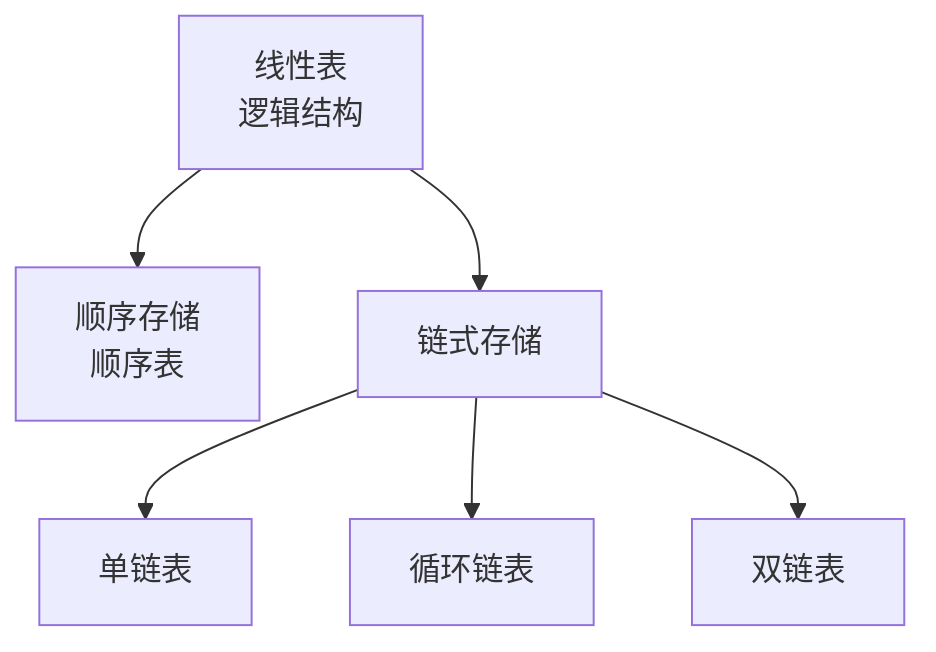
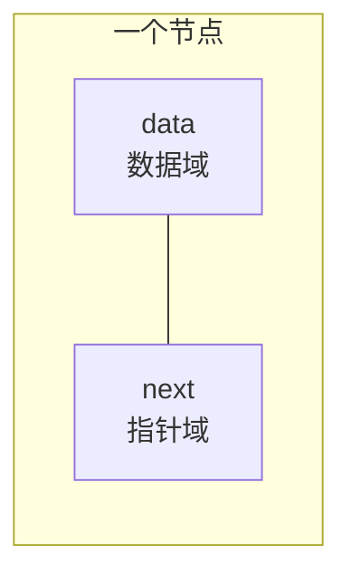
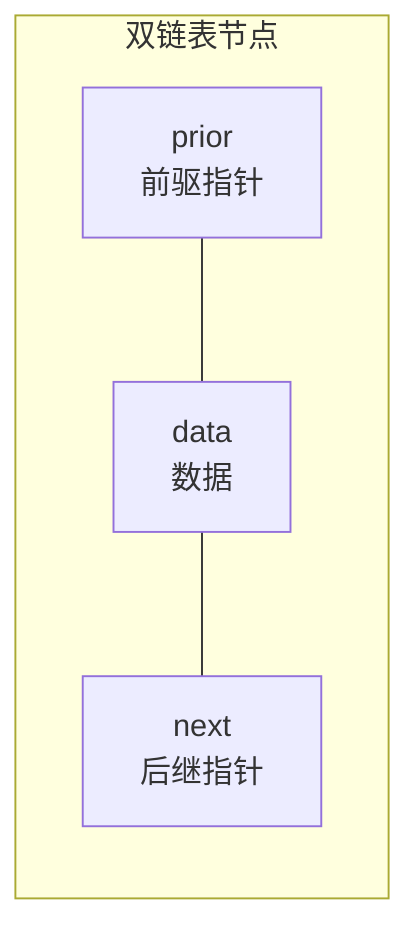
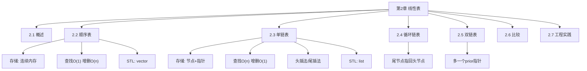

# 第 2 章　线性表

> **本章目标**：掌握两种最基本的存储方式——**顺序表**（数组）和**链表**（指针串联），并搞清楚"什么时候用哪个"。
>
> **难度**：★★★☆☆　**建议用时**：3～4 天
>
> **这是全书最重要的一章。** 后面所有数据结构（栈、队列、树、图）都建立在这一章的基础上。请务必把链表的每一行代码都敲一遍。

> **前置知识**：[第 0 章 指针与动态内存](00-C与C++基础回顾.md)（**这一章的链表完全依赖指针**）、[第 1 章 复杂度分析](01-绪论.md)
> **本章重点**：单链表的增删改查——**第 3、4、5 章都会反复用到**
> **易混点**：位序（从 1）vs 下标（从 0） → 见[速查表·表8](速查表.md)

---

## 2.0　先建立直觉：什么是"线性表"

### 【生活类比】

想象一排**火车车厢**：

```
[车头] → [1号车厢] → [2号车厢] → [3号车厢]
```

- 每节车厢**有且只有一个**前一节（除了车头）
- 每节车厢**有且只有一个**后一节（除了最后一节）
- 排成**一条线**，不会分叉

这就是**线性表**。

再比如：
- 排队买奶茶的队伍（第 1 个人、第 2 个人……）
- 一串糖葫芦
- 一首歌的播放列表

### 【与第 1 章的联系】

第 1 章讲过四种逻辑结构，**线性表属于"线性结构"**——元素之间是**一对一**的关系。

```
线性结构：① → ② → ③ → ④ → ⑤
          （每个元素最多有一个前驱、一个后继）
```

### 【本节自测】

**2-0-1.** 用生活例子说明：什么是"一对一"的关系？它和"一对多"有什么区别？
<details><summary>点我看答案</summary>
<p><strong>&quot;一对一&quot;</strong>（线性结构）：每个元素<strong>最多有一个前驱和一个后继</strong>。</p>
<p>例子：<strong>排队买奶茶</strong></p>
<ul>
<li>队伍里每个人前面只有一个人，后面也只有一个人</li>
<li>首尾除外（队首没有前驱，队尾没有后继）</li>
</ul>
<p><strong>&quot;一对多&quot;</strong>（树形结构）：一个元素可以有<strong>多个</strong>后继。</p>
<p>例子：<strong>家族族谱</strong></p>
<ul>
<li>爷爷可以有 3 个孩子</li>
<li>这就是&quot;一对多&quot;</li>
</ul>
<p><strong>对比图示</strong>：</p><pre><code>一对一（线性）:  ① → ② → ③ → ④&#10;
一对多（树形）:      ①
                   / | \
                  ② ③ ④
</code></pre><p><strong>第 2、3 章研究&quot;一对一&quot;，第 4 章研究&quot;一对多&quot;，第 5 章研究&quot;多对多&quot;。</strong></p>
</details>

**2-0-2.** 为什么说"线性表是最基础的数据结构"？
<details><summary>点我看答案</summary>
<p>因为<strong>后面所有数据结构都建立在它之上</strong>：</p>
<table>
<thead>
<tr>
<th>数据结构</th>
<th>与线性表的关系</th>
</tr>
</thead>
<tbody>
<tr>
<td><strong>栈</strong></td>
<td>操作受限的线性表（只能在一端操作）</td>
</tr>
<tr>
<td><strong>队列</strong></td>
<td>操作受限的线性表（一端进、一端出）</td>
</tr>
<tr>
<td><strong>串</strong></td>
<td>元素限定为字符的线性表</td>
</tr>
<tr>
<td><strong>数组</strong></td>
<td>一维数组就是线性表</td>
</tr>
<tr>
<td><strong>树</strong></td>
<td>可以看成&quot;多个线性表的层次组合&quot;</td>
</tr>
<tr>
<td><strong>图</strong></td>
<td>可以用线性表（邻接表）来表示</td>
</tr>
</tbody>
</table>
<p><strong>所以第 2 章是全书的地基</strong>——把顺序表和链表搞懂，后面都是&quot;在此基础上加限制或加层次&quot;。</p>
</details>

---

## 2.1　线性表概述

### 2.1.1　线性表的定义

#### 【正式定义】

**线性表（Linear List）** 是由 **n 个（n ≥ 0）相同类型**的数据元素组成的**有限序列**。

记作：

```
(a₁, a₂, a₃, ..., aₙ)
```

#### 【三个关键词，逐个拆解】

| 关键词 | 含义 | 反例 |
|---|---|---|
| **n 个** | 元素个数是有限的 | "所有实数"不是线性表（无限个） |
| **相同类型** | 每个元素类型一样 | 一个表里既放 int 又放 string，不是标准线性表 |
| **有限序列** | 有顺序，位置有意义 | 集合 `{1,2,3}` 不是序列（没顺序） |

#### 【几个术语】（考试常考）

假设线性表是 `(a₁, a₂, a₃, a₄, a₅)`：

| 术语 | 含义 | 在这例子中 |
|---|---|---|
| **表长** | 元素个数 n | 5 |
| **空表** | n = 0 的表 | —— |
| **第一个元素（表头）** | a₁ | a₁ |
| **最后一个元素（表尾）** | aₙ | a₅ |
| **前驱** | 某元素前面那个 | a₃ 的前驱是 a₂ |
| **后继** | 某元素后面那个 | a₃ 的后继是 a₄ |
| **位序（位置）** | 元素的序号 | a₃ 的位序是 3 |

#### 【⚠ 极其重要的约定：位序从 1 开始，数组下标从 0 开始】

这是初学者最容易搞混的地方！

```
线性表的位序:   1     2     3     4     5
              a₁    a₂    a₃    a₄    a₅
数组的下标:     0     1     2     3     4
```

**规则**：
- 教材说"第 i 个元素" → 指的是**位序 i**
- 数组里对应的是 **`a[i-1]`**

**举例**：`Get(3)` 要取"第 3 个元素 a₃"，在数组里是 `data[2]`。

> **为什么这么设计？** 数学上"第 1 个"更自然（人从 1 开始数）；但 C/C++ 数组下标从 0 开始（因为偏移量的概念）。**两套体系共存，必须时刻清醒。**

### 2.1.2　线性表的运算

对线性表能做哪些操作？教材列举了这些：

| 操作 | 说明 |
|---|---|
| **初始化** | 建立一个空表 |
| **求表长** | 返回元素个数 |
| **按位查找 Get(i)** | 取第 i 个元素 |
| **按值查找 Locate(x)** | 找值为 x 的元素的位置 |
| **插入 Insert(i, x)** | 在第 i 个位置插入 x |
| **删除 Delete(i)** | 删除第 i 个元素 |
| **遍历 PrintList()** | 依次访问每个元素 |
| **判空 Empty()** | 判断是否为空表 |

> **注意**：这些是"**运算的定义**"，不是"实现"。同一个运算（比如插入），在顺序表和链表上实现方式完全不同，效率也完全不同。这就是本章的核心。

### 2.1.3　各种常用存储结构

**同一个线性表，可以用不同的方式存在内存里。**



| 存储结构 | 怎么存 | 一句话特点 |
|---|---|---|
| **顺序表** | 用一整块连续内存 | "挨着放"，像数组 |
| **单链表** | 每个节点存数据和下一个节点的地址 | "用指针串起来" |
| **循环链表** | 单链表的尾巴接回头部 | "围成一个圈" |
| **双链表** | 每个节点同时存前驱和后继 | "能往前也能往后走" |

#### 【用生活类比理解两种存储】

**顺序表** = **电影院的连座**

```
座位号: [1][2][3][4][5][6][7][8]
        [张][李][王][ ][ ][ ][ ][ ]
```
- 座位挨着，找第 5 个人直接走过去（快）
- 但要在张和李之间插一个人？**后面所有人都得往后挪一个座位**（慢）

**链表** = **寻宝游戏**

```
纸条1: "宝藏1，下一张纸条在书架上"
纸条2: "宝藏2，下一张纸条在抽屉里"
纸条3: "宝藏3，没有下一张了"
```
- 纸条散落各处，靠"线索"连起来
- 要插一张新纸条？只要改上一张的线索（快）
- 但想找第 5 张纸条？**必须从头一张张跟过去**（慢）

**这个对比是本章的灵魂。**

### 【本节自测】

**2-1-1.** 判断：线性表中的元素必须是相同类型的吗？
<details><summary>答案</summary>
<p><strong>是的。</strong> 标准定义要求&quot;相同类型&quot;。</p>
<p>理由：如果类型不同，元素占用的内存大小就不同，无法用统一的方式存储和计算（尤其是顺序表，要求每个元素占同样多的字节）。</p>
<p><strong>但实际编程中</strong>，可以用&quot;结构体&quot;把不同类型的数据打包成一个元素。例如：</p><pre><code class="language-cpp">struct Student { int id; string name; double score; };  // 三种类型打包成一个
Student list[100];   // 每个元素都是 Student 类型（类型相同）
</code></pre><p>这样既满足了&quot;相同类型&quot;，又能表达复杂数据。</p>
</details>

**2-1-2.** 线性表 `(a₁, a₂, a₃, a₄)` 中，a₂ 的前驱和后继分别是什么？表长是多少？

<details><summary>答案</summary>
<ul>
<li>a₂ 的<strong>前驱</strong>：a₁</li>
<li>a₂ 的<strong>后继</strong>：a₃</li>
<li><strong>表长</strong>：4</li>
</ul>
<p><strong>注意</strong>：a₁ 没有前驱，a₄ 没有后继。这是线性表的边界。</p>
</details>

**2-1-3.** 教材说"删除第 3 个元素"，在数组里操作的是哪个下标？
<details><summary>答案</summary>
<p><strong>下标 2</strong>。</p>
<p>因为&quot;第 3 个&quot;是<strong>位序</strong>（从 1 开始），数组下标从 0 开始，所以 <code>下标 = 位序 - 1 = 3 - 1 = 2</code>。</p>
<p><strong>记忆口诀</strong>：<strong>位序从 1 数，下标从 0 数，差 1。</strong></p>
</details>

**2-1-4.** 用一句话概括"顺序表"和"链表"最本质的区别。
<details><summary>答案</summary>
<p><strong>顺序表用&quot;连续的内存&quot;表达顺序，链表用&quot;指针&quot;表达顺序。</strong></p>
<ul>
<li>顺序表：靠&quot;物理位置相邻&quot;来说明谁在谁后面。</li>
<li>链表：靠&quot;节点里存着下一个节点的地址&quot;来说明谁在谁后面。</li>
</ul>
<p><strong>这个本质区别，导致了它们在插入、删除、查找上的所有性能差异。</strong></p>
</details>

---

## 2.2　顺序表的实现

### 2.2.1　顺序表的存储结构

#### 【一句话概括】

**顺序表 = 用一块连续的内存依次存放元素**（本质上就是数组）。

#### 【内存布局】

假设顺序表存 `(10, 20, 30, 40)`，每个元素占 4 字节，从地址 1000 开始：

```
地址:   1000    1004    1008    1012
       ┌──────┬──────┬──────┬──────┐
       │  10  │  20  │  30  │  40  │
       └──────┴──────┴──────┴──────┘
下标:     0      1      2      3
位序:     1      2      3      4
```

**关键公式**（随机访问为什么快）：

```
第 i 个元素的地址 = 起始地址 + (i-1) × 每个元素的大小
```

**例子**：要找第 3 个元素（下标 2）：
```
地址 = 1000 + 2 × 4 = 1008  ✓
```

**一步算出来，不用遍历！** 这就是顺序表**随机访问 O(1)** 的原因。

#### 【C/C++ 知识回顾：为什么数组能"一步定位"】

```cpp
int a[4] = {10, 20, 30, 40};
cout << a[2] << endl;   // 30
```

编译器实际做的事：`*(a + 2)` —— 从 `a` 的地址往后偏移 2 个 int 的位置，直接读。

**因为每个 int 大小固定（4 字节），所以偏移量可以精确计算。**

> **对比**：如果元素大小不固定（比如一个存字符串的表），就没法这样算了——这也是为什么顺序表要求"元素类型相同"。

#### 【C++ 类的定义】

教材用类来描述顺序表：

```cpp
template <class T>
class SeqList {
private:
    T*    data;      // 指向存储数据的连续内存
    int   maxSize;   // 最大容量
    int   length;    // 当前元素个数

public:
    SeqList(int size);        // 构造函数
    ~SeqList();               // 析构函数
    int  Length() const;      // 求表长
    T    Get(int i);          // 按位查找
    int  Locate(T x);         // 按值查找
    void Insert(int i, T x);  // 插入
    T    Delete(int i);       // 删除
    void PrintList();         // 遍历输出
};
```

**三个成员变量的作用**：

| 成员 | 作用 | 类比 |
|---|---|---|
| `data` | 指向真正的数据区 | 停车场的入口地址 |
| `maxSize` | 最多能放多少个 | 停车场总车位数 |
| `length` | 现在放了几个 | 当前停了几个车 |

> **为什么要分开 `maxSize` 和 `length`？**
> 因为数组开了 100 个位置，不代表现在有 100 个元素。**有效元素的个数是 `length`，不是 `maxSize`。**
> 这是初学者常见 bug：遍历时用了 `maxSize` 而不是 `length`，结果输出了垃圾数据。

### 2.2.2　顺序表的基本运算

#### 【运算 1：求表长】

```cpp
template <class T>
int SeqList<T>::Length() const {
    return length;
}
```
**O(1)** —— 直接返回一个变量。

#### 【运算 2：按位查找 Get(i)】

```cpp
template <class T>
T SeqList<T>::Get(int i) {
    if (i < 1 || i > length) {
        throw "查找位置非法";     // 越界检查
    }
    return data[i - 1];           // ★ 位序 i → 下标 i-1
}
```

**O(1)** —— 数组随机访问。

**⚠ 注意 `data[i-1]`**：这是"位序 vs 下标"差 1 的经典体现。

#### 【运算 3：按值查找 Locate(x)】

```cpp
template <class T>
int SeqList<T>::Locate(T x) {
    for (int i = 0; i < length; i++) {
        if (data[i] == x) return i + 1;   // 返回位序
    }
    return 0;                              // 0 表示没找到
}
```

**O(n)** —— 最坏要比较 n 次。

**为什么按值查找是 O(n)，按位查找是 O(1)？**
- 按位查找：知道位置 → 直接算地址 → O(1)
- 按值查找：不知道位置 → 只能一个个比 → O(n)

> **这就是"位置已知"和"位置未知"的巨大差别**，也是后面所有查找算法要解决的问题。

#### 【运算 4：插入 Insert(i, x)】⭐ 重点

**目标**：在第 i 个位置插入 x。

**步骤**：
1. 检查表是否已满、位置是否合法
2. **把第 i 个及之后的所有元素，整体往后挪一格**
3. 把 x 放到第 i 个位置
4. 表长 +1

**图示**：在位置 3 插入 99

```
插入前:  [10][20][30][40][50][ ][ ]
         1   2   3   4   5

第①步：从后往前，依次后移（★ 必须从后往前！）
        [10][20][ ][30][40][50][ ]
         
第②步：放入 99
        [10][20][99][30][40][50][ ]
         1   2   3   4   5   6
```

```cpp
template <class T>
void SeqList<T>::Insert(int i, T x) {
    if (length == maxSize) throw "表已满";
    if (i < 1 || i > length + 1) throw "插入位置非法";

    // ★ 从后往前搬，否则会覆盖数据
    for (int j = length; j >= i; j--) {
        data[j] = data[j - 1];       // 下标 j 收到 j-1 的值
    }
    data[i - 1] = x;                 // 放入新元素
    length++;
}
```

#### 【⚠ 为什么必须"从后往前"搬？】

**反面演示**（如果从前往后搬）：

```
初始: [10][20][30][40]
       0   1   2   3
要在下标 1 处插入 99

从前往后（❌ 错误）：
  data[2] = data[1]  →  [10][20][20][40]   ← 30 被覆盖了！
  data[3] = data[2]  →  [10][20][20][20]   ← 40 也被覆盖了！
结果数据全乱了。

从后往前（✓ 正确）：
  data[4] = data[3]  →  [10][20][30][40][40]   40 安全了
  data[3] = data[2]  →  [10][20][30][30][40]   30 安全了
  data[2] = data[1]  →  [10][20][20][30][40]
  data[1] = 99       →  [10][99][20][30][40]   ✓ 正确
```

**记忆口诀**：**往后挪，从后往前；往前挪，从前往后。**（永远是"先搬离目的地远的"）

#### 【插入的时间复杂度】

| 插入位置 | 要移动的元素个数 | 复杂度 |
|---|---|---|
| 表头（i=1） | n 个 | O(n) |
| 表尾（i=n+1） | 0 个 | O(1) |
| 平均 | n/2 个 | **O(n)** |

**为什么平均是 n/2？** 在 n+1 个可能位置插入，平均移动 `(0+1+2+...+n)/(n+1) = n/2` 个。

**结论**：顺序表插入的**平均时间复杂度是 O(n)**。

#### 【运算 5：删除 Delete(i)】

**步骤**：
1. 检查位置是否合法
2. **把第 i 个之后的元素，整体往前挪一格**
3. 表长 -1

**图示**：删除位置 3（值是 30）

```
删除前:  [10][20][30][40][50]
         1   2   3   4   5

第①步：从前往后，依次前移
        [10][20][40][50][50]
         
第②步：length--（逻辑上忽略最后一个）
        [10][20][40][50]
         1   2   3   4
```

```cpp
template <class T>
T SeqList<T>::Delete(int i) {
    if (i < 1 || i > length) throw "删除位置非法";

    T x = data[i - 1];               // 保存要删的值（要返回）

    // ★ 从前往后搬（因为目标是往前挪）
    for (int j = i - 1; j < length - 1; j++) {
        data[j] = data[j + 1];
    }
    length--;
    return x;
}
```

**时间复杂度**：同样是 **O(n)**（平均移动 n/2 个元素）。

#### 【顺序表各运算复杂度汇总】

| 运算 | 时间复杂度 | 原因 |
|---|---|---|
| 求表长 | O(1) | 直接读变量 |
| 按位查找 | **O(1)** ★ | 随机访问，一步定位 |
| 按值查找 | O(n) | 要遍历比较 |
| 插入 | **O(n)** ⚠ | 要搬移后面所有元素 |
| 删除 | **O(n)** ⚠ | 要搬移后面所有元素 |

**记住这个结论**：**顺序表"查得快、改得慢"。**

### 2.2.3　顺序表的应用——通信录

教材用"通信录"作为综合例子。我们来做一个简化版。

#### 【需求】

- 存若干联系人（姓名 + 电话）
- 支持：添加、按姓名查找、删除、显示全部

#### 【代码实现】

```cpp
#include <iostream>
#include <string>
using namespace std;

struct Contact {
    string name;      // 姓名
    string phone;     // 电话
};

class PhoneBook {
private:
    Contact data[100];   // 最多 100 个联系人
    int     length;      // 当前个数

public:
    PhoneBook() { length = 0; }

    // 添加联系人
    void add(const Contact& c) {
        if (length >= 100) { cout << "通信录已满" << endl; return; }
        data[length] = c;
        length++;
        cout << "已添加: " << c.name << endl;
    }

    // 按姓名查找
    int findByName(const string& name) {
        for (int i = 0; i < length; i++) {
            if (data[i].name == name) return i + 1;   // 返回位序
        }
        return 0;   // 没找到
    }

    // 按姓名删除
    void remove(const string& name) {
        int pos = findByName(name);
        if (pos == 0) { cout << "没找到 " << name << endl; return; }
        // 后面的元素往前挪
        for (int j = pos - 1; j < length - 1; j++) {
            data[j] = data[j + 1];
        }
        length--;
        cout << "已删除: " << name << endl;
    }

    // 显示全部
    void printAll() {
        cout << "--- 通信录 (" << length << " 条) ---" << endl;
        for (int i = 0; i < length; i++) {
            cout << i + 1 << ". " << data[i].name
                 << "  " << data[i].phone << endl;
        }
    }
};

int main() {
    PhoneBook pb;
    pb.add({"张三", "138-0000-1111"});
    pb.add({"李四", "139-0000-2222"});
    pb.add({"王五", "137-0000-3333"});
    pb.printAll();

    int pos = pb.findByName("李四");
    cout << "李四在第 " << pos << " 位" << endl;

    pb.remove("李四");
    pb.printAll();
    return 0;
}
```

> 完整代码见 `code/02_顺序表.cpp`。

#### 【从这个例子学到什么】

| 操作 | 对应顺序表的哪个运算 | 复杂度 |
|---|---|---|
| `add` | 尾部插入 | O(1)（不需要移动） |
| `findByName` | 按值查找 | O(n) |
| `remove` | 删除 | O(n)（要移动元素） |

**思考**：如果通信录有 1 万人，每次删除一个人都要移动后面几千条记录，很慢。**有更好的办法吗？**——有，用链表（下一节）。

### 2.2.4　STL 中的顺序表——vector

教材介绍了 STL 的 `vector`，它就是**顺序表的现成实现**。

```cpp
#include <iostream>
#include <vector>
using namespace std;

int main() {
    vector<int> v;

    // 插入（尾部）—— 对应 Insert(length+1, x)
    v.push_back(10);
    v.push_back(20);
    v.push_back(30);

    // 按位查找 —— 对应 Get(i)
    cout << v[0] << endl;        // 10
    cout << v.at(1) << endl;     // 20（at 会做越界检查）

    // 求表长
    cout << v.size() << endl;    // 3

    // 任意位置插入 —— 对应 Insert(i, x)，O(n)
    v.insert(v.begin() + 1, 99); // 在下标 1 处插入

    // 删除 —— 对应 Delete(i)，O(n)
    v.erase(v.begin() + 1);

    // 判空
    cout << v.empty() << endl;   // 0（false，非空）
}
```

#### 【vector 对比手写顺序表】

| 功能 | 手写 SeqList | STL vector |
|---|---|---|
| 插入尾部 | `Insert(length+1, x)` | `v.push_back(x)` |
| 任意插入 | `Insert(i, x)` | `v.insert(v.begin()+i-1, x)` |
| 删除 | `Delete(i)` | `v.erase(v.begin()+i-1)` |
| 取元素 | `Get(i)` | `v[i-1]` 或 `v.at(i-1)` |
| 表长 | `Length()` | `v.size()` |
| 扩容 | **要自己判断表满** | **自动扩容** ★ |

#### 【vector 的杀手锏：自动扩容】

手写顺序表最麻烦的是"表满了怎么办"。`vector` 自动处理：

```
当 size == capacity 时：
  1. 申请一块更大的内存（通常是原来的 2 倍）
  2. 把老数据全部拷贝过去
  3. 释放老内存
  4. 继续添加
```

**这就是"动态数组"的含义。**

> **性能提示**：扩容时要拷贝所有元素，是 O(n)。但因为是"2 倍扩容"，平均到每次 `push_back` 上仍然是 **O(1)**（摊还分析）。
> 这就是为什么 `vector` 尾插很快，但**中间插入是 O(n)**（要搬移后面的元素）。

### 【本节自测】

**2-2-1.** 顺序表在表头插入一个元素，需要移动多少个元素？时间复杂度是多少？
<details><summary>答案</summary>
<p>表头插入，<strong>所有 n 个元素都要往后移一格</strong>，所以移动 <strong>n</strong> 个元素，时间复杂度 <strong>O(n)</strong>。</p>
<p><strong>对比</strong>：表尾插入不需要移动任何元素，是 O(1)。</p>
<p>这就是为什么&quot;往顺序表前面插数据&quot;很慢。</p>
</details>

**2-2-2.** 下面这段插入代码错在哪？
```cpp
for (int j = i; j <= length; j++) {
    data[j] = data[j - 1];
}
```
<details><summary>答案</summary>
<p><strong>移动方向反了。</strong></p>
<p>这段代码是<strong>从前往后</strong>搬（j 从 i 递增到 length），会<strong>覆盖还没搬走的数据</strong>。</p>
<p>正确应该<strong>从后往前</strong>：</p><pre><code class="language-cpp">for (int j = length; j &gt;= i; j--) {
    data[j] = data[j - 1];
}
</code></pre><p><strong>记忆口诀</strong>：<strong>往后挪就从后往前搬</strong>（先搬走最后面的，避免覆盖）。</p>
<p>举例说明：<code>[10][20][30]</code> 在下标 1 处插入：</p>
<ul>
<li>错误（从前往后）：<code>data[1]=data[0]</code> → <code>[10][10][30]</code>，原来的 20 没了</li>
<li>正确（从后往前）：<code>data[2]=data[1]</code> → <code>[10][20][20]</code>，再 <code>data[1]=99</code> → <code>[10][99][20]</code> ✓</li>
</ul>
</details>

**2-2-3.** 为什么顺序表"按位查找"是 O(1)，而"按值查找"是 O(n)？
<details><summary>答案</summary>
<ul>
<li>
<p><strong>按位查找</strong>：你知道位置 i，通过公式 <code>地址 = 起始地址 + (i-1) × 元素大小</code> <strong>一步算出地址</strong>，直接读取。跟 n 无关 → <strong>O(1)</strong>。</p>
</li>
<li>
<p><strong>按值查找</strong>：你只知道&quot;值&quot;，不知道&quot;位置&quot;。只能从第 1 个开始<strong>一个个比较</strong>，最坏要比 n 次 → <strong>O(n)</strong>。</p>
</li>
</ul>
<p><strong>本质区别</strong>：<strong>知不知道位置</strong>。</p>
<p><strong>这个思想贯穿整本书</strong>：第 6 章的散列表就是为了把&quot;按值查找&quot;也做到 O(1)。</p>
</details>

**2-2-4.** 写一段代码，把顺序表中所有值为 x 的元素都删除。
<details><summary>答案</summary>
<pre><code class="language-cpp">// 方法：用一个新下标 k 记录&quot;保留下来&quot;的元素位置
int k = 0;
for (int i = 0; i &lt; length; i++) {
    if (data[i] != x) {
        data[k++] = data[i];   // 保留下来的往前放
    }
}
length = k;   // 更新表长
</code></pre><p><strong>思路</strong>：不要&quot;找到一个删一个&quot;（那样每次都要搬移，O(n²)）。而是<strong>遍历一遍，把要保留的元素依次挪到前面</strong>，最后改表长。这样只需 O(n)。</p>
<p><strong>这是一个经典技巧</strong>，第 2.7 节的&quot;荷兰国旗问题&quot;也是类似思路。</p>
</details>

**2-2-5.** `vector` 的 `size()` 和 `capacity()` 有什么区别？
<details><summary>答案</summary>
<ul>
<li><code>size()</code>：<strong>当前存了几个元素</strong>（逻辑长度）</li>
<li><code>capacity()</code>：<strong>当前分配的内存能存几个元素</strong>（物理容量）</li>
</ul><pre><code class="language-cpp">vector&lt;int&gt; v;
cout &lt;&lt; v.size() &lt;&lt; &quot; &quot; &lt;&lt; v.capacity() &lt;&lt; endl;  // 0 0
v.push_back(1);
cout &lt;&lt; v.size() &lt;&lt; &quot; &quot; &lt;&lt; v.capacity() &lt;&lt; endl;  // 1 1
v.push_back(2);
cout &lt;&lt; v.size() &lt;&lt; &quot; &quot; &lt;&lt; v.capacity() &lt;&lt; endl;  // 2 2
v.push_back(3);
cout &lt;&lt; v.size() &lt;&lt; &quot; &quot; &lt;&lt; v.capacity() &lt;&lt; endl;  // 3 4  ← 扩容了！
</code></pre><p><strong>关系</strong>：<code>size() &lt;= capacity()</code>。当 <code>size()</code> 要超过 <code>capacity()</code> 时，vector 会扩容（通常是 2 倍）。</p>
<p><strong>类比</strong>：<code>capacity</code> 是你家的衣柜总空间，<code>size</code> 是里面已经挂了几件衣服。</p>
</details>

---

## 2.3　单链表的实现 ⭐ 本章重点中的重点

### 2.3.1　单链表的存储结构

#### 【一句话概括】

**单链表 = 一堆散落的节点，用指针把它们串起来。**

#### 【节点长什么样】

每个节点有两部分：



```cpp
template <class T>
struct Node {
    T     data;    // 数据域：存真正的数据
    Node* next;    // 指针域：存下一个节点的地址
};
```

#### 【链表长什么样】

假设链表存 `(10, 20, 30)`：

```
        front (头指针)
          ↓
       ┌────┬────┐    ┌────┬────┐    ┌────┬──────┐
       │ 10 │  ●─┼──→ │ 20 │  ●─┼──→ │ 30 │ NULL │
       └────┴────┘    └────┴────┘    └────┴──────┘
        节点1          节点2          节点3
```

**关键点**：
1. `front` 是**头指针**，指向第一个节点。通过它才能找到整个链表。
2. 每个节点的 `next` 指向下一个节点。
3. 最后一个节点的 `next` 是 **NULL**（空指针），表示"到头了"。

#### 【⚠ 重要：带头节点 vs 不带头节点】

教材用的是**带头节点的链表**。这是初学者的一大困惑点，必须讲清楚。

**不带头节点**（第一个节点就存数据）：

```
front → [10|●] → [20|●] → [30|NULL]
```

**带头节点**（第一个节点不存数据，只是个"哨兵"）：

```
front → [空|●] → [10|●] → [20|●] → [30|NULL]
        头节点    第1个     第2个     第3个
```

**为什么要加一个"不存数据"的头节点？**

| 好处 | 说明 |
|---|---|
| **插入/删除统一了** | 不用特殊处理"在第一个位置操作"的情况 |
| **代码更简洁** | 所有节点都有前驱（头节点），不用写 `if (是第一个节点)` 分支 |
| **空表和非空表处理一致** | 空表就是 `front->next == NULL`，不用判断 `front` 本身 |

**举例说明好处**：

不带头节点时，删除第一个节点要特殊处理：
```cpp
// 不带头节点：删除第 1 个要改 front 本身
if (i == 1) {
    Node* q = front;
    front = front->next;   // ★ 要修改 front
    delete q;
}
```

带头节点时，删除任何节点（包括第 1 个）都统一：
```cpp
// 带头节点：所有情况都一样
Node* p = Get(i - 1);      // 找到第 i-1 个
Node* q = p->next;         // q 是要删的
p->next = q->next;         // 摘掉 q
delete q;
```
**注意**：删除"第 1 个数据节点"时，`i-1 = 0`，`Get(0)` 返回的正是头节点，代码完全统一。

> **本笔记后面统一用"带头节点"的写法**（跟教材一致）。你在别处看到不带头的版本也不用慌，逻辑是一样的。

#### 【链表的 C++ 类定义】

```cpp
template <class T>
class LinkList {
private:
    Node<T>* front;    // 头指针（指向头节点）

public:
    LinkList();                    // 构造：创建头节点
    ~LinkList();                   // 析构：释放所有节点
    int  Length();                 // 求表长
    T    Get(int i);               // 按位查找
    int  Locate(T x);              // 按值查找
    void Insert(int i, T x);       // 插入
    T    Delete(int i);            // 删除
    void PrintList();              // 遍历输出
};
```

#### 【构造函数：头插法 vs 尾插法】

创建链表有两种方式，**结果顺序相反**，这是常考点。

**头插法**（每次插在头节点后面）：

```cpp
// 输入 1, 2, 3，头插法的结果是 3, 2, 1（逆序！）
LinkList(T a[], int n) {
    front = new Node<T>;       // 创建头节点
    front->next = NULL;
    for (int i = 0; i < n; i++) {
        Node<T>* s = new Node<T>;
        s->data = a[i];
        s->next = front->next;  // ① 新节点指向原来的第一个
        front->next = s;        // ② 头节点指向新节点
    }
}
```

**图示**（依次插入 1, 2, 3）：

```
插入 1:  front → [头] → [1|NULL]

插入 2:  front → [头] → [2|●] → [1|NULL]

插入 3:  front → [头] → [3|●] → [2|●] → [1|NULL]
                                    ↑ 结果是逆序的！
```

**尾插法**（每次插在链表末尾）：

```cpp
// 输入 1, 2, 3，尾插法的结果是 1, 2, 3（保持顺序）
LinkList(T a[], int n) {
    front = new Node<T>;
    front->next = NULL;
    Node<T>* rear = front;      // ★ rear 始终指向最后一个节点

    for (int i = 0; i < n; i++) {
        Node<T>* s = new Node<T>;
        s->data = a[i];
        s->next = NULL;
        rear->next = s;         // ① 接到末尾
        rear = s;               // ② rear 后移
    }
}
```

**图示**（依次插入 1, 2, 3）：

```
插入 1:  front → [头] → [1|NULL]
                          ↑rear

插入 2:  front → [头] → [1|●] → [2|NULL]
                                  ↑rear

插入 3:  front → [头] → [1|●] → [2|●] → [3|NULL]
                                            ↑rear
```

**口诀**：**头插法逆序，尾插法保序。**

> **为什么要维护 `rear` 指针？** 因为尾插法要频繁访问"最后一个节点"。如果不保存 `rear`，每次插入都要从头遍历到尾找最后一个，就变成 O(n²) 了。

### 2.3.2　单链表的基本运算

#### 【运算 1：求表长】

```cpp
template <class T>
int LinkList<T>::Length() {
    Node<T>* p = front->next;    // 从第一个数据节点开始
    int count = 0;
    while (p != NULL) {          // 一路走到头
        count++;
        p = p->next;
    }
    return count;
}
```

**O(n)** —— 必须遍历一遍。

> **对比**：顺序表求表长是 O(1)（直接读 `length`），链表是 O(n)（要数）。
> 这是链表的劣势之一。**优化办法**：在类里加一个 `length` 成员变量，插入时 +1、删除时 -1。

#### 【运算 2：按位查找 Get(i)】

```cpp
template <class T>
Node<T>* LinkList<T>::Get(int i) {
    if (i < 0) return NULL;
    Node<T>* p = front;          // ★ 从头节点开始
    int j = 0;
    while (p != NULL && j < i) { // 走 i 步
        p = p->next;
        j++;
    }
    return p;                    // 返回第 i 个节点（i=0 时是头节点）
}
```

**O(n)** —— 必须从头一个个走。

**⚠ 与顺序表的巨大差异**：

| | 顺序表 | 单链表 |
|---|---|---|
| 按位查找 | **O(1)** | **O(n)** |

**为什么？** 因为链表**不能随机访问**。你不知道第 5 个节点在哪，只能从头节点开始，跟着指针走 5 步。

**生活类比**：顺序表像"按门牌号找房间"（直接走到 305）；链表像"寻宝游戏"（必须按线索一步步走）。

#### 【运算 3：按值查找 Locate(x)】

```cpp
template <class T>
int LinkList<T>::Locate(T x) {
    Node<T>* p = front->next;
    int j = 1;
    while (p != NULL) {
        if (p->data == x) return j;   // 找到，返回位序
        p = p->next;
        j++;
    }
    return 0;   // 没找到
}
```

**O(n)**

#### 【运算 4：插入 Insert(i, x)】⭐

**目标**：在第 i 个位置插入 x（即插在第 i-1 个和第 i 个之间）。

**关键步骤**：
1. 找到**第 i-1 个节点**（记作 p）
2. 创建新节点 s
3. **s->next = p->next**（先接后面）
4. **p->next = s**（再改前面）

**图示**：在位置 2 插入 99（即插在节点1和节点2之间）

```
插入前:
   front → [头] → [10|●] → [20|●] → [30|NULL]
                   ↑p       ↑p->next

第①步 s->next = p->next:  新节点接上后面的链表
   front → [头] → [10|●]   [20|●] → [30|NULL]
                            ↑
                   [99|●]───┘

第②步 p->next = s: 前面的指针指向新节点
   front → [头] → [10|●] → [99|●] → [20|●] → [30|NULL]
```

```cpp
template <class T>
void LinkList<T>::Insert(int i, T x) {
    Node<T>* p = Get(i - 1);          // ① 找到第 i-1 个节点
    if (p == NULL) throw "插入位置非法";

    Node<T>* s = new Node<T>;         // ② 创建新节点
    s->data = x;
    s->next = p->next;                // ③ ★ 先接后面
    p->next = s;                      // ④ ★ 再改前面
}
```

#### 【⚠ 为什么必须先 `s->next = p->next`，再 `p->next = s`？】

**如果顺序反了**：

```
先 p->next = s:
   front → [头] → [10|●] → [99|●] → ??? 
                            （20 和 30 丢失了！因为 p->next 已经被覆盖）

此时再 s->next = p->next:
   s->next 指向的是 99 自己 → 死循环！
```

**记忆口诀**：**先接后，再断前**（或者"新的先抓住后面，再让前面抓住新的"）。

**生活类比**：换链条的时候，要先把新链环扣住后面的链环，再解开旧的——否则链子就掉了。

#### 【插入的时间复杂度】

- **找到第 i-1 个节点**：O(n)
- **插入动作本身**：O(1)（只改两个指针）
- **总体**：**O(n)**

> **重要澄清**：很多人说"链表插入是 O(1)"——这**不准确**。
> - 如果**已经知道插入位置的前一个节点**（比如手里已经有 p），插入确实是 O(1)。
> - 但如果只知道"位序 i"，还要先**找**到第 i-1 个节点，那就是 O(n)。
>
> **准确说法**：链表"在已知位置插入"是 O(1)，"按位序插入"是 O(n)。
> 这个区别在考试中很关键。

#### 【运算 5：删除 Delete(i)】⭐

**目标**：删除第 i 个节点。

**关键步骤**：
1. 找到**第 i-1 个节点**（记作 p）
2. 记下要删的节点 `q = p->next`
3. **p->next = q->next**（跳过 q）
4. **delete q**（释放内存）

**图示**：删除位置 2（节点 20）

```
删除前:
   front → [头] → [10|●] → [20|●] → [30|NULL]
                   ↑p       ↑q

第①步 q = p->next:  记下要删的节点

第②步 p->next = q->next: 跳过 q
   front → [头] → [10|●] ─┐  [20|●]   [30|NULL]
                           └───────────↑

第③步 delete q: 释放内存
   front → [头] → [10|●] → [30|NULL]
```

```cpp
template <class T>
T LinkList<T>::Delete(int i) {
    Node<T>* p = Get(i - 1);          // ① 找到第 i-1 个
    if (p == NULL || p->next == NULL) throw "删除位置非法";

    Node<T>* q = p->next;             // ② 记下要删的节点
    T x = q->data;                    // ③ 保存数据（要返回）
    p->next = q->next;                // ④ 跳过 q
    delete q;                         // ⑤ 释放内存
    return x;
}
```

#### 【⚠ 三个致命错误】

**错误 1：忘了 `delete q` → 内存泄漏**
```cpp
p->next = q->next;
// ❌ 忘了 delete q;  → 这块内存永远收不回来
```

**错误 2：先 delete 再用 q**
```cpp
delete q;
p->next = q->next;   // 💥 q 已经被释放，访问它是"野指针"
```
**必须先改指针，最后才 delete。**

**错误 3：删除后没有更新表长**（如果维护了 length 变量）

#### 【单链表运算复杂度汇总】

| 运算 | 时间复杂度 | 说明 |
|---|---|---|
| 求表长 | O(n) | 要遍历（可用 length 变量优化到 O(1)） |
| 按位查找 | **O(n)** ⚠ | 不能随机访问 |
| 按值查找 | O(n) | 要遍历 |
| 插入 | O(n) | 找位置 O(n) + 改指针 O(1) |
| 删除 | O(n) | 找位置 O(n) + 改指针 O(1) |

**记住这个结论**：**链表"查得慢、改得快"**（跟顺序表正好相反）。

#### 【⚠ 一个重要的思考题（教材原题）】

> 教材原文："如果要删除单链表中 p 所指的某个节点，该如何设计时间复杂度为 O(1) 的算法？"

**答案**：因为只有 `p`，没有 `p` 的前驱，正常删除需要前驱。

**技巧：把后继节点的数据复制到 p，然后删除后继节点。**

```cpp
void deleteNode(Node* p) {
    if (p == NULL || p->next == NULL) return;  // 尾节点不能用这招
    Node* q = p->next;          // q 是 p 的后继
    p->data = q->data;          // ★ 把后继的数据"搬"到 p
    p->next = q->next;          // 跳过 q
    delete q;                   // 删掉 q
}
```

**图示**：

```
原链表:  ... → [10|●] → [20|●] → [30|NULL]
                ↑p       ↑q
要"删除"p（10）

第一步：p->data = q->data
        ... → [20|●] → [20|●] → [30|NULL]
                ↑p       ↑q
（p 的值变成 20 了，看起来像"10 被删了"）

第二步：p->next = q->next; delete q;
        ... → [20|●] → [30|NULL]
                ↑p
```

**本质**：不真删 p，而是**让 p 变成 q 的样子**，然后删掉 q。**效果上等价于删除了 p**。

> **局限性**：如果 p 是**最后一个节点**，就没有后继可以"借用"，这招失效。
> 这个技巧在面试中很常见，值得记住。

### 2.3.3　单链表的应用——通信录

用链表实现通信录，对比 2.2.3 的顺序表版本：

```cpp
#include <iostream>
#include <string>
using namespace std;

struct Contact {
    string name;
    string phone;
    void print() const { cout << name << "  " << phone; }
};

template <class T>
struct Node {
    T      data;
    Node*  next;
};

template <class T>
class LinkList {
private:
    Node<T>* front;    // 头指针

public:
    LinkList() {
        front = new Node<T>;
        front->next = NULL;
    }

    // 尾部添加（尾插法）
    void push_back(T x) {
        Node<T>* p = front;
        while (p->next != NULL) p = p->next;   // 走到最后一个
        Node<T>* s = new Node<T>;
        s->data = x;
        s->next = NULL;
        p->next = s;
    }

    // 按值查找
    int Locate(T x) {
        Node<T>* p = front->next;
        int j = 1;
        while (p != NULL) {
            if (p->data.name == x.name) return j;
            p = p->next;
            j++;
        }
        return 0;
    }

    // 删除
    void remove(T x) {
        Node<T>* p = front;
        while (p->next != NULL && p->next->data.name != x.name) {
            p = p->next;
        }
        if (p->next == NULL) { cout << "没找到" << endl; return; }
        Node<T>* q = p->next;
        p->next = q->next;
        delete q;
    }

    // 显示全部
    void PrintList() {
        Node<T>* p = front->next;
        while (p != NULL) {
            p->data.print();
            cout << endl;
            p = p->next;
        }
    }
};

int main() {
    LinkList<Contact> pb;
    pb.push_back({"张三", "138-0000-1111"});
    pb.push_back({"李四", "139-0000-2222"});
    pb.push_back({"王五", "137-0000-3333"});
    pb.PrintList();

    cout << "--- 删除李四 ---" << endl;
    pb.remove({"李四", ""});
    pb.PrintList();
    return 0;
}
```

> 完整代码见 `code/02_单链表.cpp`。

#### 【顺序表 vs 链表：同一个需求的两种实现】

| 操作 | 顺序表 | 链表 |
|---|---|---|
| 添加（尾部） | O(1) | O(n) ⚠（要走到尾部） |
| 查找 | O(n) | O(n) |
| 删除 | **O(n)**（要搬元素） | **O(n)**（要找位置） |
| 显示 | O(n) | O(n) |

**咦？看起来链表没优势啊？**

**关键点**：这里的"删除"都要 O(n)，但**原因不同**：
- 顺序表：找位置 O(1)，但**搬移元素** O(n)
- 链表：找位置 O(n)，但**删除动作** O(1)

**当"找到位置"和"删除"分开时，链表的优势就出来了**：

```cpp
// 场景：已经持有要删除的节点的指针 p
// 顺序表：还是要搬移后面的元素 → O(n)
// 链表：  直接改指针 → O(1) ★
```

**所以真实场景中**：
- 如果**删除操作特别频繁**，且能提前拿到位置 → 用链表
- 如果**查找特别频繁** → 用顺序表（能随机访问）

### 【本节自测】

**2-3-1.** 头插法和尾插法建立的链表，元素顺序有什么区别？
<details><summary>答案</summary>
<ul>
<li><strong>头插法</strong>：新元素总是插在最前面，所以最终顺序与输入顺序<strong>相反</strong>（逆序）。</li>
<li><strong>尾插法</strong>：新元素接在最后面，所以最终顺序与输入顺序<strong>相同</strong>（保序）。</li>
</ul>
<p><strong>例</strong>：依次输入 1, 2, 3</p>
<ul>
<li>头插法结果：<code>3 → 2 → 1</code></li>
<li>尾插法结果：<code>1 → 2 → 3</code></li>
</ul>
<p><strong>口诀</strong>：头插逆序，尾插保序。</p>
</details>

**2-3-2.** 下面插入代码错在哪？会造成什么后果？
```cpp
s->data = x;
p->next = s;
s->next = p->next;
```
<details><summary>答案</summary>
<p><strong>顺序错了，而且会造成严重后果。</strong></p>
<ul>
<li>第 2 行 <code>p-&gt;next = s</code>：p 现在指向新节点 s。此时 <code>p-&gt;next</code> 就是 <code>s</code> 自己。</li>
<li>第 3 行 <code>s-&gt;next = p-&gt;next</code>：<code>p-&gt;next</code> 已经是 <code>s</code> 了，所以 <code>s-&gt;next = s</code> —— <strong>自己指向自己，形成自环！</strong></li>
</ul>
<p><strong>同时</strong>：原来 p 后面的节点（比如 20、30）<strong>全部丢失</strong>，再也找不到了（内存泄漏）。</p>
<p><strong>正确顺序</strong>：</p><pre><code class="language-cpp">s-&gt;data = x;
s-&gt;next = p-&gt;next;   // ★ 先让新节点接住后面
p-&gt;next = s;         // ★ 再让前面指向新节点
</code></pre><p><strong>记忆口诀</strong>：<strong>先接后，再断前</strong>。</p>
</details>

**2-3-3.** 为什么单链表"按位查找"是 O(n) 而顺序表是 O(1)？
<details><summary>答案</summary>
<p>因为<strong>链表不能随机访问</strong>。</p>
<ul>
<li><strong>顺序表</strong>：元素连续存放，第 i 个的地址可以<strong>直接算出来</strong>（<code>基址 + (i-1)×大小</code>），一步到位 → O(1)。</li>
<li><strong>链表</strong>：节点散落在内存各处，只有通过前一个节点的 <code>next</code> 指针才能找到下一个。要找第 i 个，必须<strong>从头节点出发走 i 步</strong> → O(n)。</li>
</ul>
<p><strong>生活类比</strong>：</p>
<ul>
<li>顺序表 = 酒店房间按门牌号排列，直接走到 305 房。</li>
<li>链表 = 寻宝游戏，必须按线索一张张纸条找过去。</li>
</ul>
</details>

**2-3-4.** 写代码：反转一个单链表（带头节点）。
<details><summary>答案</summary>
<pre><code class="language-cpp">void Reverse() {
    Node&lt;T&gt;* p = front-&gt;next;   // p 指向第一个数据节点
    front-&gt;next = NULL;         // ★ 头节点先断开，作为新链表的&quot;尾巴&quot;&#10;
    while (p != NULL) {
        Node&lt;T&gt;* q = p-&gt;next;   // ① 先记住 p 的后继（否则待会找不到了）
        p-&gt;next = front-&gt;next;  // ② p 插到最前面（头插法）
        front-&gt;next = p;
        p = q;                  // ③ 继续处理下一个
    }
}
</code></pre><p><strong>思路</strong>：<strong>把原链表的所有节点，依次用&quot;头插法&quot;重新插一遍。</strong></p>
<p>因为头插法是逆序的，所以插完就反过来了。</p>
<p><strong>图示</strong>（链表 <code>1 → 2 → 3</code>）：</p><pre><code>初始:  front → [头] → [1] → [2] → [3] → NULL
                        ↑p&#10;
第1轮: p=1, q=2
       [1] 头插到 front 后面:  front → [头] → [1] → NULL
       p 移到 2&#10;
第2轮: p=2, q=3
       [2] 头插:  front → [头] → [2] → [1] → NULL
       p 移到 3&#10;
第3轮: p=3, q=NULL
       [3] 头插:  front → [头] → [3] → [2] → [1] → NULL
       p 移到 NULL，循环结束&#10;
结果: 3 → 2 → 1 ✓ 反转成功
</code></pre><p><strong>易错点</strong>：</p>
<ol>
<li>一定要先保存 <code>q = p-&gt;next</code>，否则改完 <code>p-&gt;next</code> 就找不到后继了。</li>
<li><code>front-&gt;next = NULL</code> 这一步很关键——它让头节点成为新链表的&quot;起点&quot;。</li>
</ol>
</details>

**2-3-5.** 已知一个单链表的头指针，如何找到中间的节点？（只遍历一次）
<details><summary>答案</summary>
<p><strong>快慢指针法</strong>：</p><pre><code class="language-cpp">Node* findMiddle() {
    Node* slow = front;    // 慢指针：每次走 1 步
    Node* fast = front;    // 快指针：每次走 2 步&#10;
    while (fast != NULL &amp;&amp; fast-&gt;next != NULL) {
        slow = slow-&gt;next;         // 走 1 步
        fast = fast-&gt;next-&gt;next;   // 走 2 步
    }
    return slow;   // 快指针到头时，慢指针正好在中间
}
</code></pre><p><strong>原理</strong>：快指针速度是慢指针的 2 倍。当快指针走完全程时，慢指针正好走了一半。</p>
<p><strong>图示</strong>（<code>1→2→3→4→5</code>）：</p><pre><code>开始:  slow=头, fast=头
第1轮: slow=1,   fast=2
第2轮: slow=2,   fast=4
第3轮: slow=3,   fast=NULL（到头）
→ slow 在 3，正是中间 ✓
</code></pre><p><strong>这是链表经典技巧</strong>，类似的还有：</p>
<ul>
<li>判断链表是否有环（快慢指针相遇则有环）</li>
<li>找倒数第 k 个节点（快指针先走 k 步）</li>
</ul>
</details>

---

## 2.4　循环链表的实现

### 【一句话概括】

**循环链表 = 让最后一个节点的 `next` 指向头节点，而不是 NULL。**

### 【图示对比】

```
普通单链表:
   front → [头] → [10] → [20] → [30] → NULL
                                        （到头了）

循环链表:
   front → [头] → [10] → [20] → [30] ─┐
             ↑                          │
             └──────────────────────────┘
                  （绕回来了，没有尽头）
```

### 【代码上的唯一区别】

```cpp
// 单链表：最后一个节点的 next 是 NULL
rear->next = NULL;

// 循环链表：最后一个节点的 next 指向头节点
rear->next = front;
```

### 【循环链表的最大好处】

**从任意一个节点出发，都能遍历整个链表。**

这在单链表里做不到——单链表只能从前往后，到了 NULL 就停。循环链表"绕圈"，可以一直转。

### 【应用场景】

| 场景 | 为什么用循环链表 |
|---|---|
| **约瑟夫环问题** | 一群人围成圈报数，报到某个数的人出列 |
| **轮询调度** | 操作系统轮流给进程分配时间片 |
| **循环播放列表** | 播放完最后一首回到第一首 |

### 【约瑟夫环问题（经典应用）】

**问题**：n 个人围成一圈，从第 1 个人开始报数，报到 m 的人出列，然后从下一个人继续报数，直到所有人出列。

**用循环链表解**：

```cpp
// 思路示意
Node* p = front;           // 从头开始
while (链表不为空) {
    for (int i = 1; i < m; i++) {   // 数 m-1 个人
        p = p->next;
    }
    // 此时 p 指向要出列的人
    cout << p->data << " 出列" << endl;
    // 删除 p（需要 p 的前驱，或用"偷梁换柱"法）
}
```

### 【循环链表的遍历：怎么判断"转完一圈了"？】

**关键**：不能用 `p != NULL` 判断了（因为永远不会 NULL）。

```cpp
// 方法：用 do-while，判断条件改成"是否回到起点"
Node* p = front->next;
if (p != front) {          // 非空表
    do {
        cout << p->data << " ";
        p = p->next;
    } while (p != front->next);   // ★ 回到起点就停
}
```

> **⚠ 常见死循环 bug**：忘记判断"回到起点"，导致无限循环。写循环链表时**一定要想清楚终止条件**。

### 【本节自测】

**2-4-1.** 循环链表和单链表在代码上的核心区别是什么？
<details><summary>答案</summary>
<p><strong>最后一个节点的 <code>next</code> 指向不同</strong>：</p>
<ul>
<li>单链表：<code>rear-&gt;next = NULL</code>（表示结束）</li>
<li>循环链表：<code>rear-&gt;next = front</code>（指回头节点，形成环）</li>
</ul>
<p><strong>其他操作（插入、删除）基本一样</strong>，但<strong>遍历的终止条件</strong>必须改（不能判断 NULL，要判断&quot;是否回到起点&quot;）。</p>
</details>

**2-4-2.** 循环链表遍历时，如果写成 `while (p != NULL)` 会发生什么？
<details><summary>答案</summary>
<p><strong>死循环！</strong></p>
<p>因为循环链表里<strong>没有节点的 next 是 NULL</strong>（最后一个指回头节点），所以 <code>p != NULL</code> 永远成立，循环永远不会结束。</p>
<p><strong>正确写法</strong>：记录起点，回到起点时停止。</p><pre><code class="language-cpp">Node* start = front-&gt;next;
Node* p = start;
do {
    cout &lt;&lt; p-&gt;data;
    p = p-&gt;next;
} while (p != start);   // ★ 回到起点就停
</code></pre><p><strong>这是写循环链表最容易犯的错误。</strong></p>
</details>

---

## 2.5　双链表的实现

### 2.5.1　双链表的基本结构

#### 【一句话概括】

**双链表 = 每个节点既知道"下一个是谁"，也知道"上一个是谁"。**

#### 【为什么需要它】

单链表有个大问题：**只能往前走，不能往回走**。

```cpp
// 单链表：想访问 p 的前驱，做不到！
Node* p = ...;
// p->prev 不存在，只能从头再走一遍找前驱 → O(n)
```

**双链表解决了这个问题**：加一个 `prior` 指针指向前驱。

#### 【节点结构】



```cpp
template <class T>
struct DNode {
    T      data;
    DNode* prior;   // ★ 指向前驱
    DNode* next;    // 指向后继
};
```

#### 【链表长相】

```
        front (头指针)
          ↓
       ┌────┬────┬────┐    ┌────┬────┬────┐    ┌────┬────┬────┐
NULL ←─┤prev│ 空 │next├───→┤prev│ 10 │next├───→┤prev│ 20 │next├──→ NULL
       └────┴────┴────┘    └────┴────┴────┘    └────┴────┴────┘
        头节点               第1个              第2个
```

**注意**：双链表通常是**循环**的（首尾相连），这样最方便。但教材讲的是基础版本，先理解"多一个 prev 指针"。

### 2.5.2　双链表的基本运算

#### 【插入：比单链表多改两个指针】

**目标**：在 p 后面插入新节点 s。

**要改 4 个指针**：

```cpp
// 在 p 之后插入 s
s->next = p->next;          // ① s 的后继 = p 原来的后继
if (p->next != NULL) {
    p->next->prior = s;     // ② 原后继的前驱 = s
}
s->prior = p;               // ③ s 的前驱 = p
p->next = s;                // ④ p 的后继 = s
```

**图示**：

```
插入前:
   ... ⇄ [p] ⇄ [q] ⇄ ...
            （q = p->next）

第①步 s->next = p->next:   s 先接住 q
   [p]  [s]→[q]

第②步 q->prior = s:        q 的前驱改指向 s
   [p]  [s]⇄[q]

第③步 s->prior = p:        s 的前驱指向 p
   [p]⇄[s]⇄[q]

第④步 p->next = s:         p 的后继指向 s
   [p]⇄[s]⇄[q]   ✓ 完成
```

#### 【⚠ 双链表插入的易错点】

**指针顺序很重要**，但比单链表灵活一些（因为有 prev 兜底）。核心原则：

**先把新节点的两个指针接好，再改邻居的指针。**

```cpp
// 推荐顺序：先处理新节点，再处理邻居
s->next = p->next;
s->prior = p;
if (p->next != NULL) p->next->prior = s;
p->next = s;
```

#### 【删除：也比单链表多改一个指针】

**目标**：删除节点 p。

```cpp
// 删除 p
if (p->prior != NULL) p->prior->next = p->next;   // ① 前驱的后继 = p 的后继
if (p->next != NULL)  p->next->prior = p->prior;  // ② 后继的前驱 = p 的前驱
delete p;                                          // ③ 释放
```

**图示**：

```
删除前:
   ... ⇄ [a] ⇄ [p] ⇄ [b] ⇄ ...
            （a = p->prior, b = p->next）

第①步 a->next = b:   a 跳过 p 指向 b
第②步 b->prior = a:  b 跳过 p 指回 a
第③步 delete p
结果:
   ... ⇄ [a] ⇄ [b] ⇄ ...
```

### 2.5.3　STL 中的双链表——list

```cpp
#include <iostream>
#include <list>
using namespace std;

int main() {
    list<int> L;
    L.push_back(1);
    L.push_back(2);
    L.push_back(3);

    // 遍历（不能用 L[i]，因为 list 不支持随机访问！）
    for (int x : L) cout << x << " ";   // 1 2 3
    cout << endl;

    // 在中间插入
    auto it = L.begin();
    ++it;                          // 移到第 2 个位置
    L.insert(it, 99);              // 插入 99 → 1 99 2 3

    // 删除
    L.pop_front();                 // 删第一个
    L.pop_back();                  // 删最后一个
}
```

#### 【⚠ vector 和 list 的关键区别】

| | `vector`（顺序表） | `list`（双链表） |
|---|---|---|
| **随机访问** | `v[5]` ✓ **O(1)** | `L[5]` ❌ **不支持** |
| 中间插入 | O(n)（要搬元素） | **O(1)** ★（只改指针） |
| 中间删除 | O(n) | **O(1)** ★ |
| 内存占用 | 紧凑 | 每个节点多两个指针 |
| 适用场景 | 频繁查找、尾部增删 | 频繁中间增删 |

**这是最重要的选型知识**：

```cpp
// 需要频繁随机访问 → vector
vector<int> v;
cout << v[1000];    // O(1)

// 需要频繁中间插入删除 → list
list<int> L;
L.insert(it, x);    // O(1)
```

> **⚠ 别被"list 插入是 O(1)"骗了**：这里的 O(1) 是"已经拿到迭代器 it"的情况下。
> 如果你只知道"第 5 个位置"要去插入，还是要先**遍历找位置**（O(n)），总复杂度还是 O(n)。
> **准确说法**：list 的插入/删除**本身**是 O(1)，但**定位**要 O(n)。

### 【本节自测】

**2-5-1.** 双链表比单链表多了一个什么指针？带来什么好处和代价？
<details><summary>答案</summary>
<p><strong>多了一个 <code>prior</code> 指针</strong>（指向前驱）。</p>
<p><strong>好处</strong>：</p>
<ul>
<li>可以<strong>反向遍历</strong>（从后往前走）。</li>
<li>可以<strong>O(1) 找到前驱</strong>（单链表找前驱要 O(n)）。</li>
<li>删除节点时更方便（单链表删除需要前驱，双链表可以自己找到）。</li>
</ul>
<p><strong>代价</strong>：</p>
<ul>
<li>每个节点多占一个指针的空间（内存开销增加）。</li>
<li>插入/删除时要<strong>多维护一个指针</strong>，代码更复杂，更容易出错。</li>
</ul>
<p><strong>一句话</strong>：空间换时间 + 空间换便利。</p>
</details>

**2-5-2.** 双链表在 p 之后插入 s，需要修改几个指针？按什么顺序？
<details><summary>答案</summary>
<p><strong>需要修改 4 个指针</strong>：</p><pre><code class="language-cpp">s-&gt;next = p-&gt;next;                        // ①
if (p-&gt;next != NULL) p-&gt;next-&gt;prior = s;  // ②
s-&gt;prior = p;                             // ③
p-&gt;next = s;                              // ④
</code></pre><p><strong>推荐顺序</strong>：先接好新节点 s 的两个指针（①②③），最后改 p 的指针（④）。</p>
<p><strong>核心原则</strong>：<strong>先把新节点的&quot;退路&quot;铺好，再去动原来的连接。</strong> 这样即使中间出错，也不会丢失后面的节点。</p>
</details>

**2-5-3.** 为什么 `list` 不能像 `vector` 那样用 `L[3]` 访问元素？
<details><summary>答案</summary>
<p>因为 <code>list</code> 是<strong>双链表</strong>，节点散落在内存各处，<strong>没有&quot;连续存储&quot;这个前提</strong>，所以无法通过&quot;基址 + 偏移&quot;直接算出第 i 个元素的地址。</p>
<p>要访问第 i 个元素，只能从 <code>begin()</code> 开始，<strong>沿着指针走 i 步</strong> → O(n)。</p>
<p><strong><code>vector</code> 能 <code>v[3]</code> 是因为它底层是连续数组</strong>，可以一步定位 → O(1)。</p>
<p><strong>这就是&quot;顺序存储 vs 链式存储&quot;在 STL 上的直接体现。</strong></p>
</details>

---

## 2.6　顺序表与链表的比较 ⭐ 考试重点

### 2.6.1　时间性能比较

| 操作 | 顺序表 | 单链表 | 谁更快 |
|---|---|---|---|
| **按位查找** | **O(1)** ★ | O(n) | **顺序表** |
| **按值查找** | O(n) | O(n) | 打平 |
| **插入（表头）** | O(n) | **O(1)** ★ | **链表** |
| **插入（表尾）** | **O(1)** ★ | O(n) | **顺序表** |
| **插入（中间）** | O(n) | O(n) | 打平* |
| **删除（表头）** | O(n) | **O(1)** ★ | **链表** |
| **删除（表尾）** | **O(1)** | O(n) | **顺序表** |
| **求表长** | **O(1)** ★ | O(n) | **顺序表** |

> \* 插入中间：顺序表是"搬移 O(n)"，链表是"定位 O(n)"。虽然都是 O(n)，但**如果已经拿到位置**，链表只需 O(1)，顺序表仍需 O(n)。

**归纳成两句话**：

- **顺序表**：**查得快（随机访问），改得慢（要搬移）**。
- **链表**：**改得快（改指针），查得慢（要遍历）**。

#### 【记忆口诀】

```
顺序表 = 排排坐的教室    → 找座位快，插人麻烦
链  表 = 手拉手的一群人  → 插人容易，找人麻烦
```

### 2.6.2　空间性能比较

| 维度 | 顺序表 | 链表 |
|---|---|---|
| **存储密度** | 高（100%，全存数据） | 低（每个节点要多存指针） |
| **空间分配** | 需**预先估计**容量 | **按需分配**，用多少要多少 |
| **空间浪费** | 估大了浪费，估小了溢出 | 不浪费，但指针本身占空间 |
| **能否扩容** | 需**整体搬迁**（O(n)） | 天然支持（加节点即可） |

#### 【存储密度公式】

```
存储密度 = 数据本身占的空间 / 节点总占的空间

顺序表：density = 100%     （只存数据）
链表：  density = 数据大小 / (数据大小 + 指针大小)
```

**链表密度的具体数值取决于指针占几个字节**：

| 平台 | 指针大小 | 存 `int`（4 字节）时的密度 |
|---|---|---|
| 32 位程序 | 4 字节 | 4 / (4+4) = **50%** |
| 64 位程序 | 8 字节 | 4 / (4+8) ≈ **33%** |

> **现在（2020 年代）几乎都是 64 位环境，所以按 33% 记更贴近实际。**
> 但教材和一些旧资料常按 50% 算——**看到不同数值时，先看它假设的指针大小**。

**链表"密度低"的意思是**：为了存 4 字节的数据，要多花 4~8 字节存指针。**空间利用率只有三到五成。**

#### 【一张表总结选型】

| 你的需求 | 该选谁 |
|---|---|
| 数据量基本确定，很少增删 | **顺序表** |
| 需要频繁随机访问（`a[i]`） | **顺序表** |
| 数据量变化很大，经常增删 | **链表** |
| 需要在中间频繁插入/删除 | **链表** |
| 内存紧张，要求高利用率 | **顺序表** |
| 需要双向遍历 | **双链表** |
| 需要循环访问 | **循环链表** |

### 【本节自测】

**2-6-1.** 什么情况下用顺序表比链表好？举两个具体场景。
<details><summary>答案</summary>
<p><strong>场景 1：需要频繁随机访问元素</strong></p>
<ul>
<li>比如&quot;学生成绩表&quot;，要经常查&quot;第 50 个学生的成绩&quot;。</li>
<li>顺序表 O(1)，链表 O(n)。</li>
</ul>
<p><strong>场景 2：数据量基本固定，很少增删</strong></p>
<ul>
<li>比如&quot;一周七天的天气数据&quot;（固定 7 条）。</li>
<li>顺序表不需要搬移元素，还省了指针的内存。</li>
</ul>
<p><strong>其他场景</strong>：</p>
<ul>
<li>需要<strong>按索引快速定位</strong>的场合（数组天然支持）</li>
<li><strong>内存受限</strong>的嵌入式环境（顺序表存储密度 100%）</li>
</ul>
<p><strong>判断标准</strong>：<strong>如果&quot;查找&quot;是主要操作，用顺序表；如果&quot;增删&quot;是主要操作，用链表。</strong></p>
</details>

**2-6-2.** 什么是"存储密度"？为什么链表的存储密度低于顺序表？
<details><summary>答案</summary>
<p><strong>存储密度 = 数据本身占的空间 ÷ 节点总占的空间</strong></p>
<ul>
<li><strong>顺序表</strong>：每个位置只存数据，密度 = <strong>100%</strong>。</li>
<li><strong>链表</strong>：每个节点 = 数据 + 指针。在 64 位环境下指针占 8 字节，所以存 <code>int</code>（4 字节）时密度 = 4/12 ≈ <strong>33%</strong>（32 位环境下指针 4 字节，则是 50%）。</li>
</ul>
<p><strong>为什么链表密度低？</strong> 因为链表<strong>必须额外存指针</strong>来维系&quot;谁接谁&quot;的关系。这是&quot;用空间换灵活性&quot;的代价。</p>
<p><strong>实际影响</strong>：同样 1MB 内存，顺序表能存 25 万个 int，链表可能只能存 8 万多个。</p>
</details>

**2-6-3.** 判断：链表插入和删除的时间复杂度都是 O(1)。
<details><summary>答案</summary>
<p><strong>错误（不严谨）。</strong></p>
<p>准确的表述是：</p>
<ul>
<li><strong>在已知位置</strong>插入/删除 → <strong>O(1)</strong>（只改指针）</li>
<li><strong>按位序 i</strong> 插入/删除 → <strong>O(n)</strong>（要先找到第 i 个节点）</li>
</ul>
<p>因为&quot;按位序操作&quot;是常见需求，所以通常说链表的插入/删除是 <strong>O(n)</strong>（包含查找位置的代价）。</p>
<p><strong>这是一个高频考点</strong>。答题时要看题目问的是&quot;操作本身&quot;还是&quot;整个操作（含定位）&quot;。</p>
</details>

---

## 2.7　工程实践和思考

教材在本章末尾提出了 4 个开放问题。这里逐一通俗讲解。

### 【问题 1】不支持指针的高级语言，如何实现链表？⭐ 教材核心：静态链表

**背景**（教材第 48～51 页）：早期没有指针类型的高级语言（如 BASIC、Fortran，或某些嵌入式内存受限环境），如何实现“逻辑相邻、物理不必连续、增删不搬移元素”的链表？

**教材核心答案：用数组下标模拟指针 —— 静态链表（Static Linked List）！**

#### 【核心思想：两条链表共存于一个数组】

每个数组元素不再只存数据，而是存一对 `(data, next)`，其中 `next` 是一个整数**游标（cursor）**，记录下一个节点在数组中的**下标**（`-1` 表示链表结束，等价于 `nullptr`）：

```cpp
const int MAXSIZE = 100;
struct StaticNode {
    int data;   // 数据域
    int next;   // 游标（模拟指针：存放后继节点的数组下标，-1 表示末尾）
};
```

数组里同时维护**两条互不干扰的链表**：
- **数据链表（头游标 `front`）**：串起所有当前有效元素；空表时 `front = -1`。
- **空闲链表（头游标 `tail`）**：串起所有还没分配出去的空槽位；全满时 `tail = -1`。

#### 【图解静态链表（对应教材图 2-25 / 图 2-26）】

```
初始空表 (front = -1, tail = 0)        插入 3 个元素 a1, a2, a3 后 (front = 0, tail = 4)
下标  data  next                        下标  data  next
 0   [   ]   1  ← tail                   0   [ a1 ]   3  ← front（第 1 个）
 1   [   ]   2                           1   [    ]   5  （空闲）
 2   [   ]   3                           2   [ a3 ]  -1  （第 3 个，结尾）
 3   [   ]   4                           3   [ a2 ]   2  （第 2 个）
 4   [   ]   5                           4   [    ]   1  ← tail（空闲链头：4 → 1 → 5 → ...）
 ...                                     5   [    ]   6
 99  [   ]  -1                           99  [    ]  -1

顺着 front 走：0(a1) → 3(a2) → 2(a3) → -1（逻辑顺序和数组物理顺序完全无关！）
```

#### 【自己写“微型内存管理器”：`slNewNode` 与 `slFreeNode`】

因为不能用 `new` / `delete`，我们要自己从空闲链借槽位、用完再还回空闲链：

```cpp
// 初始化：全部槽位串成空闲链表 0 → 1 → 2 → ... → MAXSIZE-1 → -1
void slInit(StaticNode arr[], int& front, int& tail) {
    for (int i = 0; i < MAXSIZE - 1; i++) arr[i].next = i + 1;
    arr[MAXSIZE - 1].next = -1;
    front = -1;     // 数据链表初始为空
    tail = 0;       // 空闲链表从 0 开始
}

// 申请一个空闲槽位（等价于 new）
int slNewNode(StaticNode arr[], int& tail) {
    if (tail == -1) return -1;          // 空间已满
    int idx = tail;                     // 摘下空闲链表的第一个槽位
    tail = arr[tail].next;              // tail 后移指向下一个空闲槽位
    return idx;
}

// 归还一个槽位回空闲链表（等价于 delete，头插回 tail）
void slFreeNode(StaticNode arr[], int idx, int& tail) {
    arr[idx].next = tail;               // 让被删槽位指向原空闲链头
    tail = idx;                         // 它自己成为新的空闲链头
}
```

> **💡 教材思考题（p.51）：能否在同一个数组空间里存储多个静态链表？如何实现？**
> **能！** 只需要给每个静态链表各自维护一个头游标（如 `front1, front2, front3`），大家**共享同一个空闲链表 `tail`** 即可！谁需要节点就调一次 `slNewNode`，谁删节点就调一次 `slFreeNode` 归还公共池——这其实就是**对象池 / 内存池（Memory Pool）**的雏形！

> **补充（现代语言视角）**：像 Java、Python 这类现代高级语言，虽然语法上隐藏了指针运算，但本质上用**对象引用**（如 Python 的 `self.next = None`）实现了动态链式存储。而 C/C++ 的静态链表让你看清了**链式存储的本质**——“指针不是唯一手段，用任何方式（地址或数组下标）记录后继位置，就是链式存储”。
>
> **动手练习**：对应 [`labs/12_静态链表与稀疏矩阵/lab12_todo.cpp`](labs/12_静态链表与稀疏矩阵/lab12_todo.cpp)（`python judge.py 12`）。

### 【问题 2】如何实现一元多项式的求和？

**背景**：多项式 `P(x) = 3x⁵ + 2x³ + x + 7`，怎么在计算机里表示和相加？

**朴素想法**：用一个数组存系数，下标当指数。

```cpp
double coef[100];   // coef[i] 表示 x^i 的系数
coef[5] = 3;  coef[3] = 2;  coef[1] = 1;  coef[0] = 7;
```

**问题**：如果多项式是 `x^1000 + 1`，数组要开 1001 个，**绝大部分是 0，极度浪费**。

**更好的方法：用链表**，每个节点存"系数 + 指数"。

```cpp
struct Term {
    double coef;    // 系数
    int    exp;     // 指数
    Term*  next;
};

// 3x^5 + 2x^3 + x + 7 表示为：
// [3,5] → [2,3] → [1,1] → [7,0] → NULL
```

**求和算法**（类似归并排序的合并）：

```
两个多项式 P 和 Q，按指数从大到小排列
while (P 和 Q 都还有节点) {
    if (P->exp > Q->exp)  { 取 P 的节点; P 后移; }
    else if (P->exp < Q->exp) { 取 Q 的节点; Q 后移; }
    else {
        系数相加;
        if (和不为 0) 存入结果;
        两边都后移;
    }
}
```

**这个例子的价值**：说明**"选对存储结构"能极大节省空间**。稀疏数据（大部分是 0）用链表比数组好得多。

> **教材第 3 章会讲"稀疏矩阵"**，用的是同样的思想。

### 【问题 3】操作系统的内存如何管理？

**背景**：你 `new` 一块内存，操作系统怎么知道哪块空闲、哪块被占用？

**答**：用**空闲链表（Free List）**。

**简化模型**：

```
空闲内存块用链表串起来：
[块A: 起始地址1000, 大小100KB] → [块B: 2000, 50KB] → [块C: 3000, 200KB] → NULL
```

**申请内存时**（`new`）：
1. 遍历空闲链表，找一个够大的块
2. 从块里切出需要的大小
3. 把剩下的部分放回链表

**释放内存时**（`delete`）：
1. 把释放的块加回链表
2. **合并相邻的空闲块**（否则会产生大量碎片）

**碎片问题**：反复申请释放后，空闲内存被切成很多小块，虽然总量够，但没有一块连续的大内存——这叫**内存碎片**。

> 这是**链表在操作系统中的核心应用**，也是为什么"数据结构"是计算机专业的基石课。

### 【问题 4】荷兰国旗问题

**问题描述**：一个数组里有红、白、蓝三种颜色（用 0、1、2 表示），要求**原地排序**，使数组变成 `[0...0, 1...1, 2...2]`。

**要求**：只能遍历一次，不能开额外的数组。

**解法：三指针法**

```cpp
void sortColors(vector<int>& a) {
    int low = 0;                 // low 左边全是 0
    int high = a.size() - 1;     // high 右边全是 2
    int i = 0;                   // 当前处理的位置

    while (i <= high) {
        if (a[i] == 0) {
            swap(a[i], a[low]);   // 0 换到左边
            low++;
            i++;
        } else if (a[i] == 2) {
            swap(a[i], a[high]);  // 2 换到右边
            high--;
            // ★ 注意：i 不增加！因为换过来的数还没检查
        } else {
            i++;                  // 是 1，留在中间，继续
        }
    }
}
```

**手工模拟**（`[2, 0, 1]`）：

```
初始: [2, 0, 1]   low=0, i=0, high=2

i=0: a[0]=2 → 和 a[2] 交换 → [1, 0, 2]
     high=1, i 不变（还是 0）

i=0: a[0]=1 → i++ → i=1
     数组: [1, 0, 2]

i=1: a[1]=0 → 和 a[low=0] 交换 → [0, 1, 2]
     low=1, i=2

i=2 > high=1 → 循环结束
结果: [0, 1, 2] ✓
```

**为什么 `a[i]==2` 时 `i` 不增加？**
因为从右边换过来的数**还没检查过**，可能是 0 或 1，需要下一轮继续处理。

**这个问题的价值**：展示了**"一次遍历 + 双指针"**的经典技巧，时间复杂度 O(n)，空间 O(1)。

> **联系第 7 章**：这其实就是"快速排序"中 partition 思想的变体。

### 【本节自测】

**2-7-1.** 为什么"稀疏多项式"用链表存比用数组存更好？
<details><summary>答案</summary>
<p>因为<strong>数组会浪费大量空间存 0</strong>。</p>
<p><strong>例子</strong>：多项式 <code>x^1000 + 1</code></p>
<ul>
<li><strong>数组</strong>：要开 1001 个位置，其中 999 个是 0 → 浪费 99.9%</li>
<li><strong>链表</strong>：只需 2 个节点 <code>[1,1000] → [1,0]</code> → 零浪费</li>
</ul>
<p><strong>判断标准</strong>：<strong>当数据&quot;稀疏&quot;（大部分是空/0）时，用链表；当数据&quot;稠密&quot;时，用数组。</strong></p>
<p><strong>这个原则在第 3 章的&quot;稀疏矩阵&quot;中会再次出现</strong>，也是选择存储结构的通用准则。</p>
</details>

**2-7-2.** 荷兰国旗问题中，为什么 `a[i]==2` 时 `i` 不增加？
<details><summary>答案</summary>
<p>因为交换过来的元素<strong>来自数组末尾，还没有被检查过</strong>。</p><pre><code class="language-cpp">} else if (a[i] == 2) {
    swap(a[i], a[high]);  // 把 a[high] 换到位置 i
    high--;
    // i 不增加：因为新换到 a[i] 的值还没判断
}
</code></pre><p><strong>对比</strong>：<code>a[i]==0</code> 时要 <code>i++</code>，因为换过来的 <code>a[low]</code> 是<strong>已经处理过的区域</strong>（low 左边都是 0），所以可以放心跳过。</p>
<p><strong>这是最容易写错的地方</strong>——忘记这个细节会导致结果错误。</p>
</details>

**2-7-3.** 操作系统管理内存用到了哪种数据结构？为什么？
<details><summary>答案</summary>
<p>用<strong>链表</strong>（空闲链表 / Free List）。</p>
<p><strong>为什么用链表而不用数组？</strong></p>
<ul>
<li>内存块的<strong>数量、大小都不固定</strong>，运行时会不断申请和释放。</li>
<li>用数组无法预先知道需要多少个块。</li>
<li>链表能<strong>动态增删</strong>，正好匹配内存块的动态变化。</li>
</ul>
<p><strong>另外还需要&quot;合并相邻空闲块&quot;</strong>，防止内存碎片。</p>
<p><strong>这说明</strong>：数据结构不只是课本知识，它是<strong>操作系统、数据库、编译器等底层系统的核心工具</strong>。</p>
</details>

---

## 💻 手写代码实战工坊（从空白文件到跑通顺序表、单链表、双链表）

> 很多同学看懂了前面的示意图，一打开空白 `.cpp` 文件却卡在“指针指哪儿了”“下标差 1 怎么办”。
> 别急！手写数据结构**不是背代码**，而是严格走完四步流水线：
> **① 画图定状态 → ② 中文拆步骤 → ③ 逐句翻成纯 `int + struct` 代码（先抛开模板 `template<T>` 干扰）→ ④ 边界过安检**。

---

### 实战 1：动态顺序表插入与自动 2 倍扩容 `insertElem`

先定义最干净的纯整数顺序表结构体（不用模板，专注逻辑）：
```cpp
struct SeqList {
    int* data;      // 指向堆上动态数组的首地址
    int length;     // 当前有效元素个数
    int capacity;   // 数组当前最大容量
};
```

#### ① 【画图定状态】

假设当前表有 4 个元素 `[10, 20, 30, 40]`，`length = 4, capacity = 4`。
现在要在**位序 `pos = 2`**（即**下标 `idx = pos - 1 = 1`**）插入 `99`：

```text
【步骤 A：先发现满了 (length == capacity)，必须 2 倍扩容】
旧数组 data (cap=4):  [10][20][30][40]
                       ↓   ↓   ↓   ↓   (先搬数据到新家，再拆旧房子!)
新数组 newData (cap=8):[10][20][30][40][ ][ ][ ][ ]
                       ↑
                  最后 delete[] 旧 data，再让 data = newData, capacity = 8

【步骤 B：在下标 idx = pos - 1 = 1 腾空位，必须从后往前搬！】
下标:    0    1    2    3    4
原状:  [10] [20] [30] [40] [  ]   (length = 4)
                  ↑    ↑    ↑
搬移:        i=3: data[4] = data[3] (40 后移)
             i=2: data[3] = data[2] (30 后移)
             i=1: data[2] = data[1] (20 后移)
空出:  [10] [空] [20] [30] [40]
放入:  [10] [99] [20] [30] [40]   → length 变成 5
```

> 💡 **为什么必须从后往前搬？**
> 想象排队插队：想在第 2 个人前面塞进一个人，必须让**最后一个人先退一步**，再让倒数第二个退一步……如果第 2 个人先往后退，会一脚踩在第 3 个人身上（把 `data[2]` 覆盖销毁）！

#### ② 【中文拆步骤】

1. **查位序合法性**：教材约定 `pos` 是从 1 开始的位序，合法插入范围是 `1 ~ length + 1`（允许尾插到 `length + 1`）。非法直接返回 `false`。
2. **满表则 2 倍扩容**：若 `length == capacity`，按**“开新房 → 搬家具 → 拆旧房 → 换门牌”**四步扩容（新容量至少为 4，否则翻倍）。
3. **腾出空位**：令插入下标 `idx = pos - 1`，让 `i` 从 `length - 1` 倒着走到 `idx`，每次执行 `data[i + 1] = data[i]`。
4. **写入并加长度**：把 `x` 放进 `data[idx]`，`length++`，返回 `true`。

#### ③ 【逐句翻译成 C++】

```cpp
bool insertElem(SeqList& L, int pos, int x) {
    // 第 1 步：位序安检（合法范围 1 .. L.length + 1）
    if (pos < 1 || pos > L.length + 1) {
        return false;
    }

    // 第 2 步：若满了，自动 2 倍扩容
    if (L.length == L.capacity) {
        int newCap = (L.capacity == 0) ? 4 : L.capacity * 2;
        int* newData = new int[newCap];         // ① 开新房（先申请新空间）
        for (int i = 0; i < L.length; ++i) {
            newData[i] = L.data[i];             // ② 搬家具（拷贝旧元素）
        }
        delete[] L.data;                        // ③ 拆旧房（释放旧空间，防内存泄漏）
        L.data = newData;                       // ④ 换门牌（指针改指新数组）
        L.capacity = newCap;
    }

    // 第 3 步：从后往前搬移，空出下标 idx = pos - 1
    int idx = pos - 1;
    for (int i = L.length - 1; i >= idx; --i) {
        L.data[i + 1] = L.data[i];
    }

    // 第 4 步：写入新元素，更新表长
    L.data[idx] = x;
    L.length++;
    return true;
}
```

#### ④ 【边界过安检】

- **表尾插入（`pos == L.length + 1`）**：此时 `idx = L.length`，循环 `i = L.length - 1; i >= L.length` 一次都不执行，直接落在 `L.data[L.length] = x`，完美兼容！
- **空表插入（`length == 0, pos == 1`）**：`idx = 0`，循环条件 `i = -1 >= 0` 不成立，直接写入 `data[0]`。
- **扩容顺序铁律**：绝对不能先 `delete[] L.data` 再拷贝！旧内存一旦释放，原数据立刻变成垃圾。

---

### 实战 2：带头结点单链表 `insertAt` 与 `deleteAt`

约定使用**带头结点单链表**：`head` 指向哑巴头结点（不存有效数据），第 1 个有效数据节点是 `head->next`，空表时 `head->next == nullptr`。

```cpp
struct LNode {
    int data;
    LNode* next;
};
```

#### ① 【画图定状态】

无论是插入第 `pos` 个位置，还是删除第 `pos` 个节点，**第一步都是找“第 `pos - 1` 个前驱节点 `p`”**（把头结点 `head` 当作第 `0` 号节点）：

```text
序号:     0          1          2          3
       [head] ──→ [ 10 ] ──→ [ 20 ] ──→ [ 30 ] ──→ nullptr
                    ↑          ↑
                 (pos=2时)   (要插入的位置 / 要删除的 q)
                 前驱 p 停在这!

【插入新节点 s（例如在 pos=2 插入 99）】
                ┌── [ 99 ] ──┐
                │     s      ↓
  [head] ──→ [ 10 ] ─x─→ [ 20 ] ──→ [ 30 ]
                p
  顺序铁律：
    ① 先接后：s->next = p->next;   （s 先抓住 20，不断链）
    ② 再断前：p->next = s;         （10 再改指 s）

【删除节点 q（例如删除 pos=2 的 20）】
                ┌───────────────┐
                │               ↓
  [head] ──→ [ 10 ]   [ 20 ] ──→ [ 30 ]
                p       q
  三步口诀：
    ① 先抓人：LNode* q = p->next;  removedVal = q->data;
    ② 再跨过：p->next = q->next;
    ③ 后释放：delete q;
```

#### ② 【中文拆步骤】

- **`insertAt(head, pos, x)`**：
  1. 拦截非法输入：`head == nullptr || pos < 1` 返回 `false`。
  2. 从头结点出发（`p = head, idx = 0`），一直往后走，直到 `p == nullptr` 或 `idx == pos - 1`。
  3. 如果走到 `p == nullptr`，说明链表不够长（`pos > len + 1`），返回 `false`。
  4. 新建节点 `s`，严格执行**先 `s->next = p->next`、再 `p->next = s`**，返回 `true`。
- **`deleteAt(head, pos, removedVal)`**：
  1. 同样先走到第 `pos - 1` 个前驱节点 `p`。
  2. **双重判空**：不仅 `p` 不能是空，**`p->next` 也不能是空**（因为要删的是 `p->next`，表尾后面没东西可删！）。
  3. 按**抓人 → 跨过 → 释放**三步删除 `q = p->next`。

#### ③ 【逐句翻译成 C++】

```cpp
// 按位序 pos (1 .. len+1) 插入元素 x
bool insertAt(LNode* head, int pos, int x) {
    if (head == nullptr || pos < 1) return false;

    LNode* p = head;    // 把 head 当作第 0 个节点
    int idx = 0;
    // 只要没走丢，且还没到达前驱 pos-1，就继续往后挪
    while (p != nullptr && idx < pos - 1) {
        p = p->next;
        ++idx;
    }
    if (p == nullptr) return false;  // pos 超过 len + 1，越界

    LNode* s = new LNode{x, nullptr};
    s->next = p->next;  // ① 先接后：新节点先接住后面的链
    p->next = s;        // ② 再断前：前驱再指向新节点（两行绝不能反！）
    return true;
}

// 按位序 pos (1 .. len) 删除节点，并通过 removedVal 带回被删值
bool deleteAt(LNode* head, int pos, int& removedVal) {
    if (head == nullptr || pos < 1) return false;

    LNode* p = head;
    int idx = 0;
    while (p != nullptr && idx < pos - 1) {
        p = p->next;
        ++idx;
    }
    // ★ 注意：p == nullptr 表示连前驱都没有；p->next == nullptr 表示前驱已是尾节点，后面无节点可删！
    if (p == nullptr || p->next == nullptr) return false;

    LNode* q = p->next;     // ① 抓人：保存待删节点指针
    removedVal = q->data;   //    顺手取出数据
    p->next = q->next;      // ② 跨过：前驱直接连向后继
    delete q;               // ③ 释放：归还堆内存
    return true;
}
```

#### ④ 【边界过安检】

- **为什么带头结点这么香？** 当 `pos == 1`（表头增删）时，`pos - 1 == 0`，`while` 循环 0 次，`p` 恰好停在 `head`，完全不用写 `if (pos == 1)` 的特殊分支！
- **空表检验**：空表时 `head->next == nullptr`。调 `insertAt(head, 1, 99)` 时 `p = head != nullptr`，成功插入；调 `deleteAt(head, 1, val)` 时 `p->next == nullptr`，安全拦截返回 `false`。

---

### 实战 3：单链表原地反转 `reverseList`（三指针逐步推演）

要求：**不能 `new` 新节点，也不能只交换 `data`**，必须原地把每个节点的 `next` 指针掉头！

#### ① 【画图定状态】

忘掉死记硬背！反转只干一件事：**把每个箭头 `A ──→ B` 掰成 `A ←── B`**。
但如果你直接把 `cur->next` 掰向 `prev`，**后面的链表就会立刻脱手丢失**！所以必须多派第 3 个指针 `next` 提前抓住后面的节点。

看初始状态和第 1、2 轮推演（原链表 `[head] -> [10] -> [20] -> [30] -> nullptr`）：

```text
【初始状态】
  prev = nullptr
  cur  = head->next  (指向 10)

  nullptr    [ 10 ] ──→ [ 20 ] ──→ [ 30 ] ──→ nullptr
    ↑          ↑
   prev       cur

【第 1 轮循环（cur = 10）】
  ① next = cur->next;   // 先拉住 20，防止断链！
  ② cur->next = prev;   // 掰转箭头：10 指向 nullptr
  ③ prev = cur;         // prev 前进到 10
  ④ cur  = next;        // cur  前进到 20

  nullptr ←── [ 10 ]     [ 20 ] ──→ [ 30 ] ──→ nullptr
                ↑          ↑
               prev       cur

【第 2 轮循环（cur = 20）】
  ① next = cur->next;   // 拉住 30
  ② cur->next = prev;   // 掰转箭头：20 指向 10
  ③ prev = cur;         // prev 前进到 20
  ④ cur  = next;        // cur  前进到 30

  nullptr ←── [ 10 ] ←── [ 20 ]     [ 30 ] ──→ nullptr
                           ↑          ↑
                          prev       cur

【第 3 轮结束（cur == nullptr）】
  nullptr ←── [ 10 ] ←── [ 20 ] ←── [ 30 ]     nullptr
                                      ↑          ↑
                                     prev       cur
  最后收尾：head->next = prev;  →  [head] -> [30] -> [20] -> [10] -> nullptr !
```

#### ② 【中文拆步骤】

1. 若空表或只有 1 个节点（`head == nullptr || head->next == nullptr`），直接返回。
2. 初始化 `prev = nullptr`，`cur = head->next`。
3. 循环 `while (cur != nullptr)`，每轮做固定的四连拍：**存后继 → 掰箭头 → `prev` 跟进 → `cur` 跟进**。
4. 循环结束时 `prev` 恰好停在原来的尾节点（现在的新首节点），令 `head->next = prev` 接回头结点！

#### ③ 【逐句翻译成 C++】

```cpp
void reverseList(LNode* head) {
    if (head == nullptr || head->next == nullptr) return;

    LNode* prev = nullptr;      // 已反转部分的“新头”
    LNode* cur  = head->next;   // 当前准备掉头的节点

    while (cur != nullptr) {
        LNode* next = cur->next; // ① 先保存下一个节点，防断链
        cur->next = prev;        // ② 当前节点箭头掉头，指向 prev
        prev = cur;              // ③ prev 往前迈一步
        cur  = next;             // ④ cur  往前迈一步
    }
    head->next = prev;           // 收尾：头结点挂上反转后的新首节点
}
```

> 💬 **拓展提示**：在闯关实验 `lab03` 中还会看到另一种等价思路——**摘下再头插法**（先把 `head->next = nullptr`，再逐个摘下节点头插回 `head` 后）。两种方法都是 $O(n)$ 时间、$O(1)$ 空间、原地改指针，你掌握其中一种后可以顺手对比另一种，融会贯通！

#### ④ 【边界过安检】

- **空表 / 单节点链表**：开头 `if` 直接返回，不会误操作空指针。
- **容易忘的最后一行**：如果漏写 `head->next = prev`，原首节点 `10` 的 `next` 已经被改成了 `nullptr`，结果 `head` 后面只剩 `[10]`，其余节点全部“消失”！

---

### 实战 4：双链表插入与删除的四指针连接（表尾空指针防护）

双链表节点比单链表多一个前驱指针 `prior`：
```cpp
struct DNode {
    int data;
    DNode* prior;
    DNode* next;
};
```

#### ① 【画图定状态】

在节点 `p` **之后**插入新节点 `s`，要维护 4 条指针连线；删除节点 `q`（`q` 不是头结点）要改 2 条连线。最致命的坑在于：**如果 `p`（或 `q`）恰好是最后一个节点，它的 `next` 是 `nullptr`，绝对不能访问 `nullptr->prior`！**

```text
【场景 A：在 p 之后插入 s（普通情况：p->next != nullptr）】
                   ┌─── [  s  ] ───┐
               ③↑  │④          ①│  ↓②
  ... ⇄ [  p  ] ──x──→  [ p->next ] ⇄ ...
                   ←──x──

  安全接线顺序：
    ① s->next = p->next;          // s 先向右连
    ② if (p->next != nullptr)     // ★ 表尾防护！右边有人才改它的 prior
          p->next->prior = s;
    ③ s->prior = p;               // s 向左连回 p
    ④ p->next = s;                // 最后才改 p->next（如果放最前面，原 p->next 就丢了！）

【场景 B：删除节点 q】
  ... ⇄ [ q->prior ] ⇄ [  q  ] ⇄ [ q->next ] ⇄ ...
              │                       ↑
              └───────────────────────┘
  安全摘链顺序：
    ① q->prior->next = q->next;   // 左邻居越过 q 指向右邻居
    ② if (q->next != nullptr)     // ★ 表尾防护！右邻居存在才改它的 prior
          q->next->prior = q->prior;
    ③ delete q;
```

#### ② 【中文拆步骤】

- **后插 `insertAfter(p, x)`**：
  1. 若 `p == nullptr` 返回 `false`。
  2. 新建节点 `s`，先把 `s` 的左右和右邻居的 `prior` 接好：**先动 `s->next`，再判断 `p->next != nullptr` 才动 `p->next->prior`，再动 `s->prior`，最后才覆盖 `p->next`**。
- **删节点 `deleteNode(q)`**（已知 `q` 非头结点，故 `q->prior` 必存在）：
  1. 若 `q == nullptr || q->prior == nullptr` 返回 `false`。
  2. 左邻居的 `next` 直接接右邻居；**仅当 `q->next != nullptr` 时**，右邻居的 `prior` 才接左邻居。
  3. 释放 `delete q`。

#### ③ 【逐句翻译成 C++】

```cpp
// 在节点 p 之后插入值为 x 的新节点
bool insertAfter(DNode* p, int x) {
    if (p == nullptr) return false;

    DNode* s = new DNode{x, nullptr, nullptr};
    s->next = p->next;              // ① s 的右箭头接住原来的后继（可能是 nullptr）
    if (p->next != nullptr) {       // ② ★ 关键防护：不是尾节点时，才让原后继回指 s
        p->next->prior = s;
    }
    s->prior = p;                   // ③ s 的左箭头指回 p
    p->next = s;                    // ④ 最后再改 p->next，保证上面 ② 能正确找到原后继
    return true;
}

// 删除指定数据节点 q（带头结点双链表中 q->prior 一定非空）
bool deleteNode(DNode* q) {
    if (q == nullptr || q->prior == nullptr) return false;

    q->prior->next = q->next;       // ① 前驱跳过 q 指向后继
    if (q->next != nullptr) {       // ② ★ 关键防护：不是尾节点时，后继才需要改 prior
        q->next->prior = q->prior;
    }
    delete q;                       // ③ 释放内存
    return true;
}
```

#### ④ 【边界过安检】

- **空双链表插入第 1 个节点**：`p = head`，此时 `head->next == nullptr`。步骤 ② 自动跳过，执行完后 `head->next == s` 且 `s->prior == head`、`s->next == nullptr`，双向完全对称！
- **删除双链表最后一个节点**：`q->next == nullptr`。步骤 ① 让前驱的 `next` 变成 `nullptr`（成为新表尾），步骤 ② 自动跳过，安全 `delete q`，零崩溃！

---

### 🎯 【动手闯关入口】看完立刻写代码验证！

光看懂不算会，打开以下 3 个带自动测试的 TODO 文件，把空函数补全并一键评测：

| 关卡编号 | 动手文件（把 `TODO` 补全） | 覆盖核心操作 |
|---|---|---|
| **Lab 02** | `labs/02_顺序表手写/lab02_todo.cpp` | 顺序表初始化、按位/按值查找、插入、删除、2 倍扩容 |
| **Lab 03** | `labs/03_单链表手写/lab03_todo.cpp` | 带头结点单链表头插、尾插、按位增删、原地反转、销毁 |
| **Lab 04** | `labs/04_双链表与约瑟夫环/lab04_todo.cpp` | 双链表四指针增删（含表尾防护）+ 循环链表解约瑟夫环 |

在 `labs/` 目录下运行一键评测命令：
```bash
cd labs
python judge.py 02 03 04
```

---

## 🩺 本章高频 Bug 排错诊所

下面 4 段代码都是初学者最常写出的**“看着很像对，一跑就炸/结果全错”**的病例。先自己当医生找找茬，再点开诊断书核对！

### 病例 1：顺序表插入后，后面元素全变成了同一个数

```cpp
// 试图在下标 idx 处插入元素 x（当前表长 L.length < L.capacity）
for (int i = idx; i < L.length; ++i) {
    L.data[i + 1] = L.data[i];
}
L.data[idx] = x;
L.length++;
```

<details><summary>点我看诊断与修复</summary>
<p><strong>病因诊断</strong>：搬移方向写反了（<strong>从前往后搬</strong>），导致“多米诺骨牌式覆盖”！</p>
<p><strong>运行后果</strong>：假设原数组为 <code>[10, 20, 30, 40]</code>，在 <code>idx = 1</code> 插入 <code>99</code>：</p>
<ul>
<li><code>i = 1</code>：<code>data[2] = data[1]</code> → 数组变成 <code>[10, 20, 20, 40]</code>（原来的 30 已被踩死！）</li>
<li><code>i = 2</code>：<code>data[3] = data[2]</code> → 数组变成 <code>[10, 20, 20, 20]</code>（40 也被踩死！）</li>
<li><code>i = 3</code>：<code>data[4] = data[3]</code> → 数组变成 <code>[10, 20, 20, 20, 20]</code></li>
<li>最终结果成了 <code>[10, 99, 20, 20, 20]</code>，<code>30</code> 和 <code>40</code> 凭空消失。</li>
</ul>
<p><strong>正确修复</strong>：插入腾空位必须<strong>从后往前搬</strong>（口诀：<strong>插入倒着搬，删除正着搬</strong>）：</p>
<pre><code class="language-cpp">for (int i = L.length - 1; i &gt;= idx; --i) {
    L.data[i + 1] = L.data[i];
}
L.data[idx] = x;
L.length++;
</code></pre>
</details>

### 病例 2：单链表删除节点时直接 `delete p->next`，程序崩溃或数据乱码

```cpp
// 已知 p 是待删除节点的前驱，且 p->next != nullptr
delete p->next;             // 先把待删节点释放掉
p->next = p->next->next;    // 再试图接上下一个节点
```

<details><summary>点我看诊断与修复</summary>
<p><strong>病因诊断</strong>：<strong>释放后使用（Use-After-Free）+ 断链</strong>！</p>
<p><strong>运行后果</strong>：第 1 行 <code>delete p-&gt;next</code> 已经把待删节点归还给了操作系统，它内部的 <code>next</code> 指针已经失效（可能已被覆写为垃圾值）。第 2 行再读取 <code>p-&gt;next-&gt;next</code> 属于<strong>未定义行为</strong>，轻则断链丢失整条后半段链表，重则直接段错误（Segmentation Fault）崩溃！</p>
<p><strong>正确修复</strong>：牢记删除三步法——<strong>先用临时指针 <code>q</code> 存住 → 再让 <code>p</code> 跨过 <code>q</code> → 最后 <code>delete q</code></strong>：</p>
<pre><code class="language-cpp">LNode* q = p-&gt;next;    // ① 先存住待删节点
p-&gt;next = q-&gt;next;     // ② 先把链表接好（趁 q 还没释放！）
delete q;              // ③ 安全释放
</code></pre>
</details>

### 病例 3：单链表按值查找，查不到时直接崩溃（段错误）

```cpp
// 在带头结点单链表中查找值为 x 的节点，找不到返回 nullptr
LNode* findNode(LNode* head, int x) {
    LNode* p = head->next;
    while (p->data != x && p != nullptr) {
        p = p->next;
    }
    return p;
}
```

<details><summary>点我看诊断与修复</summary>
<p><strong>病因诊断</strong>：<code>&amp;&amp;</code> 左右两个条件的<strong>短路求值顺序写反了</strong>！</p>
<p><strong>运行后果</strong>：C++ 中 <code>A &amp;&amp; B</code> 严格<strong>先算左边的 <code>A</code></strong>。当链表里不存在 <code>x</code>（或链表本身为空）时，<code>p</code> 最终会变成 <code>nullptr</code>。进入下一轮判断时，程序先去计算 <code>p-&gt;data</code>——直接对空指针解引用，立刻触发 <strong>Segmentation Fault（段错误）</strong>，右边的 <code>p != nullptr</code> 根本来不及执行！</p>
<p><strong>正确修复</strong>：<strong>凡是指针判空与解引用同时出现，判空条件永远写在 <code>&amp;&amp;</code> 的最左边！</strong>（顺便给入口也加上 <code>head == nullptr</code> 防护）：</p>
<pre><code class="language-cpp">LNode* findNode(LNode* head, int x) {
    if (head == nullptr) return nullptr;
    LNode* p = head-&gt;next;
    while (p != nullptr &amp;&amp; p-&gt;data != x) {  // ★ 先判空，再解引用！
        p = p-&gt;next;
    }
    return p;
}
</code></pre>
</details>

### 病例 4：双链表在中间插入都正常，一往表尾插就崩溃

```cpp
// 在双链表节点 p 之后插入新节点 s
void insertAfter(DNode* p, DNode* s) {
    s->next = p->next;
    p->next->prior = s;   // ← 表尾插入时直接炸在这里！
    s->prior = p;
    p->next = s;
}
```

<details><summary>点我看诊断与修复</summary>
<p><strong>病因诊断</strong>：忘记检查 <strong><code>p</code> 是否是尾节点（<code>p-&gt;next == nullptr</code>）</strong>。</p>
<p><strong>运行后果</strong>：当双链表为空（<code>p == head</code>）或在最后一个节点之后插入时，<code>p-&gt;next</code> 是 <code>nullptr</code>。此时执行 <code>p-&gt;next-&gt;prior = s</code> 就等价于 <code>nullptr-&gt;prior = s</code>——空指针解引用，程序当场崩溃！</p>
<p><strong>正确修复</strong>：只有在 <code>p</code> 后面确实还有节点（<code>p-&gt;next != nullptr</code>）时，才去修改那个节点的 <code>prior</code> 指针：</p>
<pre><code class="language-cpp">void insertAfter(DNode* p, DNode* s) {
    if (p == nullptr || s == nullptr) return;
    s-&gt;next = p-&gt;next;
    if (p-&gt;next != nullptr) {   // ★ 加上表尾空指针防护！
        p-&gt;next-&gt;prior = s;
    }
    s-&gt;prior = p;
    p-&gt;next = s;
}
</code></pre>
</details>

---

## 2.8　本章小结

### 【知识地图】



### 【必背清单】

| 内容 | 重要度 |
|---|---|
| 线性表的定义（n 个相同类型元素的有限序列） | ★★★★☆ |
| **位序从 1 开始，下标从 0 开始** | ★★★★★ |
| 顺序表插入/删除为什么要搬移元素 | ★★★★★ |
| 顺序表插入"从后往前"、删除"从前往后" | ★★★★★ |
| **单链表插入"先接后，再断前"** | ★★★★★ |
| 带头节点的好处 | ★★★★☆ |
| 头插法逆序、尾插法保序 | ★★★★☆ |
| **顺序表 vs 链表 的时间复杂度对比表** | ★★★★★ |
| 存储密度的概念 | ★★★☆☆ |
| 循环链表遍历要用 do-while | ★★★☆☆ |
| 双链表插入要改 4 个指针 | ★★★★☆ |

### 【本章自测·综合卷】

**综 1.** 设顺序表有 n 个元素，在表头插入一个元素需要移动多少个？在表尾呢？
<details><summary>答案</summary>
<ul>
<li><strong>表头插入</strong>：后面 <strong>n 个</strong>元素全部后移 → 移动 n 个</li>
<li><strong>表尾插入</strong>：不需要移动任何元素 → 移动 0 个</li>
</ul>
<p><strong>推广</strong>：在第 i 个位置插入，需要移动 <code>n - i + 1</code> 个元素。</p>
</details>

**综 2.** 写出在单链表中"在 p 节点之后插入 s 节点"的代码，并说明为什么顺序不能反。
<details><summary>答案</summary>
<pre><code class="language-cpp">s-&gt;next = p-&gt;next;   // ① 新节点先接住 p 原来的后继
p-&gt;next = s;         // ② p 指向新节点
</code></pre><p><strong>顺序不能反的原因</strong>：
如果先执行 <code>p-&gt;next = s</code>，那么 <code>p-&gt;next</code> 就变成了 <code>s</code>。此时再执行 <code>s-&gt;next = p-&gt;next</code>，就是 <code>s-&gt;next = s</code>——<strong>自己指向自己</strong>，同时<strong>原来的后继节点全部丢失</strong>（内存泄漏）。</p>
<p><strong>记忆</strong>：<strong>先接后，再断前。</strong></p>
</details>

**综 3.** 已知一个单链表的头指针 `front`，写一个函数删除所有值为 x 的节点。
<details><summary>答案</summary>
<pre><code class="language-cpp">void removeAll(T x) {
    Node&lt;T&gt;* p = front;              // p 是&quot;当前节点的前驱&quot;
    while (p-&gt;next != NULL) {
        if (p-&gt;next-&gt;data == x) {
            Node&lt;T&gt;* q = p-&gt;next;    // 要删的
            p-&gt;next = q-&gt;next;       // 跳过
            delete q;                // 释放
            // ★ 注意：p 不移动！因为新的 p-&gt;next 还没检查
        } else {
            p = p-&gt;next;             // 没删，p 才后移
        }
    }
}
</code></pre><p><strong>关键点</strong>：</p>
<ol>
<li>用 <code>p</code> 表示&quot;前驱&quot;，判断的是 <code>p-&gt;next-&gt;data</code>，这样删除时才有前驱可用。</li>
<li><strong>删除后 <code>p</code> 不能后移</strong>——因为新的 <code>p-&gt;next</code> 是刚接上来的，还没检查。</li>
</ol>
<p><strong>易错点</strong>：如果写成&quot;先 <code>p = p-&gt;next</code> 再判断&quot;，就无法删除节点（没有前驱）。</p>
</details>

**综 4.** 顺序表和链表各有优劣，请给出 3 条选择依据。
<details><summary>答案</summary>
<p>（任答 3 条）</p>
<ol>
<li><strong>访问方式</strong>：需要频繁随机访问（<code>a[i]</code>）→ 顺序表；只需要顺序访问 → 链表。</li>
<li><strong>操作类型</strong>：频繁插入/删除 → 链表；频繁查找 → 顺序表。</li>
<li><strong>数据规模</strong>：规模基本固定 → 顺序表；规模变化剧烈 → 链表。</li>
<li><strong>内存限制</strong>：内存紧张 → 顺序表（存储密度 100%）；内存充足 → 链表。</li>
<li><strong>是否需要双向遍历</strong> → 双链表。</li>
</ol>
<p><strong>核心判断</strong>：<strong>&quot;查多用顺序表，改多用链表。&quot;</strong></p>
</details>

**综 5.** 用链表实现：判断一个链表是否有环。
<details><summary>答案</summary>
<p><strong>快慢指针法</strong>：</p><pre><code class="language-cpp">bool hasCycle() {
    Node* slow = front;
    Node* fast = front;&#10;
    while (fast != NULL &amp;&amp; fast-&gt;next != NULL) {
        slow = slow-&gt;next;          // 每次 1 步
        fast = fast-&gt;next-&gt;next;    // 每次 2 步
        if (slow == fast) return true;   // 相遇 → 有环
    }
    return false;   // fast 走到头 → 无环
}
</code></pre><p><strong>原理</strong>：</p>
<ul>
<li>如果<strong>无环</strong>，快指针会先到 NULL，循环结束。</li>
<li>如果<strong>有环</strong>，快指针会先进入环，然后在环里转圈；慢指针也进入环后，快指针每轮追近 1 步，<strong>最终一定追上</strong>（类似跑道套圈）。</li>
</ul>
<p><strong>为什么一定追上？</strong> 因为快指针相对慢指针每轮前进 1 步，环的长度有限，所以最多 n 轮必然相遇。</p>
<p><strong>这是链表最经典的面试题之一。</strong></p>
</details>

**综 6.** 循环链表遍历时，终止条件应该怎么写？
<details><summary>答案</summary>
<p><strong>不能判断 NULL</strong>（因为循环链表没有 NULL），要<strong>记录起点，回到起点时停止</strong>：</p><pre><code class="language-cpp">if (front-&gt;next != front) {        // 非空表
    Node* start = front-&gt;next;
    Node* p = start;
    do {
        cout &lt;&lt; p-&gt;data &lt;&lt; &quot; &quot;;
        p = p-&gt;next;
    } while (p != start);          // ★ 回到起点就停
}
</code></pre><p><strong>易错点</strong>：写成 <code>while (p != NULL)</code> 会导致<strong>死循环</strong>。</p>
</details>

---

## 【本章代码文件】

| 文件 | 内容 |
|---|---|
| `code/02_顺序表.cpp` | 顺序表完整实现（插入/删除/查找/通信录应用） |
| `code/02_单链表.cpp` | 单链表完整实现（头插/尾插/插入/删除/反转） |
| `code/02_双链表.cpp` | 双链表的插入与删除 |
| `code/02_循环链表_约瑟夫环.cpp` | 循环链表 + 约瑟夫环问题 |
| `code/02_荷兰国旗问题.cpp` | 三指针一次遍历排序 |

**编译运行**：
```bash
g++ code/02_顺序表.cpp -o demo1 && ./demo1
g++ code/02_单链表.cpp -o demo2 && ./demo2
```

**手写闯关训练（`labs/` 自动评测）**：

| 关卡 | 练习文件 | 一键评测命令（在 `labs/` 目录下执行） |
|---|---|---|
| Lab 02：顺序表手写 | `labs/02_顺序表手写/lab02_todo.cpp` | `python judge.py 02` |
| Lab 03：单链表手写 | `labs/03_单链表手写/lab03_todo.cpp` | `python judge.py 03` |
| Lab 04：双链表与约瑟夫环 | `labs/04_双链表与约瑟夫环/lab04_todo.cpp` | `python judge.py 04` |

```bash
# 一次评测第 2 章全部 3 关：
cd labs
python judge.py 02 03 04
```

---

**下一章**：[第 3 章 线性表的扩展](03-线性表的扩展.md) —— 栈、队列、串，以及四大经典算法。
