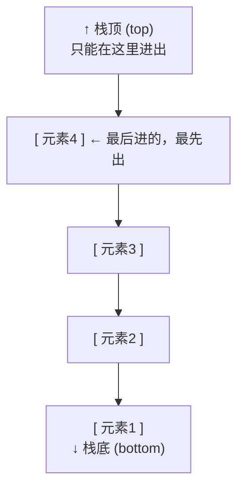
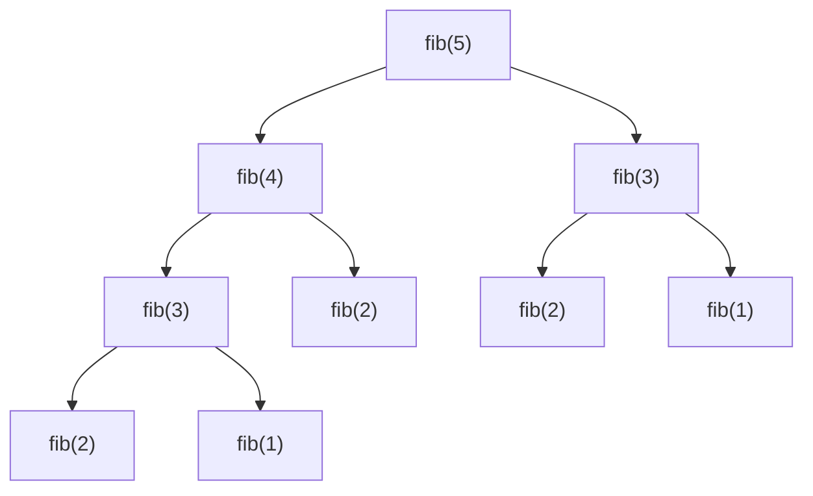
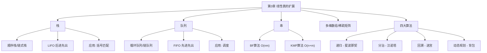

# 第 3 章　线性表的扩展

> **本章目标**：学会三种"受限的线性表"——**栈**、**队列**、**串**，以及**多维数组**和**稀疏矩阵**；再用它们解决四大经典算法问题（**递归、分治、回溯、动态规划**）。
>
> **难度**：★★★★☆　**建议用时**：4～5 天
>
> **本章内容最多。** 栈和队列是基础必会；KMP 是经典难点；后面四大算法是"内功"，直接决定你能否做出有难度的题。

> **前置知识**：[第 2 章 线性表](02-线性表.md)（栈和队列都是"受限的线性表"）、[第 0 章 递归](00-C与C++基础回顾.md)
> **本章重点**：① 栈/队列的实现（3.2、3.3）② 递归→分治→回溯→动态规划这条算法主线（3.6）
> **下章铺垫**：**队列是第 5 章 BFS 的基础**，**递归是第 4 章树遍历的基础**
> **异常语法**：代码里的 `throw` 见[附录A 异常处理](附录A-异常处理.md)

---

## 3.1　各种扩展线性表

### 【一句话概括】

**普通线性表可以在任何位置插入删除；"扩展线性表"给操作加了限制——只能在特定位置操作。**

### 【为什么要有"限制"】

你可能会想：限制不是变弱了吗？

**恰恰相反**：**限制带来了效率和语义的清晰。**

| 数据结构 | 限制 | 带来什么 |
|---|---|---|
| **栈** | 只能在一端（栈顶）操作 | "后进先出"的语义，解决括号匹配、函数调用 |
| **队列** | 一端进、另一端出 | "先进先出"的语义，解决排队、调度 |
| **串** | 元素是字符，整体操作 | 文本处理、模式匹配 |

**生活类比**：
- **栈** = 一摞盘子。你只能从**最上面**拿，也只能往**最上面**放。
- **队列** = 排队买奶茶。你从**队尾**加入，从**队头**离开。
- **串** = 一串字符，比如"hello world"。

### 3.1.1　栈

#### 【定义】

**栈（Stack）**：只允许在**一端**进行插入和删除的线性表。

- 允许操作的那一端叫 **栈顶（top）**
- 另一端叫 **栈底（bottom）**
- 插入叫 **入栈 / 进栈 / push**
- 删除叫 **出栈 / 退栈 / pop**

#### 【图示】



**核心特点：后进先出（LIFO, Last In First Out）**

#### 【生活类比】

**一摞盘子**：
1. 你放盘子只能放在最上面（入栈）
2. 你拿盘子也只能从最上面拿（出栈）
3. **最后放上去的盘子，最先被拿走**

**再比如浏览器后退按钮**：
- 你访问 A → B → C
- 点"后退"→ 回到 B
- 再点"后退"→ 回到 A
- **最后访问的页面，最先被"退"回去** —— 这就是栈！

### 3.1.2　队列

#### 【定义】

**队列（Queue）**：只允许在**一端插入**、在**另一端删除**的线性表。

- 允许**插入**的一端叫 **队尾（rear）**
- 允许**删除**的一端叫 **队头（front）**

#### 【图示】

```
出队 ← [a₁][a₂][a₃][a₄] ← 入队
       ↑                ↑
     队头(front)      队尾(rear)
```

**核心特点：先进先出（FIFO, First In First Out）**

#### 【生活类比】

**排队买奶茶**：
- 新来的人排在**队尾**（入队）
- 买到奶茶的人从**队头**离开（出队）
- **先来的先买到** —— 这就是队列！

**再比如打印机任务队列**：
- 你发的文档排到队尾
- 打印机按顺序一个个处理
- 先发的先打印

### 3.1.3　串

#### 【定义】

**串（String）**：由**零个或多个字符**组成的有限序列。

```
S = "hello"
```
- 串名：S
- 串值："hello"
- 串长：5（字符个数）
- **空串**：长度为 0 的串，记作 `""`
- **空格串**：由一个或多个空格组成，如 `"   "`（**注意：空格串不是空串！**）

#### 【几个重要术语】

| 术语 | 含义 | 例子 |
|---|---|---|
| **子串** | 串中任意个连续字符组成的子序列 | "ell" 是 "hello" 的子串 |
| **主串** | 包含子串的那个串 | "hello" 是 "ell" 的主串 |
| **位置** | 子串在主串中第一次出现的起始位置 | "ll" 在 "hello" 中的位置是 3 |

#### 【⚠ 空串 vs 空格串（常考）】

```
空串:   ""      长度 0，什么都没存
空格串: "   "   长度 3，存了 3 个空格字符
```

**它们是不同的！** 空串什么都没有，空格串有内容（只是内容是空格）。

#### 【串 vs 线性表】

串本质上就是"**元素类型限定为字符**的线性表"。但它有自己的特点：

**串的操作通常以"整体"为单位**，而不是一个个字符。

比如：
- 找子串（模式匹配）
- 求子串
- 串连接
- 串替换

这些操作比"在第 i 个位置插入字符"更常用。

### 3.1.4　多维数组

#### 【定义】

**数组**：元素类型相同、个数固定的一组数据。

- **一维数组**：`a[5]` —— 就是线性表
- **二维数组**：`a[3][4]` —— 3 行 4 列
- **多维数组**：`a[2][3][4]` —— 以此类推

#### 【二维数组在内存里怎么存？】

**关键**：内存是**一维**的（一条线），二维数组必须"**拍扁**"成一维。

**两种拍法**：

**① 行优先（Row-major）**——C/C++ 采用

```
a[2][3] = {{1,2,3}, {4,5,6}}

内存中:  1  2  3  4  5  6
         └─第0行─┘└─第1行─┘
```

**② 列优先（Column-major）**——Fortran/MATLAB 采用

```
内存中:  1  4  2  5  3  6
         └第0列┘└第1列┘└第2列┘
```

#### 【地址计算公式】（考试常考）

以**行优先**为例，`a[m][n]` 中元素 `a[i][j]` 的地址：

```
地址 = 基址 + (i × n + j) × 每个元素大小
```

**验证**：`a[3][4]`，求 `a[1][2]` 的地址（基址 1000，每个元素 4 字节）：

```
地址 = 1000 + (1 × 4 + 2) × 4 = 1000 + 6 × 4 = 1024
```

**理解**：`a[1][2]` 前面有"第 0 行的 4 个元素" + "第 1 行的前 2 个元素" = 6 个元素。

#### 【为什么这很重要】

因为**多维数组的存储方式决定了访问效率**。
- 如果按**行**访问（一行行遍历），效率高（内存连续）
- 如果按**列**访问，效率低（要跳着访问，会频繁加载内存页）

这是"**程序局部性原理**"的一个实际应用。

### 【本节自测】

**3-1-1.** 栈和队列的主要区别是什么？各举一个生活中的例子。
<details><summary>答案</summary>
<p><strong>区别在操作端</strong>：</p>
<ul>
<li><strong>栈</strong>：只在<strong>一端</strong>插入和删除 → <strong>后进先出（LIFO）</strong></li>
<li><strong>队列</strong>：<strong>一端插入、另一端删除</strong> → <strong>先进先出（FIFO）</strong></li>
</ul>
<p><strong>生活例子</strong>：</p>
<ul>
<li>栈：一摞盘子（最后放的先拿走）、浏览器后退按钮</li>
<li>队列：排队买奶茶、打印机任务队列</li>
</ul>
</details>

**3-1-2.** 空串和空格串有什么区别？
<details><summary>答案</summary>
<ul>
<li><strong>空串</strong>：长度为 0 的串，写作 <code>&quot;&quot;</code>，<strong>什么字符都没有</strong>。</li>
<li><strong>空格串</strong>：由一个或多个空格组成的串，如 <code>&quot;   &quot;</code>（3 个空格），<strong>长度是 3</strong>。</li>
</ul>
<p><strong>关键区别</strong>：空串长度为 0，空格串长度 &gt; 0（内容是空格字符）。</p>
<p><strong>为什么容易错？</strong> 因为打印出来都像是&quot;空白&quot;，但它们在计算机里完全不同（一个占 0 字节，一个占 3 字节）。</p>
</details>

**3-1-3.** 二维数组 `a[3][4]` 按行优先存储，基址为 1000，每个元素占 2 字节。求 `a[2][1]` 的地址。
<details><summary>答案</summary>
<p><strong>地址 = 1018</strong></p>
<p>用公式计算：</p><pre><code>地址 = 基址 + (i × n + j) × 元素大小
     = 1000 + (2 × 4 + 1) × 2
     = 1000 + (8 + 1) × 2
     = 1000 + 9 × 2
     = 1018
</code></pre><p><strong>直观理解</strong>：<code>a[2][1]</code> 前面有 9 个元素（第 0 行 4 个 + 第 1 行 4 个 + 第 2 行的第 1 个），所以偏移 <code>9 × 2 = 18</code> 字节，地址 <code>1000 + 18 = 1018</code>。</p>
<p><strong>易错点</strong>：不要忘了乘&quot;元素大小&quot;（这里是 2 字节，不是 1）。</p>
</details>

---

## 3.2　栈的实现

### 3.2.1　顺序栈

#### 【一句话概括】

**顺序栈 = 用数组实现的栈**，用一个变量 `top` 记录栈顶位置。

#### 【核心设计】

```cpp
const int MAX = 100;
T data[MAX];    // 存数据的数组
int top;        // 栈顶下标
```

**`top` 的含义**（有两种约定，本笔记统一用第一种）：

| 约定 | `top` 指向 | 空栈条件 | 满栈条件 |
|---|---|---|---|
| **方案A** ★ | 栈顶元素本身 | `top == -1` | `top == MAX-1` |
| 方案B | 栈顶元素的**下一个**空位 | `top == 0` | `top == MAX` |

**方案 A 图示**（栈里存了 3 个元素 a、b、c）：

```
下标:   0    1    2    3    4    5
      ┌────┬────┬────┬────┬────┬────┐
      │ a  │ b  │ c  │    │    │    │
      └────┴────┴────┴────┴────┴────┘
               ↑
              top = 2

空栈:  top = -1（top 指向栈顶元素，-1 表示没有元素）
满栈:  top = MAX-1
入栈:  top++; data[top] = x;
出栈:  x = data[top]; top--;
```

#### 【代码实现】

```cpp
template <class T>
class SeqStack {
private:
    T*  data;       // 动态数组
    int maxSize;    // 最大容量
    int top;        // 栈顶下标（-1 表示空栈）

public:
    SeqStack(int size = 100) {
        maxSize = size;
        data = new T[maxSize];
        top = -1;               // ★ 空栈标志
    }

    ~SeqStack() { delete[] data; }

    // 判空
    bool Empty() const { return top == -1; }

    // 判满
    bool Full() const { return top == maxSize - 1; }

    // 入栈 O(1)
    void Push(T x) {
        if (Full()) { cout << "栈已满" << endl; return; }
        data[++top] = x;        // ★ 先移动 top，再放数据
    }

    // 出栈 O(1)
    T Pop() {
        if (Empty()) { cout << "栈已空" << endl; return T(); }
        return data[top--];     // ★ 先取数据，再移动 top
    }

    // 取栈顶（不删除）O(1)
    T Top() const {
        if (top == -1) return T();
        return data[top];
    }

    // 求栈中元素个数
    int Size() const { return top + 1; }
};
```

#### 【⚠ 易错点：`++top` 和 `top++`】

```cpp
// 入栈：要用前置 ++
data[++top] = x;     // 等价于 top = top + 1; data[top] = x;

// 出栈：要用后置 --
return data[top--];  // 等价于 { T tmp = data[top]; top = top - 1; return tmp; }
```

**记忆方法**：
- 入栈：**先把 top 抬上去，再放东西**（先 `++`）
- 出栈：**先把东西拿出来，再把 top 降下去**（后 `--`）

#### 【所有操作都是 O(1)】

| 操作 | 复杂度 |
|---|---|
| 入栈 Push | **O(1)** ★ |
| 出栈 Pop | **O(1)** ★ |
| 取栈顶 Top | **O(1)** ★ |
| 判空/判满 | O(1) |

**这就是栈的优势**：所有操作都是常数时间。

### 3.2.2　链式栈

#### 【一句话概括】

**链式栈 = 用链表实现的栈**，通常以链表头部作为栈顶。

#### 【为什么用链表头当栈顶？】

因为链表的**头插和头删都是 O(1)**！

```
栈顶 → [c] → [b] → [a] → NULL
       ↑头节点方向

入栈 = 头插（O(1)）
出栈 = 头删（O(1)）
```

**如果以尾部当栈顶会怎样？** 尾插需要遍历到末尾（O(n)），效率低。**所以链式栈必须用头部当栈顶。**

#### 【代码实现】

```cpp
template <class T>
struct StackNode {
    T data;
    StackNode* next;
};

template <class T>
class LinkStack {
private:
    StackNode<T>* top;    // 指向栈顶节点

public:
    LinkStack() { top = nullptr; }
    ~LinkStack() {
        while (top != nullptr) {
            StackNode<T>* p = top;
            top = top->next;
            delete p;
        }
    }

    bool Empty() const { return top == nullptr; }

    // 入栈 = 头插 O(1)
    void Push(T x) {
        StackNode<T>* s = new StackNode<T>;
        s->data = x;
        s->next = top;      // 新节点指向原栈顶
        top = s;            // 栈顶指针移到新节点
    }

    // 出栈 = 头删 O(1)
    T Pop() {
        if (Empty()) { cout << "栈空" << endl; return T(); }
        T x = top->data;
        StackNode<T>* p = top;
        top = top->next;
        delete p;
        return x;
    }

    T Top() const { return top ? top->data : T(); }
};
```

#### 【顺序栈 vs 链式栈】

| | 顺序栈 | 链式栈 |
|---|---|---|
| 空间 | 需预分配，可能溢出 | 按需分配 |
| 时间 | 全部 O(1) | 全部 O(1) |
| 额外开销 | 无 | 每个节点多一个指针 |
| 适用 | 栈的大小可预估 | 栈的大小变化大 |

### 3.2.3　STL 中的栈——stack

```cpp
#include <iostream>
#include <stack>
using namespace std;

int main() {
    stack<int> s;

    s.push(1);          // 入栈
    s.push(2);
    s.push(3);

    cout << s.top() << endl;   // 3（只查看，不删除）
    cout << s.size() << endl;  // 3

    s.pop();                   // 出栈（★ 没有返回值！）
    cout << s.top() << endl;   // 2

    cout << s.empty() << endl; // 0（false，非空）
}
```

#### 【⚠ STL stack 的三个注意点】

1. **`pop()` 不返回值**！它只负责删除元素。
   ```cpp
   // ❌ 错误
   int x = s.pop();
   
   // ✓ 正确
   int x = s.top();   // 先取值
   s.pop();           // 再删除
   ```

2. **不能遍历**！`stack` 没有迭代器，只能通过 `top()` + `pop()` 逐个访问。

3. **`empty()` 前要先判空**，否则 `top()` 是未定义行为。

### 【顺序栈的经典应用：括号匹配】

**问题**：判断一个字符串里的括号是否匹配。例如 `"((()))"` 匹配，`"(()"` 不匹配。

**思路**：
- 遇到左括号 → 入栈
- 遇到右括号 → 看栈顶是不是对应的左括号，是就出栈，不是就不匹配
- 最后栈为空 → 匹配

```cpp
bool checkBrackets(const string& s) {
    stack<char> st;
    for (char c : s) {
        if (c == '(' || c == '[' || c == '{') {
            st.push(c);                        // 左括号入栈
        } else if (c == ')' || c == ']' || c == '}') {
            if (st.empty()) return false;      // 右括号但栈空 → 不匹配
            char t = st.top();
            if ((c == ')' && t == '(') ||
                (c == ']' && t == '[') ||
                (c == '}' && t == '{')) {
                st.pop();                      // 配对成功，出栈
            } else {
                return false;                  // 类型不匹配
            }
        }
    }
    return st.empty();   // 栈空才说明全部匹配
}
```

> 完整代码见 `code/03_栈.cpp`。

### 【本节自测】

**3-2-1.** 顺序栈中 `top == -1` 表示什么？`top == maxSize-1` 表示什么？
<details><summary>答案</summary>
<ul>
<li><code>top == -1</code>：<strong>空栈</strong>（没有任何元素）</li>
<li><code>top == maxSize - 1</code>：<strong>栈满</strong>（数组最后一个位置也被占了）</li>
</ul>
<p><strong>为什么用 -1 表示空栈？</strong> 因为 <code>top</code> 是&quot;栈顶元素的下标&quot;，没有元素时下标不存在，用 -1 表示。</p>
<p>（如果采用&quot;top 指向栈顶下一个空位&quot;的方案，则是 <code>top == 0</code> 表示空栈。）</p>
</details>

**3-2-2.** 依次执行：push(1), push(2), push(3), pop(), push(4), pop(), pop()。最后栈里有什么？每次 pop 返回什么？
<details><summary>答案</summary>
<table>
<thead>
<tr>
<th>操作</th>
<th>栈内容（底→顶）</th>
<th>pop 返回值</th>
</tr>
</thead>
<tbody>
<tr>
<td>push(1)</td>
<td>1</td>
<td></td>
</tr>
<tr>
<td>push(2)</td>
<td>1, 2</td>
<td></td>
</tr>
<tr>
<td>push(3)</td>
<td>1, 2, 3</td>
<td></td>
</tr>
<tr>
<td>pop()</td>
<td>1, 2</td>
<td><strong>3</strong></td>
</tr>
<tr>
<td>push(4)</td>
<td>1, 2, 4</td>
<td></td>
</tr>
<tr>
<td>pop()</td>
<td>1, 2</td>
<td><strong>4</strong></td>
</tr>
<tr>
<td>pop()</td>
<td>1</td>
<td><strong>2</strong></td>
</tr>
</tbody>
</table>
<p><strong>最后栈里剩：1</strong></p>
<p><strong>pop 返回值顺序：3, 4, 2</strong></p>
<p><strong>关键</strong>：pop 总是返回<strong>最后 push 进来的</strong>（后进先出）。</p>
</details>

**3-2-3.** 为什么链式栈要用"链表头部"作栈顶，而不是尾部？
<details><summary>答案</summary>
<p>因为<strong>头部操作是 O(1)，尾部操作是 O(n)</strong>。</p>
<ul>
<li><strong>头部作栈顶</strong>：
<ul>
<li>入栈 = 头插，只需改两个指针 → <strong>O(1)</strong></li>
<li>出栈 = 头删，只需改一个指针 → <strong>O(1)</strong></li>
</ul>
</li>
<li><strong>尾部作栈顶</strong>：
<ul>
<li>入栈要遍历到末尾才能插 → O(n)</li>
<li>出栈（单链表）也要找前驱 → O(n)</li>
</ul>
</li>
</ul>
<p><strong>所以链式栈必然用头部当栈顶。</strong></p>
<p>（如果维护一个 <code>rear</code> 指针，尾插可以 O(1)，但单链表的尾删仍需 O(n)，所以还是头部更好。）</p>
</details>

**3-2-4.** 用栈判断字符串 `"([)]"` 的括号是否匹配。
<details><summary>答案</summary>
<p><strong>不匹配。</strong></p>
<p>逐步分析：</p>
<table>
<thead>
<tr>
<th>字符</th>
<th>操作</th>
<th>栈内容（底→顶）</th>
</tr>
</thead>
<tbody>
<tr>
<td><code>(</code></td>
<td>入栈</td>
<td><code>(</code></td>
</tr>
<tr>
<td><code>[</code></td>
<td>入栈</td>
<td><code>( [</code></td>
</tr>
<tr>
<td><code>)</code></td>
<td>检查栈顶是 <code>[</code>，与 <code>)</code> 不配对 → <strong>返回 false</strong></td>
<td></td>
</tr>
</tbody>
</table>
<p><strong>关键</strong>：虽然左右括号数量相等，但<strong>嵌套顺序错了</strong>。<code>[</code> 还在栈里没出去，就来 <code>)</code>，说明交叉了。</p>
<p><strong>正确的匹配要求</strong>：括号必须<strong>正确嵌套</strong>，不能交叉。</p>
</details>

---

## 3.3　队列的实现

### 3.3.1　循环队列 ⭐

#### 【先看"朴素队列"的问题】

用数组存队列，设两个指针：
- `front`：队头下标
- `rear`：队尾下标

**问题 1：队头固定时，出队要移动所有元素**

```
出队前:  [a1][a2][a3][a4][ ][ ]
          ↑front        ↑rear

a1 出队后（朴素做法）:  [a2][a3][a4][ ][ ][ ]
                         ↑front     ↑rear
（所有元素都往前挪了一格，O(n)）

正确做法:  [ ][a2][a3][a4][ ][ ]
              ↑front      ↑rear
（只移动 front 指针，O(1)）
```

**问题 2：front 后移后，前面的空间浪费了**

```
经过多次入队出队后:
[ ][ ][ ][x][y][ ]
 ↑front        ↑rear

前面 3 个位置空着，但 rear 已经到底，无法再入队！——假溢出
```

#### 【解决方案：循环队列】

**把数组看成"环形"，rear 到底了就绕回开头。**

```
      ┌───────────────────┐
      │  0   1   2   3   4  │
      │ [ ][a2][a3][a4][ ]  │
      └───────────────────┘
         ↑front     ↑rear
         
rear 走到 5 时，绕回到 0：
      ┌───────────────────┐
      │  0   1   2   3   4  │
      │ [a5][a2][a3][a4][ ] │
      └───────────────────┘
              ↑front  ↑rear（绕回来了）
```

**实现方式**：用取模运算 `%`

```cpp
rear = (rear + 1) % maxSize;    // 走到末尾就绕回 0
front = (front + 1) % maxSize;
```

#### 【⚠ 循环队列的核心难点：怎么区分"空"和"满"】

**问题**：在循环队列里，`front == rear` 既可能是"空"也可能是"满"！

```
空队列:  [ ][ ][ ][ ][ ]
          ↑
        front == rear == 0

满队列:  [a][b][c][d][e]
          ↑
        front == rear == 0（转了一圈又碰上了）
```

**两种判断一样，没法区分！**

#### 【三种解决方案】

**方案 1：少用一个空间**（最常用）★

规定：**最多存 `maxSize - 1` 个元素**，留一个空位用来区分。

```
队空条件:  front == rear
队满条件:  (rear + 1) % maxSize == front
```

**图示**（maxSize = 5，存 4 个就满了）：

```
满:  [a][b][c][d][ ]
      ↑front        ↑rear
     rear 的下一个是 front → 满

空:  [ ][ ][ ][ ][ ]
      ↑
     front == rear → 空
```

**方案 2：加一个计数器 `size`**

```cpp
int size;   // 当前元素个数

队空:  size == 0
队满:  size == maxSize
```

**方案 3：加一个标志位 `tag`**

```cpp
int tag;   // 0 表示最近是"出队"操作，1 表示最近是"入队"

队空:  front == rear && tag == 0
队满:  front == rear && tag == 1
```

> **本笔记采用方案 1**（教材也常用），因为不需要额外变量。

#### 【代码实现】

```cpp
template <class T>
class CirQueue {
private:
    T*  data;
    int maxSize;
    int front;    // 队头下标
    int rear;     // 队尾下标（指向"下一个空位"）

public:
    CirQueue(int size = 100) {
        maxSize = size;
        data = new T[maxSize];
        front = rear = 0;
    }

    ~CirQueue() { delete[] data; }

    // 判空
    bool Empty() const { return front == rear; }

    // 判满（★ 留一个空位）
    bool Full() const { return (rear + 1) % maxSize == front; }

    // 入队：在队尾 O(1)
    void EnQueue(T x) {
        if (Full()) { cout << "队满" << endl; return; }
        data[rear] = x;
        rear = (rear + 1) % maxSize;   // ★ 循环后移
    }

    // 出队：从队头 O(1)
    T DeQueue() {
        if (Empty()) { cout << "队空" << endl; return T(); }
        T x = data[front];
        front = (front + 1) % maxSize; // ★ 循环后移
        return x;
    }

    // 取队头（不删除）
    T Front() const {
        if (Empty()) return T();
        return data[front];
    }

    // 元素个数
    int Size() const {
        return (rear - front + maxSize) % maxSize;   // ★ 注意加 maxSize 处理负数
    }
};
```

#### 【关键细节：`(rear - front + maxSize) % maxSize`】

**为什么要 `+ maxSize`？**

因为 `rear - front` 可能是负数！

```
例子: maxSize=5, front=4, rear=1
     rear - front = 1 - 4 = -3   （负数，取模结果不对）
     
     (1 - 4 + 5) % 5 = 2 % 5 = 2   ✓ 正确（确实有 2 个元素）
```

#### 【手工模拟循环队列】

`maxSize = 5`（实际只能存 4 个）：

| 操作 | data 内容 | front | rear | 说明 |
|---|---|---|---|---|
| 初始 | `[ ][ ][ ][ ][ ]` | 0 | 0 | 空 |
| EnQueue(1) | `[1][ ][ ][ ][ ]` | 0 | 1 | |
| EnQueue(2) | `[1][2][ ][ ][ ]` | 0 | 2 | |
| EnQueue(3) | `[1][2][3][ ][ ]` | 0 | 3 | |
| EnQueue(4) | `[1][2][3][4][ ]` | 0 | 4 | |
| EnQueue(5) | —— | 0 | 4 | **队满**！`(4+1)%5 = 0 == front` |
| DeQueue() → 1 | `[ ][2][3][4][ ]` | 1 | 4 | |
| EnQueue(5) | `[5][2][3][4][ ]` | 1 | 0 | **绕回去了！** |
| DeQueue() → 2 | `[5][ ][3][4][ ]` | 2 | 0 | |

**观察**：`rear` 从 4 变成了 0，实现了"循环"。

### 3.3.2　链队列

#### 【一句话概括】

**链队列 = 用链表实现的队列**，需要两个指针：`front`（队头）和 `rear`（队尾）。

#### 【设计要点】

```
front → [头节点] → [a1] → [a2] → [a3] → NULL
                    ↑                 ↑
                 队头元素           rear（队尾）
```

**为什么要两个指针？**
- **出队**在队头：需要 `front` → O(1)
- **入队**在队尾：需要 `rear` → O(1)

**如果只有 `front`**：入队要遍历到尾部，O(n)。所以必须维护 `rear`。

#### 【代码实现】

```cpp
template <class T>
struct QNode {
    T data;
    QNode* next;
};

template <class T>
class LinkQueue {
private:
    QNode<T>* front;   // 队头指针（指向头节点）
    QNode<T>* rear;    // 队尾指针（指向最后一个节点）

public:
    LinkQueue() {
        front = rear = new QNode<T>;   // 创建头节点
        front->next = nullptr;
    }

    ~LinkQueue() {
        while (front != nullptr) {
            QNode<T>* p = front;
            front = front->next;
            delete p;
        }
    }

    bool Empty() const { return front == rear; }

    // 入队：在队尾 O(1)
    void EnQueue(T x) {
        QNode<T>* s = new QNode<T>;
        s->data = x;
        s->next = nullptr;
        rear->next = s;      // ★ 接到队尾
        rear = s;            // ★ rear 后移
    }

    // 出队：在队头 O(1)
    T DeQueue() {
        if (Empty()) { cout << "队空" << endl; return T(); }
        QNode<T>* p = front->next;   // 队头元素
        T x = p->data;
        front->next = p->next;       // 摘掉
        // ★ 如果删的是最后一个节点，要修正 rear
        if (rear == p) rear = front;
        delete p;
        return x;
    }

    T Front() const {
        if (Empty()) return T();
        return front->next->data;
    }
};
```

#### 【⚠ 链队列最容易漏的一步】

**出队时如果删掉了最后一个节点，必须把 `rear` 重新指向头节点！**

```cpp
if (rear == p) rear = front;   // ★ 关键！
```

**如果不写会怎样？**

```
出队前:  front → [头] → [a1] → NULL
                        ↑
                       rear

出队 a1 后（忘了修正 rear）:
         front → [头] → NULL
                  ↑
                rear（悬空指针！指向已删除的节点）

再入队:  rear->next = s;   // 💥 访问已释放的内存，崩溃！
```

**这是链队列最经典的 bug。**

### 3.3.3　STL 中的队列——queue

```cpp
#include <iostream>
#include <queue>
using namespace std;

int main() {
    queue<int> q;

    q.push(1);              // 入队
    q.push(2);
    q.push(3);

    cout << q.front() << endl;  // 1（队头）
    cout << q.back() << endl;   // 3（队尾）
    cout << q.size() << endl;   // 3

    q.pop();                    // 出队（★ 同样不返回值）
    cout << q.front() << endl;  // 2

    cout << q.empty() << endl;  // 0
}
```

#### 【STL 的 `priority_queue`（优先队列）】

教材在 3.7 节提到了优先级队列。它不是"先进先出"，而是"**优先级最高的先出**"。

```cpp
#include <queue>
priority_queue<int> pq;        // 默认大顶堆（最大的先出）

pq.push(3);
pq.push(1);
pq.push(5);

cout << pq.top() << endl;   // 5（最大的）
pq.pop();
cout << pq.top() << endl;   // 3

// 小顶堆（最小的先出）
priority_queue<int, vector<int>, greater<int>> minPQ;
```

**底层实现是"堆"**（第 7 章会讲堆排序）。

**应用场景**：
- 任务调度（优先级高的先执行）
- 求第 K 大的元素
- 合并 K 个有序链表

### 【本节自测】

**3-3-1.** 循环队列中，为什么 `front == rear` 不能作为"队满"的判断条件？
<details><summary>答案</summary>
<p>因为在循环队列中，<strong><code>front == rear</code> 既能表示&quot;空&quot;，也能表示&quot;满&quot;</strong>：</p><pre><code>空队列（转了一圈又回来）:  front == rear
满队列（绕了一整圈）:      front == rear
</code></pre><p><strong>无法区分！</strong></p>
<p><strong>解决办法</strong>（任选一种）：</p>
<ol>
<li><strong>少用一个空间</strong>（最常用）：最多存 <code>maxSize-1</code> 个。判满条件改为 <code>(rear+1) % maxSize == front</code>。</li>
<li>加一个计数器 <code>size</code>。</li>
<li>加一个标志位 <code>tag</code>。</li>
</ol>
</details>

**3-3-2.** 循环队列 `maxSize = 6`，当前 `front = 4, rear = 1`。队列里有多少个元素？
<details><summary>答案</summary>
<p><strong>3 个元素。</strong></p>
<p>用公式：</p><pre><code>size = (rear - front + maxSize) % maxSize
     = (1 - 4 + 6) % 6
     = 3 % 6
     = 3
</code></pre><p><strong>为什么不能直接 <code>rear - front</code>？</strong> 因为 <code>1 - 4 = -3</code> 是负数，算出来不对。加 <code>maxSize</code> 后变正数，再取模就对了。</p>
<p><strong>图示验证</strong>：</p><pre><code>下标:  0   1   2   3   4   5
      [ ][x][x][x][ ][ ]
            ↑rear     ↑front
从 front=4 走到 rear=1（绕一圈）: 4→5→0→1，经过 3 个位置
但元素在 1,2,3 位置（因为 rear 指向&quot;下一个空位&quot;）
✓ 3 个元素
</code></pre>
</details>

**3-3-3.** 链队列出队时，为什么有时要执行 `if (rear == p) rear = front;`？
<details><summary>答案</summary>
<p>因为<strong>当出队的是队列中最后一个节点时，<code>rear</code> 会变成悬空指针</strong>。</p>
<p><strong>场景</strong>：</p><pre><code>出队前:  front → [头] → [a1] → NULL
                        ↑
                       rear&#10;
出队 a1 后，如果没有修正 rear:
         front → [头] → NULL
                  ↑
                rear  ❌ 还指向已被 delete 的 a1！
</code></pre><p><strong>后果</strong>：下次入队时执行 <code>rear-&gt;next = s</code>，访问<strong>已释放的内存</strong> → 崩溃或数据错乱。</p>
<p><strong>修正</strong>：如果删除的节点正是 <code>rear</code> 指向的节点，就把 <code>rear</code> 拉回头节点。</p><pre><code class="language-cpp">if (rear == p) rear = front;   // ★ 必须是这个顺序（在 delete p 之前）
delete p;
</code></pre><p><strong>这是链队列实现中最容易漏掉的一步。</strong></p>
</details>

**3-3-4.** `stack` 的 `pop()` 和 `queue` 的 `pop()` 都"不返回值"，为什么要这样设计？
<details><summary>答案</summary>
<p><strong>为了性能和异常安全。</strong></p>
<p><strong>原因 1：避免不必要的拷贝</strong>
如果 <code>pop()</code> 返回值，就必须先把元素<strong>拷贝</strong>出来再删除。对于大对象，这是一次昂贵的拷贝。</p>
<p><strong>原因 2：异常安全</strong>
如果拷贝过程中抛异常，元素已经删了但没成功返回，数据就丢了。</p>
<p><strong>所以标准库的约定是</strong>：<code>top()/front()</code> 负责&quot;看&quot;，<code>pop()</code> 负责&quot;删&quot;，两步分开：</p><pre><code class="language-cpp">int x = s.top();    // ① 取值（不删除）
s.pop();            // ② 删除
</code></pre><p><strong>这是 C++ 标准库的设计哲学</strong>，其他语言（如 Python 的 <code>list.pop()</code> 返回元素）不一定如此，注意区分。</p>
</details>

---

## 3.4　串的实现

### 3.4.1　串的存储结构

**串本质是字符的线性表**，所以存储方式也类似。

| 存储方式 | 说明 |
|---|---|
| **顺序存储** | 用 `char` 数组，如 `char s[100]` |
| **链式存储** | 每个节点存一个或多个字符 |

**实际中顺序存储更常用**（因为字符处理通常是整块的，链式反而更麻烦）。

```cpp
// C 风格：字符数组 + '\0' 结尾
char s1[] = "hello";      // 实际占 6 字节（末尾有 '\0'）

// C++ 风格：string 类
string s2 = "hello";      // 自动管理长度
```

### 3.4.2　串的模式匹配（BF 算法）

#### 【问题定义】

**模式匹配**：在主串 S 中查找子串 T 第一次出现的位置。

**例子**：
```
主串 S = "aacaaba"
子串 T = "aab"
问：T 在 S 中的哪个位置？

答：位置 5（从 1 开始计数）：a a c a a b a
                                  ↑↑↑
                                  从第5位开始是 "aab"
```

#### 【暴力算法（BF, Brute Force）】

**思路**：主串的每个位置都试一遍，看能不能匹配上。

```cpp
int BF(const string& s, const string& t) {
    int i = 0, j = 0;
    while (i < (int)s.size() && j < (int)t.size()) {
        if (s[i] == t[j]) {
            i++; j++;                   // 匹配成功，都比下一个
        } else {
            i = i - j + 1;              // ★ 主串回溯到"本次起始位置的下一个"
            j = 0;                      // ★ 子串回到开头
        }
    }
    if (j >= (int)t.size()) return i - j + 1;   // 匹配成功，返回位置（1-based）
    return 0;                                     // 失败
}
```

#### 【手工模拟】

```
S = "aacaaba"   T = "aab"

第1轮: i=0,j=0  a==a ✓  → i=1,j=1
       i=1,j=1  a==a ✓  → i=2,j=2
       i=2,j=2  c!=b ✗  → i 回溯到 1, j 回到 0

第2轮: i=1,j=0  a==a ✓  → i=2,j=1
       i=2,j=1  c!=a ✗  → i 回溯到 2, j 回到 0

第3轮: i=2,j=0  c!=a ✗  → i 回溯到 3, j 回到 0

第4轮: i=3,j=0  a==a ✓  → i=4,j=1
       i=4,j=1  a==a ✓  → i=5,j=2
       i=5,j=2  b==b ✓  → i=6,j=3 (j 到末尾，匹配成功!)
       
返回 i-j+1 = 6-3+1 = 4（0-based 的 3，对应 1-based 的第 4 位）

S = a a c a a b a
    1 2 3 4 5 6 7   （1-based）

"aab" 匹配的位置：从第 4 位开始 a a b ✓
```

#### 【BF 算法的时间复杂度】

- **最好情况**：O(n)（第一次就匹配上）
- **最坏情况**：**O(n × m)**（n 是主串长，m 是子串长）

**最坏情况的例子**：
```
S = "aaaaaaaaaab"   (10个a + 1个b)
T = "aaab"          (3个a + 1个b)

每一轮都要比较 m 次才发现失败，共 n 轮 → O(n×m)
```

#### 【BF 的缺点】

**每次失败，主串指针 `i` 都要回溯**（退回到本次起始位置的下一个）。

**这些回溯很多是浪费的！** 这就引出了 KMP 算法。

### 3.4.3　KMP 算法 ⭐ 经典难点

#### 【一句话概括】

**KMP 算法 = 让主串指针永不回溯的模式匹配算法。**

#### 【先理解 KMP 想解决什么】

看 BF 的一个低效场景：

```
主串:   a a a b a a a b
子串:   a a a b
                 ↑
             前 3 个 'a' 都匹配上了，第 4 个失败

BF 的做法: 主串退回到第 2 个位置，子串回到开头，重新比较
KMP 的想法: 前 3 个 'a' 已经知道是什么了，能不能不退回？
```

**KMP 的关键洞察**：

当在位置 j 失配时，我们**已经知道**子串的前 j-1 个字符和主串对应位置是相同的。

**利用这个"已知信息"，可以让子串多滑一段，避免无谓的比较。**

#### 【两个核心概念】

**① 前缀**：从字符串**开头**开始的连续子串（不含最后一个字符）

```
"abab" 的前缀: "a", "ab", "aba"
```

**② 后缀**：到字符串**结尾**的连续子串（不含第一个字符）

```
"abab" 的后缀: "b", "ab", "bab"
```

**③ 最长公共前后缀**：前缀和后缀中**相同且最长**的那个

```
"abab":
  前缀: a, ab, aba
  后缀: b, ab, bab
  公共: "ab"（长度 2）
  最长公共前后缀长度 = 2
```

#### 【`next` 数组：KMP 的灵魂】

**`next[j]` 的含义**：当子串的第 j 个字符失配时，**子串应该回溯到哪个位置**。

**计算规则**：
```
next[j] = 子串前 j-1 个字符的"最长公共前后缀长度" + 1
```

**以 `"aab"` 为例**：

| j | 前 j-1 个字符 | 最长公共前后缀 | next[j] |
|---|---|---|---|
| 1 | （无） | —— | **0**（特殊约定） |
| 2 | "a" | 0（没有公共前后缀） | **1** |
| 3 | "aa" | 1（"a"） | **2** |

**所以 `next = [0, 1, 2]`**（下标 1~3）。

**再看 `"abab"`**：

| j | 前 j-1 个字符 | 最长公共前后缀 | next[j] |
|---|---|---|---|
| 1 | —— | —— | **0** |
| 2 | "a" | 0 | **1** |
| 3 | "ab" | 0 | **1** |
| 4 | "aba" | 1（"a"） | **2** |

**所以 `next = [0, 1, 1, 2]`**。

**`next` 数组的物理意义**：

```
当第 j 位失配时，说明子串的前 j-1 位已经匹配了。
如果这 j-1 位里有"公共前后缀"，那么：
  前缀部分可以直接当作"已经匹配好的"，不用重新比！
所以子串跳到 next[j] 位置继续比。
```

#### 【KMP 匹配过程】

```cpp
// ★ 本笔记配套代码 03_KMP.cpp 采用的版本：next[0] = -1（0-based）
int KMP(const string& s, const string& t, const vector<int>& next) {
    int i = 0;   // 主串指针（★ 永不回溯！）
    int j = 0;   // 子串指针

    while (i < (int)s.size() && j < (int)t.size()) {
        if (j == -1 || s[i] == t[j]) {
            // j == -1 表示子串已退到开头之前，只能让主串前进一格重新开始
            i++;
            j++;
        } else {
            j = next[j];    // ★ 只有子串回溯，主串不动！
        }
    }
    if (j >= (int)t.size()) return i - j + 1;
    return 0;
}
```

> **⚠ 三种 next 约定（很重要，选了就必须全套统一）**
>
> | 约定 | `next[0]` 的值 | KMP 里的判据 | 说明 |
> |---|---|---|---|
> | **0-based + 哨兵** | **-1** | `if (j == -1 \|\| ...)` | ★ **本笔记配套代码用这个** |
> | 0-based | 0 | `if (j == 0 \|\| ...)` | 退到开头时靠 `j==0` 判断 |
> | 教材（1-based） | `next[1] = 0` | `if (j == 0 \|\| ...)` | 下标从 1 开始 |
>
> **核心思想三种写法完全相同**（主串不回溯 + 子串按 next 跳），**但代码细节不能混用**：
> - 如果你用 `next[0] = -1` 生成的数组，却写 `if (j == 0 || ...)`，程序会把"退到开头"误判成"匹配成功"，**结果全错**。
> - 反之亦然。
>
> **建议**：`buildNext()` 和 `KMP()` 两个函数**必须采用同一种约定**。
> 本笔记的配套代码 [`code/03_KMP.cpp`](code/03_KMP.cpp) 统一使用 **`next[0] = -1`** 这一种，
> 并已用 7 组数据与暴力算法 BF 对拍验证通过（结果完全一致）。

#### 【KMP 的复杂度】

| | BF | KMP |
|---|---|---|
| 时间复杂度 | O(n × m) | **O(n + m)** ★ |
| 主串是否回溯 | 是 | **否** |

**为什么 KMP 是 O(n+m)？**
- 求 `next` 数组：O(m)
- 匹配过程：主串 `i` 只前进不后退，最多走 n 步；子串 `j` 虽然有回溯，但总回溯次数不超过 n → O(n)
- 合计 **O(n + m)**

#### 【KMP 理解要点总结】

很多人学 KMP 卡住，是因为没抓住这三个点：

1. **为什么可以不回溯主串？** 因为失配时，我们已经知道子串的前 j-1 个字符与主串匹配。这些信息是"已知的"，不需要重新验证。

2. **`next` 数组是什么？** 它是"子串自身的性质"，记录"失配时该退到哪"。**只跟子串有关，跟主串无关。**

3. **`next[j]` 怎么算？** 就是"前 j-1 个字符的最长公共前后缀长度 + 1"。公共前后缀越长，能跳过的越多，效率越高。

> **小白建议**：KMP 理论看一遍有个印象就行。真正理解要靠**手工模拟几遍**（用 `"abab"` 和 `"aabaa"` 这样的串自己算 next，再走一遍匹配）。代码见 `code/03_KMP.cpp`，里面有详细的中间过程打印。

### 3.4.4　STL 中的串——string

```cpp
#include <iostream>
#include <string>
using namespace std;

int main() {
    string s = "hello world";

    // 长度
    cout << s.size() << endl;          // 11
    cout << s.length() << endl;        // 11（和 size 一样）

    // 取子串
    cout << s.substr(0, 5) << endl;    // "hello"

    // 查找（返回下标，找不到返回 string::npos）
    size_t pos = s.find("world");
    if (pos != string::npos) {
        cout << "found at " << pos << endl;   // 6
    }

    // 拼接
    s += "!";
    cout << s << endl;                 // "hello world!"

    // 拼接
    string t = "abc";
    t.append("def");
    cout << t << endl;                 // "abcdef"

    // 替换
    t.replace(0, 3, "XYZ");            // 把下标 0 开始的 3 个字符换成 "XYZ"
    cout << t << endl;                 // "XYZdef"

    // 比较（按字典序）
    cout << (string("abc") < string("abd")) << endl;  // 1（true）

    // 遍历
    for (char c : s) cout << c;
    cout << endl;

    // C 风格转换
    const char* cstr = s.c_str();
}
```

#### 【`string::npos` 是什么？】

它是 `string` 类的一个特殊常量，表示"**没找到**"。

```cpp
if (s.find("xyz") == string::npos) {
    cout << "没找到" << endl;
}
```

**注意**：`npos` 是一个很大的无符号数（通常是 `size_t(-1)`），**不要用 `int` 去接它**，会出问题。用 `size_t` 或 `auto`。

### 【本节自测】

**3-4-1.** BF 算法和 KMP 算法的主要区别是什么？
<details><summary>答案</summary>
<p><strong>核心区别：主串指针是否回溯。</strong></p>
<table>
<thead>
<tr>
<th></th>
<th>BF</th>
<th>KMP</th>
</tr>
</thead>
<tbody>
<tr>
<td><strong>主串回溯</strong></td>
<td>每次失配都回溯到本次起始位置的下一个</td>
<td><strong>永不回溯</strong> ★</td>
</tr>
<tr>
<td><strong>子串回溯</strong></td>
<td>回到开头（j=0）</td>
<td>回到 <code>next[j]</code>（可能不是开头）</td>
</tr>
<tr>
<td><strong>时间复杂度</strong></td>
<td>最坏 O(n×m)</td>
<td><strong>O(n+m)</strong></td>
</tr>
<tr>
<td><strong>额外空间</strong></td>
<td>O(1)</td>
<td>O(m)（存 next 数组）</td>
</tr>
</tbody>
</table>
<p><strong>KMP 的思想</strong>：利用&quot;已经匹配过的信息&quot;，避免重复比较。</p>
</details>

**3-4-2.** 求模式串 `"abaab"` 的 next 数组（1-based，next[1]=0）。
<details><summary>答案</summary>
<p><strong>next = [0, 1, 1, 2, 2]</strong>（下标 1~5）</p>
<p>计算过程：</p>
<table>
<thead>
<tr>
<th>j</th>
<th>前 j-1 个字符</th>
<th>前缀</th>
<th>后缀</th>
<th>最长公共前后缀</th>
<th>next[j]</th>
</tr>
</thead>
<tbody>
<tr>
<td>1</td>
<td>——</td>
<td>——</td>
<td>——</td>
<td>——</td>
<td><strong>0</strong>（约定）</td>
</tr>
<tr>
<td>2</td>
<td>&quot;a&quot;</td>
<td>无</td>
<td>无</td>
<td>0</td>
<td><strong>1</strong></td>
</tr>
<tr>
<td>3</td>
<td>&quot;ab&quot;</td>
<td>a</td>
<td>b</td>
<td>0</td>
<td><strong>1</strong></td>
</tr>
<tr>
<td>4</td>
<td>&quot;aba&quot;</td>
<td>a, ab</td>
<td>a, ba</td>
<td>&quot;a&quot;（长度1）</td>
<td><strong>2</strong></td>
</tr>
<tr>
<td>5</td>
<td>&quot;abaa&quot;</td>
<td>a, ab, aba</td>
<td>a, aa, baa</td>
<td>&quot;a&quot;（长度1）</td>
<td><strong>2</strong></td>
</tr>
</tbody>
</table>
<p><strong>所以 next = [0, 1, 1, 2, 2]</strong></p>
<p><strong>验证 j=5</strong>：前 4 个字符是 &quot;abaa&quot;</p>
<ul>
<li>前缀：<code>a</code>, <code>ab</code>, <code>aba</code></li>
<li>后缀：<code>a</code>, <code>aa</code>, <code>baa</code></li>
<li>公共的有：<code>a</code> → 长度 1</li>
<li>所以 next[5] = 1 + 1 = 2 ✓</li>
</ul>
</details>

**3-4-3.** 为什么说 KMP 的 `next` 数组"只与模式串有关"？
<details><summary>答案</summary>
<p>因为 <code>next[j]</code> 的定义是：<strong>模式串前 j-1 个字符的最长公共前后缀长度 + 1</strong>。</p>
<p><strong>这里只用到模式串自己的字符</strong>，完全没有涉及主串。</p>
<p><strong>这意味着</strong>：</p>
<ul>
<li>同一个模式串，无论去匹配什么主串，<code>next</code> 数组都一样。</li>
<li>所以可以<strong>预先算好</strong> <code>next</code>，反复使用。</li>
<li>这也是为什么 KMP 适合&quot;一个模式串匹配大量文本&quot;的场景（比如文本编辑器查找）。</li>
</ul>
</details>

---

## 3.5　多维数组

（3.1.4 已介绍基本概念，这里补充稀疏矩阵）

### 3.5.1　多维数组的存储

**核心结论**：内存是一维的，多维数组必须"拍扁"。C/C++ 用**行优先**。

**地址公式**（行优先，`a[m][n]`）：
```
address(a[i][j]) = base + (i × n + j) × sizeof(T)
```

**推广到三维**（`a[p][m][n]`）：
```
address(a[i][j][k]) = base + (i × m × n + j × n + k) × sizeof(T)
```

**规律**：把每一维的"跨越量"乘起来累加。

### 3.5.2　稀疏矩阵 ⭐

#### 【定义】

**稀疏矩阵**：矩阵中**非零元素非常少**（通常认为非零元素占比 < 5%）。

**例子**：
```
    0  0  0  5  0
    0  0  0  0  0
    0  0  3  0  0
    0  0  0  0  7
    1  0  0  0  0
```
5×5 = 25 个位置，只有 4 个非零元素。

#### 【为什么不能直接用二维数组？】

**浪费空间**：25 个位置里 21 个存的是 0。

**更大的矩阵呢？** 一个 10000×10000 的稀疏矩阵（1 亿个位置），如果用二维数组要占 400MB，但非零元素可能只有几千个。**极度浪费！**

#### 【解决方案：三元组表示法】

**只存非零元素**，每个元素记录三样东西：

```
(行号, 列号, 值)
```

上面的矩阵用三元组表示：

```
(0, 3, 5)
(2, 2, 3)
(3, 4, 7)
(4, 0, 1)
```

**存储量从 25 降到 4 × 3 = 12 个数字。**

#### 【代码实现】

```cpp
struct Triple {
    int row;      // 行号
    int col;      // 列号
    int value;    // 值
};

class SparseMatrix {
private:
    Triple* data;    // 三元组数组
    int rows, cols;  // 矩阵的维度
    int count;       // 非零元素个数

public:
    SparseMatrix(int r, int c, int n) {
        rows = r; cols = c;
        count = n;
        data = new Triple[n];
    }
    // ...
};
```

#### 【三元组表示法的两种存储方式】

**① 顺序存储**（三元组顺序表）

按行优先顺序排列：

```
行 列 值
0  3  5
2  2  3
3  4  7
4  0  1
```

**② 链式存储**（十字链表）

每个非零元素是一个节点，同时串在"行链"和"列链"上：

```
       列0    列1    列2    列3    列4
行0 ─→ [3,5] ──────────────────────→ NULL
行1 ─→ NULL
行2 ─→ [2,3] ──→ NULL
行3 ─→ [4,7] ──→ NULL
行4 ─→ [0,1] ──→ NULL
```

**十字链表的好处**：**能高效地按行或按列访问**。

> **教材 3.5.2 主要讲三元组顺序表**。十字链表在第 5 章讲图的存储时还会出现（作为邻接表的变体）。

#### 【稀疏矩阵的转置】

**转置**：把行和列互换（`a[i][j]` 变成 `b[j][i]`）。

**普通矩阵转置**：
```cpp
for (int i = 0; i < rows; i++)
    for (int j = 0; j < cols; j++)
        b[j][i] = a[i][j];
```

**三元组表示法的转置**：要重新排列三元组，让它们按"新行号"（原列号）有序。

**方法 1（简单）**：先交换行列号，再排序 → O(非零元素个数 × log)

**方法 2（快速转置）**：
1. 先统计每一列有多少个非零元素
2. 算出每一列在转置后三元组中的起始位置
3. 一次遍历，把每个元素直接放到正确位置

**时间复杂度：O(列数 + 非零元素个数)** —— 这就是"快速转置"名字的由来。

### 【本节自测】

**3-5-1.** 稀疏矩阵为什么不适合用普通二维数组存储？
<details><summary>答案</summary>
<p>因为<strong>空间浪费极其严重</strong>。</p>
<p><strong>例子</strong>：一个 1000×1000 的稀疏矩阵，只有 100 个非零元素。</p>
<ul>
<li><strong>二维数组</strong>：要存 100 万个数字（大部分是 0）→ 约 4MB</li>
<li><strong>三元组表示法</strong>：只存 100 个三元组 → 约 1.2KB</li>
</ul>
<p><strong>差距约 3000 倍！</strong></p>
<p><strong>判断标准</strong>：<strong>非零元素占比很低（如 &lt; 5%）时用三元组；占比高时用普通数组。</strong></p>
</details>

**3-5-2.** 用三元组表示下面的矩阵：
```
1  0  0
0  0  2
0  3  0
```
<details><summary>答案</summary>
<pre><code>行 列 值
0  0  1
1  2  2
2  1  3
</code></pre><p><strong>解释</strong>：</p>
<ul>
<li>非零元素有 3 个：<code>a[0][0]=1</code>、<code>a[1][2]=2</code>、<code>a[2][1]=3</code></li>
<li>按<strong>行优先</strong>顺序排列（先按行号，再按列号）</li>
</ul>
<p><strong>注意行号和列号从 0 开始</strong>（如果是 1-based 的题目，就写 1,1,1 / 2,3,2 / 3,2,3）。</p>
</details>

**3-5-3.** 稀疏矩阵"快速转置"比普通转置快在哪？
<details><summary>答案</summary>
<p><strong>快在&quot;避免了排序&quot;。</strong></p>
<ul>
<li><strong>普通转置</strong>：交换所有三元组的行列号后，还要<strong>重新排序</strong>（因为要按新行号有序）→ O(k log k)（k 是非零元素个数）</li>
<li><strong>快速转置</strong>：
<ol>
<li>先统计每一列有多少个非零元素（O(k)）</li>
<li>算出每一列在结果中的<strong>起始位置</strong>（O(列数)）</li>
<li>一次遍历，把每个元素<strong>直接放到正确位置</strong>（O(k)）</li>
</ol>
</li>
</ul>
<p><strong>时间复杂度：O(列数 + k)</strong>，<strong>少了排序这一步</strong>。</p>
<p><strong>本质</strong>：用<strong>一次额外的统计遍历</strong>，换掉了<strong>排序的开销</strong>——这是典型的&quot;空间/时间权衡&quot;。</p>
</details>

---

## 3.6　基于栈的经典算法 ⭐⭐ 内功心法

这一节是**全书最有价值的部分之一**。栈看起来简单，但它是许多高级算法的实现基础。

### 3.6.1　递归——斐波那契数列

#### 【什么是递归】

**递归 = 函数调用自己**（第 0 章已介绍基础）。

**但要理解：递归的底层是靠"栈"实现的。**

#### 【斐波那契数列】

**定义**：
```
F(0) = 0
F(1) = 1
F(n) = F(n-1) + F(n-2)   (n >= 2)
```

**数列**：0, 1, 1, 2, 3, 5, 8, 13, 21, ...

#### 【递归实现】

```cpp
int fib(int n) {
    if (n <= 0) return 0;
    if (n == 1) return 1;
    return fib(n - 1) + fib(n - 2);
}
```

#### 【递归的代价：为什么它慢得可怕】

**看调用树**（`fib(5)`）：



**发现问题了吗？** `fib(3)` 被算了 **2 次**，`fib(2)` 被算了 **3 次**！

**n 越大，重复计算越恐怖**：计算 `fib(40)` 要调用约 **3 亿次**函数！

**时间复杂度：O(2ⁿ)** —— 指数级，n=50 时基本算不出来。

#### 【解决方案：从递归到递推（动态规划）】

**递归是从上往下算，改为从下往上算：**

```cpp
int fibFast(int n) {
    if (n <= 1) return n;
    int a = 0, b = 1;
    for (int i = 2; i <= n; i++) {
        int c = a + b;
        a = b;
        b = c;
    }
    return b;
}
```

**时间复杂度：O(n)** —— 从指数级降到线性！

**这就是"动态规划"思想的雏形**（下面 3.6.4 详细讲）。

#### 【递归的栈视角】

**每次函数调用，系统都会在"调用栈"上压入一个"栈帧"**（保存局部变量、返回地址等）。

```
fib(5) 调用过程：
                
    ┌──────────┐
    │ fib(5)   │
    ├──────────┤
    │ fib(4)   │   ← 递归调用，压栈
    ├──────────┤
    │ fib(3)   │   ← 继续压栈
    ├──────────┤
    │  ...     │
    └──────────┘
    
    返回时逐个弹出（出栈）
```

**这就解释了为什么"递归太深会栈溢出"** —— 栈帧太多，超出了系统给的调用栈空间。

> **重要理解**：**递归本质上就是"用栈来保存中间状态"。** 任何递归都能改写成"用显式栈的循环"。这就是 3.6.3 回溯法和第 5 章 DFS 的基础。

### 3.6.2　分治法——汉诺塔游戏

#### 【分治法思想】

**分治 = 分而治之**：把大问题拆成几个小问题，分别解决，再合并结果。

```
大问题
  ├── 小问题1  → 解决
  ├── 小问题2  → 解决
  └── 合并结果
```

**三个步骤**：
1. **分（Divide）**：把问题拆成子问题
2. **治（Conquer）**：递归解决子问题
3. **合（Combine）**：合并子问题的解

#### 【汉诺塔问题】

**问题**：3 根柱子 A、B、C，A 上有 n 个大小不同的盘子（大的在下面）。要求把所有盘子从 A 移到 C，规则：
- 每次只能移动一个盘子
- 大盘子不能放在小盘子上面

#### 【递归思路】

**关键洞察**：要移动 n 个盘子从 A 到 C：

1. 先把上面 **n-1 个盘子**从 A 移到 B（借助 C）
2. 把**最大的盘子**从 A 移到 C
3. 再把 **n-1 个盘子**从 B 移到 C（借助 A）

**图示**（n=3）：

```
第1步: 把上面2个从 A → B（借助 C）
第2步: 最大的从 A → C
第3步: 那2个从 B → C（借助 A）
```

#### 【代码实现】

```cpp
void hanoi(int n, char from, char to, char via) {
    if (n == 1) {
        cout << "移动盘子 1: " << from << " → " << to << endl;
        return;
    }
    // ① 把上面 n-1 个从 from 移到 via
    hanoi(n - 1, from, via, to);

    // ② 把最大的从 from 移到 to
    cout << "移动盘子 " << n << ": " << from << " → " << to << endl;

    // ③ 把 n-1 个从 via 移到 to
    hanoi(n - 1, via, to, from);
}
```

#### 【时间复杂度】

移动 n 个盘子需要 **2ⁿ - 1** 次移动。

| n | 移动次数 |
|---|---|
| 1 | 1 |
| 3 | 7 |
| 10 | 1023 |
| 64 | **约 1.8 × 10¹⁹** |

**传说**：64 个盘子的汉诺塔，如果每秒移动一次，需要 **5800 亿年**！

**时间复杂度：O(2ⁿ)** —— 这是分治法"无法优化"的典型（因为问题本身就需要这么多步）。

#### 【分治法的经典应用】

| 算法 | 说明 | 章节 |
|---|---|---|
| 归并排序 | 分成两半排序，再合并 | 第 7 章 |
| 快速排序 | 分成小和大两部分，再递归 | 第 7 章 |
| 二分查找 | 每次排除一半 | 第 6 章 |
| 汉诺塔 | 上面的例子 | 本节 |

### 3.6.3　回溯法——迷宫问题

#### 【回溯法思想】

**回溯 = 一条路走到黑，走不通就退回来换一条。**

**核心**：
1. **试探**：往前走一步
2. **如果可行**：继续往下走
3. **如果不可行（死路）**：**撤销这一步**（回溯），换另一个方向
4. **重复**直到找到解或所有路都试过

**生活类比**：走迷宫时，遇到死胡同就退回到最近的路口，换一条没走过的路。

#### 【迷宫问题】

**问题**：一个迷宫（0 表示通路，1 表示墙），从起点走到终点。

```
0 1 0 0 0
0 1 0 1 0
0 0 0 1 0
1 1 0 0 0
0 0 0 1 0
```

#### 【代码实现】

```cpp
int maze[5][5] = {
    {0,1,0,0,0},
    {0,1,0,1,0},
    {0,0,0,1,0},
    {1,1,0,0,0},
    {0,0,0,1,0}
};
int visited[5][5] = {0};    // 标记是否走过

// 检查位置是否可走
bool canGo(int x, int y) {
    return x >= 0 && x < 5 && y >= 0 && y < 5 &&
           maze[x][y] == 0 && visited[x][y] == 0;
}

bool dfs(int x, int y) {
    // 到达终点
    if (x == 4 && y == 4) {
        visited[x][y] = 1;
        return true;
    }

    if (!canGo(x, y)) return false;

    visited[x][y] = 1;      // ★ 标记：我来过了
    cout << "(" << x << "," << y << ") ";

    // 尝试四个方向：下、右、上、左
    if (dfs(x+1, y)) return true;
    if (dfs(x, y+1)) return true;
    if (dfs(x-1, y)) return true;
    if (dfs(x, y-1)) return true;

    // ★ 四个方向都不行 → 回溯
    visited[x][y] = 0;      // 撤销标记（关键！）
    return false;
}
```

#### 【回溯的关键：撤销标记】

```cpp
visited[x][y] = 0;    // ★ 走不通时，要"撤销"来过这里的记录
```

**为什么必须撤销？**

因为**这个位置在当前路径下走不通，不代表在别的路径下也走不通**。

如果撤销，其他路径就再也走不到这里了（被 `visited` 挡住了）。

**但注意**：如果只要求"找一条路"，不撤销也可以（找到就返回了）。如果要"找所有路"，**必须撤销**。

#### 【回溯法 vs DFS】

**回溯法本质上就是"深度优先搜索（DFS）+ 状态撤销"。**

第 5 章讲图时会详细讲 DFS。**迷宫问题就是把网格看成图，每个格子是顶点，相邻格子有边。**

#### 【回溯法的经典应用】

| 问题 | 说明 |
|---|---|
| **八皇后** | 8 个皇后放在棋盘上，互不攻击 |
| **数独** | 填数字，每行每列每宫不重复 |
| **全排列** | 列出所有排列方式 |
| **子集和** | 从集合中选子集使和等于目标 |
| **迷宫** | 本节例子 |

### 3.6.4　动态规划——背包问题

#### 【动态规划思想】

**动态规划（DP, Dynamic Programming）= 把大问题拆成小问题，并把小问题的答案存起来，避免重复计算。**

**和分治法的区别**：
- **分治**：子问题**互相独立**（如汉诺塔的左半和右半没关系）
- **动态规划**：子问题**互相重叠**（如 `fib(5)` 要算 `fib(4)` 和 `fib(3)`，而 `fib(4)` 也要算 `fib(3)`）

**"重叠"就是"重复计算"，DP 通过"记忆化"消除它。**

#### 【DP 的两个条件】

1. **最优子结构**：大问题的最优解可以由子问题的最优解推出。
2. **重叠子问题**：不同的路径会重复遇到同一个子问题。

#### 【0-1 背包问题】

**问题**：有 n 个物品，每个有**重量 w[i]** 和**价值 v[i]**。背包容量为 C。每个物品**要么拿要么不拿**，求能装入的最大总价值。

**例子**：
```
物品：  重量  价值
  1     2     3
  2     3     4
  3     4     5
背包容量 C = 5

最优解：拿物品1(重2价3) + 物品2(重3价4) = 重5，价值7
```

#### 【DP 的核心：定义状态】

**定义 `dp[i][c]`** = **只考虑前 i 个物品，容量为 c 时，能获得的最大价值**。

#### 【状态转移方程】（本题的核心）

对第 i 个物品，**只有两种选择**：

```
① 不拿第 i 个物品：
   dp[i][c] = dp[i-1][c]
   （价值等于"只考虑前 i-1 个物品"时的最大值）

② 拿第 i 个物品（前提：c >= w[i]）：
   dp[i][c] = dp[i-1][c - w[i]] + v[i]
   （腾出 w[i] 的空间，加上第 i 个的价值）

取两者最大值：
   dp[i][c] = max( dp[i-1][c],  dp[i-1][c-w[i]] + v[i] )
```

#### 【代码实现】

```cpp
int knapsack(int n, int C, vector<int>& w, vector<int>& v) {
    // dp[i][c]: 前 i 个物品，容量 c 的最大价值
    vector<vector<int>> dp(n + 1, vector<int>(C + 1, 0));

    for (int i = 1; i <= n; i++) {
        for (int c = 0; c <= C; c++) {
            // 不拿第 i 个
            dp[i][c] = dp[i-1][c];

            // 拿第 i 个（如果能装下）
            if (c >= w[i-1]) {
                dp[i][c] = max(dp[i][c],
                               dp[i-1][c - w[i-1]] + v[i-1]);
            }
        }
    }
    return dp[n][C];
}
```

#### 【手工填表】

物品：`w = [2,3,4]`，`v = [3,4,5]`，`C = 5`

**`dp[i][c]` 表**：

| i\c | 0 | 1 | 2 | 3 | 4 | 5 |
|---|---|---|---|---|---|---|
| 0 | 0 | 0 | 0 | 0 | 0 | 0 |
| 1 (w=2,v=3) | 0 | 0 | 3 | 3 | 3 | 3 |
| 2 (w=3,v=4) | 0 | 0 | 3 | 4 | 4 | **7** |
| 3 (w=4,v=5) | 0 | 0 | 3 | 4 | 5 | **7** |

**逐格验证**：

- `dp[1][2]`：容量 2 能装物品1（重2价3）→ **3**
- `dp[2][3]`：
  - 不拿物品2：`dp[1][3] = 3`
  - 拿物品2：`dp[1][3-3] + 4 = dp[1][0] + 4 = 0 + 4 = 4`
  - max(3, 4) = **4**
- `dp[2][4]`：
  - 不拿：`dp[1][4] = 3`
  - 拿：`dp[1][4-3] + 4 = dp[1][1] + 4 = 0 + 4 = 4`
  - max(3, 4) = **4**
- `dp[2][5]`：
  - 不拿：`dp[1][5] = 3`
  - 拿：`dp[1][5-3] + 4 = dp[1][2] + 4 = 3 + 4 = 7`
  - max(3, 7) = **7** ← 物品1+物品2，重 2+3=5，价 3+4=7
- `dp[3][4]`：
  - 不拿：`dp[2][4] = 4`
  - 拿：`dp[2][4-4] + 5 = dp[2][0] + 5 = 0 + 5 = 5`
  - max(4, 5) = **5** ← 只拿物品3
- `dp[3][5]`：
  - 不拿：`dp[2][5] = 7`
  - 拿：`dp[2][5-4] + 5 = dp[2][1] + 5 = 0 + 5 = 5`
  - max(7, 5) = **7**

**最终答案：`dp[3][5] = 7`**（拿物品1和物品2）

#### 【动态规划的复杂度】

**时间**：O(n × C)，n 是物品数，C 是容量。
**空间**：O(n × C)，可以优化到 O(C)（用一维数组滚动）。

#### 【DP 的经典应用】

| 问题 | 说明 |
|---|---|
| **背包问题** | 各种变形（0-1、完全、多重） |
| **最长公共子序列（LCS）** | 两个字符串的最长公共子序列 |
| **最长递增子序列（LIS）** | 数组的最长上升子序列 |
| **编辑距离** | 两个字符串的最小编辑操作数 |
| **最短路径** | Floyd 算法（第 5 章） |

#### 【贪心 vs 动态规划（教材 3.7 问题3 的内容）】

| | 贪心算法 | 动态规划 |
|---|---|---|
| **思路** | 每步选当前最优 | 考虑所有子问题的最优解 |
| **能否保证最优** | **不一定** ★ | **一定**（如果有最优子结构） |
| **速度** | 快（通常 O(n log n)） | 慢一些（通常 O(n²) 或 O(nC)） |
| **典型问题** | 找零钱（特定面额）、最小生成树 | 背包、LCS、最短路径 |

**关键**：**贪心算法不保证全局最优**！

**经典反例**：找零钱，面额 `[1, 3, 4]`，要找 6 元。
- **贪心**：先拿 4，再拿 1，再拿 1 → 3 枚硬币
- **最优**：拿 3 + 3 → 2 枚硬币

**贪心错了！** 因为每步都选最大的，反而用了更多硬币。

> **教材 3.7 的"问题3：贪心算法和动态规划的区别"专门讨论这个。**

### 【本节自测】

**3-6-1.** 递归的 `fib(n)` 为什么慢？怎么优化？
<details><summary>答案</summary>
<p><strong>慢的原因：大量重复计算。</strong></p>
<p><code>fib(5)</code> 要算 <code>fib(4)</code> 和 <code>fib(3)</code>，而 <code>fib(4)</code> 也要算 <code>fib(3)</code>——<strong>同一个 <code>fib(3)</code> 被算了多次</strong>。n 越大重复越多，时间复杂度 <strong>O(2ⁿ)</strong>。</p>
<p><strong>优化方法</strong>：</p>
<ol>
<li><strong>递推（从下往上）</strong>：</li>
</ol><pre><code class="language-cpp">int fib(int n) {
    if (n &lt;= 1) return n;
    int a = 0, b = 1;
    for (int i = 2; i &lt;= n; i++) {
        int c = a + b;
        a = b; b = c;
    }
    return b;
}
</code></pre><p>时间复杂度 <strong>O(n)</strong>。</p>
<ol start="2">
<li><strong>记忆化搜索</strong>（用数组存已算过的结果）：</li>
</ol><pre><code class="language-cpp">int memo[100] = {0};
int fib(int n) {
    if (n &lt;= 1) return n;
    if (memo[n] != 0) return memo[n];    // ★ 已经算过，直接用
    return memo[n] = fib(n-1) + fib(n-2);
}
</code></pre><p>也是 O(n)。</p>
<p><strong>这就是动态规划的核心思想：用空间换时间，消除重复计算。</strong></p>
</details>

**3-6-2.** 汉诺塔移动 3 个盘子需要多少步？移动 n 个呢？
<details><summary>答案</summary>
<ul>
<li><strong>3 个盘子</strong>：需要 <strong>7 步</strong>（2³ - 1 = 7）</li>
<li><strong>n 个盘子</strong>：需要 <strong>2ⁿ - 1 步</strong></li>
</ul>
<p><strong>推导</strong>：</p>
<ul>
<li>1 个盘子：1 步</li>
<li>2 个盘子：3 步（移动上面1个到B，移动底下1个到C，再把B上的移到C）</li>
<li>3 个盘子：7 步</li>
<li>递推关系：<code>T(n) = 2T(n-1) + 1</code></li>
<li>解得：<code>T(n) = 2ⁿ - 1</code></li>
</ul>
<p><strong>时间复杂度：O(2ⁿ)</strong>（指数级）。</p>
<p><strong>这说明</strong>：分治法不一定能&quot;优化&quot;问题——汉诺塔本身就至少需要这么多步，无法优化。</p>
</details>

**3-6-3.** 回溯法中为什么通常要"撤销标记"（`visited[x][y] = 0`）？
<details><summary>答案</summary>
<p>因为**&quot;这里在当前路径下走不通&quot;不等于&quot;这里在别的路径下也走不通&quot;**。</p>
<p><strong>举例</strong>：在迷宫中</p><pre><code>起点 → A → B → 死胡同 → 回溯到 A
        ↓
       C → 终点
</code></pre><p>如果访问 B 后不撤销标记，那么从 A 出发的另一条路（去 C）虽然能走通，但 B 旁边的某些格子可能因为&quot;B 被标记&quot;而无法通过。</p>
<p><strong>更重要的场景：找所有解</strong></p>
<p>比如&quot;数独求解&quot;要找出所有可能的填法。如果第一个解填完后不撤销，就永远找不到第二个解了。</p>
<p><strong>什么时候可以不撤销？</strong>
如果<strong>只需要找任意一个解</strong>，找到就立刻返回（return true），此时可以不撤销。</p>
<p><strong>判断方法</strong>：</p>
<ul>
<li>找<strong>一个</strong>解 → 可以不撤销</li>
<li>找<strong>所有</strong>解 / 求<strong>最优</strong>解 → <strong>必须撤销</strong></li>
</ul>
</details>

**3-6-4.** 用动态规划求：物品 `w=[1,2,3]`, `v=[6,10,12]`, 背包容量 `C=5`，最大价值是多少？
<details><summary>答案</summary>
<p><strong>最大价值 = 22</strong>（拿物品2和物品3：重 2+3=5，价 10+12=22）</p>
<p><strong>先枚举验证</strong>（容量 5）：</p>
<ul>
<li>物品1+物品2+物品3：重 1+2+3=6 &gt; 5 ✗</li>
<li>物品1+物品2：重 3，价 16</li>
<li>物品1+物品3：重 4，价 18</li>
<li><strong>物品2+物品3：重 5，价 22</strong> ← 最优</li>
<li>只拿物品3：价 12</li>
</ul>
<p><strong>用 DP 验证</strong>：</p>
<table>
<thead>
<tr>
<th>i\c</th>
<th>0</th>
<th>1</th>
<th>2</th>
<th>3</th>
<th>4</th>
<th>5</th>
</tr>
</thead>
<tbody>
<tr>
<td>0</td>
<td>0</td>
<td>0</td>
<td>0</td>
<td>0</td>
<td>0</td>
<td>0</td>
</tr>
<tr>
<td>1 (w=1,v=6)</td>
<td>0</td>
<td>6</td>
<td>6</td>
<td>6</td>
<td>6</td>
<td>6</td>
</tr>
<tr>
<td>2 (w=2,v=10)</td>
<td>0</td>
<td>6</td>
<td>10</td>
<td>16</td>
<td>16</td>
<td>16</td>
</tr>
<tr>
<td>3 (w=3,v=12)</td>
<td>0</td>
<td>6</td>
<td>10</td>
<td>16</td>
<td>18</td>
<td><strong>22</strong></td>
</tr>
</tbody>
</table>
<p><strong>关键格验证</strong>：</p>
<ul>
<li><code>dp[2][3]</code>（前2个物品，容量3）：
<ul>
<li>不拿物品2：<code>dp[1][3] = 6</code></li>
<li>拿物品2：<code>dp[1][3-2] + 10 = dp[1][1] + 10 = 6 + 10 = 16</code></li>
<li>max(6, 16) = <strong>16</strong>（物品1+物品2，重3）</li>
</ul>
</li>
<li><code>dp[3][4]</code>（前3个物品，容量4）：
<ul>
<li>不拿物品3：<code>dp[2][4] = 16</code></li>
<li>拿物品3：<code>dp[2][4-3] + 12 = dp[2][1] + 12 = 6 + 12 = 18</code></li>
<li>max(16, 18) = <strong>18</strong>（物品1+物品3，重4）</li>
</ul>
</li>
<li><code>dp[3][5]</code>（前3个物品，容量5）：
<ul>
<li>不拿物品3：<code>dp[2][5] = 16</code></li>
<li>拿物品3：<code>dp[2][5-3] + 12 = dp[2][2] + 12 = 10 + 12 = 22</code></li>
<li>max(16, 22) = <strong>22</strong> ✓（物品2+物品3，重5）</li>
</ul>
</li>
</ul>
<p><strong>答案：22</strong></p>
</details>

---

## 3.7　工程实践和思考

### 【问题 1】优先级队列的调度

**问题**：操作系统要调度进程，但不同进程优先级不同。怎么实现"优先级高的先执行"？

**答**：用**优先队列**（`priority_queue`），底层是**堆**。

```cpp
struct Task {
    int priority;      // 优先级（数字越小越紧急）
    string name;

    // 定义比较规则（小顶堆：小的先出）
    bool operator>(const Task& o) const {
        return priority > o.priority;
    }
};

priority_queue<Task, vector<Task>, greater<Task>> pq;
```

**关键点**：
- 普通队列是"先进先出"，优先队列是"**优先级最高的先出**"。
- 堆的插入和删除都是 **O(log n)**。

### 【问题 2】图像识别领域的基本问题——手写数字识别

**问题**：怎么让计算机识别手写的数字 0~9？

**教材的思路**（简化版）：

1. **把图像转成数据**：一张 28×28 的手写数字图片，就是一个 28×28 的矩阵（每个像素是灰度值）。**这本质上就是一个二维数组。**

2. **特征提取**：把矩阵"拍平"成一个 784 维的向量。

3. **分类**：用一个模型（如神经网络）判断这个向量属于哪个数字。

**这里的数据结构关联**：
- 图像 = **二维数组**（甚至三维：高×宽×通道）
- 图像处理 = 对多维数组的运算
- 这就是为什么**多维数组**是图像处理的基础

**更深入**：图像识别还用到
- **图**（超像素分割）
- **树**（决策树分类器）
- **散列表**（快速特征检索）

### 【问题 3】贪心算法和动态规划的区别

（3.6.4 已详细讲，这里补充一个决策指南）

**什么时候用贪心？**
- 问题具有**贪心选择性质**：局部最优能推出全局最优
- 典型：最小生成树（Kruskal、Prim）、Dijkstra 算法、活动安排

**什么时候必须用 DP？**
- 局部最优**不能**推出全局最优
- 典型：0-1 背包、最长公共子序列

**判断方法**：**试着找反例**。如果找不到贪心失败的反例，可能可以用贪心；如果能构造出反例（如上面找零钱的例子），就必须用 DP。

### 【问题 4】穷举法和动态规划的区别

| | 穷举法 | 动态规划 |
|---|---|---|
| **思路** | 枚举所有可能，选最优 | 拆解子问题，记录中间结果 |
| **复杂度** | 通常 O(2ⁿ) 或 O(n!) | 通常多项式时间 |
| **是否有重复计算** | 有大量重复 | 消除了重复 |
| **能否保证最优** | 能（枚举了全部） | 能（有最优子结构时） |

**关键区别：DP 消除了"重复计算"。**

**例子**：背包问题
- **穷举**：n 个物品，每个"拿/不拿"，共 2ⁿ 种组合，逐个算价值 → O(2ⁿ)
- **DP**：`dp[i][c]` 只算 n × C 个状态，每个状态 O(1) 转移 → O(nC)

**n=30, C=1000 时**：
- 穷举：2³⁰ ≈ 10 亿种组合
- DP：30 × 1000 = 3 万次运算

**差距 3 万倍！**

### 【本节自测】

**3-7-1.** 优先级队列和普通队列有什么区别？底层用什么数据结构实现？
<details><summary>答案</summary>
<p><strong>区别</strong>：</p>
<ul>
<li><strong>普通队列</strong>：先进先出（FIFO）——谁先来谁先被服务</li>
<li><strong>优先队列</strong>：<strong>优先级最高的先出</strong>——不管谁先来</li>
</ul>
<p><strong>底层实现</strong>：<strong>堆</strong>（通常是二叉堆）。</p>
<ul>
<li>插入：O(log n)</li>
<li>取出最优先：O(log n)</li>
</ul>
<p><strong>不需要有序</strong>：如果用有序数组实现，插入要 O(n)。堆只维护&quot;堆序性质&quot;（父节点比子节点优先），不需要完全有序，所以更快。</p>
</details>

**3-7-2.** 为什么 0-1 背包问题必须用动态规划而不是贪心？
<details><summary>答案</summary>
<p>因为<strong>贪心无法保证全局最优</strong>——局部最优的选择会&quot;占掉&quot;容量，导致后面装不下更划算的组合。</p>
<p><strong>反例</strong>（用 0-1 背包本身构造）：</p><pre><code>物品：w = [3, 4, 5], v = [4, 5, 6]，容量 C = 8&#10;
贪心策略：按&quot;性价比&quot;（价值/重量）从高到低拿
  物品1: 4/3 ≈ 1.33   ← 性价比最高，先拿
  物品2: 5/4 = 1.25
  物品3: 6/5 = 1.20&#10;
贪心过程：
  拿物品1（重3，价4），剩余容量 5
  再拿物品2（重4）？只剩 5，装得下 → 重 3+4=7，价 4+5=9
  再拿物品3（重5）？只剩 1，装不下。
  贪心结果：价值 9&#10;
真正的最优解：
  物品2 + 物品3 = 重 4+5 = 9 &gt; 8 ✗ 装不下
  物品1 + 物品2 = 重 7，价 9  ← 和贪心一样
  物品1 + 物品3 = 重 3+5 = 8，价 4+6 = 10  ★ 更优！&#10;
所以贪心（9）不是最优（10）。
</code></pre><p><strong>为什么贪心会错？</strong> 因为贪心&quot;先把性价比最高的塞进去&quot;，占了 3 单位容量，导致后面无法装下&quot;整体更优的组合&quot;。</p>
<p><strong>DP 为什么对？</strong> DP 会<strong>同时考虑&quot;拿&quot;和&quot;不拿&quot;两种选择</strong>，对每个容量都保留最优解，不会因为一步的贪心而丢掉更优的组合。</p>
<p><strong>更直观的反例（找零钱）</strong>：面额 <code>[1, 3, 4]</code>，要找 6。</p>
<ul>
<li>贪心：拿 4，再拿 1，再拿 1 → <strong>3 枚</strong></li>
<li>最优：3 + 3 → <strong>2 枚</strong></li>
</ul>
<p><strong>判断标准</strong>：如果问题<strong>满足&quot;贪心选择性质&quot;</strong>（即&quot;局部最优必能推出全局最优&quot;），可以用贪心；否则必须用 DP。0-1 背包<strong>不满足</strong>，所以必须用 DP。</p>
</details>

---

## 💻 手写代码实战工坊（循环队列 + 括号匹配 + KMP + 迷宫回溯 + 0-1 背包）

> 第 3 章一口气横跨“栈、队列、KMP、回溯、动态规划”五大高频考点，很多同学一上手写代码就踩坑：循环队列取模绕晕、KMP 的 `next` 数组看不懂为什么回退、迷宫递归无限死循环、背包分不清填表顺序……
> 下面全部用**纯 C++11（无模板）**按**①画图定状态 → ②中文拆步骤 → ③逐句翻译代码 → ④边界过安检**逐一拆解，带你从空白文件写出零 Bug 代码！

---

### 实战 1：循环队列（环形数组推导空/满/长度公式）

为了能装满用户要求的 `capacity` 个元素，同时又要空出 1 个格子来区分“队空”和“队满”，我们把底层数组开成 **`M = capacity + 1`** 个槽位：

```cpp
struct CircularQueue {
    int* data;   // 底层数组，总槽位数 M = capacity + 1
    int front;   // 队头下标（指向当前队头元素）
    int rear;    // 队尾下标（指向下一个待入队的空位）
    int M;       // 数组实际长度 = capacity + 1
};
```

#### ① 【画图定状态】

假设用户想要一个最多存 `capacity = 4` 个元素的队列，我们开数组大小 **`M = 5`**（下标 `0..4`），把它弯成一个圆环：

```text
【状态 1：队空】                【状态 2：绕回一圈后】           【状态 3：队满（故意留 1 空槽）】
       [0] ← front, rear             [0] 40                         [0] 40
     /     \                       /     \                        /     \
   [4]     [1]                   [4] 30  [1] ← rear             [4] 30  [1] 50
    |       |                     |       |                      |       |
   [3]─────[2]                   [3] 20──[2]                    [3] 20──[2] ← rear
                                  ↑                               ↑
                                front                           front (指向 [3])
                                                                (看！(rear+1)%5 == 3 == front!)

公式推导（一眼看穿，绝不死背）：
  1) 判空：front == rear
  2) 判满：rear 再往前走一步就撞上 front → (rear + 1) % M == front
  3) 入队：放到 data[rear]，然后 rear 顺时针走一步 → rear = (rear + 1) % M
  4) 出队：取出 data[front]，然后 front 顺时针走一步 → front = (front + 1) % M
  5) 长度：当 rear 在 front 前面（如状态 2：front=3, rear=1），rear - front = -2 是负数！
          加上一圈 M 再取模，把负数拉回正数：
          size = (rear - front + M) % M  →  (1 - 3 + 5) % 5 = 3 个元素（下标 3, 4, 0）✓
```

#### ② 【中文拆步骤】

1. **初始化**：设 `M = capacity + 1`，申请 `new int[M]`，`front = 0, rear = 0`。
2. **入队 `enqueue(q, x)`**：先判满 `(rear + 1) % M == front`，满了返回 `false`；否则写入 `data[rear] = x`，再把 `rear` 环形前移 `(rear + 1) % M`。
3. **出队 `dequeue(q, outVal)`**：先判空 `front == rear`，空了返回 `false`；否则先读出 `outVal = data[front]`，再把 `front` 环形前移 `(front + 1) % M`。
4. **求长度 `queueSize(q)`**：直接套公式 `(rear - front + M) % M`。

#### ③ 【逐句翻译成 C++】

```cpp
void initQueue(CircularQueue& q, int capacity) {
    q.M = capacity + 1;          // 故意多留 1 个空槽区分队空与队满
    q.data = new int[q.M];
    q.front = 0;
    q.rear = 0;
}

bool isEmpty(const CircularQueue& q) {
    return q.front == q.rear;
}

bool isFull(const CircularQueue& q) {
    return (q.rear + 1) % q.M == q.front;
}

int queueSize(const CircularQueue& q) {
    return (q.rear - q.front + q.M) % q.M;
}

bool enqueue(CircularQueue& q, int x) {
    if (isFull(q)) return false;           // ① 先判满，防覆盖队头
    q.data[q.rear] = x;                    // ② 放到队尾空位
    q.rear = (q.rear + 1) % q.M;           // ③ 环形前进（别漏 % q.M！）
    return true;
}

bool dequeue(CircularQueue& q, int& outVal) {
    if (isEmpty(q)) return false;          // ① 先判空，防读垃圾值
    outVal = q.data[q.front];              // ② 取出队头元素
    q.front = (q.front + 1) % q.M;         // ③ 环形前进（别漏 % q.M！）
    return true;
}
```

#### ④ 【边界过安检】

- **为什么长度公式必须 `+ q.M`？** 因为 C++ 里负数取模结果还是负数（例如 `(-2) % 5 == -2`），加上 `q.M` 保证括号内非负，无论 `rear >= front` 还是 `rear < front` 都完全正确！
- **销毁别忘释放**：退出前要 `delete[] q.data; q.data = nullptr;`。

---

### 实战 2：顺序栈解括号匹配 `isBracketValid`

判断字符串 `s` 中的 `()`, `[]`, `{}` 是否成对正确嵌套（如 `"{[()]}"` 合法，`"{[(])}"`、`")("`、`"((("` 均非法）。

#### ① 【画图定状态】

用顺序栈（手写数组 + 栈顶指针 `top`，初始 `top = -1` 表示空栈），以 `s = "{[()]}"` 为例跟踪栈顶变化：

```text
扫描字符:   '{'       '['       '('       ')'         ']'         '}'
操作:      入栈      入栈      入栈    弹'('匹配✓   弹'['匹配✓   弹'{'匹配✓

栈内状态:  |   |     |   |     | ( |←top |   |       |   |       |   |
           |   |     | [ |←top | [ |     | [ |←top   |   |       |   |
           | { |←top | { |     | { |     | { |       | { |←top   |   | (top=-1 空!)
           └───┘     └───┘     └───┘     └───┘       └───┘       └───┘

三种失败瞬间（缺一不可！）：
  ❌ 情况 A（右括号多余）：遇到 ')' 时栈已经空了 (top == -1) → 立刻返回 false
  ❌ 情况 B（类型交叉）  ：遇到 ']' 时栈顶却是 '(' → 立刻返回 false
  ❌ 情况 C（左括号多余）：整串扫完了，栈里还剩没配对的 '(' (top != -1) → 返回 false！
```

#### ② 【中文拆步骤】

1. 准备一个字符栈 `char stk[MAXN]`（或动态数组）和栈顶下标 `top = -1`。
2. 从左到右遍历字符串每个字符 `c`：
   - 若 `c` 是左括号 `'('` / `'['` / `'{'`：直接入栈 `stk[++top] = c`。
   - 若 `c` 是右括号 `')'` / `']'` / `'}'`：
     - **先判栈空**：若 `top == -1`，说明右括号落单，立刻返回 `false`；
     - **再弹栈顶比对**：取出 `char left = stk[top--]`，看 `left` 和 `c` 是否是一对，不是就返回 `false`。
   - 其他普通字符（如字母、数字、运算符）：直接跳过忽略。
3. **循环结束后，必须检查 `return (top == -1);`**（确保没有多余的左括号留在栈里）。

#### ③ 【逐句翻译成 C++】

```cpp
#include <string>
#include <vector>

bool isBracketValid(const std::string& s) {
    std::vector<char> stk(s.size());  // 用固定大小数组模拟顺序栈，避免越界
    int top = -1;                     // top == -1 表示空栈

    for (size_t i = 0; i < s.size(); ++i) {
        char c = s[i];
        if (c == '(' || c == '[' || c == '{') {
            stk[++top] = c;           // 左括号：栈顶先加 1，再存入
        } else if (c == ')' || c == ']' || c == '}') {
            if (top == -1) {
                return false;         // ① 遇到右括号却栈空 → 右括号多了！
            }
            char left = stk[top--];   // 弹出最近未匹配的左括号
            bool matched = (left == '(' && c == ')')
                        || (left == '[' && c == ']')
                        || (left == '{' && c == '}');
            if (!matched) {
                return false;         // ② 括号类型不匹配（如 "(]"）
            }
        }
    }
    return top == -1;                 // ③ ★ 扫完必须栈空，否则左括号多了！
}
```

#### ④ 【边界过安检】

- **空字符串 `""`**：循环 0 次，`top == -1` 为真，返回 `true`。
- **单个右括号 `")"`**：进 `else if` 第一行就触发 `top == -1`，不会非法访问 `stk[-1]`！
- **全是左括号 `"((("`**：循环内全部入栈，出循环后 `top == 2 != -1`，靠最后一行 `return top == -1` 拦住。

---

### 实战 3：KMP 算法 `buildNext` 与 `kmpMatch`（彻底悟透 `j = next[j - 1]`）

> ⚠️ **版本对齐提醒**：教材正文中为方便手算用的是 **1-based** `next`（`next[1]=0`）；写 C++ 代码时字符串下标从 `0` 开始，工程与机试最流行 **0-based 前缀函数版 `next`**（含义：`next[i]` = 子串 `pat[0..i]` 的**最长相等真前缀与真后缀的长度**）。两者思想完全一致，0-based 代码写出来**极短、只有 10 行且绝不差 1**！

#### ① 【画图定状态】手推 `pat = "ababaca"` 并证明灵魂回退语句

先看**最核心的疑问**：算 `next[i]` 时，已知前一段已经匹配了长度 `j`（即 `pat[0..j-1] == pat[i-j..i-1]`）。
现在看新字符 `pat[i]` 和 `pat[j]`：
- 如果相等：`j++`，直接搞定！
- 如果**不等**，**为什么不是退回 `j = 0`，而是 `j = next[j - 1]`？**

看下面这张图，一秒彻底顿悟：

```text
已知：前一段蓝色前缀 == 右边蓝色后缀（长度均为 j）：
  [====== pat[0 .. j-1] ======] ... [====== pat[i-j .. i-1] ======] pat[i]
                                                                     ↑
  现在 pat[j] != pat[i]，长度 j 接不下去了，只能找“次长的相等前后缀”！

令 k = next[j - 1]，它表示左半段 pat[0 .. j-1] 自己内部最长的相等前后缀：
  [== A ==] ... [== B ==]           (左半段内部：A == B，长度都是 k)
  ╰────────整段相等────────╯
                            [== C ==] ... [== D ==]
  因为左整段 == 右整段，所以左段末尾 B 必然等于右段末尾 D！
  于是：A == B == D  ──→  pat[0 .. k-1] == pat[i-k .. i-1] ！

结论：
  不用从 0 重新比！前 k 个字符（A 和 D）天然已经对齐相等了！
  直接把 j 回退到 k = next[j - 1]，拿 pat[k] 和 pat[i] 继续比！
  如果还不等，就继续回退 j = next[j - 1]，直到相等或退到 j == 0 为止（所以必须是 while！）。
```

现在拿 **`pat = "ababaca"`** 亲手走一遍表格，重点盯住 **`i = 5`** 的连续两次回退：

| `i` | 子串 `pat[0..i]` | 进入前 `j` | 比较 `pat[i]` vs `pat[j]` 与回退过程 | 结束后 `j` (= `next[i]`) |
|---|---|---|---|---|
| `0` | `"a"` | — | 真前后缀长度恒为 0 | **`0`** |
| `1` | `"ab"` | `0` | `'b' != 'a'`，已 `j==0` | **`0`** |
| `2` | `"aba"` | `0` | `'a' == 'a'` → `j++` | **`1`** (`"a"`) |
| `3` | `"abab"` | `1` | `'b' == 'b'` → `j++` | **`2`** (`"ab"`) |
| `4` | `"ababa"` | `2` | `'a' == 'a'` → `j++` | **`3`** (`"aba"`) |
| **`5`** | **`"ababac"`** | **`3`** | ① `'c' != pat[3]('b')` → `j = next[2] = 1`<br>② `'c' != pat[1]('b')` → `j = next[0] = 0`<br>③ `'c' != pat[0]('a')`，停在 `0` | **`0`** |
| `6` | `"ababaca"` | `0` | `'a' == pat[0]('a')` → `j++` | **`1`** (`"a"`) |

最终得到 **`next = [0, 0, 1, 2, 3, 0, 1]`**！

#### ② 【中文拆步骤】

- **`buildNext(pat)`**（求前缀函数）：
  1. 空串返回空数组；建 `next(m, 0)`，令已匹配前缀长度 `j = 0`。
  2. 后缀末尾 `i` 从 `1` 扫到 `m - 1`：
     - 失配就循环回退：`while (j > 0 && pat[i] != pat[j]) j = next[j - 1];`
     - 若相等则长度加 1：`if (pat[i] == pat[j]) j++;`
     - 记录 `next[i] = j;`。
- **`kmpMatch(text, pat)`**（主串匹配，逻辑和 `buildNext` 几乎一模一样！）：
  1. 空模式串返回 `0`；模式串更长返回 `-1`。
  2. 算出 `next = buildNext(pat)`，令模式串进度 `j = 0`。
  3. 主串下标 `i` 从 `0` 单向前进到 `n - 1`（**永不回退！**）：
     - 失配就回退模式串：`while (j > 0 && text[i] != pat[j]) j = next[j - 1];`
     - 相等则 `j++`；
     - 一旦 `j == m`，整串匹配成功，起始下标就是 **`i - m + 1`**，立刻返回！

#### ③ 【逐句翻译成 C++】

```cpp
#include <string>
#include <vector>

std::vector<int> buildNext(const std::string& pat) {
    int m = (int)pat.size();
    if (m == 0) return {};

    std::vector<int> next(m, 0);
    int j = 0;  // j 既是前一步匹配好的前缀长度，也是下一个待比较的前缀下标
    for (int i = 1; i < m; ++i) {
        // ① 失配时不断沿 next 回退（必须用 while，不能用 if！）
        while (j > 0 && pat[i] != pat[j]) {
            j = next[j - 1];
        }
        // ② 如果当前字符接上了，前缀长度 +1
        if (pat[i] == pat[j]) {
            j++;
        }
        // ③ 记下 pat[0..i] 的最长相等真前后缀长度
        next[i] = j;
    }
    return next;
}

int kmpMatch(const std::string& text, const std::string& pat) {
    int n = (int)text.size();
    int m = (int)pat.size();
    if (m == 0) return 0;
    if (m > n) return -1;

    std::vector<int> next = buildNext(pat);
    int j = 0;  // 当前已在 pat 中匹配了 j 个字符
    for (int i = 0; i < n; ++i) {
        while (j > 0 && text[i] != pat[j]) {
            j = next[j - 1];
        }
        if (text[i] == pat[j]) {
            j++;
        }
        if (j == m) {
            return i - m + 1;  // 末尾在 i，长度为 m → 起点是 i - m + 1
        }
    }
    return -1;
}
```

#### ④ 【边界过安检】

- **为什么起点是 `i - m + 1`？** 代个具体数验算：主串 `"abc"` 匹配 `"abc"`（`m = 3`），匹配完最后一个 `'c'` 时 `i = 2`，`2 - 3 + 1 = 0` ✓。
- **为什么先转 `int`？** 避免写 `text.size() - pat.size()` 时因 `size_t` 无符号减法下溢变成超级大正数。

---

### 实战 4：迷宫回溯框架 + 0-1 背包状态转移表推导

#### Part A：迷宫回溯 `solveMaze`（四步搭出万能 DFS 框架）

##### ① 【画图定状态】

迷宫 `grid` 中 `0` 表示通路、`1` 表示墙，起点 `(sr, sc)`，终点 `(tr, tc)`。
站在格子 `(r, c)` 时，向**上、下、左、右**四个方向试探，并用 `visited[r][c] = 1` 留脚印防止绕圈死循环：

```text
方向数组（彻底告别复制粘贴 4 份几乎一样的 if）：
  dr[4] = {-1, 1, 0, 0}   →  (-1, 0) 上   (+1, 0) 下
  dc[4] = { 0, 0,-1, 1}   →  ( 0,-1) 左   ( 0,+1) 右

递归树心法：
  dfs(r, c):
    ├─ 是终点吗？(r == tr && c == tc) → 返回 true！（出口）
    ├─ 插旗子：visited[r][c] = 1       （绝不走回头路）
    └─ for k = 0..3 试探邻居 (nr, nc):
         先查越界 → 再查是不是墙 → 再查去没去过 → 递归 dfs(nr, nc)
         只要有一个方向返回 true，立刻向上汇报 true！
    四个方向都碰壁 → 返回 false（自动回退到上一层换方向）
```

##### ② 【中文拆步骤】 & ③ 【逐句翻译成 C++】

```cpp
#include <vector>

bool dfsMaze(const std::vector<std::vector<int>>& grid,
             std::vector<std::vector<int>>& visited,
             int r, int c, int tr, int tc) {
    // 1. 递归出口：已到达终点
    if (r == tr && c == tc) return true;

    // 2. 标记当前格子已访问，防止在环路里兜圈子栈溢出
    visited[r][c] = 1;

    // 3. 用方向数组试探 上/下/左/右 四个邻居
    const int dr[4] = {-1, 1, 0, 0};
    const int dc[4] = { 0, 0,-1, 1};
    int rows = (int)grid.size();
    int cols = (int)grid[0].size();

    for (int k = 0; k < 4; ++k) {
        int nr = r + dr[k];
        int nc = c + dc[k];
        // ★ 必须先把越界检查写在最前面，再访问 grid[nr][nc] 和 visited[nr][nc]！
        if (nr >= 0 && nr < rows && nc >= 0 && nc < cols
            && grid[nr][nc] == 0 && visited[nr][nc] == 0) {
            if (dfsMaze(grid, visited, nr, nc, tr, tc)) {
                return true;  // 这条路通了，立刻逐层返回 true
            }
        }
    }
    return false;             // 4. 四面碰壁，回溯返回 false
}

bool solveMaze(const std::vector<std::vector<int>>& grid,
               int sr, int sc, int tr, int tc) {
    if (grid.empty() || grid[0].empty()) return false;
    int rows = (int)grid.size(), cols = (int)grid[0].size();
    // 入口边界安检：起终点越界，或者起终点本身就是墙
    if (sr < 0 || sr >= rows || sc < 0 || sc >= cols) return false;
    if (tr < 0 || tr >= rows || tc < 0 || tc >= cols) return false;
    if (grid[sr][sc] == 1 || grid[tr][tc] == 1) return false;

    std::vector<std::vector<int>> visited(rows, std::vector<int>(cols, 0));
    return dfsMaze(grid, visited, sr, sc, tr, tc);
}
```

##### ④ 【边界过安检】

- **只判断“能否到达”时不需要撤销 `visited[r][c] = 0`**：如果从 `(r, c)` 四面八方都走不到终点，以后从别的路径再绕到 `(r, c)` 同样走不通，保持标记反而避免指数级重复搜索！（只有在题目要求“打印所有可行路径”时才需要恢复现场。）
- **起点等于终点**：如果该格子是 `0` 直接在 `dfsMaze` 第一行返回 `true`；如果是 `1`（墙）已在 `solveMaze` 开头被拦住返回 `false`。

---

#### Part B：0-1 背包状态转移表 `dp[i][w]` 手推与代码

##### ① 【画图定状态】手推 `dp[i][w]` 填表

假设背包最大承重 **`W = 5`**，有 3 件物品（每件最多选 1 次）：
- 物品 1：重 `w = 2`，价值 `v = 3`
- 物品 2：重 `w = 3`，价值 `v = 4`
- 物品 3：重 `w = 4`，价值 `v = 5`

状态定义：**`dp[i][w]` = 只考虑前 `i` 件物品、背包承重上限为 `w` 时的最大总价值**。
面对第 `i` 件物品（重 `wi`，值 `vi`），只有两种选择：
- **装不下（`w < wi`）**：只能不选 → `dp[i][w] = dp[i-1][w]`（直接抄正上方）
- **装得下（`w >= wi`）**：在“不选”和“选它”之间取最大值 → `dp[i][w] = max(dp[i-1][w], dp[i-1][w - wi] + vi)`

一行一行把整张表填出来（`↗` 表示参考上一行左侧 `dp[i-1][w - wi]`）：

| `i`（考虑前 `i` 件） | `w=0` | `w=1` | `w=2` | `w=3` | `w=4` | `w=5` |
|---|---|---|---|---|---|---|
| `i=0`（0 件物品） | 0 | 0 | 0 | 0 | 0 | 0 |
| `i=1`（`w=2, v=3`） | 0 | 0 | **3** (`0+3`) | **3** | **3** | **3** |
| `i=2`（`w=3, v=4`） | 0 | 0 | 3 | **4** (`0+4`) | **4** | **7** (`dp[1][2]+4 = 3+4`) |
| `i=3`（`w=4, v=5`） | 0 | 0 | 3 | 4 | **5** (`0+5`) | **7** (`max(7, dp[2][1]+5)`) |

答案就是右下角 **`dp[3][5] = 7`**（选物品 1 + 物品 2：总重 `2+3=5`，总价值 `3+4=7`）！

##### ② 【中文拆步骤】 & ③ 【逐句翻译成 C++】

先把表格原样翻译成**最容易理解的二维 DP 版本**，再看只需改 2 行的**一维省空间版**：

```cpp
#include <algorithm>
#include <vector>

// 版本 1：二维表直译版（和上面的手推表 100% 一一对应，最易写对！）
int knapsack01_2D(const std::vector<int>& weight, const std::vector<int>& value, int W) {
    int n = (int)weight.size();
    if (n == 0 || W <= 0) return 0;

    // dp[i][w]：前 i 件物品、容量 w 的最大价值（多开第 0 行和第 0 列，自动初始化为 0）
    std::vector<std::vector<int>> dp(n + 1, std::vector<int>(W + 1, 0));

    for (int i = 1; i <= n; ++i) {
        int wi = weight[i - 1];   // 第 i 件物品在数组中的下标是 i - 1
        int vi = value[i - 1];
        for (int w = 0; w <= W; ++w) {
            if (w < wi) {
                dp[i][w] = dp[i - 1][w];                              // 装不下，抄上一行
            } else {
                dp[i][w] = std::max(dp[i - 1][w],                     // 不选第 i 件
                                    dp[i - 1][w - wi] + vi);          // 选第 i 件
            }
        }
    }
    return dp[n][W];
}

// 版本 2：一维滚动数组版（空间 O(W)，注意内层容量 w 必须倒序！）
int knapsack01(const std::vector<int>& weight, const std::vector<int>& value, int W) {
    int n = (int)weight.size();
    if (n == 0 || W <= 0) return 0;

    std::vector<int> dp(W + 1, 0);
    for (int i = 0; i < n; ++i) {
        // ★ 必须从 W 倒序到 weight[i]！这样 dp[w - weight[i]] 还是“上一行”的旧值，
        //   确保第 i 件物品最多只被装入 1 次（正序会重复装，变成完全背包！）
        for (int w = W; w >= weight[i]; --w) {
            dp[w] = std::max(dp[w], dp[w - weight[i]] + value[i]);
        }
    }
    return dp[W];
}
```

##### ④ 【边界过安检】

- **`W == 0` 或物品数组为空**：入口直接返回 `0`。
- **单件物品超重（`weight[i] > W`）**：二维版走 `if (w < wi)`；一维版循环条件 `w = W; w >= weight[i]` 自动 0 次执行，均不会越界。

---

### 🎯 【动手闯关入口】看完立刻写代码验证！

打开以下 2 个带全套边界测试用例的 TODO 文件，亲手补全代码并运行自动评测：

| 关卡编号 | 动手文件（把 `TODO` 补全） | 覆盖核心操作 |
|---|---|---|
| **Lab 05** | `labs/05_栈与循环队列/lab05_todo.cpp` | 顺序栈、括号匹配 + 循环队列（判空/判满/队头/队尾/长度） |
| **Lab 06** | `labs/06_KMP与递归回溯/lab06_todo.cpp` | BF 匹配、KMP `buildNext` / `kmpMatch` + 迷宫回溯 + 0-1 背包 DP |

在 `labs/` 目录下运行一键评测命令：
```bash
cd labs
python judge.py 05 06
```

---

## 🩺 本章高频 Bug 排错诊所

以下 4 个病例几乎是每个手写第 3 章代码的同学都踩过的真实大坑。先自己找错，再点开诊断书！

### 病例 1：括号匹配通过了正常用例，却把 `"((("` 判成了合法！

```cpp
bool isBracketValid(const std::string& s) {
    std::vector<char> stk(s.size());
    int top = -1;
    for (char c : s) {
        if (c == '(' || c == '[' || c == '{') {
            stk[++top] = c;
        } else if (c == ')' || c == ']' || c == '}') {
            if (top == -1) return false;
            char left = stk[top--];
            if ((left == '(' && c != ')') || (left == '[' && c != ']') || (left == '{' && c != '}')) {
                return false;
            }
        }
    }
    return true;   // ← 埋雷就在这一行！
}
```

<details><summary>点我看诊断与修复</summary>
<p><strong>病因诊断</strong>：遍历结束后<strong>忘记检查栈是否为空</strong>！</p>
<p><strong>运行后果</strong>：当输入 <code>&quot;(((&quot;</code> 或 <code>&quot;([()])(&quot;</code> 时，多余的左括号全都压进了栈里，循环中途从未触发任何右括号失配，走出循环直接 <code>return true</code>，导致严重误判！</p>
<p><strong>正确修复</strong>：把最后的 <code>return true;</code> 改成判断栈空：</p>
<pre><code class="language-cpp">return top == -1;   // 只有所有左括号都被成对消掉了，才算合法！
</code></pre>
</details>

### 病例 2：循环队列反复入队出队几轮后，程序越界崩溃

```cpp
bool dequeue(CircularQueue& q, int& outVal) {
    if (q.front == q.rear) return false;
    outVal = q.data[q.front];
    q.front++;    // ← 忘记取模，越走越远！
    return true;
}
```

<details><summary>点我看诊断与修复</summary>
<p><strong>病因诊断</strong>：出队（或入队）移动队头/队尾指针时只写了 <code>++</code>，<strong>漏了 <code>% q.M</code> 环形回绕</strong>。</p>
<p><strong>运行后果</strong>：队列刚跑前几轮看似正常，一旦总出队次数达到 <code>q.M</code>，<code>q.front</code> 就变成 <code>q.M</code>、<code>q.M + 1</code>……直接越界读取非法堆内存，不仅破坏了“循环复用数组”的本质，还会导致数据错乱甚至程序崩溃！</p>
<p><strong>正确修复</strong>：循环队列里凡是移动 <code>front</code> 或 <code>rear</code>，一律写成取模回绕形式：</p>
<pre><code class="language-cpp">bool dequeue(CircularQueue&amp; q, int&amp; outVal) {
    if (q.front == q.rear) return false;
    outVal = q.data[q.front];
    q.front = (q.front + 1) % q.M;   // ★ 到达 M-1 后自动绕回 0！
    return true;
}
</code></pre>
</details>

### 病例 3：KMP 的 `buildNext` 在简单串上没错，遇到 `"ababaca"` 就算错

```cpp
std::vector<int> buildNext(const std::string& pat) {
    int m = (int)pat.size();
    if (m == 0) return {};
    std::vector<int> next(m, 0);
    int j = 0;
    for (int i = 1; i < m; ++i) {
        if (j > 0 && pat[i] != pat[j]) {   // ← 这里写成了 if！
            j = next[j - 1];
        }
        if (pat[i] == pat[j]) j++;
        next[i] = j;
    }
    return next;
}
```

<details><summary>点我看诊断与修复</summary>
<p><strong>病因诊断</strong>：失配回退写成了单次 <code>if</code> 而不是循环 <code>while</code>。</p>
<p><strong>运行后果</strong>：回退一次后，新的 <code>pat[j]</code> 仍然可能不等于 <code>pat[i]</code>！拿 <code>&quot;ababaca&quot;</code> 的 <code>i = 5</code>（字符 <code>'c'</code>，此时 <code>j = 3</code>）验算：</p>
<ul>
<li><code>if</code> 只回退一次：<code>pat[5]('c') != pat[3]('b')</code> → <code>j</code> 退到 <code>next[2] = 1</code>。</li>
<li>此时 <code>pat[5]('c')</code> 和 <code>pat[1]('b')</code> 依然不等，但 <code>if</code> 已经结束了，没有继续退到 <code>0</code>！</li>
<li>接着执行 <code>next[5] = j</code>，把 <code>next[5]</code> 错算成了 <code>1</code>（正确应为 <code>0</code>），后续整条 <code>next</code> 数组全部连锁崩坏！</li>
</ul>
<p><strong>正确修复</strong>：把 <code>if</code> 改为 <code>while</code>，直到匹配上或退无可退（<code>j == 0</code>）为止（<code>kmpMatch</code> 中同理）：</p>
<pre><code class="language-cpp">while (j &gt; 0 &amp;&amp; pat[i] != pat[j]) {   // ★ 必须用 while 连续回退！
    j = next[j - 1];
}
</code></pre>
</details>

### 病例 4：迷宫回溯一跑就栈溢出死循环，或者直接数组越界崩溃

```cpp
bool dfsMaze(const std::vector<std::vector<int>>& grid, int r, int c, int tr, int tc) {
    if (r == tr && c == tc) return true;
    const int dr[4] = {-1, 1, 0, 0}, dc[4] = {0, 0, -1, 1};
    int rows = (int)grid.size(), cols = (int)grid[0].size();
    for (int k = 0; k < 4; ++k) {
        int nr = r + dr[k], nc = c + dc[k];
        // 坑 1：把 grid[nr][nc] == 0 写在了越界检查之前！
        // 坑 2：完全没有 visited 数组标记走过的格子！
        if (grid[nr][nc] == 0 && nr >= 0 && nr < rows && nc >= 0 && nc < cols) {
            if (dfsMaze(grid, nr, nc, tr, tc)) return true;
        }
    }
    return false;
}
```

<details><summary>点我看诊断与修复</summary>
<p><strong>病因诊断</strong>：同时踩了回溯法的两大经典地雷：</p>
<ul>
<li><strong>雷 1（越界检查写太晚）</strong>：<code>&amp;&amp;</code> 从左往右算，当站在第 0 行向上走时 <code>nr = -1</code>，程序先访问 <code>grid[-1][nc]</code>——立刻数组越界崩溃，右边的 <code>nr &gt;= 0</code> 根本来不及拦截！</li>
<li><strong>雷 2（没标记 <code>visited</code>）</strong>：从 <code>(0,0)</code> 走到 <code>(0,1)</code>，又从 <code>(0,1)</code> 走回 <code>(0,0)</code>，两点之间无限左右横跳，几毫秒就把系统调用栈撑爆（Stack Overflow）！</li>
</ul>
<p><strong>正确修复</strong>：传入 <code>visited</code> 矩阵，进入格子先打标，并且<strong>永远把越界判断写在 <code>&amp;&amp;</code> 最前面</strong>：</p>
<pre><code class="language-cpp">visited[r][c] = 1;  // ① 先插旗防回头路
for (int k = 0; k &lt; 4; ++k) {
    int nr = r + dr[k], nc = c + dc[k];
    // ② 先查下标合法，再查通路和未访问！
    if (nr &gt;= 0 &amp;&amp; nr &lt; rows &amp;&amp; nc &gt;= 0 &amp;&amp; nc &lt; cols
        &amp;&amp; grid[nr][nc] == 0 &amp;&amp; visited[nr][nc] == 0) {
        if (dfsMaze(grid, visited, nr, nc, tr, tc)) return true;
    }
}
</code></pre>
</details>

---

## 3.8　本章小结

### 【知识地图】



### 【必背清单】

| 内容 | 重要度 |
|---|---|
| 栈的定义和 LIFO 特性 | ★★★★★ |
| 队列的定义和 FIFO 特性 | ★★★★★ |
| 顺序栈的 push/pop 实现（`++top` / `top--`） | ★★★★★ |
| **循环队列判空/判满条件** | ★★★★★ |
| 循环队列元素个数公式 `(rear-front+maxSize)%maxSize` | ★★★★☆ |
| 链队列出队要修正 rear | ★★★★☆ |
| 空串 vs 空格串 | ★★★★☆ |
| 二维数组地址计算 | ★★★★☆ |
| 稀疏矩阵三元组表示 | ★★★★☆ |
| BF 算法 O(nm)，KMP 算法 O(n+m) | ★★★★★ |
| KMP 的 next 数组含义 | ★★★★☆ |
| 递归/分治/回溯/DP 的区别 | ★★★★★ |
| 汉诺塔 2ⁿ-1 步 | ★★★★☆ |
| 背包问题的状态转移方程 | ★★★★☆ |
| 贪心 vs DP 的区别 | ★★★★☆ |

### 【本章自测·综合卷】

**综 1.** 画图说明：依次 push(1), push(2), push(3), pop(), pop() 后，栈的状态。
<details><summary>答案</summary>
<pre><code>push(1):  ┌───┐
          │ 1 │ ← top
          └───┘&#10;
push(2):  ┌───┐
          │ 2 │ ← top
          ├───┤
          │ 1 │
          └───┘&#10;
push(3):  ┌───┐
          │ 3 │ ← top
          ├───┤
          │ 2 │
          ├───┤
          │ 1 │
          └───┘&#10;
pop() 返回 3:
          ┌───┐
          │ 2 │ ← top
          ├───┤
          │ 1 │
          └───┘&#10;
pop() 返回 2:
          ┌───┐
          │ 1 │ ← top
          └───┘
</code></pre><p><strong>结果</strong>：栈里剩 <code>[1]</code>。</p>
</details>

**综 2.** 循环队列 `maxSize=8`, `front=6`, `rear=2`。队列中有几个元素？还能再放入几个？
<details><summary>答案</summary>
<p><strong>元素个数</strong>：</p><pre><code>size = (rear - front + maxSize) % maxSize
     = (2 - 6 + 8) % 8
     = 4 % 8
     = 4
</code></pre><p><strong>有 4 个元素。</strong></p>
<p><strong>还能放几个</strong>：</p>
<ul>
<li>循环队列<strong>最多存 <code>maxSize - 1 = 7</code> 个</strong>（留一个空位区分空/满）</li>
<li>已经存了 4 个</li>
<li><strong>还能放 7 - 4 = 3 个</strong></li>
</ul>
<p><strong>验证</strong>：</p><pre><code>front=6, rear=2，元素在下标 6, 7, 0, 1：
       0   1   2   3   4   5   6   7
      [x][x][ ][ ][ ][ ][x][x]
       ↑rear              ↑front&#10;
元素在位置 6,7,0,1 → 4 个 ✓
空位置在 2,3,4,5 → 4 个位置&#10;
但只能再放 3 个（因为要留一个空位）：
放入 3 个后，rear 会在 5，还剩位置 5 空着 → 满
如再放 1 个，rear=6=front → 看起来像&quot;空&quot;，无法区分！
</code></pre><p><strong>所以答案是：4 个元素，还能放 3 个。</strong></p>
</details>

**综 3.** 求模式串 `"abcabc"` 的 next 数组。
<details><summary>答案</summary>
<p><strong>next = [0, 1, 1, 1, 2, 3]</strong>（1-based）</p>
<table>
<thead>
<tr>
<th>j</th>
<th>前 j-1 个字符</th>
<th>最长公共前后缀</th>
<th>next[j]</th>
</tr>
</thead>
<tbody>
<tr>
<td>1</td>
<td>——</td>
<td>——</td>
<td><strong>0</strong></td>
</tr>
<tr>
<td>2</td>
<td>&quot;a&quot;</td>
<td>0</td>
<td><strong>1</strong></td>
</tr>
<tr>
<td>3</td>
<td>&quot;ab&quot;</td>
<td>0</td>
<td><strong>1</strong></td>
</tr>
<tr>
<td>4</td>
<td>&quot;abc&quot;</td>
<td>0</td>
<td><strong>1</strong></td>
</tr>
<tr>
<td>5</td>
<td>&quot;abca&quot;</td>
<td>&quot;a&quot;（长度1）</td>
<td><strong>2</strong></td>
</tr>
<tr>
<td>6</td>
<td>&quot;abcab&quot;</td>
<td>&quot;ab&quot;（长度2）</td>
<td><strong>3</strong></td>
</tr>
</tbody>
</table>
<p><strong>验证 j=6</strong>：前 5 个字符是 <code>&quot;abcab&quot;</code></p>
<ul>
<li>前缀：<code>a</code>, <code>ab</code>, <code>abc</code>, <code>abca</code></li>
<li>后缀：<code>b</code>, <code>ab</code>, <code>cab</code>, <code>bcab</code></li>
<li>公共最长：<code>ab</code>（长度 2）</li>
<li>next[6] = 2 + 1 = <strong>3</strong> ✓</li>
</ul>
<p><strong>意义</strong>：如果在第 6 位失配，子串跳到第 3 位继续比（因为前 2 个字符 <code>ab</code> 已经在主串里匹配好了）。</p>
</details>

**综 4.** 解释为什么递归会有"栈溢出"风险，以及怎么避免。
<details><summary>答案</summary>
<p><strong>原因</strong>：每次函数调用，系统都要在<strong>调用栈</strong>上压入一个&quot;栈帧&quot;（保存参数、局部变量、返回地址）。</p>
<ul>
<li>递归深度越深，栈帧越多。</li>
<li>系统给每个程序分配的栈空间是<strong>有限的</strong>（通常几 MB）。</li>
<li>递归太深 → 栈帧超出限制 → <strong>栈溢出（stack overflow）</strong> → 程序崩溃。</li>
</ul>
<p><strong>例子</strong>：</p><pre><code class="language-cpp">int f(int n) { return f(n+1); }   // 没有出口，无限递归 → 立刻栈溢出
</code></pre><p><strong>避免方法</strong>：</p>
<ol>
<li><strong>确保有递归出口</strong>（最基本）</li>
<li><strong>控制递归深度</strong>：如果深度可能很大（如 10 万层），改用<strong>迭代</strong>（循环）</li>
<li><strong>用显式栈</strong>：手动维护一个 <code>stack</code>，把递归改成循环</li>
<li><strong>尾递归优化</strong>（某些编译器支持）</li>
</ol>
<p><strong>例子</strong>（链表长度，递归 vs 迭代）：</p><pre><code class="language-cpp">// 递归：链表很长时可能栈溢出
int len(Node* p) {
    if (p == NULL) return 0;
    return 1 + len(p-&gt;next);
}&#10;
// 迭代：安全
int len(Node* p) {
    int n = 0;
    while (p != NULL) { n++; p = p-&gt;next; }
    return n;
}
</code></pre>
</details>

**综 5.** 用动态规划求最长公共子序列（LCS）的长度。两个串是 `"ABCBDAB"` 和 `"BDCABA"`。
<details><summary>答案</summary>
<p><strong>LCS 长度 = 4</strong>（例如 <code>&quot;BCBA&quot;</code> 或 <code>&quot;BDAB&quot;</code>）</p>
<p><strong>DP 定义</strong>：<code>dp[i][j]</code> = 串 A 前 i 个字符与串 B 前 j 个字符的 LCS 长度。</p>
<p><strong>状态转移</strong>：</p><pre><code>如果 A[i-1] == B[j-1]:
    dp[i][j] = dp[i-1][j-1] + 1
否则:
    dp[i][j] = max(dp[i-1][j], dp[i][j-1])
</code></pre><p><strong>代码</strong>：</p><pre><code class="language-cpp">int lcs(string a, string b) {
    int m = a.size(), n = b.size();
    vector&lt;vector&lt;int&gt;&gt; dp(m+1, vector&lt;int&gt;(n+1, 0));&#10;
    for (int i = 1; i &lt;= m; i++) {
        for (int j = 1; j &lt;= n; j++) {
            if (a[i-1] == b[j-1])
                dp[i][j] = dp[i-1][j-1] + 1;
            else
                dp[i][j] = max(dp[i-1][j], dp[i][j-1]);
        }
    }
    return dp[m][n];
}&#10;
// 调用
lcs(&quot;ABCBDAB&quot;, &quot;BDCABA&quot;);   // 返回 4
</code></pre><p><strong>复杂度</strong>：时间 O(m×n)，空间 O(m×n)。</p>
<p><strong>核心思想</strong>：用一张表记录&quot;两个前缀的 LCS 长度&quot;，从小的前缀推到大的前缀，避免重复计算。</p>
</details>

**综 6.** 下面哪些问题适合用贪心算法，哪些必须用动态规划？
① 最小生成树　② 0-1 背包　③ 找零钱（随意面额）　④ 单源最短路径（非负权）
<details><summary>答案</summary>
<table>
<thead>
<tr>
<th>问题</th>
<th>算法</th>
<th>原因</th>
</tr>
</thead>
<tbody>
<tr>
<td>① 最小生成树</td>
<td><strong>贪心</strong>（Kruskal/Prim）</td>
<td>有贪心选择性质：每次选最小边不会错</td>
</tr>
<tr>
<td>② 0-1 背包</td>
<td><strong>动态规划</strong></td>
<td>贪心会因&quot;占位置&quot;导致次优</td>
</tr>
<tr>
<td>③ 找零钱（随意面额）</td>
<td><strong>动态规划</strong></td>
<td>贪心可能不是最优（如面额 [1,3,4] 找 6）</td>
</tr>
<tr>
<td>④ 单源最短路径</td>
<td><strong>贪心</strong>（Dijkstra）</td>
<td>有贪心选择性质（非负权时）</td>
</tr>
</tbody>
</table>
<p><strong>判断依据</strong>：</p>
<ul>
<li><strong>有&quot;贪心选择性质&quot;</strong>（局部最优 → 全局最优）→ 可以用贪心</li>
<li><strong>没有</strong> → 必须用动态规划</li>
</ul>
<p><strong>注意</strong>：③ 如果面额是&quot;标准的&quot;（如人民币 1,5,10,20,50,100），贪心是可以的。但题目说&quot;随意面额&quot;，所以不一定。</p>
</details>

---

## 【本章代码文件】

| 文件 | 内容 |
|---|---|
| `code/03_栈.cpp` | 顺序栈 + 链式栈 + 括号匹配应用 |
| `code/03_队列.cpp` | 循环队列 + 链队列 |
| `code/03_KMP.cpp` | BF 算法 vs KMP 算法（含 next 数组计算过程） |
| `code/03_稀疏矩阵.cpp` | 三元组表示法 + 快速转置 |
| `code/03_四大算法.cpp` | 递归/分治/回溯/动态规划四个完整例子 |

**编译运行**：
```bash
g++ code/03_栈.cpp -o demo && ./demo
g++ code/03_队列.cpp -o demo2 && ./demo2
```

**手写闯关训练（`labs/` 自动评测）**：

| 关卡 | 练习文件 | 一键评测命令（在 `labs/` 目录下执行） |
|---|---|---|
| Lab 05：栈与循环队列 | `labs/05_栈与循环队列/lab05_todo.cpp` | `python judge.py 05` |
| Lab 06：KMP 与递归回溯 | `labs/06_KMP与递归回溯/lab06_todo.cpp` | `python judge.py 06` |

```bash
# 一次评测第 3 章全部 2 关：
cd labs
python judge.py 05 06
```

---

**下一章**：[第 4 章 树](04-树.md) —— 从"一对一"进阶到"一对多"，最有用的数据结构。
