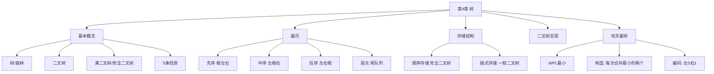

# 第 4 章　树

> **本章目标**：掌握**树**和**二叉树**这两种"一对多"的结构，学会**四种遍历**，理解**哈夫曼树与编码**（压缩软件的核心原理）。
>
> **难度**：★★★★☆　**建议用时**：3～4 天
>
> **本章是分水岭。** 前面都是"一条线"的结构，从这章开始进入"分支"结构。**递归思维**是本章的钥匙。

> **前置知识**：[第 0 章 递归](00-C与C++基础回顾.md)（**二叉树遍历全靠递归**）、[第 2 章 指针](02-线性表.md)、[第 3 章 递归/分治](03-线性表的扩展.md)
> **本章重点**：① 二叉树三种遍历（4.2）② 递归算法模板（4.4.3，**能套用大部分树题**）③ 哈夫曼树（4.5）
> **下章铺垫**：**树的遍历思想直接用到第 5 章图的 DFS**；树是第 6 章 BST/AVL/B-树 的基础

---

## 4.1　基本概念

### 4.1.1　树

#### 【一句话概括】

**树 = 有层次关系的"一对多"结构。**

#### 【生活类比】

**家族族谱**：

```
              爷爷
            /   |   \
         大伯  爸爸  叔叔
         /  \    |     |
       堂哥 堂姐  我   堂弟
```

- 爷爷在最上面（**根**）
- 爷爷有 3 个孩子（**分支**）
- 每个孩子又有自己的孩子

**再比如**：
- 公司的组织架构（CEO → 总监 → 经理 → 员工）
- 电脑的文件系统（C盘 → 文件夹 → 子文件夹 → 文件）
- 一本书的目录（章 → 节 → 小节）

#### 【正式定义】

**树（Tree）** 是 n（n ≥ 0）个节点的有限集合。当 n = 0 时是**空树**；当 n > 0 时：

1. 有且仅有一个特定的节点，称为**根（root）**
2. 其余节点可分为 m（m ≥ 0）个**互不相交**的子树

**关键点：子树之间不能相交**（一个节点只能有一个"父亲"）。

#### 【树的术语】（考试高频）

用这棵树举例：

```
              A          ← 第1层（根）
            / | \
           B  C  D       ← 第2层
          / \    |
         E   F   G       ← 第3层
             |
             H           ← 第4层
```

| 术语 | 含义 | 在本例中 |
|---|---|---|
| **节点（Node）** | 树中的每个元素 | A、B、C... |
| **根节点** | 最上面的节点（没有父节点） | A |
| **叶子节点（终端节点）** | 没有子节点的节点 | E、H、G |
| **分支节点（非终端节点）** | 有子节点的节点 | A、B、C、D、F |
| **父节点（双亲）** | 直接上层节点 | B 的父节点是 A |
| **子节点（孩子）** | 直接下层节点 | A 的子节点是 B、C、D |
| **兄弟节点** | 同一个父节点的节点 | B、C、D 互为兄弟 |
| **祖先** | 从根到该节点路径上的所有节点 | H 的祖先是 A、B、F |
| **子孙** | 该节点下面的所有节点 | B 的子孙是 E、F、H |
| **节点的度（Degree）** | 该节点有几个子节点 | A 的度是 3，B 的度是 2，E 的度是 0 |
| **树的度** | 所有节点中最大的度 | 本例树的度是 3（A 的度） |
| **层次（Level）** | 根是第 1 层，往下递增 | A 在第 1 层 |
| **深度（Depth）/ 高度** | 树中节点的最大层次 | 本例深度是 4 |
| **路径** | 从祖先到子孙经过的节点序列 | A→B→F→H |
| **路径长度** | 路径上经过的**边数** | A→B→F→H 长度是 3 |
| **森林（Forest）** | m 棵互不相交的树的集合 | 去掉根 A，B、C、D 三棵子树构成森林 |

#### 【⚠ 三个易错点】

**① 叶子节点 vs 度为 0**
叶子节点就是度为 0 的节点（没有孩子）。**两个说法是一回事。**

**② 树的深度 vs 节点的高度**
- **树的深度**：从根到最远叶子的层数（本例 4）
- **某节点的深度**：从根到该节点的层数
- **某节点的高度**：从该节点到最远叶子的层数

**有些教材从第 0 层开始计数**，做题目时注意题目约定。

**③ 路径长度是"边数"不是"节点数"**
```
A→B→F→H：经过 3 条边，所以路径长度是 3（不是 4）
```

### 4.1.2　二叉树 ⭐

#### 【一句话概括】

**二叉树 = 每个节点最多有 2 个子节点的树**（而且左右有区别）。

#### 【为什么单独研究二叉树】

因为：
1. **结构简单**：最多 2 个分支，容易实现
2. **性质丰富**：有很多可用的数学性质
3. **应用广泛**：二叉排序树、哈夫曼树、堆都是二叉树
4. **能表示任意树**：任何树都能转成二叉树（4.2.4 会讲）

#### 【二叉树的 5 种基本形态】

```
① 空树        ② 只有根      ③ 只有左子树   ④ 只有右子树   ⑤ 左右都有

   (空)         (A)          (A)            (A)           (A)
                              /                \          /   \
                            (B)                (B)      (B)   (C)
```

#### 【⚠ 二叉树 ≠ 度为 2 的树】

这是**最容易搞混**的概念：

| | 二叉树 | 度为 2 的树 |
|---|---|---|
| 子节点数 | **最多 2 个**（可以是 0、1、2） | **最多 2 个**（树中最大度为 2，也允许有度为 1 的节点） |
| 左右是否区分 | **严格区分**（左子树、右子树） | **不区分**（是"无序树"） |
| 是否可以为空 | **可以是空树**（n ≥ 0） | 至少有 1 个节点（树本身非空） |

**真正的区别有两条**：

**① 是否区分左右**

二叉树中，下面是**两棵不同的树**：

```
     A              A
    /                \
   B                  B

左边是"B 是 A 的左孩子"，右边是"B 是 A 的右孩子"
```

而"度为 2 的树"不区分左右——这两种画法**是同一棵树**。

**② 二叉树可以为空**

"度为 2 的树"作为普通树，必须有根节点（非空）；而二叉树允许是**空树**（一个节点都没有）。

> **⚠ 不要混淆的三个概念**：
> | 名称 | 含义 |
> |---|---|
> | **度为 2 的树** | 树中**最大度**为 2（允许有度为 1 的节点） |
> | **正则二叉树** | 每个节点的度**恰好是 0 或 2**（没有度为 1 的节点） |
> | **满二叉树** | 每一层都填满的二叉树（是正则二叉树的特例） |

**核心差异图示**：

```
     A              A
    /                \
   B                  B
   
这两个是不同的二叉树！
```

#### 【两种特殊二叉树】

**① 满二叉树（Full Binary Tree）**

**每一层的节点数都达到最大**。

```
        1
      /   \
     2     3
    / \   / \
   4   5 6   7
```
- 深度为 k 的满二叉树有 **2ᵏ - 1** 个节点
- 本例 k=3，节点数 = 2³-1 = 7 ✓

**② 完全二叉树（Complete Binary Tree）**

**只有最后一层可以不满，且节点都集中在左边**。

```
        1
      /   \
     2     3
    / \   /
   4   5 6      ← 最后一层只有 6，且靠左
```

**满二叉树一定是完全二叉树，但完全二叉树不一定是满二叉树。**

#### 【⚠ 完全二叉树为什么重要？】

因为**它可以用数组存储，且不浪费空间**（4.3.2 会讲）。

**判断完全二叉树的技巧**：
- 从上到下、从左到右给节点编号（1, 2, 3, ...）
- 编号必须是连续的，中间不能有空缺

#### 【二叉树的 5 条重要性质】（考试必背）

**性质 1**：第 i 层最多有 **2^(i-1)** 个节点（i ≥ 1）

```
第1层: 2^0 = 1 个  ✓
第2层: 2^1 = 2 个  ✓
第3层: 2^2 = 4 个  ✓
```

**性质 2**：深度为 h 的二叉树最多有 **2^h - 1** 个节点（h ≥ 1）

```
深度1: 2^1 - 1 = 1  ✓
深度3: 2^3 - 1 = 7  ✓
```

**性质 3** ⭐ 最重要：对于任何二叉树，如果叶子节点数为 **n₀**，度为 2 的节点数为 **n₂**，则：

```
n₀ = n₂ + 1
```

**记忆**：**叶子数 = 双分支节点数 + 1**

**证明思路**：
- 设度为 1 的节点数为 n₁，总节点数 n = n₀ + n₁ + n₂
- 从"分支数"角度：总分支数 = n₁ + 2n₂（度为1的贡献1条，度为2的贡献2条）
- 又因为除根节点外每个节点都被一条分支指向，所以总分支数 = n - 1
- 联立：n₁ + 2n₂ = n - 1 = n₀ + n₁ + n₂ - 1
- 化简：**n₂ = n₀ - 1**，即 **n₀ = n₂ + 1** ✓

**性质 4**：具有 n 个节点的完全二叉树，深度为 **⌊log₂n⌋ + 1**

```
n=1 → 深度 1
n=2,3 → 深度 2
n=4~7 → 深度 3
n=8~15 → 深度 4
```

**性质 5** ⭐ 完全二叉树的编号性质（数组存储的关键）：

对 n 个节点的完全二叉树，从上到下、从左到右编号 1, 2, ..., n，则对编号为 i 的节点：

| 关系 | 编号 |
|---|---|
| **父节点** | ⌊i/2⌋（i > 1） |
| **左孩子** | 2i（如果 2i ≤ n） |
| **右孩子** | 2i + 1（如果 2i+1 ≤ n） |

**举例**（n=6）：

```
        1
      /   \
     2     3
    / \   /
   4   5 6

节点 2: 父 = ⌊2/2⌋ = 1, 左孩子 = 4, 右孩子 = 5
节点 3: 父 = ⌊3/2⌋ = 1, 左孩子 = 6, 右孩子 = 7（>6，不存在）
节点 4: 父 = ⌊4/2⌋ = 2, 左孩子 = 8（不存在）
```

**这条性质是"用数组存二叉树"的理论基础**（4.3.2）。

### 4.1.3　森林

#### 【定义】

**森林（Forest）** = m（m ≥ 0）棵**互不相交**的树的集合。

#### 【树、森林、二叉树的关系】

```
森林 = 去掉树的根节点后剩下的子树集合
      ↓（可以互相转换）
任何森林都能转成二叉树，任何树也能转成二叉树
```

**这个转换是"通用树存储"的基础**（4.2.4 详细讲）。

### 【本节自测】

**4-1-1.** 判断：二叉树就是度为 2 的树。
<details><summary>答案</summary>
<p><strong>错误。</strong></p>
<table>
<thead>
<tr>
<th></th>
<th>二叉树</th>
<th>度为 2 的树</th>
</tr>
</thead>
<tbody>
<tr>
<td>子节点数</td>
<td>最多 2 个（0/1/2 都可以）</td>
<td>最多 2 个（也允许有度为 1 的节点）</td>
</tr>
<tr>
<td>左右顺序</td>
<td><strong>严格区分</strong></td>
<td><strong>不区分</strong></td>
</tr>
<tr>
<td>能否为空</td>
<td>可以是空树</td>
<td>不能为空（普通树非空）</td>
</tr>
</tbody>
</table>
<p><strong>关键差异</strong>：</p>
<ol>
<li>二叉树中，&quot;左孩子是 B&quot;和&quot;右孩子是 B&quot;是<strong>两棵不同的树</strong>；而普通树不区分顺序。</li>
<li>二叉树允许是<strong>空树</strong>；普通树必须有根节点。</li>
</ol>
<p><strong>⚠ 易错提醒</strong>：&quot;每个节点要么 0 个要么恰好 2 个孩子&quot;描述的是<strong>正则二叉树</strong>，不是&quot;度为 2 的树&quot;——后者只要求&quot;最大度为 2&quot;，中间可以有度为 1 的节点。</p>
</details>

**4-1-2.** 一棵二叉树有 10 个叶子节点，度为 1 的节点有 5 个。求度为 2 的节点数和总节点数。
<details><summary>答案</summary>
<p><strong>度为 2 的节点数 = 9，总节点数 = 24</strong></p>
<p><strong>计算</strong>：</p>
<ol>
<li>
<p>由性质 3：<code>n₀ = n₂ + 1</code>
→ <code>10 = n₂ + 1</code>
→ <strong>n₂ = 9</strong></p>
</li>
<li>
<p>总节点数：<code>n = n₀ + n₁ + n₂ = 10 + 5 + 9 = 24</code></p>
</li>
</ol>
<p><strong>答案：n₂ = 9，n = 24</strong></p>
<p><strong>验证</strong>：分支数 = n₁ + 2n₂ = 5 + 18 = 23 = n - 1 = 24 - 1 ✓ 正确</p>
</details>

**4-1-3.** 深度为 5 的满二叉树有多少个节点？有多少个叶子节点？
<details><summary>答案</summary>
<p><strong>总节点数 = 2⁵ - 1 = 31</strong></p>
<p><strong>叶子节点数 = 2⁴ = 16</strong></p>
<p><strong>推导</strong>：</p>
<ul>
<li>深度为 h 的满二叉树，总节点数 = <code>2^h - 1</code> = 2⁵-1 = <strong>31</strong></li>
<li>叶子都在最后一层（第 5 层），第 5 层最多有 <code>2^(5-1) = 2⁴ = 16</code> 个节点</li>
<li>因为是满二叉树，第 5 层是满的，所以叶子节点数 = <strong>16</strong></li>
</ul>
<p><strong>验证性质 3</strong>：</p>
<ul>
<li>叶子 n₀ = 16</li>
<li>度为 2 的节点（第 1~4 层）：1 + 2 + 4 + 8 = 15 = n₂</li>
<li>n₀ = n₂ + 1 → 16 = 15 + 1 ✓</li>
</ul>
</details>

**4-1-4.** 一棵完全二叉树有 1000 个节点，求它的深度和最后一个非叶子节点的编号。
<details><summary>答案</summary>
<p><strong>深度 = 10</strong></p>
<p>由性质 4：深度 = ⌊log₂n⌋ + 1 = ⌊log₂1000⌋ + 1 = 9 + 1 = <strong>10</strong></p>
<p>（因为 2⁹ = 512 ≤ 1000 &lt; 1024 = 2¹⁰）</p>
<p><strong>最后一个非叶子节点的编号 = ⌊1000/2⌋ = 500</strong></p>
<p><strong>推导</strong>：编号为 i 的节点，如果它有左孩子，则 <code>2i ≤ n</code>。</p>
<ul>
<li>当 <code>2i &gt; n</code> 时，i 是叶子节点。</li>
<li><code>2i &gt; 1000</code> → <code>i &gt; 500</code></li>
<li>所以 i = 501 ~ 1000 都是叶子，<strong>i = 500 是最后一个非叶子节点</strong>。</li>
</ul>
</details>

---

## 4.2　基本操作（遍历）⭐ 核心

### 4.2.1　树的遍历

**树的遍历**：按某种规则访问树中每个节点一次。

两种基本方式：
- **先根遍历**：先访问根，再依次遍历每棵子树
- **后根遍历**：先依次遍历每棵子树，再访问根

> **树的遍历不区分"左右"**（因为没有左右之分），只按子树的顺序。

### 4.2.2　二叉树的遍历 ⭐⭐ 本章最重要

#### 【四种遍历方式】

**二叉树有左右之分，所以遍历方式更多。**

| 遍历方式 | 访问顺序 | 口诀 |
|---|---|---|
| **先序遍历（前序）** | 根 → 左 → 右 | **根左右** |
| **中序遍历** | 左 → 根 → 右 | **左根右** |
| **后序遍历** | 左 → 右 → 根 | **左右根** |
| **层次遍历** | 一层一层，从左到右 | 用队列 |

**关键理解**：这里的"左"和"右"指的是**子树**，而不是单个节点。

#### 【用同一棵树演示】

```
            A
          /   \
         B     C
        / \   / \
       D   E F   G
```

**先序遍历（根左右）**：`A B D E C F G`

**推导过程**：
```
访问 A → 遍历左子树 → 遍历右子树
A
  左子树: 访问 B → B 的左子树 D → B 的右子树 E
  → A B D E
  右子树: 访问 C → C 的左子树 F → C 的右子树 G
  → A B D E C F G
```

**中序遍历（左根右）**：`D B E A F C G`

**推导过程**：
```
先遍历左子树（完全遍历完）→ 访问根 → 再遍历右子树
左子树（根B）: 先遍历B的左子树 D → 访问 B → 遍历 B 的右子树 E
  → D B E
访问根 A
右子树（根C）: 先遍历C的左子树 F → 访问 C → 遍历 C 的右子树 G
  → F C G
结果: D B E A F C G
```

**后序遍历（左右根）**：`D E B F G C A`

**推导过程**：
```
先遍历左子树 → 再遍历右子树 → 最后访问根
左子树: D E B（先左 D，再右 E，最后根 B）
右子树: F G C
最后访问 A
结果: D E B F G C A
```

**层次遍历**：`A B C D E F G`（一层层来）

#### 【⚠ 一个超级好用的技巧：从遍历序列还原树】

**已知中序 + 前序（或后序），可以唯一确定一棵二叉树。**

**为什么？**
- **前序的第一个**永远是**根**
- **后序的最后一个**永远是**根**
- **中序**中，根左边的都是**左子树**，根右边的都是**右子树**

**例题**：已知前序 `A B D E C F G`，中序 `D B E A F C G`，求后序。

**解题步骤**：

```
第1步：前序第一个是 A → A 是根
       中序: D B E | A | F C G
             左子树  根  右子树

第2步：左子树（中序 DBE，前序 BDE）
       前序第一个 B → B 是左子树的根
       中序: D | B | E
           左子  根  右子

第3步：右子树（中序 FCG，前序 CFG）
       前序第一个 C → C 是右子树的根
       中序: F | C | G
           左子  根  右子

还原出的树：
            A
          /   \
         B     C
        / \   / \
       D   E F   G

后序 = D E B F G C A ✓
```

**记忆口诀**：
- **前序定根**（第一个）
- **中序分左右**（根左边是左子树，右边是右子树）
- **后序验证**（最后一个是根）

#### 【递归实现三种遍历】

```cpp
// 先序遍历
void PreOrder(Node* p) {
    if (p == nullptr) return;
    cout << p->data << " ";   // ① 访问根
    PreOrder(p->left);        // ② 遍历左子树
    PreOrder(p->right);       // ③ 遍历右子树
}

// 中序遍历
void InOrder(Node* p) {
    if (p == nullptr) return;
    InOrder(p->left);         // ① 遍历左子树
    cout << p->data << " ";   // ② 访问根
    InOrder(p->right);        // ③ 遍历右子树
}

// 后序遍历
void PostOrder(Node* p) {
    if (p == nullptr) return;
    PostOrder(p->left);       // ① 遍历左子树
    PostOrder(p->right);      // ② 遍历右子树
    cout << p->data << " ";   // ③ 访问根
}
```

**看！三个函数只差一行代码的位置。** 这就是递归的优雅。

**记忆方法**：`cout` 放在哪里，就是什么遍历：
- 放**最前** → 先序（先访问根）
- 放**中间** → 中序
- 放**最后** → 后序

#### 【层次遍历：用队列实现】

```cpp
void LevelOrder(Node* root) {
    if (root == nullptr) return;
    queue<Node*> q;
    q.push(root);                      // 根入队

    while (!q.empty()) {
        Node* p = q.front();
        q.pop();
        cout << p->data << " ";        // 访问

        if (p->left)  q.push(p->left); // 左孩子入队
        if (p->right) q.push(p->right);// 右孩子入队
    }
}
```

**为什么用队列？** 因为层次遍历要求"先来先访问"——第 1 层的先访问完，再访问第 2 层。这正是**队列的 FIFO 特性**。

**图示**：

```
初始: 队列 = [A]

第1轮: 出队 A，输出 A，入队 B、C
      队列 = [B, C]

第2轮: 出队 B，输出 B，入队 D、E
      队列 = [C, D, E]

第3轮: 出队 C，输出 C，入队 F、G
      队列 = [D, E, F, G]

...
输出: A B C D E F G ✓
```

### 4.2.3　森林的遍历

- **森林的先序遍历**：依次对每棵树做先根遍历
- **森林的后序遍历**：依次对每棵树做后根遍历

> **森林遍历与二叉树遍历的对应关系**（4.2.4 转换后）：
> - 森林的先序 = 对应二叉树的**先序**
> - 森林的后序 = 对应二叉树的**中序**

### 4.2.4　树、森林与二叉树的转换 ⭐

#### 【为什么需要转换】

因为**二叉树有成熟的算法和存储方式**。把普通树/森林转成二叉树，就能复用二叉树的一切工具。

#### 【转换规则：左孩子右兄弟】

**核心口诀**：**左指针指向第一个孩子，右指针指向下一个兄弟。**

**例子**：把下面的树转成二叉树

```
原树：
           A
        /  |  \
       B   C   D
      / \      |
     E   F     G
```

**转换步骤**：

**第 1 步**：每个节点的**第一个孩子**变成**左孩子**

```
A 的左孩子 = B（第一个孩子）
B 的左孩子 = E
D 的左孩子 = G
C 没有孩子
```

**第 2 步**：每个节点的**下一个兄弟**变成**右孩子**

```
B 的右孩子 = C（B 的兄弟）
C 的右孩子 = D
E 的右孩子 = F（E 的兄弟）
```

**转换结果**：

```
        A
       /
      B
     / \
    E   C
     \   \
      F   D
           \
            G
```

**验证**：对结果做**先序遍历** → `A B E F C D G`
对原树做**先根遍历** → `A B E F C D G` ✓ 一致！

#### 【森林转二叉树】

**规则**：
1. 把每棵树转成二叉树
2. 从第二棵树开始，把每棵树的根，当作前一棵树根的**右孩子**连起来

**例子**：森林 `[树1, 树2, 树3]`

```
树1:  A        树2:  X       树3:  P
     / \             /            /
    B   C           Y            Q

转换后：
        A
       / \
      B   C
       \
        X        ← 树2的根，作为树1根的右孩子
       /
      Y
       \
        P        ← 树3的根，作为树2根的右孩子
       /
      Q
```

### 【本节自测】

**4-2-1.** 已知一棵二叉树的前序是 `ABDECF`，中序是 `DBEAFC`。求后序，并画出这棵树。
<details><summary>答案</summary>
<p><strong>后序 = <code>DEBFCA</code></strong></p>
<p><strong>推导</strong>：</p><pre><code>第1步：前序第一个 A → A 是根
       中序: D B E | A | F C
             左子树  根  右子树&#10;
第2步：左子树（中序 DBE，前序 BDE）
       前序第一个 B → B 是根
       中序: D | B | E
           左子  根  右子
       → B 的左孩子 D，右孩子 E&#10;
第3步：右子树（中序 FC，前序 CF）
       前序第一个 C → C 是根
       中序: F | C
           左子  根
       → C 的左孩子 F，没有右孩子&#10;
还原出的树：
          A
        /   \
       B     C
      / \   /
     D   E F&#10;
后序 = D E B F C A
</code></pre><p><strong>验证</strong>：后序最后一个应该是根 A ✓</p>
</details>

**4-2-2.** 写出下面二叉树的前序、中序、后序、层次遍历序列。

```
        1
       / \
      2   3
     /   / \
    4   5   6
```
<details><summary>答案</summary>
<ul>
<li><strong>前序</strong>（根左右）：<code>1 2 4 3 5 6</code></li>
<li><strong>中序</strong>（左根右）：<code>4 2 1 5 3 6</code></li>
<li><strong>后序</strong>（左右根）：<code>4 2 5 6 3 1</code></li>
<li><strong>层次</strong>：<code>1 2 3 4 5 6</code></li>
</ul>
<p><strong>逐步推导（中序）</strong>：</p><pre><code>从根 1 开始，先遍历左子树（根2）：
  2 的左子树（4）→ 输出 4
  输出 2
  2 没有右子树
→ 4 2
输出 1
遍历右子树（根3）：
  3 的左子树（5）→ 输出 5
  输出 3
  3 的右子树（6）→ 输出 6
→ 5 3 6
结果: 4 2 1 5 3 6 ✓
</code></pre>
</details>

**4-2-3.** 为什么层次遍历要用队列，而不是栈？
<details><summary>答案</summary>
<p>因为<strong>层次遍历要求&quot;先进先出&quot;</strong>。</p>
<p>层次遍历的顺序是：第 1 层 → 第 2 层 → 第 3 层……</p>
<p><strong>处理过程</strong>：</p>
<ol>
<li>根节点入队</li>
<li>出队一个节点，访问它，把它的<strong>孩子</strong>入队</li>
<li>重复</li>
</ol>
<p><strong>关键</strong>：先入队的节点（上层节点）先被处理，它们的孩子后入队（下层节点）后被处理。<strong>这正是队列的 FIFO 特性。</strong></p>
<p><strong>如果改用栈</strong>（LIFO）：最后入栈的（下层节点）会先被弹出，变成&quot;深度优先&quot;而不是&quot;层次优先&quot;了。</p>
<p><strong>对比</strong>：</p>
<ul>
<li><strong>队列</strong> → 层次遍历（BFS，广度优先）</li>
<li><strong>栈</strong> → 深度优先遍历（DFS）</li>
</ul>
<p><strong>这个区别在第 5 章讲图的遍历时会再次强调。</strong></p>
</details>

**4-2-4.** 已知中序遍历是 `BADCE`，后序遍历是 `BDECA`。求前序遍历。
<details><summary>答案</summary>
<p><strong>前序 = <code>A B E C D</code></strong></p>
<p><strong>推导过程</strong>：</p><pre><code>第1步：后序 BDECA 的最后一个是 A → A 是根
       中序: B | A | D C E
           左子  根   右子
       → 左子树中序 = &quot;B&quot;，右子树中序 = &quot;DCE&quot;&#10;
第2步：左子树（中序 &quot;B&quot;，后序 &quot;B&quot;）
       只有一个节点 → B 是 A 的左孩子&#10;
第3步：右子树（中序 &quot;DCE&quot;，后序 &quot;DCE&quot;）
       后序最后一个是 E → E 是右子树的根
       中序: D C | E
           左子  根
       （E 右边没东西 → E 没有右孩子）
       → E 的左子树中序 = &quot;DC&quot;&#10;
第4步：E 的左子树（中序 &quot;DC&quot;，后序 &quot;DC&quot;）
       后序最后一个是 C → C 是根
       中序: D | C
           左子 根
       → C 的左孩子是 D&#10;
还原的树：
          A
         / \
        B   E
           /
          C
         /
        D&#10;
前序（根左右）= A B E C D
</code></pre><p><strong>关键提醒</strong>：一定要先确定&quot;谁是根&quot;——<strong>后序看最后一个，前序看第一个</strong>。然后在中序里找到根的位置，<strong>左边是左子树，右边是右子树</strong>。</p>
</details>

---

## 4.3　存储结构

### 4.3.1　树的存储结构

**普通树（非二叉树）有三种常见存储方式**：

#### 【方式 1：双亲表示法】

**用数组存，每个节点记录"父节点的下标"。**

```cpp
struct PTNode {
    int data;      // 数据
    int parent;    // 父节点的下标
};
PTNode tree[100];
```

**图示**：

```
下标:  0    1    2    3    4    5
data:  A    B    C    D    E    F
parent:-1   0    0    0    1    1

对应的树：
       A(0)
      / | \
    B(1) C(2) D(3)
    / \
  E(4) F(5)
```

**优点**：找**父节点**很快（O(1)）
**缺点**：找**子节点**很慢（要遍历整个数组）

#### 【方式 2：孩子表示法】

**每个节点记录"所有孩子的下标"。**

```cpp
struct CTNode {          // 孩子链表节点
    int child;           // 孩子下标
    CTNode* next;
};
struct CTBox {           // 表头
    int data;
    CTNode* firstChild;  // 第一个孩子
};
```

**图示**：

```
[0] A → → [1] → [2] → [3]
[1] B → → [4] → [5]
[2] C → → NULL
[3] D → → NULL
[4] E → → NULL
[5] F → → NULL
```

**优点**：找**子节点**方便
**缺点**：找**父节点**不方便

#### 【方式 3：孩子兄弟表示法】★ 最常用

**每个节点只存"第一个孩子"和"下一个兄弟"。**

```cpp
struct CSNode {
    int data;
    CSNode* firstChild;    // 第一个孩子
    CSNode* nextSibling;   // 下一个兄弟
};
```

**这其实就是"左孩子右兄弟"的二叉树表示！**

**为什么最常用？**
1. **结构统一**：所有节点都是两个指针，和二叉树一样
2. **能直接复用二叉树的算法**
3. **存储效率高**：不需要数组，动态分配

> **结论**：**普通树通常就用"孩子兄弟表示法"存成二叉树**，然后按二叉树处理。

### 4.3.2　二叉树的存储结构

#### 【方式 1：顺序存储（数组）】

**只适合完全二叉树**！

**规则**：按性质 5 的编号，把节点存进数组。

```
        1
      /   \
     2     3
    / \   /
   4   5 6

数组: [_, 1, 2, 3, 4, 5, 6]
       0  1  2  3  4  5  6   ← 下标（0 号不用）

关系（对下标 i）:
  父节点:   i/2
  左孩子:   2i
  右孩子:   2i+1
```

**优点**：
- 不用指针，节省空间
- 找父/子节点都是 O(1)（直接算下标）

**缺点**：
- **只适合完全二叉树**！普通二叉树会浪费大量空间

**看这个反例**（右斜树）：

```
1
 \
  2
   \
    3
     \
      4

数组: [_, 1, _, 2, _, _, _, 3, _, _, _, _, _, _, _, 4]
       0  1  2  3  4  5  6  7  ...                15
```

**4 个节点占了 16 个位置！浪费 75%。**

**结论**：
- **完全二叉树** → 用顺序存储（省空间、访问快）
- **一般二叉树** → 用链式存储

#### 【方式 2：链式存储】★ 最常用

**每个节点有两个指针：左孩子、右孩子。**

```cpp
template <class T>
struct BTNode {
    T data;
    BTNode* left;     // 左孩子
    BTNode* right;    // 右孩子
};
```

**图示**：

```
            A
          /   \
         B     C
        / \
       D   E

存储：
  [A|●|●]
   /     \
[B|●|●] [C|NULL|NULL]
 /   \
[D] [E]
```

**注意**：
- 没有孩子时，指针是 **NULL**
- n 个节点的二叉树，有 **n+1 个空指针**（这个性质在某些算法中有用，叫"线索二叉树"的基础）

### 【本节自测】

**4-3-1.** 为什么顺序存储只适合完全二叉树？
<details><summary>答案</summary>
<p>因为顺序存储**依赖&quot;编号连续&quot;**这个前提。</p>
<p><strong>完全二叉树</strong>的节点编号是连续的（1, 2, 3, ..., n），所以数组里没有空隙，空间利用率 100%。</p>
<p><strong>普通二叉树</strong>如果形状不规则（比如右斜树），编号会跳跃，数组里出现大量空位。</p>
<p><strong>例子</strong>（4 个节点的右斜树）：</p><pre><code>1
 \
  2
   \
    3
     \
      4&#10;
数组: [1, _, 2, _, _, _, 3, ..., 4]
      位置 0 1 2 3 4 5 6     15&#10;
4 个节点占了 16 个位置 → 浪费 75%
</code></pre><p><strong>结论</strong>：</p>
<ul>
<li><strong>完全二叉树</strong> → 顺序存储（高效）</li>
<li><strong>一般二叉树</strong> → 链式存储（灵活，不浪费）</li>
</ul>
</details>

**4-3-2.** 用"孩子兄弟表示法"，把下面的树存成二叉树。

```
      A
    / | \
   B  C  D
   |
   E
```
<details><summary>答案</summary>
<p><strong>转换结果</strong>：</p><pre><code>        A
       /
      B
     / \
    E   C
         \
          D
</code></pre><p><strong>转换过程</strong>（左孩子右兄弟）：</p>
<table>
<thead>
<tr>
<th>节点</th>
<th>firstChild（第一个孩子）</th>
<th>nextSibling（下一个兄弟）</th>
</tr>
</thead>
<tbody>
<tr>
<td>A</td>
<td>B</td>
<td>NULL</td>
</tr>
<tr>
<td>B</td>
<td>E</td>
<td>C</td>
</tr>
<tr>
<td>C</td>
<td>NULL</td>
<td>D</td>
</tr>
<tr>
<td>D</td>
<td>NULL</td>
<td>NULL</td>
</tr>
<tr>
<td>E</td>
<td>NULL</td>
<td>NULL</td>
</tr>
</tbody>
</table>
<p><strong>验证</strong>：</p>
<ul>
<li>A 的第一个孩子是 B → A 的左孩子 = B ✓</li>
<li>B 的第一个孩子是 E → B 的左孩子 = E ✓</li>
<li>B 的下一个兄弟是 C → B 的右孩子 = C ✓</li>
<li>C 的下一个兄弟是 D → C 的右孩子 = D ✓</li>
</ul>
<p><strong>做先序遍历验证</strong>：</p>
<ul>
<li>原树先根遍历：A B E C D</li>
<li>转换后二叉树先序：A B E C D ✓ 一致</li>
</ul>
</details>

---

## 4.4　二叉树的实现

### 4.4.1　二叉树的声明

```cpp
template <class T>
class BinaryTree {
private:
    BTNode<T>* root;    // 根节点指针

public:
    BinaryTree() { root = nullptr; }

    // 从数组（层序）构建完全二叉树
    void buildFromArray(T a[], int n);

    // 遍历
    void PreOrder()  { PreOrder(root); cout << endl; }
    void InOrder()   { InOrder(root);  cout << endl; }
    void PostOrder() { PostOrder(root);cout << endl; }
    void LevelOrder();

    // 统计
    int  Count()        { return Count(root); }
    int  LeafCount()    { return LeafCount(root); }
    int  Height()       { return Height(root); }

private:
    void PreOrder(BTNode<T>* p);
    void InOrder(BTNode<T>* p);
    void PostOrder(BTNode<T>* p);
    int  Count(BTNode<T>* p);
    int  LeafCount(BTNode<T>* p);
    int  Height(BTNode<T>* p);
};
```

### 4.4.2　二叉树的关键算法

#### 【算法 1：三种遍历】（已讲，略）

#### 【算法 2：统计节点总数】

```cpp
int Count(BTNode<T>* p) {
    if (p == nullptr) return 0;              // 空树有 0 个节点
    return 1 + Count(p->left) + Count(p->right);
    //       ↑自己   ↑左子树    ↑右子树
}
```

**递归思路**：**总节点数 = 1（自己）+ 左子树节点数 + 右子树节点数**

#### 【算法 3：统计叶子节点数】

```cpp
int LeafCount(BTNode<T>* p) {
    if (p == nullptr) return 0;
    if (p->left == nullptr && p->right == nullptr) return 1;  // ★ 叶子
    return LeafCount(p->left) + LeafCount(p->right);
}
```

**关键**：判断"叶子"的条件是**左右孩子都为空**。

#### 【算法 4：求树的高度】

```cpp
int Height(BTNode<T>* p) {
    if (p == nullptr) return 0;
    int lh = Height(p->left);
    int rh = Height(p->right);
    return 1 + max(lh, rh);      // ★ 取较高的那棵子树
}
```

**递归思路**：**树高 = 1（自己这一层）+ max(左子树高, 右子树高)**

#### 【算法 5：查找某个值】

```cpp
BTNode<T>* Find(BTNode<T>* p, T x) {
    if (p == nullptr) return nullptr;
    if (p->data == x) return p;              // 找到了

    BTNode<T>* leftResult = Find(p->left, x);
    if (leftResult != nullptr) return leftResult;   // 左子树找到了

    return Find(p->right, x);                // 去右子树找
}
```

#### 【算法 6：求第 k 层的节点数】

```cpp
int CountLevel(BTNode<T>* p, int k) {
    if (p == nullptr) return 0;
    if (k == 1) return 1;                    // 第 1 层就是自己
    return CountLevel(p->left, k - 1) + CountLevel(p->right, k - 1);
}
```

**思路**：求第 k 层 = 求左右子树的第 k-1 层之和。

### 4.4.3　递归算法的规律 ⭐

**这一节是"授人以渔"。掌握它，二叉树的题你都能做。**

#### 【规律 1：先写"出口"】

**所有递归函数的第一步都是判断"什么时候停"。**

二叉树递归的出口几乎都是：
```cpp
if (p == nullptr) return ...;    // 空树
```

#### 【规律 2：把问题拆成"自己 + 左子树 + 右子树"】

**几乎所有二叉树算法都是这个套路**：

```cpp
返回类型 算法(节点 p) {
    if (p == nullptr) return 出口值;
    
    // ① 处理"自己"（可选）
    ...
    
    // ② 递归处理左子树
    auto leftResult = 算法(p->left);
    
    // ③ 递归处理右子树
    auto rightResult = 算法(p->right);
    
    // ④ 合并结果
    return 合并(leftResult, rightResult, 自己);
}
```

#### 【规律 3：三种遍历对应三种"合并时机"】

| 遍历 | 什么时候处理自己 | 典型用途 |
|---|---|---|
| **前序** | 递归前 | 复制树、打印结构 |
| **中序** | 左递归后、右递归前 | 二叉排序树（输出有序） |
| **后序** | 递归后 | 求高度、统计、释放内存 |

#### 【规律 4：递归的"三要素"】

写任何二叉树递归，先想清楚三个问题：

1. **出口是什么？**（空节点返回什么）
2. **子问题是什么？**（左子树/右子树要算出什么）
3. **怎么合并？**（如何从子问题的结果算出自己的结果）

**举例**（求高度）：
1. **出口**：空节点高度为 0
2. **子问题**：左子树高度、右子树高度
3. **合并**：`1 + max(左高, 右高)`

**举例**（判断是否平衡）：
1. **出口**：空节点是平衡的
2. **子问题**：左子树是否平衡、右子树是否平衡、左右高度差
3. **合并**：左右都平衡 且 高度差 ≤ 1

### 【本节自测】

**4-4-1.** 写出求二叉树中"度为 1 的节点个数"的递归算法。
<details><summary>答案</summary>
<pre><code class="language-cpp">int CountDegree1(BTNode&lt;T&gt;* p) {
    if (p == nullptr) return 0;&#10;
    // 判断自己是不是&quot;度为1&quot;（只有一个孩子）
    int self = 0;
    if ((p-&gt;left == nullptr) != (p-&gt;right == nullptr)) {
        self = 1;      // 恰好一个为空 → 度为 1
    }&#10;
    return self + CountDegree1(p-&gt;left) + CountDegree1(p-&gt;right);
}
</code></pre><p><strong>关键技巧</strong>：用 <code>(p-&gt;left == nullptr) != (p-&gt;right == nullptr)</code> 判断&quot;恰好一个为空&quot;。</p>
<ul>
<li>两个都空：<code>true != true</code> → false → 度 0</li>
<li>两个都非空：<code>false != false</code> → false → 度 2</li>
<li>一个空一个非空：<code>true != false</code> → <strong>true</strong> → 度 1 ✓</li>
</ul>
<p><strong>这个异或技巧很常用</strong>，比写 <code>if/else if</code> 更简洁。</p>
</details>

**4-4-2.** 写算法：判断两棵二叉树是否相同（结构和值都相同）。
<details><summary>答案</summary>
<pre><code class="language-cpp">bool isSame(BTNode&lt;T&gt;* a, BTNode&lt;T&gt;* b) {
    // 出口1：都是空 → 相同
    if (a == nullptr &amp;&amp; b == nullptr) return true;&#10;
    // 出口2：只有一个空 → 不同
    if (a == nullptr || b == nullptr) return false;&#10;
    // 出口3：值不同 → 不同
    if (a-&gt;data != b-&gt;data) return false;&#10;
    // 递归：左右子树都相同才算相同
    return isSame(a-&gt;left, b-&gt;left) &amp;&amp; isSame(a-&gt;right, b-&gt;right);
}
</code></pre><p><strong>三要素分析</strong>：</p>
<ol>
<li><strong>出口</strong>：三种情况（都空 / 一空一不空 / 值不同）</li>
<li><strong>子问题</strong>：左子树是否相同、右子树是否相同</li>
<li><strong>合并</strong>：用 <code>&amp;&amp;</code>（必须都相同）</li>
</ol>
<p><strong>易错点</strong>：别忘了判断 <code>a-&gt;data != b-&gt;data</code>。只判断结构相同是不够的。</p>
</details>

**4-4-3.** 写算法：交换二叉树中所有节点的左右孩子。
<details><summary>答案</summary>
<pre><code class="language-cpp">void SwapChildren(BTNode&lt;T&gt;* p) {
    if (p == nullptr) return;&#10;
    // 交换自己的左右孩子
    swap(p-&gt;left, p-&gt;right);&#10;
    // 递归处理左右子树
    SwapChildren(p-&gt;left);
    SwapChildren(p-&gt;right);
}
</code></pre><p><strong>也可以写成后序</strong>（先递归再交换）：</p><pre><code class="language-cpp">void SwapChildren(BTNode&lt;T&gt;* p) {
    if (p == nullptr) return;
    SwapChildren(p-&gt;left);
    SwapChildren(p-&gt;right);
    swap(p-&gt;left, p-&gt;right);      // 放后面也行
}
</code></pre><p><strong>两种写法都可以</strong>，因为交换操作和递归操作互不影响。</p>
<p><strong>注意</strong>：这里的 <code>swap</code> 是 C++ 标准库函数，交换两个指针。</p>
</details>

**4-4-4.** 写算法：求二叉树中所有节点值的和。
<details><summary>答案</summary>
<pre><code class="language-cpp">int Sum(BTNode&lt;int&gt;* p) {
    if (p == nullptr) return 0;
    return p-&gt;data + Sum(p-&gt;left) + Sum(p-&gt;right);
}
</code></pre><p><strong>三要素</strong>：</p>
<ol>
<li><strong>出口</strong>：空节点返回 0</li>
<li><strong>子问题</strong>：左子树的和、右子树的和</li>
<li><strong>合并</strong>：<code>自己的值 + 左和 + 右和</code></li>
</ol>
<p><strong>对比&quot;统计节点数&quot;</strong>：</p><pre><code class="language-cpp">// 统计个数
return 1 + Count(p-&gt;left) + Count(p-&gt;right);&#10;
// 求和
return p-&gt;data + Sum(p-&gt;left) + Sum(p-&gt;right);
</code></pre><p><strong>结构完全一样，只是把&quot;1&quot;换成了&quot;p-&gt;data&quot;。</strong></p>
<p><strong>这就是二叉树递归的通用模板！</strong> 掌握这个模板，大部分题都能套。</p>
</details>

---

## 4.5　哈夫曼树的应用 ⭐ 压缩的核心

### 4.5.1　哈夫曼树的定义与存储结构

#### 【先理解"带权路径长度"】

**节点的路径长度**：从根到该节点经过的**边数**。

**节点的带权路径长度**：`该节点的权值 × 路径长度`。

**树的带权路径长度（WPL）**：所有**叶子节点**的带权路径长度之和。

```
WPL = Σ (wᵢ × lᵢ)
      i

wᵢ 是第 i 个叶子的权值
lᵢ 是第 i 个叶子的路径长度
```

#### 【哈夫曼树的定义】

**哈夫曼树（Huffman Tree）= 带权路径长度 WPL 最小的二叉树。**

也叫**最优二叉树**。

#### 【为什么重要】

**WPL 最小 = 编码最短 = 压缩率最高。**

这就是压缩软件（ZIP、RAR）和文件格式（JPEG、MP3）的核心原理。

#### 【看一个直观的例子】

假设有 4 个字符，出现频率（权值）分别是：

```
A: 7    B: 5    C: 2    D: 4
```

**方案 1：随便构造一棵二叉树**

```
           (18)
          /    \
        A(7)   (11)
              /    \
            B(5)   (6)
                  /   \
                C(2)  D(4)

WPL = 7×1 + 5×2 + 2×3 + 4×3
    = 7 + 10 + 6 + 12
    = 35
```

**方案 2：哈夫曼树**

```
           (18)
          /    \
        (7)     (11)
       /   \    /   \
     C(2) D(4) B(5) A(7)

WPL = 2×2 + 4×2 + 5×2 + 7×2 = 36  ← 不是最优
```

**哈夫曼算法的步骤是**：

1. 把所有节点放进"候选集合"
2. 每次取**权值最小的两个**，合并成一个新节点（权值 = 两者之和）
3. 把新节点放回集合
4. 重复直到只剩一个节点

**用 `A:7, B:5, C:2, D:4` 构造**：

```
第1步：取最小的两个 C(2) 和 D(4)，合并 → 新节点 (6)
       集合: {A(7), B(5), (6)}

第2步：取最小的两个 B(5) 和 (6)，合并 → 新节点 (11)
       集合: {A(7), (11)}

第3步：取 A(7) 和 (11)，合并 → 根 (18)
       集合: {(18)}

最终的哈夫曼树：
              (18)
             /    \
          A(7)    (11)
                 /    \
              B(5)    (6)
                     /   \
                   C(2)  D(4)

WPL = 7×1 + 5×2 + 2×3 + 4×3
    = 7 + 10 + 6 + 12
    = 35
```

**WPL = 35**。

**对比"每次取最大的合并"会怎样**：

```
第1步：取 A(7) 和 B(5) → (12)
第2步：取 D(4) 和 (12) → (16)
第3步：取 C(2) 和 (16) → (18)

树：
        (18)
       /    \
    C(2)   (16)
          /    \
       D(4)   (12)
             /    \
          A(7)   B(5)

WPL = 2×1 + 4×2 + 7×3 + 5×3 = 2 + 8 + 21 + 15 = 46  ← 更大！
```

**46 > 35，验证了"哈夫曼算法确实能得到最小 WPL"。**

### 4.5.2　哈夫曼树的构造

#### 【算法步骤】

```
1. 把 n 个权值看成 n 棵只有根节点的树，组成森林
2. 重复以下步骤，直到森林中只剩一棵树：
   a. 从森林中选出两棵"根节点权值最小"的树
   b. 合并成一棵新树：新根的权值 = 两个根权值之和
   c. 用新树替换原来那两棵树
3. 剩下的那棵树就是哈夫曼树
```

#### 【关键实现：用优先队列（最小堆）】

```cpp
// 哈夫曼树节点
struct HTNode {
    int weight;          // 权值
    HTNode* left;
    HTNode* right;
    HTNode(int w) : weight(w), left(nullptr), right(nullptr) {}
};

// 比较器：按权值小的优先
struct Compare {
    bool operator()(HTNode* a, HTNode* b) {
        return a->weight > b->weight;   // 小顶堆
    }
};

HTNode* buildHuffmanTree(vector<int>& weights) {
    // 小顶堆
    priority_queue<HTNode*, vector<HTNode*>, Compare> pq;

    // ① 每个权值建一棵单节点树
    for (int w : weights) {
        pq.push(new HTNode(w));
    }

    // ② 反复取最小的两个合并
    while (pq.size() > 1) {
        HTNode* a = pq.top(); pq.pop();   // 最小
        HTNode* b = pq.top(); pq.pop();   // 次小

        HTNode* parent = new HTNode(a->weight + b->weight);
        parent->left = a;
        parent->right = b;

        pq.push(parent);
    }

    return pq.top();    // 剩下的就是根
}
```

> 完整代码见 `code/04_哈夫曼树.cpp`。

#### 【重要结论】

1. **哈夫曼树没有度为 1 的节点**（每次都是"两两合并"，所以要么 0 个孩子要么 2 个）。
2. **n 个叶子节点的哈夫曼树共有 2n-1 个节点**（n 个叶子 + n-1 个内部节点）。
3. **权值越大的叶子，离根越近**（路径越短，编码越短）。
4. **哈夫曼树不唯一**（权值相同时，合并顺序可以不同），但 **WPL 都是最小的**。

### 4.5.3　哈夫曼编码表的构建

#### 【编码是什么】

**编码**：把字符转换成二进制串。

**例子**：把 "ABAC" 编码成 01 串。

#### 【两种编码方式】

**① 等长编码**

每个字符用**相同长度**的二进制表示。

```
4 个字符，需要 2 位二进制：
A = 00
B = 01
C = 10
D = 11

"ABAC" → 00 01 00 10  （8 位）
```

**优点**：简单，容易解码
**缺点**：**不区分频率**，高频字符和低频字符一样长

**② 变长编码**

**高频字符用短编码，低频字符用长编码。**

```
假设频率: A出现很多次，D很少

A = 0      （1 位）
B = 10     （2 位）
C = 110    （3 位）
D = 111    （3 位）
```

**这样整体会更短！** 但有个问题：

#### 【⚠ 前缀编码：变长编码的必要条件】

**问题**：如果编码是 `A=0, B=1, C=10`，那么 `"10"` 到底是 `C` 还是 `BA`？

**这就是歧义！**

**解决方案：前缀编码**——**任何编码都不是另一个编码的前缀**。

```
✓ 合法: A=0, B=10, C=110, D=111
   （0 不是 10 的前缀，10 不是 110 的前缀）

✗ 非法: A=0, B=01, C=10
   （0 是 01 的前缀，有歧义）
```

**哈夫曼编码天然满足前缀编码**！因为：
- 所有字符都在**叶子节点**上
- 从根到叶子的路径不会经过另一个叶子
- 所以任何编码都不可能是另一个的前缀

#### 【哈夫曼编码的构造】

**规则**：
1. 构造哈夫曼树
2. **从根出发，向左走记 0，向右走记 1**
3. 从根到每个叶子节点的路径，就是这个字符的编码

**例子**（权值 `A:7, B:5, C:2, D:4`）：

```
哈夫曼树：
              (18)
             /    \
            0      1
          A(7)    (11)
                 /    \
                0      1
              B(5)    (6)
                     /   \
                    0     1
                   C(2)  D(4)

编码（从根到叶子的路径）：
A: 0         （左）
B: 10        （左→右）
C: 110       （左→右→左）
D: 111       （左→右→右）
```

**验证前缀性质**：
- `0` 不是 `10` 的前缀 ✓
- `10` 不是 `110` 的前缀 ✓
- `110` 和 `111` 互相不是前缀 ✓

**计算压缩效果**：

```
原字符串假设是 "AAAABBBCD"（按频率 7:5:2:4 近似）

等长编码（2位）：10 个字符 × 2 = 20 位
哈夫曼编码：
  A(4个) × 1位 = 4
  B(3个) × 2位 = 6
  C(1个) × 3位 = 3
  D(2个) × 3位 = 6
  合计 = 19 位

（这个例子差距不大，因为字符少。实际文本中，压缩率可达 50% 以上）
```

### 4.5.4　哈夫曼编、解码的实现

#### 【编码】

```cpp
// 从根遍历到每个叶子，记录路径
void buildCode(HTNode* p, string code, map<char, string>& table) {
    if (p == nullptr) return;

    if (p->left == nullptr && p->right == nullptr) {
        table[p->ch] = code;      // 叶子节点，记录编码
        return;
    }

    buildCode(p->left,  code + "0", table);   // 向左走加 0
    buildCode(p->right, code + "1", table);   // 向右走加 1
}
```

#### 【解码】

**从根出发，遇到 0 往左走，遇到 1 往右走，走到叶子就输出一个字符。**

```cpp
string decode(HTNode* root, const string& encoded) {
    string result;
    HTNode* p = root;

    for (char bit : encoded) {
        if (bit == '0') p = p->left;
        else            p = p->right;

        if (p->left == nullptr && p->right == nullptr) {
            result += p->ch;     // 到叶子了，输出字符
            p = root;            // ★ 回到根，准备解下一个
        }
    }
    return result;
}
```

**为什么解码这么简单？** 因为**前缀编码保证了解码无歧义**——从根开始走，一走到叶子就必然是一个完整的字符编码，不会有"不知道停在哪"的问题。

### 【本节自测】

**4-5-1.** 权值集合 `{5, 7, 2, 3}`，构造哈夫曼树并求 WPL。
<details><summary>答案</summary>
<p><strong>WPL = 32</strong></p>
<p><strong>构造过程</strong>：</p><pre><code>初始集合: {2, 3, 5, 7}&#10;
第1步：取最小的两个 2 和 3，合并 → 5
       集合: {5, 5, 7}
       （注意：原来有个权值 5，现在合并又产生一个 5）&#10;
第2步：取最小的两个 5 和 5，合并 → 10
       集合: {7, 10}&#10;
第3步：取 7 和 10，合并 → 17
       集合: {17}
</code></pre><p><strong>树结构</strong>：</p><pre><code>              (17)
             /    \
          7        (10)
                  /    \
                (5)     5
               /   \
              2     3
</code></pre><p><strong>计算 WPL</strong>（各叶子的权值 × 路径长度）：</p>
<table>
<thead>
<tr>
<th>叶子</th>
<th>路径长度</th>
<th>贡献</th>
</tr>
</thead>
<tbody>
<tr>
<td>7</td>
<td>1</td>
<td>7</td>
</tr>
<tr>
<td>5</td>
<td>2</td>
<td>10</td>
</tr>
<tr>
<td>2</td>
<td>3</td>
<td>6</td>
</tr>
<tr>
<td>3</td>
<td>3</td>
<td>9</td>
</tr>
</tbody>
</table>
<p><strong>WPL = 7 + 10 + 6 + 9 = 32</strong></p>
<p><strong>验证技巧</strong>：WPL 也等于&quot;所有非叶节点的权值之和&quot;：</p><pre><code>非叶节点: 5, 10, 17
和 = 5 + 10 + 17 = 32 ✓
</code></pre><p><strong>注意</strong>：第 1 步有两个权值 5（原来的 5 和 2+3=5），取哪两个合并都可以，最终 WPL 相同。</p>
</details>

**4-5-2.** 为什么哈夫曼树中没有度为 1 的节点？
<details><summary>答案</summary>
<p>因为<strong>哈夫曼树的构造过程是&quot;每次合并两个节点&quot;</strong>。</p>
<p><strong>合并时总是产生一个有两个孩子的父节点</strong>：</p><pre><code>   新节点
   /    \
  左     右
</code></pre><p>所以每个内部节点都有<strong>恰好 2 个孩子</strong>，不存在&quot;只有 1 个孩子&quot;的情况。</p>
<p><strong>推论</strong>：n 个叶子节点的哈夫曼树，内部节点有 <strong>n-1</strong> 个，总节点数 <strong>2n-1</strong> 个。</p>
<p><strong>验证</strong>（n=4 的例子）：</p>
<ul>
<li>叶子：4 个（A、B、C、D）</li>
<li>内部节点：3 个（合并了 3 次）</li>
<li>总计：7 个 = 2×4-1 ✓</li>
</ul>
</details>

**4-5-3.** 什么是"前缀编码"？为什么哈夫曼编码天然满足它？
<details><summary>答案</summary>
<p><strong>前缀编码</strong>：任何一个编码都<strong>不是</strong>另一个编码的<strong>前缀</strong>。</p>
<p><strong>为什么需要它？</strong> 否则解码会有歧义。</p>
<p><strong>反例</strong>：<code>A=0, B=01</code></p><pre><code>收到 &quot;01&quot;：
  可以理解为 B
  也可以理解为 A 后面跟 1（但 1 不是有效编码）
  → 有歧义
</code></pre><p><strong>哈夫曼编码天然满足</strong>：因为<strong>所有字符都在叶子节点上</strong>。</p>
<p>从根到某个叶子的路径，<strong>不会经过其他叶子</strong>（叶子就是路径终点）。所以：</p>
<ul>
<li>一个字符的编码（路径）不可能是另一个字符编码（路径）的前缀</li>
<li>如果 A 的编码是 B 编码的前缀，那 A 就在 B 的路径中间，A 就不是叶子了——矛盾</li>
</ul>
<p><strong>这就是为什么哈夫曼编码能&quot;无歧义解码&quot;的根本原因。</strong></p>
</details>

**4-5-4.** 为什么哈夫曼编码中，出现频率高的字符编码短？
<details><summary>答案</summary>
<p>因为<strong>哈夫曼树的构造规则：每次合并权值最小的两个节点</strong>。</p>
<p><strong>推论</strong>：</p>
<ul>
<li>权值<strong>小</strong>的节点，<strong>先被合并</strong>（在树的深层）</li>
<li>权值<strong>大</strong>的节点，<strong>后被合并</strong>（在树的浅层）</li>
</ul>
<p>而<strong>编码长度 = 从根到该叶子的路径长度 = 节点在树中的深度</strong>。</p>
<p>所以：</p>
<ul>
<li><strong>权值大（频率高）→ 深度浅 → 编码短</strong> ✓</li>
<li><strong>权值小（频率低）→ 深度深 → 编码长</strong> ✓</li>
</ul>
<p><strong>这正是&quot;最优&quot;的含义</strong>：让最常出现的字符用最短的编码，从而使<strong>总的加权路径长度（WPL）最小</strong>。</p>
<p><strong>类比</strong>：摩尔斯电码中，最常用的字母 E 是 <code>.</code>（1 个符号），而少用的 Q 是 <code>--.-</code>（4 个符号）——同样的思想。</p>
</details>

---

## 4.6　工程实践和思考

### 【问题 1】构建算术表达式二叉树

**问题**：把算术表达式 `(a+b)*c-d` 表示成二叉树。

**规则**：
- **运算符**放在**内部节点**
- **操作数**放在**叶子节点**

**例子**：`(a+b)*c`

```
        *
       / \
      +   c
     / \
    a   b
```

**关键性质**：
- **中序遍历** → `a + b * c`（中缀表达式，但要注意括号）
- **前序遍历** → `* + a b c`（**前缀表达式**，即波兰表达式）
- **后序遍历** → `a b + c *`（**后缀表达式**，即逆波兰表达式）

**这就是为什么编译器能处理表达式**：
1. 把表达式解析成二叉树（语法树）
2. 用**后序遍历**生成机器码（后缀表达式最适合栈式求值）

> **联系第 3 章**：我们在 3.2 节用栈实现了"逆波兰表达式求值"。**那个后缀表达式就是从语法树后序遍历得到的！**

### 【问题 2】通信系统中如何使用哈夫曼树压缩信息？

**完整流程**：

```
① 统计字符频率
   读一遍原文，统计每个字符出现多少次
   
② 构造哈夫曼树
   用频率作为权值

③ 生成编码表
   从根到叶子的路径（左0右1）

④ 编码
   用编码表把原文转成二进制串

⑤ 传输/存储
   传输二进制串 + 编码表（解码需要）

⑥ 解码
   用哈夫曼树从根走，到叶子输出字符
```

**实际压缩效果**：

| 文件类型 | 压缩率 | 说明 |
|---|---|---|
| 纯文本 | 40~60% | 字符频率差异大，效果好 |
| 源代码 | 30~50% | 类似文本 |
| 已压缩文件（jpg/mp3） | ~0% | 已经是高熵，压不动 |

**为什么压缩过的文件压不动？** 因为哈夫曼编码依赖"字符频率不均匀"。已经压缩过的数据，0 和 1 的分布接近均匀，没有可压缩的空间。

**实际应用**：
- **ZIP / RAR**：用 DEFLATE 算法（LZ77 + 哈夫曼编码）
- **JPEG**：图像 DCT 变换后，用哈夫曼编码压缩系数
- **MP3**：音频变换后，用哈夫曼编码
- **HTTP/2**：头部压缩用 HPACK（含哈夫曼编码）

**这就是为什么说"哈夫曼编码是现代压缩技术的基石"。**

### 【本节自测】

**4-6-1.** 算术表达式 `a+b*c` 的后缀表达式（逆波兰）是什么？画出它的语法树。
<details><summary>答案</summary>
<p><strong>后缀表达式：<code>a b c * +</code></strong></p>
<p><strong>语法树</strong>：</p><pre><code>        +
       / \
      a   *
         / \
        b   c
</code></pre><p><strong>验证</strong>：</p>
<ul>
<li>后序遍历：左(a) → 右(b c *) → 根(+) → <code>a b c * +</code> ✓</li>
<li>中序遍历：<code>a + b * c</code> ✓（中缀）</li>
</ul>
<p><strong>注意</strong>：<code>a+b*c</code> 中 <code>*</code> 优先级高于 <code>+</code>，所以 <code>b*c</code> 先算。语法树的结构正好反映了这个优先级（<code>*</code> 在更深的层次）。</p>
<p><strong>这就是语法树的妙处</strong>：<strong>运算符的优先级和结合性，直接体现在树的结构中</strong>，不需要额外的括号。</p>
</details>

**4-6-2.** 为什么已经压缩过的文件（如 jpg、mp3）用哈夫曼编码压不动？
<details><summary>答案</summary>
<p>因为<strong>哈夫曼编码依赖&quot;字符频率不均匀&quot;</strong>。</p>
<p><strong>原理</strong>：</p>
<ul>
<li>如果某些字符出现频率高、某些低 → 给高频字符短编码 → 能压缩</li>
<li>如果所有字符频率接近 → 编码长度都差不多 → 压不动</li>
</ul>
<p><strong>压缩过的文件</strong>（jpg、mp3、zip）已经经过了熵编码，<strong>0 和 1 的分布接近均匀</strong>（接近&quot;随机&quot;），没有可利用的频率差异。</p>
<p><strong>信息论解释</strong>：这些文件的<strong>信息熵已经接近最大</strong>（每字节承载的信息量已达上限），所以无法再压缩。</p>
<p><strong>类比</strong>：把一件衣服塞进箱子（压缩）后，再想塞得更小就很难了——因为空间已经用满。</p>
</details>

---

## 💻 手写代码实战工坊（二叉树递归万能心法 + 层序遍历 + 哈夫曼静态数组实现）

看懂“根左右 / 左根右 / 左右根”并不难，但很多同学一到空白编辑器写二叉树递归、层序队列或哈夫曼静态数组时就会卡壳。下面我们统一采用**纯 `int` + `struct`（无模板）**写法，用**「画图定状态 → 中文拆步骤 → 逐句翻译成 C++ → 动手闯关」**四步法，彻底打通第 4 章最核心的手写代码套路。

先约定实战 1、实战 2 共用的最简二叉树节点结构：

```cpp
struct TreeNode {
    int val;
    TreeNode* left;
    TreeNode* right;
    TreeNode(int x) : val(x), left(nullptr), right(nullptr) {}
};
```

---

### 实战 1：二叉树递归三步万能心法（高度 / 叶子数 / 镜像 / 销毁）

写二叉树递归最忌讳“人肉把每一层调用全部展开去想”，人脑根本记不住那么多层栈帧。你只需要掌握**三步万能心法**：

> **① 空树返回什么？**（递归出口）
> **② 假设左右子树已经被递归完美算好了，拿到左右结果。**（相信递归契约）
> **③ 当前节点怎么把左右结果组合起来？**（本层逻辑）
> **合起来就是 5~8 行代码！**

#### ① 【画图定状态】

把任意一棵非空二叉树看作“当前根节点 `root` + 左子树黑盒 + 右子树黑盒”：

```
              [ root ]  ← 我只关心站在这里要做什么！
             /        \
      ┌──────────┐  ┌──────────┐
      │  左子树   │  │  右子树   │
      │ (已算好) │  │ (已算好) │
      └──────────┘  └──────────┘
       返回 leftRes   返回 rightRes
```

**特别画图：为什么销毁二叉树（`destroyTree`）必须用后序（左 → 右 → 根）？**

```
错误的前序销毁（先删 root）：            正确的后序销毁（最后删 root）：
        [X] ← 先 delete root！                 [ root ] ← ③ 最后 delete root
       /   \                                   /      \
    (悬空!) (悬空!)                         [左]      [右]
   再读 root->left 就踩雷崩溃！          ① 先删完   ② 再删完
```

一旦你先 `delete root`，`root` 所指内存就已经还给操作系统了；下一句再去读 `root->left` 和 `root->right` 属于典型的**访问已释放内存（Use-After-Free）**！所以必须先递归销毁左子树、再销毁右子树，最后才安全地释放 `root` 自己。

#### ② 【中文拆步骤】

用同一个“三步心法”一次性拆解 4 个高频手写题：

| 函数目标 | ① 空树（`root == nullptr`）怎么办？ | ② 递归拿到左右子树结果 | ③ 当前节点怎么组合？ |
|---|---|---|---|
| **求树高 `treeHeight`** | 返回 `0` | `leftH = treeHeight(root->left)`<br>`rightH = treeHeight(root->right)` | 返回 `1 + max(leftH, rightH)` |
| **求叶子数 `countLeaves`** | 返回 `0`（**注意先判空再判叶子！**） | 若左右孩子都为空则返回 `1`；否则递归算左、右叶子数 | 返回 `leftLeaves + rightLeaves` |
| **左右镜像 `invertTree`** | 返回 `nullptr` | `newLeft = invertTree(root->left)`<br>`newRight = invertTree(root->right)` | 交换挂载：`root->left = newRight; root->right = newLeft;`，返回 `root` |
| **安全销毁 `destroyTree`** | 直接 `return` | 先 `destroyTree(root->left)`<br>再 `destroyTree(root->right)` | 最后 `delete root;`（**必须是后序！**） |

#### ③ 【逐句翻译成 C++】

```cpp
#include <algorithm> // std::max

// 1. 求二叉树高度（空树高度为 0）
int treeHeight(TreeNode* root) {
    if (root == nullptr) return 0;              // ① 出口：空树高度是 0
    int leftH = treeHeight(root->left);         // ② 相信左子树已经算出高度
    int rightH = treeHeight(root->right);       // ② 相信右子树已经算出高度
    return 1 + std::max(leftH, rightH);         // ③ 加上当前这一层（+1）
}

// 2. 统计叶子节点个数
int countLeaves(TreeNode* root) {
    if (root == nullptr) return 0;              // ① 出口1：必须最先判空！防止下方解引用崩溃
    if (root->left == nullptr && root->right == nullptr) {
        return 1;                               // ① 出口2：没有左右孩子，自己就是 1 片叶子
    }
    int leftCnt = countLeaves(root->left);      // ② 左子树的叶子数
    int rightCnt = countLeaves(root->right);    // ② 右子树的叶子数
    return leftCnt + rightCnt;                  // ③ 两边相加
}

// 3. 翻转（镜像）二叉树
TreeNode* invertTree(TreeNode* root) {
    if (root == nullptr) return nullptr;        // ① 出口：空树翻转后仍是空树
    TreeNode* leftInverted = invertTree(root->left);   // ② 先把左子树内部翻好并暂存
    TreeNode* rightInverted = invertTree(root->right); // ② 再把右子树内部翻好并暂存
    root->left = rightInverted;                 // ③ 原来右子树挂到左边
    root->right = leftInverted;                 // ③ 原来左子树挂到右边（暂存变量避免了覆盖丢失）
    return root;
}

// 4. 释放整棵二叉树内存（必须后序！）
void destroyTree(TreeNode* root) {
    if (root == nullptr) return;                // ① 出口：空指针无需释放
    destroyTree(root->left);                    // ② 先彻底释放左子树
    destroyTree(root->right);                   // ② 再彻底释放右子树
    delete root;                                // ③ 左右指针以后不再使用，安全释放当前节点
}
// 提示：调用方执行 destroyTree(root); 后，最好顺手写一句 root = nullptr; 防止外部留悬空指针。
```

#### ④ 【动手闯关入口】

立刻打开 `labs/07_二叉树手写/lab07_todo.cpp`，亲手补全建树、前/中/后序遍历、树高、叶子数、镜像与销毁函数！

---

### 实战 2：二叉树层序遍历（用队列维护“待展开的节点”）

前/中/后序都是“一条路扎到底再回头”（深度优先，用递归栈），而层序遍历要求“第 1 层全打完 → 再打第 2 层 → 再打第 3 层”（广度优先）。**谁能保证“先发现的节点先展开它的孩子”？答案就是先进先出（FIFO）的队列！**

#### ① 【画图定状态】

对下面这棵二叉树执行层序遍历，观察**队列 `q`** 和 **结果 `res`** 的每一步状态：

```
示例二叉树：
        1
       / \
      2   3
     / \
    4   5
```

```
初始：空树检查通过，根 1 入队
  队列 q: [ 1 ]                 res: []

第 1 轮：队头 1 出队 → 记入 res → 非空孩子 2, 3 依次入队
  队列 q: [ 2, 3 ]              res: [ 1 ]

第 2 轮：队头 2 出队 → 记入 res → 非空孩子 4, 5 依次入队
  队列 q: [ 3, 4, 5 ]           res: [ 1, 2 ]

第 3 轮：队头 3 出队 → 记入 res → 3 无孩子，不入队
  队列 q: [ 4, 5 ]              res: [ 1, 2, 3 ]

第 4 轮：队头 4 出队 → 记入 res → 无孩子
  队列 q: [ 5 ]                 res: [ 1, 2, 3, 4 ]

第 5 轮：队头 5 出队 → 记入 res → 无孩子 → 队列变空，循环结束！
  队列 q: []                    res: [ 1, 2, 3, 4, 5 ]
```

#### ② 【中文拆步骤】

1. **空树保护**：如果 `root == nullptr`，直接返回空数组 `res`（千万不能把 `nullptr` 塞进队列！）。
2. 创建 `std::queue<TreeNode*> q`，先把根节点 `root` 入队。
3. 只要队列不空（`while (!q.empty())`），重复执行：
   - 取出队头节点 `cur = q.front()`，然后立刻出队 `q.pop()`。
   - 访问当前节点：把 `cur->val` 追加到结果数组 `res`。
   - **只把非空孩子入队**：如果 `cur->left != nullptr` 就 `q.push(cur->left)`；如果 `cur->right != nullptr` 就 `q.push(cur->right)`。
4. 循环结束，返回 `res`。

#### ③ 【逐句翻译成 C++】

```cpp
#include <queue>
#include <vector>

std::vector<int> levelOrder(TreeNode* root) {
    std::vector<int> res;
    if (root == nullptr) return res;    // ★ 第 1 步：空树直接返回，绝不把 nullptr 推进队列

    std::queue<TreeNode*> q;
    q.push(root);                       // ★ 第 2 步：根节点先入队，作为第一批待展开节点

    while (!q.empty()) {                // ★ 第 3 步：队列里还有“待展开”的节点就继续
        TreeNode* cur = q.front();      // 注意：C++ 的 q.pop() 不返回值，必须先 front() 再 pop()
        q.pop();

        res.push_back(cur->val);        // 访问当前节点

        if (cur->left != nullptr) {     // 先左后右入队，保证同一层从左到右输出
            q.push(cur->left);
        }
        if (cur->right != nullptr) {
            q.push(cur->right);
        }
    }
    return res;
}
```

#### ④ 【动手闯关入口】

在 `labs/07_二叉树手写/lab07_todo.cpp` 中完成 `levelOrder` 后，结合实战 1 的全部函数一起跑通第 07 关测试！

---

### 实战 3：哈夫曼树静态数组构造与编码回溯（教材经典 `2n - 1` 实现）

教材中构造哈夫曼树最经典的工程写法不是动态 `new` 节点，而是用一个长度为 **`2n - 1`** 的**静态结构体数组**（数组下标直接充当“指针”）：
- 为什么长度恰好是 `2n - 1`？因为起初有 `n` 个叶子（`n` 棵单节点树），每次合并 2 棵树会让树的总数减 1，合并成 1 棵大树恰好需要 **`n - 1` 次合并**，每次产生 1 个新父节点，所以总节点数 = `n + (n - 1) = 2n - 1`！

#### ① 【画图定状态】

以 4 个叶子权值 `{2, 4, 5, 7}`（`n = 4`，总节点数 `2*4 - 1 = 7`，下标 `0..6`）为例：

**阶段 A：构造静态数组表（`-1` 表示“无父节点”或“无孩子”）**

```
初始状态（0..3 存叶子，4..6 空着待合并）：
下标  weight  parent  lchild  rchild
  0     2       -1      -1      -1     ← 无父节点（候选）
  1     4       -1      -1      -1     ← 无父节点（候选）
  2     5       -1      -1      -1     ← 无父节点（候选）
  3     7       -1      -1      -1     ← 无父节点（候选）

第 1 次合并（填下标 4）：在 [0..3] 中找 parent==-1 的最小两个 → s1=0(权2), s2=1(权4)
  → tree[4] = {weight:6, parent:-1, lchild:0, rchild:1}
  → 同时把 tree[0].parent = 4, tree[1].parent = 4  （★ 双向连接！0 和 1 从此退出候选）

第 2 次合并（填下标 5）：在 [0..4] 中找 parent==-1 的最小两个 → s1=2(权5), s2=4(权6)
  → tree[5] = {weight:11, parent:-1, lchild:2, rchild:4}
  → 同时把 tree[2].parent = 5, tree[4].parent = 5

第 3 次合并（填下标 6）：在 [0..5] 中找 parent==-1 的最小两个 → s1=3(权7), s2=5(权11)
  → tree[6] = {weight:18, parent:-1, lchild:3, rchild:5}   ← 最后一个下标 2n-2 就是整棵树的根！
  → 同时把 tree[3].parent = 6, tree[5].parent = 6
```

**阶段 B：从叶子往根回溯生成编码（左 `'0'` 右 `'1'`，最后反转！）**

```
想知道叶子 0(权2) 的编码？沿着 parent 一路向上爬：
  cur=0 → p=4：0 是 4 的 lchild → 记 '0'    (已记录: "0")
  cur=4 → p=5：4 是 5 的 rchild → 记 '1'    (已记录: "01")
  cur=5 → p=6：5 是 6 的 rchild → 记 '1'    (已记录: "011")
  cur=6 → p=-1：到达树根，停止！

★ 刚才记录的是“从叶到根”的倒序 "011"
★ 反转一下 reverse("011") → 得到从根到叶子的正序编码 "110" ✓
```

#### ② 【中文拆步骤】

1. **定义节点与初始化**：创建长度为 `2n - 1` 的 `HTNode` 数组；前 `n` 个填入 `weights[i]`，所有节点的 `parent = lchild = rchild = -1`。
2. **找两最小无父节点 `selectTwoMin`**：遍历 `0 .. count - 1`，**只看 `tree[i].parent == -1` 的节点**，维护最小值下标 `s1` 和次小值下标 `s2`。
   - 如果当前节点权值比 `s1` 还小：原来的最小 `s1` 顺位变成次小 `s2 = s1`，然后 `s1 = i`。
   - 否则如果比 `s2` 小：直接更新 `s2 = i`。
3. **循环 `n - 1` 次合并**：`i` 从 `n` 到 `2n - 2`：
   - 调用 `selectTwoMin(tree, i, s1, s2)`（注意只在当前已生成的 `0 .. i - 1` 范围找）。
   - 写新节点：`tree[i].weight = tree[s1].weight + tree[s2].weight`，`tree[i].lchild = s1`，`tree[i].rchild = s2`。
   - **别忘反指父亲**：`tree[s1].parent = i; tree[s2].parent = i;`。
4. **回溯生成编码**：对每个叶子 `i = 0 .. n - 1`：
   - 特判：如果整棵树只有 1 个叶子（`n == 1`），直接给它编码 `"0"`。
   - 否则令 `cur = i, p = tree[cur].parent`，只要 `p != -1`，判断 `tree[p].lchild == cur` 加 `'0'`、否则加 `'1'`，然后 `cur = p; p = tree[cur].parent;`；循环结束后 `std::reverse` 反转字符串。

#### ③ 【逐句翻译成 C++】

```cpp
#include <algorithm>
#include <string>
#include <vector>

struct HTNode {
    int weight;
    int parent;
    int lchild;
    int rchild;
};

// 在 tree[0 .. count-1] 中，选出 parent == -1 且权值最小的两个下标 s1, s2
void selectTwoMin(const std::vector<HTNode>& tree, int count, int& s1, int& s2) {
    s1 = -1;
    s2 = -1;
    for (int i = 0; i < count; ++i) {
        if (tree[i].parent != -1) continue; // ★ 核心过滤：已有父节点的不能再参与合并！

        if (s1 == -1 || tree[i].weight < tree[s1].weight) {
            s2 = s1;    // 原来的第一小退居第二小（顺序绝不能写反！）
            s1 = i;     // 发现新的第一小
        } else if (s2 == -1 || tree[i].weight < tree[s2].weight) {
            s2 = i;     // 只比第二小小，更新第二小
        }
    }
}

// 根据 n 个叶子权值构造静态数组哈夫曼树（返回长度为 2n-1 的数组）
std::vector<HTNode> buildHuffmanTree(const std::vector<int>& weights) {
    int n = (int)weights.size();
    if (n == 0) return std::vector<HTNode>();

    int total = 2 * n - 1;
    std::vector<HTNode> tree(total);

    // 1. 初始化全部 2n-1 个节点
    for (int i = 0; i < total; ++i) {
        tree[i].weight = (i < n) ? weights[i] : 0;
        tree[i].parent = -1;
        tree[i].lchild = -1;
        tree[i].rchild = -1;
    }

    // 2. 合并 n-1 次，依次填充下标 n .. 2n-2
    for (int i = n; i < total; ++i) {
        int s1 = -1, s2 = -1;
        selectTwoMin(tree, i, s1, s2);

        tree[i].weight = tree[s1].weight + tree[s2].weight;
        tree[i].lchild = s1;        // 父 → 子 连接
        tree[i].rchild = s2;
        tree[s1].parent = i;        // 子 → 父 连接（标记已合并，避免重复选中）
        tree[s2].parent = i;
    }
    return tree;
}

// 从叶子向根回溯，生成 n 个叶子的哈夫曼编码
std::vector<std::string> generateCodes(const std::vector<HTNode>& tree, int n) {
    std::vector<std::string> codes(n);
    if (n == 0) return codes;
    if (n == 1) {
        codes[0] = "0";             // 边界特判：仅 1 个字符时约定编码为 "0"
        return codes;
    }

    for (int i = 0; i < n; ++i) {
        std::string code;
        int cur = i;
        int p = tree[cur].parent;
        while (p != -1) {
            if (tree[p].lchild == cur) code.push_back('0');
            else                       code.push_back('1');
            cur = p;
            p = tree[cur].parent;
        }
        std::reverse(code.begin(), code.end()); // ★ 把“叶→根”反转为“根→叶”
        codes[i] = code;
    }
    return codes;
}
```

#### ④ 【动手闯关入口】

现在就去把纸上理解变成机器跑通的代码！完成以下两关的 `TODO` 函数并运行自动评测：

- 第 07 关：`labs/07_二叉树手写/lab07_todo.cpp`（建树、前/中/后/层序遍历、高度、叶子数、镜像与销毁）
- 第 08 关：`labs/08_哈夫曼编码/lab08_todo.cpp`（哈夫曼树构造、WPL 计算、前缀编码与解码）

```bash
cd labs
python judge.py 07 08
```

---

## 🩺 本章高频 Bug 排错诊所

下面 4 段“带坑代码”全部来自初学者真实踩雷现场。**先别点开答案，自己当 1 分钟面试官找出 Bug 在哪一行！**

### 病例 1：销毁二叉树写成前序，程序随机崩溃

```cpp
void destroyTree(TreeNode* root) {
    if (root == nullptr) return;
    delete root;                  // ← 先删了根
    destroyTree(root->left);      // ← 再删左子树
    destroyTree(root->right);     // ← 再删右子树
}
```

<details><summary>点我看诊断与修复</summary>
<p><strong>病因诊断</strong>：<strong>释放后使用（Use-After-Free）</strong>。执行 <code>delete root;</code> 后，<code>root</code> 指向的堆内存已被操作系统回收，里面的 <code>left</code> 和 <code>right</code> 指针数据随时可能被改写或触发段错误（Segmentation Fault）。下一行再去读取 <code>root-&gt;left</code> 和 <code>root-&gt;right</code> 属于严重未定义行为。</p>
<p><strong>运行后果</strong>：在调试器或内存检测工具（ASan）下立刻报错崩溃；偶尔表面“跑通”也是隐藏定时炸弹，稍换输入就会崩溃或内存泄漏。</p>
<p><strong>正确修复（严格后序：左 → 右 → 根）</strong>：</p>
<pre><code class="language-cpp">void destroyTree(TreeNode* root) {
    if (root == nullptr) return;
    destroyTree(root-&gt;left);   // ① 先销毁左子树
    destroyTree(root-&gt;right);  // ② 再销毁右子树
    delete root;               // ③ 最后安全释放当前节点
}
</code></pre>
</details>

---

### 病例 2：统计叶子节点忘写空树出口，遇到单孩子节点直接段错误

```cpp
int countLeaves(TreeNode* root) {
    // 直接判断左右是否为空，以为这就是出口！
    if (root->left == nullptr && root->right == nullptr) {
        return 1;
    }
    return countLeaves(root->left) + countLeaves(root->right);
}
```

<details><summary>点我看诊断与修复</summary>
<p><strong>病因诊断</strong>：<strong>缺少 <code>root == nullptr</code> 出口，导致空指针解引用</strong>。很多同学以为“只在传入空树时才会出事”，但实际上<strong>哪怕整棵树非空，只要树里有一个“只有左孩子、没有右孩子”的单分支节点</strong>，执行 <code>countLeaves(root-&gt;right)</code> 就会把 <code>nullptr</code> 传进下一层递归，紧接着访问 <code>root-&gt;left</code> 当场崩溃！</p>
<p><strong>运行后果</strong>：程序异常退出（段错误 / 访问冲突 <code>0xC0000005</code>）。</p>
<p><strong>正确修复（先判空，再判叶子）</strong>：</p>
<pre><code class="language-cpp">int countLeaves(TreeNode* root) {
    if (root == nullptr) return 0; // ★ 必须排在第一行！空节点贡献 0 片叶子
    if (root-&gt;left == nullptr &amp;&amp; root-&gt;right == nullptr) {
        return 1;
    }
    return countLeaves(root-&gt;left) + countLeaves(root-&gt;right);
}
</code></pre>
</details>

---

### 病例 3：层序遍历未判空树，空树一测就炸

```cpp
std::vector<int> levelOrder(TreeNode* root) {
    std::vector<int> res;
    std::queue<TreeNode*> q;
    q.push(root);               // ← 没判空就直接入队！

    while (!q.empty()) {
        TreeNode* cur = q.front();
        q.pop();
        res.push_back(cur->val);
        if (cur->left)  q.push(cur->left);
        if (cur->right) q.push(cur->right);
    }
    return res;
}
```

<details><summary>点我看诊断与修复</summary>
<p><strong>病因诊断</strong>：当传入空树（<code>root == nullptr</code>）时，<code>q.push(nullptr)</code> 会让队列长度变为 <strong>1</strong>（队列里装着一个空指针，<code>q.empty()</code> 是 <code>false</code>！）。于是程序进入 <code>while</code> 循环，取出 <code>cur = nullptr</code>，紧接着执行 <code>cur-&gt;val</code> 直接空指针解引用崩溃。</p>
<p><strong>运行后果</strong>：非空树测试全过，一测空树边界用例立刻崩溃。</p>
<p><strong>正确修复（入队前加空树守卫）</strong>：</p>
<pre><code class="language-cpp">std::vector&lt;int&gt; levelOrder(TreeNode* root) {
    std::vector&lt;int&gt; res;
    if (root == nullptr) return res;   // ★ 空树守卫：绝不把 nullptr 推进队列

    std::queue&lt;TreeNode*&gt; q;
    q.push(root);
    while (!q.empty()) {
        TreeNode* cur = q.front();
        q.pop();
        res.push_back(cur-&gt;val);
        if (cur-&gt;left != nullptr)  q.push(cur-&gt;left);
        if (cur-&gt;right != nullptr) q.push(cur-&gt;right);
    }
    return res;
}
</code></pre>
</details>

---

### 病例 4：哈夫曼 `selectTwoMin` 忘记过滤已有父节点的节点

```cpp
void selectTwoMin(const std::vector<HTNode>& tree, int count, int& s1, int& s2) {
    s1 = -1;
    s2 = -1;
    for (int i = 0; i < count; ++i) {
        // ← 漏写了：if (tree[i].parent != -1) continue;
        if (s1 == -1 || tree[i].weight < tree[s1].weight) {
            s2 = s1;
            s1 = i;
        } else if (s2 == -1 || tree[i].weight < tree[s2].weight) {
            s2 = i;
        }
    }
}
```

<details><summary>点我看诊断与修复</summary>
<p><strong>病因诊断</strong>：哈夫曼树每次合并的是<strong>“当前森林中尚未被合并的根节点”</strong>（即 <code>parent == -1</code> 的节点）。如果漏掉 <code>if (tree[i].parent != -1) continue;</code>，最小的两个原始叶子权值永远是整个数组里最小的！</p>
<p><strong>运行后果</strong>：</p>
<ul>
<li>每一轮 <code>selectTwoMin</code> 都会反复选中最初那两个最小叶子（比如权值 2 和 4）；</li>
<li>后面的合并节点反复覆盖这两个叶子的 <code>parent</code>，而其他大权值叶子永远游离在森林之外（<code>parent</code> 一直是 <code>-1</code>）；</li>
<li>最终整棵树断裂、WPL 严重错误、大部分字符编码变成空串！</li>
</ul>
<p><strong>正确修复（循环第一行过滤已有父亲的节点）</strong>：</p>
<pre><code class="language-cpp">void selectTwoMin(const std::vector&lt;HTNode&gt;&amp; tree, int count, int&amp; s1, int&amp; s2) {
    s1 = -1;
    s2 = -1;
    for (int i = 0; i &lt; count; ++i) {
        if (tree[i].parent != -1) continue;  // ★ 只在“还没当过孩子”的候选根里挑选！
        if (s1 == -1 || tree[i].weight &lt; tree[s1].weight) {
            s2 = s1;
            s1 = i;
        } else if (s2 == -1 || tree[i].weight &lt; tree[s2].weight) {
            s2 = i;
        }
    }
}
</code></pre>
</details>

---

## 4.7　本章小结

### 【知识地图】



### 【必背清单】

| 内容 | 重要度 |
|---|---|
| 树的术语（度、层次、深度、叶子） | ★★★★☆ |
| **二叉树 ≠ 度为2的树** | ★★★★★ |
| 满二叉树 vs 完全二叉树 | ★★★★★ |
| **性质3：n₀ = n₂ + 1** | ★★★★★ |
| **性质5：完全二叉树编号关系（父 i/2，左 2i，右 2i+1）** | ★★★★★ |
| **三种遍历的口诀（根左右/左根右/左右根）** | ★★★★★ |
| **已知两种遍历求第三种** | ★★★★★ |
| 层次遍历用队列 | ★★★★☆ |
| 左孩子右兄弟转换 | ★★★★☆ |
| 顺序存储只适合完全二叉树 | ★★★★☆ |
| 二叉树递归的通用模板 | ★★★★★ |
| **哈夫曼树的构造（每次合并最小的两个）** | ★★★★★ |
| WPL 的计算 | ★★★★★ |
| 前缀编码的性质 | ★★★★☆ |
| 哈夫曼编码：左0右1 | ★★★★★ |

### 【本章自测·综合卷】

**综 1.** 一棵完全二叉树有 1000 个节点，求：(1) 深度；(2) 叶子节点个数。
<details><summary>答案</summary>
<p><strong>(1) 深度 = 10</strong></p>
<p>由性质 4：深度 = ⌊log₂1000⌋ + 1 = 9 + 1 = <strong>10</strong></p>
<p><strong>(2) 叶子节点个数 = 500</strong></p>
<p><strong>推导</strong>：</p>
<ul>
<li>完全二叉树中，最后一个非叶子节点的编号 = ⌊n/2⌋ = ⌊1000/2⌋ = 500</li>
<li>所以 1~500 是非叶子节点，501~1000 是叶子节点</li>
<li>叶子个数 = 1000 - 500 = <strong>500</strong></li>
</ul>
<p><strong>验证（用性质 3）</strong>：</p>
<ul>
<li>完全二叉树中度为 1 的节点最多 1 个</li>
<li>n = 1000 是偶数，说明有 1 个度为 1 的节点</li>
<li>设 n₀ = 叶子数，n₂ = 度为2的节点数，n₁ = 1</li>
<li>n₀ + n₂ + 1 = 1000</li>
<li>n₀ = n₂ + 1</li>
<li>联立：n₀ + (n₀ - 1) + 1 = 1000 → 2n₀ = 1000 → <strong>n₀ = 500</strong> ✓</li>
</ul>
</details>

**综 2.** 已知二叉树的前序是 `ABDGCEHIF`，中序是 `DGBAHEICF`。求后序。
<details><summary>答案</summary>
<p><strong>后序 = <code>GDBHIEFCA</code></strong></p>
<p><strong>推导过程</strong>：</p><pre><code>第1步：前序第一个 A → A 是根
       中序: D G B | A | H E I C F
             左子树  根   右子树
       → 左子树节点集 {D,G,B}，右子树节点集 {H,E,I,C,F}&#10;
第2步：左子树（中序 DGB，前序 BDG）
       前序第一个 B → B 是根
       中序: D G | B
           左子  根
       → B 的左子树中序 = &quot;DG&quot;，没有右子树&#10;
第3步：B 的左子树（中序 DG，前序 DG）
       前序第一个 D → D 是根
       中序: D | G  （D 在第1位，所以左子树空，右子树 = G）
       → D 没有左孩子，右孩子是 G&#10;
第4步：右子树（中序 HEICF，前序 CEHI F → 前序是 CEHIF）
       前序第一个 C → C 是根
       中序: H E I | C | F
           左子树   根  右子树
       → C 的左子树中序 = &quot;HEI&quot;，右子树 = &quot;F&quot;&#10;
第5步：C 的左子树（中序 HEI，前序 EHI）
       前序第一个 E → E 是根
       中序: H | E | I
           左子 根  右子
       → E 的左孩子 H，右孩子 I&#10;
第6步：C 的右子树 = F（单节点）&#10;
完整的树：
            A
          /   \
         B     C
        /     / \
       D     E   F
        \   / \
         G H   I&#10;
后序 = G D B H I E F C A
</code></pre><p><strong>答案：<code>GDBHIEFCA</code></strong></p>
<p><strong>验证</strong>：后序最后一个应该是 A ✓</p>
</details>

**综 3.** 权值 `{1, 4, 9, 16, 25, 36}` 构造哈夫曼树，求 WPL。
<details><summary>答案</summary>
<p><strong>WPL = 195</strong></p>
<p><strong>构造过程</strong>：</p><pre><code>初始集合: {1, 4, 9, 16, 25, 36}&#10;
第1步：取 1, 4 → 合并 5
       集合: {5, 9, 16, 25, 36}&#10;
第2步：取 5, 9 → 合并 14
       集合: {14, 16, 25, 36}&#10;
第3步：取 14, 16 → 合并 30
       集合: {25, 30, 36}&#10;
第4步：取 25, 30 → 合并 55
       集合: {36, 55}&#10;
第5步：取 36, 55 → 合并 91
       集合: {91}
</code></pre><p><strong>树结构</strong>（从合并过程反推）：</p><pre><code>                  91
                /    \
              36      55
                     /    \
                   25      30
                          /    \
                        14      16
                       /  \
                      5    9
                     / \
                    1   4
</code></pre><p><strong>各叶子的路径长度与贡献</strong>：</p>
<table>
<thead>
<tr>
<th>叶子</th>
<th>路径长度</th>
<th>贡献</th>
</tr>
</thead>
<tbody>
<tr>
<td>1</td>
<td>5</td>
<td>5</td>
</tr>
<tr>
<td>4</td>
<td>5</td>
<td>20</td>
</tr>
<tr>
<td>9</td>
<td>4</td>
<td>36</td>
</tr>
<tr>
<td>16</td>
<td>3</td>
<td>48</td>
</tr>
<tr>
<td>25</td>
<td>2</td>
<td>50</td>
</tr>
<tr>
<td>36</td>
<td>1</td>
<td>36</td>
</tr>
</tbody>
</table>
<p><strong>WPL = 5 + 20 + 36 + 48 + 50 + 36 = 195</strong></p>
<p><strong>验证技巧</strong>：WPL = 所有非叶节点权值之和</p><pre><code>非叶节点: 5, 14, 30, 55, 91
和 = 5 + 14 + 30 + 55 + 91 = 195 ✓
</code></pre><p><strong>这个验证技巧很实用</strong>：<strong>WPL = 所有非叶子节点权值之和</strong>（因为每个非叶节点被&quot;经过&quot;的次数正好等于它的权值贡献）。</p>
</details>

**综 4.** 写出判断一棵二叉树是否为"完全二叉树"的算法思路。
<details><summary>答案</summary>
<p><strong>思路：层次遍历 + 标记</strong></p>
<p>完全二叉树的特征：<strong>层次遍历时，一旦遇到空节点，后面就不能再有非空节点。</strong></p><pre><code class="language-cpp">bool isComplete(BTNode&lt;T&gt;* root) {
    if (root == nullptr) return true;&#10;
    queue&lt;BTNode&lt;T&gt;*&gt; q;
    q.push(root);
    bool seenNull = false;         // ★ 是否遇到过空节点&#10;
    while (!q.empty()) {
        BTNode&lt;T&gt;* p = q.front();
        q.pop();&#10;
        if (p == nullptr) {
            seenNull = true;       // 遇到空节点
        } else {
            if (seenNull) return false;   // ★ 空节点后又出现非空 → 不是完全二叉树
            q.push(p-&gt;left);       // 空孩子也要入队（用来判断）
            q.push(p-&gt;right);
        }
    }
    return true;
}
</code></pre><p><strong>关键点</strong>：</p>
<ol>
<li><strong>空孩子也要入队</strong>（否则无法检测&quot;空后面还有非空&quot;）</li>
<li>用一个 <code>seenNull</code> 标志记录&quot;是否已经见过空节点&quot;</li>
<li>如果见过空节点后又遇到非空节点 → <strong>不是完全二叉树</strong></li>
</ol>
<p><strong>举例验证</strong>：</p><pre><code>完全二叉树:      不完全二叉树:
     1                 1
    / \               / \
   2   3             2   3
  /                 /     \
 4                 4       5
                   ↑ 4 只有左孩子，但 3 有右孩子
</code></pre><p>对第二种，层次遍历顺序：1, 2, 3, 4, null, null, 5</p>
<ul>
<li>遇到 4（非空），入队 null, null</li>
<li>遇到 null → seenNull = true</li>
<li>遇到 null → 还是 true</li>
<li>遇到 5（非空）→ <strong>seenNull 已经是 true → 返回 false</strong> ✓</li>
</ul>
</details>

**综 5.** 为什么说"二叉树的递归算法都可以用栈改写成非递归"？
<details><summary>答案</summary>
<p>因为<strong>递归本身就是用&quot;系统调用栈&quot;保存中间状态</strong>。</p>
<p><strong>原理</strong>：</p>
<ul>
<li>每次递归调用，系统会把&quot;当前函数的局部变量、返回地址&quot;压入<strong>调用栈</strong></li>
<li>函数返回时，从栈里弹出，恢复状态</li>
<li>所以&quot;递归&quot;和&quot;用显式栈的循环&quot;是<strong>等价的</strong></li>
</ul>
<p><strong>举例</strong>：中序遍历的两种写法</p>
<p><strong>递归版</strong>：</p><pre><code class="language-cpp">void InOrder(Node* p) {
    if (!p) return;
    InOrder(p-&gt;left);
    cout &lt;&lt; p-&gt;data;
    InOrder(p-&gt;right);
}
</code></pre><p><strong>非递归版（用栈模拟）</strong>：</p><pre><code class="language-cpp">void InOrderIter(Node* root) {
    stack&lt;Node*&gt; st;
    Node* p = root;&#10;
    while (p != nullptr || !st.empty()) {
        // ① 一路向左，把沿途节点压栈
        while (p != nullptr) {
            st.push(p);
            p = p-&gt;left;
        }&#10;
        // ② 弹出栈顶，访问
        p = st.top();
        st.pop();
        cout &lt;&lt; p-&gt;data &lt;&lt; &quot; &quot;;&#10;
        // ③ 转向右子树
        p = p-&gt;right;
    }
}
</code></pre><p><strong>为什么能改写？</strong></p>
<ul>
<li>递归版中，&quot;左子树遍历完要回到自己&quot;这个状态，<strong>存在调用栈里</strong></li>
<li>非递归版中，我们把&quot;自己&quot;<strong>显式压入栈</strong>，达到同样效果</li>
</ul>
<p><strong>什么时候必须改写成非递归？</strong></p>
<ul>
<li><strong>递归太深会栈溢出</strong>（比如链表化的树，深度 10 万）</li>
<li>系统调用栈空间有限（通常几 MB），而显式栈可以用堆空间（大得多）</li>
</ul>
</details>

---

## 【本章代码文件】

| 文件 | 内容 |
|---|---|
| `code/04_二叉树.cpp` | 二叉树完整实现（四种遍历、统计、高度、查找） |
| `code/04_哈夫曼树.cpp` | 哈夫曼树构造 + 编码 + 解码 |
| `code/04_树转二叉树.cpp` | 孩子兄弟表示法 + 树转二叉树 |
| `labs/07_二叉树手写/lab07_todo.cpp` | **动手闯关 07**：手写二叉树建树、四种遍历、高度、叶子数、镜像与销毁 |
| `labs/08_哈夫曼编码/lab08_todo.cpp` | **动手闯关 08**：手写静态数组哈夫曼树构造、WPL 计算与编解码 |

**编译运行参考示例**：
```bash
g++ code/04_二叉树.cpp -o demo && ./demo
g++ code/04_哈夫曼树.cpp -o demo2 && ./demo2
```

**手写闯关自动评测**：
```bash
cd labs
python judge.py 07 08
```

---

**下一章**：[第 5 章 图](05-图.md) —— 最复杂的结构，也是最有用的（导航、社交网络都靠它）。
