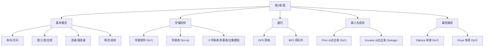

# 第 5 章　图

> **本章目标**：掌握最复杂也最有用的数据结构——**图**。学会两种存储方式、两种遍历、**最小生成树**和**最短路径**算法。
>
> **难度**：★★★★★　**建议用时**：4～5 天
>
> **本章是全书最难的一章。** 但也是最实用的——导航、社交网络、推荐系统全靠它。建议**边画图边学**，不要只看代码。

> **前置知识**：[第 3 章 队列](03-线性表的扩展.md)（**BFS 必须用队列**）、[第 4 章 树与递归](04-树.md)（**DFS 就是递归**）、[第 2 章 链表](02-线性表.md)（邻接表是"数组+链表"）
> **本章重点**：① 邻接矩阵 vs 邻接表的选择（5.2.6）② DFS/BFS（5.3.2）③ 最小生成树 Prim/Kruskal（5.4）④ 最短路径 Dijkstra/Floyd（5.5）
> **注意**：本章**所有算法都依赖前面章节**——队列、递归、贪心、动态规划都会用到

---

## 5.1　基本概念

### 5.1.1　图的定义

#### 【一句话概括】

**图 = 一堆"点"和连接这些点的"线"。**

#### 【生活类比】

**地铁线路图**：

```
     【西直门】──────【积水潭】
         │              │
         │              │
    【车公庄】──────【鼓楼大街】
```

- 每个**车站**是一个"**顶点**"
- 每段**轨道**是一条"**边**"

**再比如**：
- 微信好友关系（人 = 顶点，好友关系 = 边）
- 城市航线图（城市 = 顶点，航线 = 边）
- 网页链接（网页 = 顶点，超链接 = 边）—— 这就是 Google 的 PageRank 的基础

#### 【正式定义】

**图 G = (V, E)**
- **V**：顶点的有穷非空集合（Vertex）
- **E**：边的有穷集合（Edge）

#### 【和第 4 章"树"的区别】

| | 树 | 图 |
|---|---|---|
| 关系 | 一对多 | **多对多** |
| 能否有环 | 不能 | **可以** |
| 根节点 | 有 | 没有 |
| 边数 | n-1（n 个节点） | 任意 |

**关键**：**树是特殊的图**（没有环、连通、有一个根）。图的限制更少，所以更复杂。

### 5.1.2　图的基本术语 ⭐ 考试高频

#### 【有向图 vs 无向图】

**无向图**：边没有方向。

```
  A ─── B        A 和 B 互通（互相能到达）
```

**有向图**：边有方向（叫"**弧**"）。

```
  A ──→ B        A 能到 B，但 B 不一定能到 A
```

**符号**：
- 无向边：`(A, B)` —— 圆括号，表示无序
- 有向边（弧）：`<A, B>` —— 尖括号，表示从 A 到 B
  - A 叫**弧尾**（起点）
  - B 叫**弧头**（终点）

#### 【完全图】

**无向完全图**：任意两个顶点之间都有边。

n 个顶点的无向完全图有 **n(n-1)/2** 条边。

```
3 个顶点: 3 条边
   A
  / \
 B───C

4 个顶点: 6 条边
   A───B
   │\ /│
   │ X │
   │/ \│
   C───D
```

**有向完全图**：任意两个顶点之间都有**两条方向相反的弧**。

n 个顶点的有向完全图有 **n(n-1)** 条边。

#### 【顶点的度】

**无向图中**：顶点的度 = 与该顶点相连的**边数**。

```
   A───B
   │   │
   C───D

A 的度 = 2（连了 B 和 C）
```

**有向图中**，度分为：
- **入度（ID）**：指向该顶点的弧数
- **出度（OD）**：从该顶点出发的弧数
- **度 = 入度 + 出度**

```
   A ──→ B
   ↑     │
   │     ↓
   D ←── C

B 的入度 = 1（来自 A）
B 的出度 = 1（指向 C）
B 的度 = 2
```

**重要性质**：
```
无向图：所有顶点的度数之和 = 边数 × 2
       （因为每条边被两个顶点各算一次）

有向图：所有顶点的入度之和 = 所有顶点的出度之和 = 弧数
```

#### 【路径与回路】

| 术语 | 含义 |
|---|---|
| **路径** | 从一个顶点到另一个顶点经过的顶点序列 |
| **路径长度** | 路径上**边**的数目 |
| **简单路径** | 顶点不重复出现的路径 |
| **回路（环）** | 起点和终点相同的路径 |
| **简单回路** | 除起点终点外，顶点不重复的回路 |

#### 【连通性】

| 术语 | 含义 | 适用 |
|---|---|---|
| **连通** | 两个顶点之间有路径 | 无向图 |
| **连通图** | 任意两个顶点都连通 | 无向图 |
| **连通分量** | 无向图的**极大连通子图** | 无向图 |
| **强连通图** | 任意两个顶点**互相**可达 | 有向图 |
| **强连通分量** | 有向图的极大强连通子图 | 有向图 |

**图示**：

```
连通图（整体连通）:        非连通图（分两块）:
   A───B                     A───B      D───E
   │   │                     
   C───D                     C         F
   
（任意两点都有路径）      （有两个连通分量）
```

#### 【网（带权图）】

**网（Network）**：边带**权值**的图。

```
   A───5───B        边的权值是 5（比如距离、花费）
   │       │
   3       2
   │       │
   C───7───D
```

**实际应用**：地图上城市之间的距离、网络带宽、飞机票价。

#### 【生成树】

**生成树**：包含图中**全部 n 个顶点**和**n-1 条边**的**极小连通子图**。

```
原图:                  生成树（一种）:
   A───B                  A───B
   │\ /│                  
   │ X │                  C───D
   │/ \│
   C───D

（6 条边）              （3 条边，连接 4 个顶点，无环）
```

**特点**：
- 有 n 个顶点，n-1 条边
- 连通
- **没有回路**（再加一条边就有环了）

### 【本节自测】

**5-1-1.** 有 5 个顶点的无向完全图有多少条边？有向完全图呢？
<details><summary>答案</summary>
<ul>
<li><strong>无向完全图</strong>：n(n-1)/2 = 5×4/2 = <strong>10 条边</strong></li>
<li><strong>有向完全图</strong>：n(n-1) = 5×4 = <strong>20 条边</strong></li>
</ul>
<p><strong>推导</strong>：</p>
<ul>
<li>无向图中，每两个顶点之间有一条边，从 5 个顶点中选 2 个 = C(5,2) = 10</li>
<li>有向图中，每两个顶点之间有两条弧（双向），所以是 10×2 = 20</li>
</ul>
</details>

**5-1-2.** 一个无向图有 10 条边，求所有顶点的度数之和。
<details><summary>答案</summary>
<p><strong>度数之和 = 20</strong></p>
<p><strong>原理</strong>：无向图中，<strong>每条边贡献 2 度</strong>（给两端的顶点各加 1）。</p>
<p>所以：<strong>所有顶点的度数之和 = 边数 × 2 = 10 × 2 = 20</strong></p>
<p><strong>这个性质叫&quot;握手定理&quot;</strong>：想象 n 个人互相握手，每握一次手，总&quot;握手次数&quot;增加 2（两个人各握一次）。</p>
<p><strong>应用</strong>：如果题目问&quot;每个顶点的平均度数&quot;，就是 20/顶点数。</p>
</details>

**5-1-3.** 连通图和强连通图有什么区别？
<details><summary>答案</summary>
<ul>
<li><strong>连通图</strong>：针对<strong>无向图</strong>。任意两个顶点之间<strong>有路径</strong>（不管方向）。</li>
<li><strong>强连通图</strong>：针对<strong>有向图</strong>。任意两个顶点之间<strong>互相可达</strong>（双向都有路径）。</li>
</ul>
<p><strong>例子</strong>：</p><pre><code>有向图:  A → B → C&#10;
它是&quot;连通&quot;的（忽略方向的话，A、B、C 连在一起）
但它不是&quot;强连通&quot;的（C 到不了 A）
</code></pre><p><strong>记忆</strong>：</p>
<ul>
<li><strong>连通</strong> = 能走到（无向）</li>
<li><strong>强连通</strong> = 能互相走到（有向）</li>
</ul>
</details>

---

## 5.2　图的存储结构 ⭐

### 5.2.1　邻接矩阵

#### 【一句话概括】

**邻接矩阵 = 用一个二维数组表示"谁和谁相连"。**

#### 【无向图的邻接矩阵】

n 个顶点，开一个 n×n 的数组。`A[i][j] = 1` 表示顶点 i 和 j 之间有边。

**例子**：

```
图:            邻接矩阵:
  0───1           0  1  2  3
  │   │        0 [0, 1, 1, 0]
  │   │        1 [1, 0, 0, 1]
  2───3        2 [1, 0, 0, 1]
               3 [0, 1, 1, 0]
```

**特点**：
1. **对称矩阵**（`A[i][j] == A[j][i]`）—— 因为无向边是双向的
2. **第 i 行（或列）的 1 的个数 = 顶点 i 的度**
3. 需要的空间：**O(n²)**

#### 【有向图的邻接矩阵】

`A[i][j] = 1` 表示**从 i 到 j** 有弧。

**例子**：

```
图:            邻接矩阵:
  0 ──→ 1        0  1  2
  ↑     │     0 [0, 1, 0]
  │     ↓     1 [0, 0, 1]
  2 ←── 3     2 [0, 0, 0]
              3 [0, 0, 1]  （假设 3→2）
```

**特点**：
1. **不一定对称**
2. **第 i 行的 1 的个数 = 顶点 i 的出度**
3. **第 j 列的 1 的个数 = 顶点 j 的入度**

#### 【网的邻接矩阵】

边有权值时，`A[i][j]` 存**权值**而不是 1。

```
图:                    邻接矩阵:
  0 ──5── 1               0    1    2
  │       │            0 [ 0,   5,   3 ]
  3       2            1 [ 5,   0,   2 ]
  │       │            2 [ 3,   2,   0 ]
  2 ──2── 1

（不存在的边用 ∞ 或 0 表示）
```

**约定**：
- 顶点到自己的距离 = **0**
- 不存在的边 = **∞（无穷大）**

**为什么用 ∞？** 因为求最短路径时要"取最小值"，不存在的边如果记为 0 会干扰结果。

#### 【代码实现】

```cpp
class MGraph {
private:
    vector<char> vertex;              // 顶点表
    vector<vector<int>> edge;         // 邻接矩阵
    int numVertex, numEdge;           // 顶点数、边数

public:
    MGraph(int n) : numVertex(n), numEdge(0) {
        vertex.resize(n);
        edge.assign(n, vector<int>(n, 0));   // 初始化为 0
    }

    // 添加一条边（无向图）
    void addEdge(int i, int j, int w = 1) {
        edge[i][j] = w;
        edge[j][i] = w;     // 无向图要对称
        numEdge++;
    }
};
```

#### 【邻接矩阵的优缺点】

| | 说明 |
|---|---|
| **优点** | ① 判断两点是否相连：O(1)（直接查表）<br>② 求顶点的度：O(n)（数一行）<br>③ 实现简单 |
| **缺点** | ① 空间 O(n²)，**稀疏图极度浪费**<br>② 求"所有邻居"要遍历一整行 O(n) |

**结论**：**适合稠密图**（边多的图）。

### 5.2.2　邻接表 ⭐

#### 【一句话概括】

**邻接表 = 每个顶点挂一个链表，链表里存它的所有邻居。**

#### 【图示】

```
图:            邻接表:
  0───1        0 → [1] → [2] → NULL
  │   │        1 → [0] → [3] → NULL
  │   │        2 → [0] → [3] → NULL
  2───3        3 → [1] → [2] → NULL
```

**更直观的画法**：

```
[0] → 1 → 2 → ∧
[1] → 0 → 3 → ∧
[2] → 0 → 3 → ∧
[3] → 1 → 2 → ∧
```

#### 【有向图的邻接表】

`i → j` 表示**从 i 出发**能到 j（存的是**出边**）。

```
图:            邻接表:
  0 ──→ 1        0 → [1] → NULL
        │        1 → [2] → NULL
        ↓        2 → NULL
        2        3 → [2] → NULL
  3 ──→ 2
```

**特点**：
- **顶点 i 的链表长度 = i 的出度**

**如果想快速求入度**，可以用**逆邻接表**（存的是入边）：

```
逆邻接表:
  0 → NULL
  1 → [0] → NULL
  2 → [1] → [3] → NULL
  3 → NULL
```

#### 【网的邻接表】

节点里多存一个"权值"：

```cpp
struct EdgeNode {
    int adjvex;     // 邻接顶点编号
    int weight;     // 权值
    EdgeNode* next;
};
```

#### 【代码实现】

```cpp
struct EdgeNode {
    int adjvex;
    int weight;
    EdgeNode* next;
    EdgeNode(int v, int w) : adjvex(v), weight(w), next(nullptr) {}
};

class ALGraph {
private:
    vector<char> vertex;              // 顶点表
    vector<EdgeNode*> adjList;        // 邻接表头指针数组
    int numVertex, numEdge;

public:
    ALGraph(int n) : numVertex(n), numEdge(0) {
        vertex.resize(n);
        adjList.assign(n, nullptr);
    }

    // 添加边 i → j
    void addEdge(int i, int j, int w = 1) {
        // 头插法
        EdgeNode* node = new EdgeNode(j, w);
        node->next = adjList[i];
        adjList[i] = node;
        numEdge++;
    }

    // 添加无向边
    void addUndirectedEdge(int i, int j, int w = 1) {
        addEdge(i, j, w);
        addEdge(j, i, w);
    }
};
```

#### 【邻接表的优缺点】

| | 说明 |
|---|---|
| **优点** | ① 空间 O(n + e)，**稀疏图很省**<br>② 求"所有邻居"很快（直接遍历链表） |
| **缺点** | ① 判断两点是否相连：O(度)（要遍历链表）<br>② 求有向图的**入度**麻烦（要遍历所有链表） |

**结论**：**适合稀疏图**（边少的图）。

### 5.2.3　十字链表

**用于有向图**，把"邻接表"和"逆邻接表"结合。

**每个顶点有两个链**：
- **出边链**（firstOut）
- **入边链**（firstIn）

**每个边节点有四个域**：

```
┌────────┬────────┬────────┬────────┐
│ tailvex│ headvex│ hlink  │ tlink  │
│ 弧尾   │ 弧头   │ 入边链 │ 出边链 │
└────────┴────────┴────────┴────────┘
```

**优点**：求入度和出度都很方便，O(1) 找到第一条边。

**代价**：结构复杂，实现麻烦。

### 5.2.4　邻接多重表

**用于无向图**。

**解决的问题**：无向图的邻接表中，每条边**存了两次**（i 的表里有 j，j 的表里也有 i）。

**邻接多重表**让**每条边只存一个节点**，两个顶点共享它。

**优点**：节省空间，方便"删除一条边"。

### 5.2.5　边集数组

**把所有边存成一个数组**，每个元素是 `(起点, 终点, 权值)`。

```cpp
struct Edge {
    int from, to, weight;
};
vector<Edge> edges;
```

**优点**：
- 结构简单
- **特别适合"按边处理"的算法**（如 Kruskal 算法）

**缺点**：
- 找"某个顶点的所有邻居"很慢（要遍历所有边）

### 5.2.6　图的存储结构比较 ⭐

| 存储方式 | 空间 | 判断两点相连 | 求所有邻居 | 求度 | 适用 |
|---|---|---|---|---|---|
| **邻接矩阵** | O(n²) | **O(1)** ★ | O(n) | O(n) | **稠密图** |
| **邻接表** | **O(n+e)** ★ | O(度) | **O(度)** ★ | O(度)（入度麻烦） | **稀疏图** |
| 十字链表 | O(n+e) | O(度) | O(度) | **O(1)** | 有向图 |
| 邻接多重表 | O(n+e) | O(度) | O(度) | O(度) | 无向图 |
| 边集数组 | O(e) | O(e) | O(e) | O(e) | 按边处理的算法 |

#### 【选择建议】

```
图很稠密（边接近 n²/2） → 邻接矩阵
图很稀疏（边远少于 n²） → 邻接表
需要频繁判断"两点是否相连" → 邻接矩阵
需要频繁遍历"某点的所有邻居" → 邻接表
算法按边处理（Kruskal） → 边集数组
```

**实际工程中**：绝大多数图都是**稀疏的**，所以**邻接表用得最多**。

### 【本节自测】

**5-2-1.** 一个有 100 个顶点、200 条边的图，用邻接矩阵和邻接表分别需要多少存储空间？
<details><summary>答案</summary>
<ul>
<li><strong>邻接矩阵</strong>：100 × 100 = <strong>10000 个存储单元</strong>（不管有多少边，都是 n²）</li>
<li><strong>邻接表</strong>：
<ul>
<li>顶点表：100 个</li>
<li>边节点：无向图每条边存 2 次 → 200 × 2 = <strong>400 个</strong></li>
<li>合计约 <strong>500 个存储单元</strong></li>
</ul>
</li>
</ul>
<p><strong>结论</strong>：这个图<strong>稀疏</strong>（200 条边 vs 完全图的 4950 条边），邻接表省了 <strong>20 倍</strong>空间。</p>
<p><strong>判断标准</strong>：如果 <code>边数 &lt;&lt; n²/2</code>，用邻接表。</p>
</details>

**5-2-2.** 邻接矩阵中，如何快速求一个顶点的"度"？有向图怎么求入度和出度？
<details><summary>答案</summary>
<p><strong>无向图</strong>：</p>
<ul>
<li><strong>第 i 行（或第 i 列）中 1 的个数</strong> = 顶点 i 的度</li>
<li>因为无向图的邻接矩阵是对称的，所以行和列的 1 的个数相同</li>
</ul>
<p><strong>有向图</strong>：</p>
<ul>
<li><strong>第 i 行中 1 的个数</strong> = 顶点 i 的<strong>出度</strong></li>
<li><strong>第 i 列中 1 的个数</strong> = 顶点 i 的<strong>入度</strong></li>
</ul>
<p><strong>记忆</strong>：</p>
<ul>
<li><strong>行</strong> → 从自己出去（<strong>出度</strong>）</li>
<li><strong>列</strong> → 从别人进来（<strong>入度</strong>）</li>
</ul>
<p><strong>例子</strong>：</p><pre><code>邻接矩阵:        0  1  2
              0 [0, 1, 1]   ← 第0行有2个1 → 顶点0出度=2
              1 [0, 0, 0]
              2 [1, 0, 0]
                ↑
              第0列有1个1 → 顶点0入度=1
</code></pre>
</details>

**5-2-3.** 为什么无向图的邻接矩阵一定是对称的？
<details><summary>答案</summary>
<p>因为<strong>无向边是双向的</strong>。</p>
<p>无向图中，边 <code>(i, j)</code> 表示 i 和 j <strong>互相</strong>相连。所以在邻接矩阵中：</p><pre><code>A[i][j] = 1  （i 连 j）
A[j][i] = 1  （j 也连 i）
</code></pre><p>两者必须相等，所以矩阵沿主对角线对称。</p>
<p><strong>推论</strong>：</p>
<ul>
<li>存储时可以只存<strong>上三角</strong>（或下三角），节省一半空间</li>
<li>有向图不一定对称（因为弧有方向）</li>
</ul>
</details>

---

## 5.3　图的实现

### 5.3.1　图的构建

以邻接表为例，构建一个图：

```cpp
ALGraph* buildGraph() {
    ALGraph* g = new ALGraph(6);

    g->addUndirectedEdge(0, 1);
    g->addUndirectedEdge(0, 2);
    g->addUndirectedEdge(1, 3);
    g->addUndirectedEdge(1, 4);
    g->addUndirectedEdge(2, 5);

    return g;
}
```

### 5.3.2　图的遍历 ⭐ 核心

**图的遍历有两种**：
- **深度优先搜索（DFS）**
- **广度优先搜索（BFS）**

#### 【⚠ 图遍历的关键：必须标记"已访问"！】

**为什么？** 因为图**可能有环**！

```
  0 ── 1
  │    │
  └── 2 ┘

从 0 出发：0 → 1 → 2 → 0 → 1 → 2 → ... 死循环！
```

**所以必须用一个 `visited` 数组标记走过的顶点。**

**这是图遍历和树遍历最大的区别**（树没有环，所以不用标记）。

#### 【DFS：深度优先搜索】

**思路**：一条路走到黑，走不动了再退回来。

**算法步骤**：
1. 访问顶点 v，标记已访问
2. 找 v 的一个**未访问的邻居**，递归 DFS
3. 重复直到所有邻居都访问过
4. 回溯

```cpp
void DFS(int v, vector<bool>& visited) {
    cout << v << " ";         // 访问
    visited[v] = true;        // ★ 标记已访问

    // 遍历 v 的所有邻居
    for (EdgeNode* p = adjList[v]; p != nullptr; p = p->next) {
        if (!visited[p->adjvex]) {
            DFS(p->adjvex, visited);   // 递归
        }
    }
}
```

**图示**（从 0 出发）：

```
图:            邻接表:
  0───1        0 → [2] → [1] → ∧
  │   │        1 → [4] → [3] → [0] → ∧
  │   │        2 → [5] → [0] → ∧
  2───5        3 → [1] → ∧
  │            4 → [1] → ∧
  1───3,4      5 → [2] → ∧

DFS 过程:
  访问 0 → 邻居有 2, 1
    访问 2 → 邻居有 5, 0（0 已访问）
      访问 5 → 邻居有 2（已访问）→ 返回
    返回
    访问 1 → 邻居有 4, 3, 0（0 已访问）
      访问 4 → 邻居有 1（已访问）→ 返回
      访问 3 → 邻居有 1（已访问）→ 返回

DFS 序列: 0 2 5 1 4 3
```

**⚠ 注意**：DFS 序列**不唯一**！取决于邻居的访问顺序（邻接表里链表的顺序）。

#### 【BFS：广度优先搜索】

**思路**：一层一层来，先访问所有"距离为 1"的，再访问"距离为 2"的。

**算法步骤**：
1. 访问起点 v，标记已访问，**入队**
2. 出队一个顶点 u
3. 把 u 所有**未访问的邻居**标记并**入队**
4. 重复直到队列空

```cpp
void BFS(int v) {
    vector<bool> visited(numVertex, false);
    queue<int> q;

    cout << v << " ";
    visited[v] = true;
    q.push(v);                        // ★ 起点入队

    while (!q.empty()) {
        int u = q.front();
        q.pop();

        // 遍历 u 的所有邻居
        for (EdgeNode* p = adjList[u]; p != nullptr; p = p->next) {
            int w = p->adjvex;
            if (!visited[w]) {
                cout << w << " ";
                visited[w] = true;    // ★ 入队时就标记（重要！）
                q.push(w);
            }
        }
    }
}
```

**图示**（同样的图，从 0 出发）：

```
BFS 过程:
  队列 = [0]，访问 0

  出队 0，邻居 2, 1 都没访问
    访问 2，入队 → 队列 = [2]
    访问 1，入队 → 队列 = [2, 1]

  出队 2，邻居 5, 0（0 已访问）
    访问 5，入队 → 队列 = [1, 5]

  出队 1，邻居 4, 3, 0（0 已访问）
    访问 4，入队 → 队列 = [5, 4]
    访问 3，入队 → 队列 = [5, 4, 3]

  出队 5，邻居 2（已访问）
  出队 4，邻居 1（已访问）
  出队 3，邻居 1（已访问）

BFS 序列: 0 2 1 5 4 3
```

#### 【⚠ BFS 的一个关键细节】

**入队时就要标记 `visited`，不能等到出队时才标记！**

**为什么？**

```
错误写法（出队时才标记）:
  出队 u，遍历邻居 w
    if (!visited[w]) { q.push(w); }   ← 没标记！
    
问题: 同一个 w 可能被多个 u 重复入队！

例子:
  0 的邻居是 1, 2
  1 和 2 都连到 3
  
  处理 0: 1 和 2 入队
  处理 1: 3 入队（3 还没标记）
  处理 2: 3 又入队！（因为 3 还没被标记）
  → 3 在队列里出现了两次，会被访问两次！
```

**正确写法**：
```cpp
if (!visited[w]) {
    visited[w] = true;   // ★ 立刻标记
    q.push(w);
}
```

#### 【DFS vs BFS 对比】

| | DFS | BFS |
|---|---|---|
| **数据结构** | **栈**（递归用的是系统栈） | **队列** |
| **访问顺序** | 一条路走到底 | 一层层扩散 |
| **空间** | O(深度) | O(宽度) |
| **能否求最短路径** | 不能（除非遍历所有路径） | **能**（无权图）★ |
| **典型应用** | 找所有路径、拓扑排序、连通分量 | 最短路径、层次遍历 |

**记忆**：
- **DFS 用栈**（递归）
- **BFS 用队列**

**这个对应关系和第 4 章"二叉树遍历"完全一致**：
- 二叉树先/中/后序 = DFS（用栈）
- 二叉树层次遍历 = BFS（用队列）

### 5.3.3　图的析构

**图用邻接表存储时，析构要释放所有边节点：**

```cpp
~ALGraph() {
    for (int i = 0; i < numVertex; i++) {
        EdgeNode* p = adjList[i];
        while (p != nullptr) {
            EdgeNode* q = p->next;
            delete p;
            p = q;
        }
    }
}
```

**为什么要注意这个？** 因为邻接表的每个边节点都是 `new` 出来的，不释放就内存泄漏。

### 【本节自测】

**5-3-1.** 为什么图的遍历一定要标记"已访问"，而树的遍历不用？
<details><summary>答案</summary>
<p>因为<strong>图可能有环，树没有</strong>。</p>
<p><strong>树</strong>：从根到任意节点只有<strong>唯一</strong>一条路径（没有环），所以遍历时不会重复访问。</p>
<p><strong>图</strong>：存在环，如果不标记，会在环里<strong>无限循环</strong>。</p>
<p><strong>例子</strong>：</p><pre><code>三角形图: 0 ── 1
          │    │
          └─ 2 ┘&#10;
从 0 出发（不标记）:
  0 → 1 → 2 → 0 → 1 → 2 → ...  死循环！
</code></pre><p><strong>所以图遍历必须用 <code>visited</code> 数组记录&quot;来过的顶点&quot;。</strong></p>
<p><strong>这也是为什么&quot;图&quot;比&quot;树&quot;复杂</strong>：需要额外的状态管理。</p>
</details>

**5-3-2.** 对下面的图，从顶点 0 出发，分别写出 DFS 和 BFS 序列（假设邻接表中邻居按编号从小到大排列）。

```
  0 ── 1
  │    │
  2 ── 3
```
<details><summary>答案</summary>
<p><strong>邻接表</strong>：</p><pre><code>0 → [1] → [2]
1 → [0] → [3]
2 → [0] → [3]
3 → [1] → [2]
</code></pre><p><strong>DFS 序列：<code>0 1 3 2</code></strong></p>
<p>过程：</p><pre><code>访问 0
  邻居 1 未访问 → 访问 1
    1 的邻居 0（已访问）、3 未访问 → 访问 3
      3 的邻居 1（已访问）、2 未访问 → 访问 2
        2 的邻居 0（已访问）、3（已访问）→ 返回
</code></pre><p><strong>BFS 序列：<code>0 1 2 3</code></strong></p>
<p>过程：</p><pre><code>队列 = [0]，访问 0&#10;
出队 0，邻居 1, 2 未访问
  访问 1，入队 → 队列 [1]
  访问 2，入队 → 队列 [1, 2]&#10;
出队 1，邻居 0（已访问）、3 未访问
  访问 3，入队 → 队列 [2, 3]&#10;
出队 2，邻居 0, 3 都已访问
出队 3，邻居 1, 2 都已访问
</code></pre><p><strong>注意</strong>：DFS 和 BFS 的序列<strong>都不唯一</strong>，取决于邻接表中邻居的顺序。</p>
</details>

**5-3-3.** BFS 中为什么要在"入队时"就标记 visited，而不是"出队时"？
<details><summary>答案</summary>
<p>因为<strong>入队时不标记会导致同一个顶点被多次入队</strong>。</p>
<p><strong>场景</strong>：</p><pre><code>图: 0 的邻居是 1, 2
    1 和 2 都连到 3&#10;
错误写法（出队时标记）:
  处理 0: 1 入队，2 入队        （都没标记）
  处理 1: 3 未标记 → 3 入队
  处理 2: 3 还是未标记 → 3 又入队！  ← 重复了
  → 3 会被访问两次
</code></pre><p><strong>后果</strong>：</p>
<ul>
<li>顶点被重复访问（输出重复）</li>
<li>队列膨胀，效率降低</li>
</ul>
<p><strong>正确做法</strong>：</p><pre><code class="language-cpp">if (!visited[w]) {
    visited[w] = true;   // ★ 入队前就标记
    q.push(w);
}
</code></pre><p><strong>这个细节很容易漏，是 BFS 实现的经典坑。</strong></p>
</details>

---

## 5.4　最小生成树 ⭐ 重要

### 【问题背景】

**问题**：要在 n 个城市之间铺设光缆，使任意两个城市都能通信，且**总成本最低**。

**抽象**：在一个**带权连通图**中，找一棵**生成树**，使**所有边的权值之和最小**。

**这棵树就叫"最小生成树（MST, Minimum Spanning Tree）"。**

### 【最小生成树的性质】

1. **有 n 个顶点，n-1 条边**
2. **没有回路**
3. **边权之和最小**
4. **最小生成树可能不唯一**（权值相同时），但**权值和唯一**

### 【两种经典算法】

| 算法 | 思路 | 适合 |
|---|---|---|
| **Prim（普里姆）** | 从一个点开始，不断"长出"最近的顶点 | **稠密图** |
| **Kruskal（克鲁斯卡尔）** | 不断选"最小的边"，只要不形成环 | **稀疏图** |

**记忆**：
- **Prim 从"点"出发**（加点）
- **Kruskal 从"边"出发**（加边）

### 5.4.1　普里姆算法（Prim）

#### 【思路】

**从一个顶点开始，每次加入"距离当前生成树最近的顶点"。**

**算法步骤**：
1. 任选一个顶点作为起点，加入生成树
2. 在"生成树中的顶点"和"生成树外的顶点"之间的所有边中，找**权值最小**的那条
3. 把那条边连接的**外部顶点**加入生成树
4. 重复 n-1 次，直到所有顶点都加入

#### 【手工模拟】

```
图（顶点 A B C D E F）:

        A
      / | \
     6  1  5
    /   |   \
   B    C    D
   |   / \   |
   5  5   6  2
   | /     \ |
   E ───4─── F
```

**从 A 开始**：

| 步骤 | 生成树顶点集 | 候选边（权值） | 选中 |
|---|---|---|---|
| 初始 | {A} | —— | —— |
| 1 | {A} | A-B(6), **A-C(1)**, A-D(5) | **A-C(1)** |
| 2 | {A,C} | A-B(6), A-D(5), C-B(5), C-E(5), C-F(6) | **A-D(5)** |
| 3 | {A,C,D} | A-B(6), C-B(5), C-E(5), C-F(6), D-F(2) | **D-F(2)** |
| 4 | {A,C,D,F} | A-B(6), C-B(5), C-E(5), F-E(4) | **F-E(4)** |
| 5 | {A,C,D,F,E} | A-B(6), C-B(5), E-B(5) | **C-B(5)** |
| 6 | {A,C,D,F,E,B} | 全部加入 | 完成 |

**最小生成树的边**：`A-C(1), A-D(5), D-F(2), F-E(4), C-B(5)`

**总权值** = 1 + 5 + 2 + 4 + 5 = **17**

#### 【代码实现】

```cpp
int prim(vector<vector<int>>& graph, int n) {
    const int INF = 1e9;
    vector<int> dist(n, INF);      // dist[i] = i 到生成树的最短距离
    vector<bool> inTree(n, false); // 是否已在生成树中
    int total = 0;

    dist[0] = 0;                   // 从顶点 0 开始

    for (int i = 0; i < n; i++) {
        // ① 找"不在树中且距离最小"的顶点
        int u = -1;
        for (int j = 0; j < n; j++) {
            if (!inTree[j] && (u == -1 || dist[j] < dist[u])) {
                u = j;
            }
        }
        if (dist[u] == INF) break;   // 不连通

        // ② 加入生成树
        inTree[u] = true;
        total += dist[u];

        // ③ 更新其他顶点到生成树的距离
        for (int v = 0; v < n; v++) {
            if (!inTree[v] && graph[u][v] < dist[v]) {
                dist[v] = graph[u][v];
            }
        }
    }
    return total;
}
```

**时间复杂度**：**O(n²)**（适合稠密图）

> 用优先队列（堆）优化可以做到 O(e log n)，但对稠密图来说 O(n²) 已经够了。

### 5.4.2　克鲁斯卡尔算法（Kruskal）

#### 【思路】

**把所有边按权值从小到大排序，依次加入，如果形成环就跳过。**

**算法步骤**：
1. 把所有边按权值**升序排序**
2. 依次考察每条边：
   - 如果这条边的两个顶点**不在同一个连通分量**里 → **加入**（合并两个分量）
   - 如果已经在同一个分量里 → **跳过**（会形成环）
3. 重复直到选了 n-1 条边

#### 【关键：怎么判断"会形成环"？】

**用"并查集"（Union-Find）**！

**并查集的核心操作**：
- `find(x)`：找 x 属于哪个集合（返回代表元）
- `union(x, y)`：把 x 和 y 所在的集合合并

**判断环**：如果边 `(u, v)` 的两个端点 `find(u) == find(v)`，说明它们已经在同一个集合里，加这条边会形成环。

#### 【手工模拟】

**用同一个图**，先列出所有边并排序：

```
边（按权值排序）:
  A-C(1)
  D-F(2)
  F-E(4)
  A-D(5)
  C-B(5)
  C-E(5)
  A-B(6)
  C-F(6)
  B-E(5)  ← 注意这里还有 B-E
```

| 步骤 | 边 | 判断 | 操作 |
|---|---|---|---|
| 1 | A-C(1) | A、C 不同集合 | **加入** ✓ |
| 2 | D-F(2) | D、F 不同集合 | **加入** ✓ |
| 3 | F-E(4) | F、E 不同集合 | **加入** ✓ |
| 4 | A-D(5) | A、D 不同集合 | **加入** ✓ |
| 5 | C-B(5) | C、B 不同集合 | **加入** ✓ |
| —— | 已选 5 条边 = n-1，**结束** |

**结果**：`A-C(1), D-F(2), F-E(4), A-D(5), C-B(5)`，总权值 **17** ✓

**和 Prim 的结果一致！**（最小生成树的权值唯一）

#### 【代码实现】

```cpp
// 并查集
class UnionFind {
    vector<int> parent;
public:
    UnionFind(int n) {
        parent.resize(n);
        for (int i = 0; i < n; i++) parent[i] = i;   // 每个点自成一个集合
    }

    int find(int x) {
        if (parent[x] != x) {
            parent[x] = find(parent[x]);   // ★ 路径压缩
        }
        return parent[x];
    }

    bool unite(int x, int y) {
        int rx = find(x), ry = find(y);
        if (rx == ry) return false;        // 已经在同一集合 → 会形成环
        parent[rx] = ry;
        return true;
    }
};

int kruskal(vector<Edge>& edges, int n) {
    // ① 按权值排序
    sort(edges.begin(), edges.end(),
         [](const Edge& a, const Edge& b) { return a.weight < b.weight; });

    UnionFind uf(n);
    int total = 0, count = 0;

    // ② 依次考察每条边
    for (const Edge& e : edges) {
        if (uf.unite(e.from, e.to)) {     // 不形成环就加入
            total += e.weight;
            count++;
            if (count == n - 1) break;    // 已选够 n-1 条边
        }
    }
    return total;
}
```

**时间复杂度**：**O(e log e)**（主要是排序的开销，适合稀疏图）

#### 【Prim vs Kruskal】

| | Prim | Kruskal |
|---|---|---|
| **思路** | 从点出发，加点 | 从边出发，加边 |
| **数据结构** | 数组/优先队列 | 边集数组 + 并查集 |
| **时间复杂度** | O(n²) | O(e log e) |
| **适合** | **稠密图**（e ≈ n²） | **稀疏图**（e << n²） |
| **实现难度** | 中等 | 简单（但要会并查集） |

### 【本节自测】

**5-4-1.** 什么是最小生成树？它有哪两个关键特点？
<details><summary>答案</summary>
<p><strong>最小生成树（MST）</strong>：在带权连通图中，边权之和最小的生成树。</p>
<p><strong>两个关键特点</strong>：</p>
<ol>
<li><strong>有 n 个顶点、n-1 条边、无回路</strong>（这是&quot;生成树&quot;的定义）</li>
<li><strong>边权之和在所有生成树中最小</strong>（这是&quot;最小&quot;的含义）</li>
</ol>
<p><strong>补充</strong>：</p>
<ul>
<li>最小生成树<strong>可能不唯一</strong>（权值相同时有多种选法）</li>
<li>但<strong>最小权值和是唯一的</strong></li>
</ul>
</details>

**5-4-2.** Prim 和 Kruskal 算法的核心区别是什么？分别适合什么图？
<details><summary>答案</summary>
<p><strong>核心区别</strong>：</p>
<table>
<thead>
<tr>
<th></th>
<th>Prim</th>
<th>Kruskal</th>
</tr>
</thead>
<tbody>
<tr>
<td><strong>出发点</strong></td>
<td><strong>顶点</strong>（每次加一个点）</td>
<td><strong>边</strong>（每次加一条边）</td>
</tr>
<tr>
<td><strong>贪心策略</strong></td>
<td>选&quot;离生成树最近的顶点&quot;</td>
<td>选&quot;权值最小且不成环的边&quot;</td>
</tr>
<tr>
<td><strong>判环方式</strong></td>
<td>天然不会成环（只加外部顶点）</td>
<td>需要<strong>并查集</strong>判环</td>
</tr>
</tbody>
</table>
<p><strong>适用场景</strong>：</p>
<ul>
<li><strong>Prim</strong>：<strong>稠密图</strong>（边多）。O(n²) 与边数无关。</li>
<li><strong>Kruskal</strong>：<strong>稀疏图</strong>（边少）。O(e log e) 与边数有关。</li>
</ul>
<p><strong>记忆</strong>：</p>
<ul>
<li><strong>Prim</strong> → <strong>P</strong>oint（点）→ 从点出发</li>
<li><strong>Kruskal</strong> → <strong>K</strong>ruskal 的边集数组 → 从边出发</li>
</ul>
</details>

**5-4-3.** 用 Kruskal 算法时，为什么判断"会形成环"可以用并查集？
<details><summary>答案</summary>
<p>因为**&quot;形成环&quot;等价于&quot;两个端点已经在同一个连通分量里&quot;**。</p>
<p><strong>推理</strong>：</p>
<ul>
<li>如果边 <code>(u, v)</code> 的两个端点 <code>u</code> 和 <code>v</code> <strong>已经在同一个连通分量</strong>里，说明已经有一条路径从 u 通到 v 了。再加这条边，就形成了环。</li>
<li>如果 <code>u</code> 和 <code>v</code> 在<strong>不同的连通分量</strong>里，加这条边只是把两个分量连起来，不会形成环。</li>
</ul>
<p><strong>并查集正好能做这件事</strong>：</p>
<ul>
<li><code>find(u) == find(v)</code> → 同一分量 → 会成环 → <strong>跳过</strong></li>
<li><code>find(u) != find(v)</code> → 不同分量 → 安全 → <strong>加入，并 union(u,v)</strong></li>
</ul>
<p><strong>并查集的效率</strong>：加了&quot;路径压缩&quot;后，<code>find</code> 的均摊复杂度接近 <strong>O(1)</strong>。</p>
</details>

---

## 5.5　最短路径 ⭐⭐ 最实用

### 【问题背景】

**问题**：从 A 城市到 B 城市，怎么走**总路程最短**？

**这就是 GPS 导航的核心问题。**

### 【两类问题】

| 类型 | 算法 | 说明 |
|---|---|---|
| **单源最短路径** | **Dijkstra（迪杰斯特拉）** | 从一个顶点到**其他所有顶点**的最短路径 |
| **多源最短路径** | **Floyd（弗洛伊德）** | **任意两点之间**的最短路径 |

### 5.5.1　Dijkstra 算法

#### 【核心思想】

**贪心**：每次从"未确定的顶点"中，选出**距离起点最近**的那个，确定它的最短路径，然后用它去更新其他顶点。

#### 【算法步骤】

1. 初始化：起点距离为 0，其他顶点距离为 ∞
2. 重复 n 次：
   - 从未确定的顶点中，选**距离最小**的 u
   - 标记 u 为"已确定"
   - 用 u 更新它的所有邻居：如果 `dist[u] + w(u,v) < dist[v]`，就更新 `dist[v]`

#### 【⚠ 重要限制：不能有负权边！】

**Dijkstra 要求所有边的权值非负。**

**为什么？** 因为它的贪心策略假设"已经确定的顶点不会再被更新"。如果有负权边，后面可能找到更短的路径，这个假设就崩了。

**有负权边要用 Bellman-Ford 算法**（不在本书范围）。

#### 【手工模拟】

```
图（从 A 出发）:

     A ──4── B
     │       │
     2       1
     │       │
     C ──3── D
```

**邻接矩阵**：
```
     A    B    C    D
A [  0,   4,   2,   ∞ ]
B [  4,   0,   ∞,   1 ]
C [  2,   ∞,   0,   3 ]
D [  ∞,   1,   3,   0 ]
```

**Dijkstra 过程**（dist 数组记录 A 到各点的最短距离）：

| 轮次 | 已确定 | dist[A] | dist[B] | dist[C] | dist[D] | 选中 |
|---|---|---|---|---|---|---|
| 初始 | {} | 0 | ∞ | ∞ | ∞ | —— |
| 1 | {A} | 0 | 4 | 2 | ∞ | **C**（dist=2） |
| 2 | {A,C} | 0 | 4 | 2 | 5 | **B**（dist=4） |
| 3 | {A,C,B} | 0 | 4 | 2 | **5** | **D**（dist=5） |
| 4 | {A,C,B,D} | 0 | 4 | 2 | 5 | 完成 |

**逐步解释**：

**第 1 轮**：从 A 出发
- A 的邻居：B(距离4)、C(距离2)
- dist = [0, 4, 2, ∞]
- 选最小的 C（dist=2），确定 A→C = 2

**第 2 轮**：用 C 更新
- C 的邻居：A（已确定）、D(距离3)
- `dist[C] + 3 = 2 + 3 = 5 < ∞` → 更新 `dist[D] = 5`
- dist = [0, 4, 2, 5]
- 未确定的里最小的是 B（dist=4），确定 A→B = 4

**第 3 轮**：用 B 更新
- B 的邻居：A（已确定）、D(距离1)
- `dist[B] + 1 = 4 + 1 = 5`，与当前 `dist[D] = 5` **相等**，不更新
- 选 D（dist=5），确定

**第 4 轮**：所有顶点已确定，完成。

**最终最短距离**：
- A→A = 0
- A→B = 4（直达 A→B）
- A→C = 2（直达 A→C）
- A→D = 5（A→C→D 或 A→B→D，两条路都是 5）

#### 【代码实现】

```cpp
vector<int> dijkstra(vector<vector<int>>& graph, int n, int start) {
    const int INF = 1e9;
    vector<int> dist(n, INF);
    vector<bool> visited(n, false);

    dist[start] = 0;

    for (int i = 0; i < n; i++) {
        // ① 找未访问中 dist 最小的
        int u = -1;
        for (int j = 0; j < n; j++) {
            if (!visited[j] && (u == -1 || dist[j] < dist[u])) {
                u = j;
            }
        }
        if (dist[u] == INF) break;    // 剩下的都不可达

        // ② 标记已确定
        visited[u] = true;

        // ③ 松弛操作：用 u 更新邻居
        for (int v = 0; v < n; v++) {
            if (!visited[v] && graph[u][v] != INF) {
                if (dist[u] + graph[u][v] < dist[v]) {
                    dist[v] = dist[u] + graph[u][v];
                }
            }
        }
    }
    return dist;
}
```

**时间复杂度**：**O(n²)**（适合稠密图）

> 用优先队列优化可以做到 O(e log n)，适合稀疏图。

#### 【"松弛"是什么意思】

**松弛（Relaxation）**：如果找到一条更短的路径，就更新距离。

```cpp
if (dist[u] + w(u,v) < dist[v]) {
    dist[v] = dist[u] + w(u,v);   // 松弛成功，找到更短的路
}
```

**为什么叫"松弛"？** 想象 dist[v] 是一根被拉紧的橡皮筋，找到更短路径就"放松"了它。

### 5.5.2　Floyd 算法

#### 【核心思想】

**动态规划**：逐个尝试"经过某个中间顶点"，看能不能让路径更短。

#### 【状态定义】

**`dist[i][j]`** = 从 i 到 j 的最短路径长度。

**初始**：`dist[i][j]` = 邻接矩阵的值（直达距离）

#### 【状态转移方程】

**依次考虑每个顶点 k 作为"中间点"**：

```
dist[i][j] = min( dist[i][j],  dist[i][k] + dist[k][j] )
```

**含义**：从 i 到 j，要么**直接走**，要么**经过 k 中转**，取更短的那个。

#### 【代码实现】（极简！）

```cpp
void floyd(vector<vector<int>>& dist, int n) {
    const int INF = 1e9;

    // ★ 三重循环，就这么简单
    for (int k = 0; k < n; k++) {          // 中间点
        for (int i = 0; i < n; i++) {      // 起点
            for (int j = 0; j < n; j++) {  // 终点
                if (dist[i][k] != INF && dist[k][j] != INF) {
                    dist[i][j] = min(dist[i][j],
                                     dist[i][k] + dist[k][j]);
                }
            }
        }
    }
}
```

**就三重循环！** 这就是 Floyd 的优雅之处。

#### 【⚠ 注意 k 必须在最外层！】

**为什么？**

因为 Floyd 是"**逐个允许中间点**"的过程：
- 第 1 轮：只允许经过顶点 0 中转
- 第 2 轮：允许经过顶点 0 或 1 中转
- 第 3 轮：允许经过顶点 0、1、2 中转
- ……

**如果 k 不在最外层**，这个"逐步放开"的逻辑就错了。

#### 【手工模拟】

用前面的例子（A=0, B=1, C=2, D=3）：

**初始邻接矩阵**：
```
     0    1    2    3
0 [  0,   4,   2,  ∞ ]
1 [  4,   0,   ∞,  1 ]
2 [  2,   ∞,   0,  3 ]
3 [  ∞,   1,   3,  0 ]
```

**k=0（允许经过 A 中转）**：
- 检查所有 `dist[i][j] > dist[i][0] + dist[0][j]`
- `dist[2][1]`: ∞ > dist[2][0]+dist[0][1] = 2+4 = 6 → 更新为 6
- `dist[1][2]`: ∞ > 4+2 = 6 → 更新为 6
- `dist[3][1]`: 1 > dist[3][0]+4，但 dist[3][0]=∞，跳过
- 结果：
```
     0    1    2    3
0 [  0,   4,   2,  ∞ ]
1 [  4,   0,   6,   1 ]
2 [  2,   6,   0,   3 ]
3 [  ∞,   1,   3,   0 ]
```

**k=1（允许经过 B 中转）**：
- `dist[0][3]`: ∞ > dist[0][1]+dist[1][3] = 4+1 = 5 → 更新为 5
- `dist[2][3]`: 3 > dist[2][1]+dist[1][3] = 6+1 = 7？不，3 < 7，不更新
- `dist[3][0]`: ∞ > dist[3][1]+dist[1][0] = 1+4 = 5 → 更新为 5
- 结果：
```
     0    1    2    3
0 [  0,   4,   2,   5 ]
1 [  4,   0,   6,   1 ]
2 [  2,   6,   0,   3 ]
3 [  5,   1,   3,   0 ]
```

**k=2（允许经过 C 中转）**：
- `dist[1][0]`: 4 > dist[1][2]+dist[2][0] = 6+2 = 8？不，4 < 8，不更新
- `dist[3][1]`: 1 > dist[3][2]+dist[2][1] = 3+6 = 9？不更新
- 无更新

**k=3（允许经过 D 中转）**：
- `dist[0][2]`: 2 > dist[0][3]+dist[3][2] = 5+3 = 8？不更新
- `dist[1][0]`: 4 > dist[1][3]+dist[3][0] = 1+5 = 6？不更新
- `dist[2][0]`: 2 > dist[2][3]+dist[3][0] = 3+5 = 8？不更新
- **`dist[1][2]`: 6 > dist[1][3]+dist[3][2] = 1+3 = 4 → 更新为 4** ★
- **`dist[2][1]`: 6 > dist[2][3]+dist[3][1] = 3+1 = 4 → 更新为 4** ★
- 结果：
```
     0    1    2    3
0 [  0,   4,   2,   5 ]
1 [  4,   0,   4,   1 ]
2 [  2,   4,   0,   3 ]
3 [  5,   1,   3,   0 ]
```

> **⚠ 这一轮最容易漏！** 前面 k=0 时算出的 `dist[1][2] = 6`（B→A→C）看着挺合理，
> 但它**不是最短的**——因为后来 k=3 时，B→D→C = 1+3 = **4** 更短。
> **Floyd 必须把每一轮的所有 (i, j) 组合都检查一遍**，不能只看几个"看起来会变"的格子。
> 这正是三重循环不能省、k 必须放最外层的意义所在。

**最终结果**：
```
     0    1    2    3
0 [  0,   4,   2,   5 ]
1 [  4,   0,   4,   1 ]
2 [  2,   4,   0,   3 ]
3 [  5,   1,   3,   0 ]
```

**验证**：
- `dist[0][3] = 5`（A→B→D = 4+1=5）✓ 与 Dijkstra 结果一致
- `dist[1][2] = 4`（B→D→C = 1+3=4）✓ 比 B→A→C 的 6 更短，正确
- `dist[2][1] = 4`（C→D→B = 3+1=4）✓ 对称，正确

#### 【复杂度】

**时间**：**O(n³)**（三重循环）
**空间**：O(n²)

**优缺点**：
- **优点**：一次算出**所有点对**的最短路径；代码极简；能处理**负权边**（但不能有负权环）
- **缺点**：O(n³)，n 大时很慢（n=1000 时是 10 亿次运算）

### 【本节自测】

**5-5-1.** Dijkstra 和 Floyd 算法各解决什么问题？
<details><summary>答案</summary>
<table>
<thead>
<tr>
<th></th>
<th>Dijkstra</th>
<th>Floyd</th>
</tr>
</thead>
<tbody>
<tr>
<td><strong>问题</strong></td>
<td><strong>单源</strong>最短路径</td>
<td><strong>多源</strong>最短路径</td>
</tr>
<tr>
<td><strong>求什么</strong></td>
<td>从<strong>一个</strong>起点到其他所有点的最短路径</td>
<td><strong>任意两点</strong>之间的最短路径</td>
</tr>
<tr>
<td><strong>时间复杂度</strong></td>
<td>O(n²)</td>
<td>O(n³)</td>
</tr>
<tr>
<td><strong>核心思想</strong></td>
<td>贪心</td>
<td>动态规划</td>
</tr>
<tr>
<td><strong>负权边</strong></td>
<td><strong>不支持</strong></td>
<td>支持（不能有负权环）</td>
</tr>
</tbody>
</table>
<p><strong>选择</strong>：</p>
<ul>
<li>只要求&quot;从一个点到所有点&quot; → <strong>Dijkstra</strong>（更快）</li>
<li>要求&quot;所有点对之间&quot; → <strong>Floyd</strong>（一次搞定）</li>
</ul>
</details>

**5-5-2.** 为什么 Dijkstra 算法不能处理负权边？举例说明。
<details><summary>答案</summary>
<p>因为 <strong>Dijkstra 的贪心假设会被负权边打破</strong>。</p>
<p><strong>假设</strong>：一旦某个顶点被&quot;确定&quot;（选为距离最小的），它的最短路径就<strong>不会再变</strong>。</p>
<p><strong>反例</strong>：</p><pre><code>    A ──1── B
    │       │
    2      -5
    │       │
    C ──────┘
</code></pre><p><strong>Dijkstra 过程</strong>：</p>
<ol>
<li>从 A 出发，dist = [A:0, B:1, C:2]</li>
<li>选最小的 B（dist=1），<strong>确定 A→B = 1</strong></li>
<li>用 B 更新：<code>dist[B] + (-5) = 1 - 5 = -4</code>，C 当前是 2，-4 &lt; 2 → 更新 <code>dist[C] = -4</code></li>
<li>选 C，确定 A→C = -4</li>
</ol>
<p><strong>但等等</strong>，还有一条路：A→B→C = 1 + (-5) = -4，和 A→C 直达的 2 相比更短。</p>
<p><strong>问题</strong>：第 2 步时，Dijkstra 认为 A→B=1 已经&quot;确定&quot;了。但实际上，<strong>如果之后发现 A 到 B 有更短的路径，B 的确定就错了</strong>。</p>
<p>在这个例子里，B 确实是 1，没出错。<strong>但考虑更复杂的情况</strong>：</p><pre><code>    A ──2── B
    │       │
    3      -10
    │       │
    C ──────┘&#10;
还有 C → B 的边权 1？
</code></pre><p><strong>关键是</strong>：负权边可能导致&quot;绕远路反而更短&quot;，而 Dijkstra 已经&quot;锁定&quot;了之前的判断，无法回退。</p>
<p><strong>解决办法</strong>：用 <strong>Bellman-Ford 算法</strong>（O(n·e)），它允许每轮都重新检查所有边。</p>
</details>

**5-5-3.** Floyd 算法中，为什么中间点 k 的循环必须在最外层？
<details><summary>答案</summary>
<p>因为 Floyd 的<strong>本质是动态规划</strong>：<strong>逐个&quot;允许&quot;新的中间点</strong>。</p>
<p><strong>过程理解</strong>：</p>
<ul>
<li><strong>第 1 轮（k=0）</strong>：只允许经过顶点 0 中转，算出&quot;只用顶点 0 作为中转&quot;的最短路</li>
<li><strong>第 2 轮（k=1）</strong>：允许经过顶点 0 或 1 中转</li>
<li><strong>第 k 轮</strong>：允许经过顶点 0..k 中转</li>
<li><strong>第 n 轮</strong>：允许经过所有顶点中转 → 得到最终答案</li>
</ul>
<p><strong>这是一个&quot;逐步放开限制&quot;的过程</strong>，必须按 k 递增的顺序进行。</p>
<p><strong>如果 k 不在最外层</strong>：</p><pre><code class="language-cpp">for (int i...) {
    for (int j...) {
        for (int k...) {   // ❌ 错误
            dist[i][j] = min(dist[i][j], dist[i][k] + dist[k][j]);
        }
    }
}
</code></pre><p>这样会在&quot;还没算完 i→k 的最短路&quot;时，就尝试用它更新 <code>dist[i][j]</code>，结果不完整。</p>
<p><strong>正确写法</strong>：</p><pre><code class="language-cpp">for (int k...) {          // ✓ k 在最外层
    for (int i...) {
        for (int j...) {
            dist[i][j] = min(dist[i][j], dist[i][k] + dist[k][j]);
        }
    }
}
</code></pre><p><strong>记忆</strong>：<strong>&quot;中间点&quot;是逐步加入的，所以它是最外层的&quot;轮次&quot;。</strong></p>
</details>

**5-5-4.** 用 Dijkstra 算法求下图中从 A 到各点的最短距离。

```
    A ──2── B
    │       │
    5       3
    │       │
    C ──1── D
```
<details><summary>答案</summary>
<p><strong>最短距离</strong>：</p>
<ul>
<li>A → A = <strong>0</strong></li>
<li>A → B = <strong>2</strong></li>
<li>A → C = <strong>5</strong></li>
<li>A → D = <strong>5</strong></li>
</ul>
<p><strong>推导过程</strong>：</p>
<table>
<thead>
<tr>
<th>轮次</th>
<th>已确定</th>
<th>dist[A]</th>
<th>dist[B]</th>
<th>dist[C]</th>
<th>dist[D]</th>
<th>选中</th>
</tr>
</thead>
<tbody>
<tr>
<td>初始</td>
<td>{}</td>
<td>0</td>
<td>∞</td>
<td>∞</td>
<td>∞</td>
<td>——</td>
</tr>
<tr>
<td>1</td>
<td>{A}</td>
<td>0</td>
<td><strong>2</strong></td>
<td>5</td>
<td>∞</td>
<td><strong>B</strong>(2)</td>
</tr>
<tr>
<td>2</td>
<td>{A,B}</td>
<td>0</td>
<td>2</td>
<td>5</td>
<td><strong>5</strong></td>
<td><strong>C</strong>(5)</td>
</tr>
<tr>
<td>3</td>
<td>{A,B,C}</td>
<td>0</td>
<td>2</td>
<td>5</td>
<td>5</td>
<td><strong>D</strong>(5)</td>
</tr>
</tbody>
</table>
<p><strong>详细说明</strong>：</p>
<p><strong>第 1 轮</strong>：</p>
<ul>
<li>从 A 出发，A 的邻居：B(2)、C(5)</li>
<li>dist = [0, 2, 5, ∞]</li>
<li>选最小的 B（dist=2）</li>
</ul>
<p><strong>第 2 轮</strong>：</p>
<ul>
<li>用 B 更新：B 的邻居 A（已确定）、D(3)</li>
<li><code>dist[B] + 3 = 2 + 3 = 5 &lt; ∞</code> → <code>dist[D] = 5</code></li>
<li>dist = [0, 2, 5, 5]</li>
<li>未确定的里，C 和 D 都是 5，选 C（编号小的）</li>
</ul>
<p><strong>第 3 轮</strong>：</p>
<ul>
<li>用 C 更新：C 的邻居 A（已确定）、D(1)</li>
<li><code>dist[C] + 1 = 5 + 1 = 6</code>，但 <code>dist[D] = 5</code>，6 &gt; 5，<strong>不更新</strong></li>
<li>选 D</li>
</ul>
<p><strong>注意 A→D 有两条路</strong>：</p>
<ul>
<li>A→B→D = 2 + 3 = 5</li>
<li>A→C→D = 5 + 1 = 6</li>
</ul>
<p><strong>取较小值 5</strong>，所以 A→D = 5 ✓</p>
</details>

---

## 5.6　工程实践与思考

### 【问题 1】图着色问题

**问题**：给地图上色，相邻的区域不能同色。最少需要几种颜色？

**抽象**：把区域看成**顶点**，相邻关系看成**边**。问题变成"用最少的颜色给顶点染色，使相邻顶点颜色不同"。

**结论**：**任意平面图都可以用 4 种颜色着色**（四色定理）。

**算法**（贪心，不保证最优）：
```
1. 按某种顺序排列顶点
2. 依次给每个顶点染"不与已染色邻居冲突的最小颜色"
```

**这是 NP 难问题**（求最少颜色数），但**判断"能否用 k 种颜色"**也是 NP 完全的（k ≥ 3）。

> **联系第 1 章**：这就是 NPC 问题的典型例子。

### 【问题 2】地铁换乘线路查找问题

**问题**：从地铁站 A 到站 B，怎么换乘最省时间？

**抽象**：
- **站点** = 顶点
- **相邻站之间的线路** = 边
- **时间** = 权值

**解法**：**Dijkstra 算法**！

**实际考虑**：
- 换乘有额外时间成本 → 把"换乘"也建模进去（可以拆点，把"某站的某线路"当成一个顶点）
- 双向边（地铁可以来回坐）

**这就是高德/百度地图路线规划的核心算法。**

### 【问题 3】教学计划安排问题

**问题**：课程之间有先修关系（比如"数据结构"要先修"程序设计"），怎么安排学期顺序？

**抽象**：**AOV 网（Activity On Vertex）** + **拓扑排序**。

**拓扑排序算法**：
```
1. 找出所有"入度为 0"的顶点（没有先修课的课），输出
2. 删除这些顶点及其出边
3. 重复直到所有顶点都输出
```

**如果还有顶点没输出，说明有环**（课程互相依赖，无法安排）。

```cpp
vector<int> topologicalSort() {
    vector<int> inDegree(n, 0);
    for (int i = 0; i < n; i++)
        for (EdgeNode* p = adjList[i]; p; p = p->next)
            inDegree[p->adjvex]++;

    queue<int> q;
    for (int i = 0; i < n; i++)
        if (inDegree[i] == 0) q.push(i);

    vector<int> result;
    while (!q.empty()) {
        int u = q.front(); q.pop();
        result.push_back(u);
        for (EdgeNode* p = adjList[u]; p; p = p->next) {
            if (--inDegree[p->adjvex] == 0) q.push(p->adjvex);
        }
    }
    return result;   // 长度 < n 说明有环
}
```

**应用**：
- 课程安排
- 编译器的依赖解析（Makefile）
- 任务调度

### 【问题 4】关键路径问题

**问题**：一个工程有很多任务，有些能并行、有些必须先后。**最短需要多久完成？哪些任务是"关键"的（延迟它们会延迟整个工程）？**

**抽象**：**AOE 网（Activity On Edge）**——边表示活动，顶点表示事件。

**关键路径** = 从源点到汇点的**最长路径**。

**为什么是最长？** 因为工程必须等**所有**并行任务都完成，所以耗时取决于**最长的那条链**。

**求解步骤**：
1. 求每个事件的**最早发生时间**（ve）：从前往后推，取**最大**
2. 求每个事件的**最迟发生时间**（vl）：从后往前推，取**最小**
3. 求每条活动的**时间余量**：`e(i) = ve(起点)`, `l(i) = vl(终点) - 权值`
4. **余量为 0 的活动就是关键活动**，它们组成的路径就是关键路径

**应用**：
- 项目管理（甘特图、PERT）
- 施工进度安排
- 软件开发排期

### 【本节自测】

**5-6-1.** 什么是拓扑排序？它有什么实际应用？
<details><summary>答案</summary>
<p><strong>拓扑排序</strong>：把有向无环图（DAG）的顶点排成一个线性序列，使得<strong>每条边的起点都排在终点之前</strong>。</p>
<p><strong>算法</strong>：反复找&quot;入度为 0&quot;的顶点输出，并删除它的出边。</p>
<p><strong>实际应用</strong>：</p>
<ol>
<li><strong>课程安排</strong>（先修课关系）</li>
<li><strong>编译依赖</strong>（Makefile 中目标之间的依赖）</li>
<li><strong>任务调度</strong>（任务之间的先后约束）</li>
<li><strong>软件包管理</strong>（npm/pip 的依赖安装顺序）</li>
</ol>
<p><strong>重要</strong>：如果拓扑排序输出的顶点数 <strong>小于</strong> 总顶点数，说明图中有<strong>环</strong>（存在循环依赖，无法排序）。</p>
</details>

**5-6-2.** 为什么"关键路径"是 AOE 网中从源点到汇点的"最长路径"？
<details><summary>答案</summary>
<p>因为<strong>工程必须等所有并行任务都完成</strong>，所以总耗时取决于<strong>最长的那条链</strong>。</p>
<p><strong>类比</strong>：</p><pre><code>      任务A(3天)
     /          \
  开始            结束
     \          /
      任务B(10天)&#10;
A 需要 3 天，B 需要 10 天，两条路并行。
整体完成时间 = max(3, 10) = 10 天（等 B 完成）
</code></pre><p><strong>关键路径上的活动叫&quot;关键活动&quot;</strong>：</p>
<ul>
<li>它们<strong>没有时间余量</strong></li>
<li>一旦延迟，整个工程就延迟</li>
<li>想缩短工期，必须<strong>缩短关键路径上的活动</strong></li>
</ul>
<p><strong>实际意义</strong>：项目经理据此知道&quot;哪些任务必须盯紧&quot;。</p>
</details>

---

## 💻 手写代码实战工坊（邻接表建图与全图遍历 + Prim + Dijkstra 从零推导）

图的纸面推演和手写代码之间隔着三道经典门槛：**怎么建邻接表？遍历怎么防漏点防死循环？Prim 和 Dijkstra 写起来明明长得很像，到底差在哪一行？**
下面我们统一使用**纯 `int` + `struct`（无模板）**写法（与闯关代码 `labs/09_图遍历与最短路/lab09_todo.cpp` 完全对齐），用四步推导法带你从空白文件一路写通！

先约定全章通用的图结构体与“无穷大”常量：

```cpp
#include <queue>
#include <vector>

// 用 10^9 表示“无穷大”（无边 / 不可达）
// ★ 切忌用 INT_MAX（2147483647），否则后面做 dist[u] + w 极易整型溢出变负数！
const int INF = 1000000000;

struct Edge {
    int to;      // 这条边指向的邻居编号（0 .. n-1）
    int weight;  // 边权（无权图默认填 1）
};

struct Graph {
    int n;                               // 顶点总数
    std::vector<std::vector<Edge>> adj;  // 邻接表：adj[u] 存从 u 出发的所有边
};

Graph makeGraph(int n) {
    Graph g;
    g.n = n;
    g.adj.assign(n, std::vector<Edge>());
    return g;
}

void addDirectedEdge(Graph& g, int u, int v, int w = 1) {
    Edge e;
    e.to = v;
    e.weight = w;
    g.adj[u].push_back(e);
}

void addUndirectedEdge(Graph& g, int u, int v, int w = 1) {
    addDirectedEdge(g, u, v, w);  // 无向图 = 双向各加一条有向边！
    addDirectedEdge(g, v, u, w);
}
```

---

### 实战 1：邻接表全图 DFS 与 BFS（攻克非连通图与重复入队）

#### ① 【画图定状态】

**疑问 1：为什么必须在最外层套 `for (int start = 0; start < g.n; ++start)`？**

看下面这张有 6 个顶点的**非连通图**（含 1 个孤立点 `1` 和 2 个独立连通分量）：

```
   连通分量 A        孤立点        连通分量 B
    0 ── 2            1            3 ── 4
                                   │
                                   5
```

- 如果只从顶点 `0` 跑一次 DFS/BFS：遍历完 `0, 2` 就结束了，**顶点 `1, 3, 4, 5` 永远不会被访问！**
- 加上外层循环扫遍 `start = 0 .. n-1`：
  - `start = 0` 未访问 → 扫完 `{0, 2}`
  - `start = 1` 未访问 → 扫完 `{1}`
  - `start = 2` 已访问 → 跳过
  - `start = 3` 未访问 → 扫完 `{3, 4, 5}`
  - `start = 4, 5` 已访问 → 跳过
  这样无论图断成几块，都能 100% 覆盖全部顶点！

**疑问 2：为什么 BFS 必须在「入队时」立刻 `visited[v] = true`，而不能「出队时」再标？**

看下面这个最简单的菱形带环图，对比两种写法的队列状态：

```
        0
       / \
      1   2
       \ /
        3
```

```
❌ 错误写法（出队时才标记 visited）：
  出队 0 (标0) → 1, 2 入队            队列: [1, 2]
  出队 1 (标1) → 邻居 3 未标，3 入队  队列: [2, 3]       ← 此时 3 还没出队，visited[3] 仍是 false！
  出队 2 (标2) → 邻居 3 仍未标，3 又入队！队列: [3, 3]   ← ★ 炸了！顶点 3 被重复塞进队列两次！

✅ 正确写法（入队瞬间就标记 visited）：
  入队 0 (立刻标0)                    队列: [0]
  出队 0 → 1, 2 入队(立刻标1, 标2)    队列: [1, 2]
  出队 1 → 3 入队(立刻标3)            队列: [2, 3]       ← 3 已经领过“排队号码牌”了！
  出队 2 → 看见 3 已经是 visited=true → 跳过！队列: [3]  ← 绝不重复入队！
```

> **一句话秒懂**：`visited[v] = true` 的含义不是“已经打印完 `v`”，而是 **“`v` 已经被发现/领过队号，别人别再叫它了”**！

#### ② 【中文拆步骤】

- **全图 DFS（递归版）**：
  1. 准备 `visited(g.n, false)` 和 `result`。
  2. 外层循环 `start = 0 .. g.n - 1`：只要 `!visited[start]`，就调用 `dfsFrom(g, start, visited, result)`。
  3. 在 `dfsFrom` 内：**第一步立刻标记 `visited[u] = true`** 并把 `u` 放入 `result`（防止遇环无限递归），然后遍历 `g.adj[u]` 的每个邻居 `v`，若 `!visited[v]` 则递归。
- **全图 BFS（队列版）**：
  1. 准备 `visited(g.n, false)`、`result` 和队列 `q`。
  2. 外层循环 `start = 0 .. g.n - 1`：若 `!visited[start]`，**立刻标 `visited[start] = true` 并入队 `q.push(start)`**。
  3. 只要 `!q.empty()`：取出队头 `u` 记入 `result`；遍历 `g.adj[u]` 的每个邻居 `v`，若 `!visited[v]`，**立刻标 `visited[v] = true` 再 `q.push(v)`**。

#### ③ 【逐句翻译成 C++】

```cpp
// --- 全图 DFS ---
void dfsFrom(const Graph& g, int u, std::vector<bool>& visited, std::vector<int>& result) {
    visited[u] = true;                  // ★ 进门先打标记！否则无向边 u-v 会来回跳导致栈溢出
    result.push_back(u);

    for (size_t i = 0; i < g.adj[u].size(); ++i) {
        int v = g.adj[u][i].to;
        if (!visited[v]) {
            dfsFrom(g, v, visited, result);
        }
    }
}

std::vector<int> dfsAll(const Graph& g) {
    std::vector<int> result;
    std::vector<bool> visited(g.n, false);
    for (int start = 0; start < g.n; ++start) {  // ★ 外层循环兜底所有非连通分量与孤立点
        if (!visited[start]) {
            dfsFrom(g, start, visited, result);
        }
    }
    return result;
}

// --- 全图 BFS ---
std::vector<int> bfsAll(const Graph& g) {
    std::vector<int> result;
    std::vector<bool> visited(g.n, false);
    std::queue<int> q;

    for (int start = 0; start < g.n; ++start) {  // ★ 外层循环覆盖非连通图
        if (visited[start]) continue;

        visited[start] = true;          // ★ 起点入队瞬间立刻标记
        q.push(start);

        while (!q.empty()) {
            int u = q.front();
            q.pop();
            result.push_back(u);

            for (size_t i = 0; i < g.adj[u].size(); ++i) {
                int v = g.adj[u][i].to;
                if (!visited[v]) {
                    visited[v] = true;  // ★ 邻居入队瞬间立刻标记，绝不等到出队！
                    q.push(v);
                }
            }
        }
    }
    return result;
}
```

#### ④ 【动手闯关入口】

打开 `labs/09_图遍历与最短路/lab09_todo.cpp`，先动手完成任务 1（`bfsAll`）和任务 2（`dfsFrom` + `dfsAll`）！

---

### 实战 2：Prim 最小生成树（邻接矩阵版 `inMST[]` + `lowCost[]` 演化推导）

Prim 的本质是**“滚雪球扩张势力范围”**：维护一个已入树顶点集合 `U`，每轮把**距离集合 `U` 最近**的一个圈外顶点 `u` 拉进圈里，再用 `u` 新连出来的边去刷新其他圈外点到 `U` 的最短连边费用 `lowCost[]`。

#### ① 【画图定状态】

对下面 4 个顶点的无向带权图执行 Prim（从顶点 `0` 开始）：

```
       0 ──6── 1
       │     ╱ │
       1   5   3
       │ ╱     │
       2 ──2── 3
```

观察两个核心数组 `inMST[]`（是否已入树）和 `lowCost[]`（到当前已选树集合的最短单边权）的逐轮演化：

| 轮次 | 本轮挑出的最小未入树点 `u` | 累加边权 `totalWeight` | `inMST[0..3]` | 本轮用 `u` 刷新后的 `lowCost[0..3]` | 说明 |
|---|---|---|---|---|---|
| 初始 | — | `0` | `[F, F, F, F]` | `[0, ∞, ∞, ∞]` | 令起点 `lowCost[0] = 0` |
| 第 1 轮 | `u = 0`（费用 0） | `0 + 0 = 0` | `[T, F, F, F]` | `[0, 6, 1, ∞]` | 用 0 的边刷新：`1→6`, `2→1` |
| 第 2 轮 | `u = 2`（费用 1） | `0 + 1 = 1` | `[T, F, T, F]` | `[0, 5, 1, 2]` | 边 `2-1(5) < 6` 刷新 `1→5`；边 `2-3(2)` 刷新 `3→2` |
| 第 3 轮 | `u = 3`（费用 2） | `1 + 2 = 3` | `[T, F, T, T]` | `[0, 3, 1, 2]` | 边 `3-1(3) < 5` 刷新 `1→3` |
| 第 4 轮 | `u = 1`（费用 3） | `3 + 3 = 6` | `[T, T, T, T]` | `[0, 3, 1, 2]` | 全部入树！总权值 = **`6`** |

#### ② 【中文拆步骤】

1. 特判空图：若 `n <= 0`，直接返回 `0`（避免访问 `lowCost[0]` 越界）。
2. 初始化 `inMST(n, false)`、`lowCost(n, INF)`，设 `lowCost[0] = 0`，`totalWeight = 0`。
3. 循环 `n` 次（每次拉 1 个点入树）：
   - **选点**：扫描 `0 .. n-1`，找出所有 `!inMST[v]` 中 `lowCost[v]` 最小的顶点 `u`。
   - **判不连通**：如果没找到（`u == -1`）或者 `lowCost[u] == INF`，说明剩下的点和当前树彻底断联，图不连通，直接返回 `-1`。
   - **入树**：标记 `inMST[u] = true`，累加 `totalWeight += lowCost[u]`。
   - **刷新**：扫描所有 `!inMST[v]`，如果新加入的 `u` 到 `v` 的直接边权 `mat[u][v] < lowCost[v]`，就更新 `lowCost[v] = mat[u][v]`。
4. 循环结束返回 `totalWeight`。

#### ③ 【逐句翻译成 C++】

```cpp
int primMST(int n, const std::vector<std::vector<int>>& mat) {
    if (n <= 0) return 0;                        // 边界：空图总权值为 0

    std::vector<bool> inMST(n, false);           // 是否已加入最小生成树
    std::vector<int> lowCost(n, INF);            // 各点到“当前已选树集合”的最小单条边权
    lowCost[0] = 0;                              // 从顶点 0 开始生长
    int totalWeight = 0;

    for (int step = 0; step < n; ++step) {
        // 1. 找距离已选集合最近的未入树顶点 u
        int u = -1;
        for (int v = 0; v < n; ++v) {
            if (!inMST[v] && (u == -1 || lowCost[v] < lowCost[u])) {
                u = v;
            }
        }

        // 2. 如果最近点都是 INF，说明图不连通，无法形成生成树！
        if (u == -1 || lowCost[u] == INF) return -1;

        // 3. 把 u 拉入生成树并累加边权
        inMST[u] = true;
        totalWeight += lowCost[u];

        // 4. 用刚入树的 u，尝试拉近其他未入树顶点到树集合的距离
        for (int v = 0; v < n; ++v) {
            if (!inMST[v] && mat[u][v] < lowCost[v]) {
                lowCost[v] = mat[u][v];          // ★ 注意：Prim 只看单条边权 mat[u][v]！
            }
        }
    }
    return totalWeight;
}
```

#### ④ 【动手闯关入口】

打开 `labs/09_图遍历与最短路/lab09_todo.cpp`，补全任务 3（`primMST`）！

---

### 实战 3：Dijkstra 单源最短路径（与 Prim 对比记忆 + 松弛一步步翻译）

初学者最常把 Prim 和 Dijkstra 写混——好消息是，**它们的程序骨架几乎一模一样，只差 1 个数组含义 + 1 行核心更新公式！**

#### ① 【画图定状态】

**先背下这张「Prim vs Dijkstra 一眼对比表」**：

| 对比维度 | Prim（最小生成树） | Dijkstra（单源最短路） |
|---|---|---|
| 核心数组含义 | `lowCost[v]`：`v` 到**已选树集合**的最小**单条边权** | `dist[v]`：**从源点 `src` 出发**到 `v` 的**累计最短路径长度** |
| 每轮选谁？ | 选未入树中 `lowCost[u]` 最小的 `u` | 选未确定中 `dist[u]` 最小的 `u` |
| **核心更新公式（唯一本质差异！）** | `if (w < lowCost[v])`<br>&emsp;`lowCost[v] = w;` | `if (dist[u] + w < dist[v])`<br>&emsp;`dist[v] = dist[u] + w;` |

**画图看懂“松弛（Relaxation）”**：

```
        源点 src ════════(dist[u])════════▶ u ────(w)────▶ v
           │                                               ▲
           └───────────────────(原来的 dist[v])─────────────┘

问：绕道刚确定的 u 再走边 (u→v)，总距离 dist[u] + w 会比原来的 dist[v] 更短吗？
答：如果 dist[u] + w < dist[v]，就立刻把 dist[v] 刷新成更短的 dist[u] + w！
```

对下面 4 个顶点的有向带权图求从 `src = 0` 出发的最短路：

```
       0 ──4──▶ 1 ──1──▶ 3
       │        ▲        ▲
       1       2         │
       ▼     ╱           │
       2 ──────6─────────┘
```

| 轮次 | 选定最小未访点 `u` | `visited[0..3]` | 松弛操作详情 | 刷新后的 `dist[0..3]` |
|---|---|---|---|---|
| 初始 | — | `[F, F, F, F]` | `dist[0] = 0` | `[0, ∞, ∞, ∞]` |
| 第 1 轮 | `u = 0`（`dist=0`） | `[T, F, F, F]` | `0→1(4)`: `0+4<∞`；`0→2(1)`: `0+1<∞` | `[0, 4, 1, ∞]` |
| 第 2 轮 | `u = 2`（`dist=1`） | `[T, F, T, F]` | `2→1(2)`: `1+2=3<4` ★；`2→3(6)`: `1+6=7<∞` | `[0, 3, 1, 7]` |
| 第 3 轮 | `u = 1`（`dist=3`） | `[T, T, T, F]` | `1→3(1)`: `3+1=4<7` ★（再次缩短！） | `[0, 3, 1, 4]` |
| 第 4 轮 | `u = 3`（`dist=4`） | `[T, T, T, T]` | 无出边，结束 | **`[0, 3, 1, 4]`** |

#### ② 【中文拆步骤】

1. 特判：若 `g.n == 0`，返回空数组；初始化 `dist(g.n, INF)`、`visited(g.n, false)`；设 `dist[src] = 0`。
2. 循环 `g.n` 轮：
   - **选点**：在所有 `!visited[i]` 中，找出 `dist[i]` 最小的顶点 `u`。
   - **提前停机（防不可达 + 防溢出！）**：如果 `u == -1` 或 `dist[u] == INF`，说明剩下的未访问顶点全部与源点断联不可达，直接 `break`！
   - **锁定**：`visited[u] = true`（因为非负权图中，此后任何绕路只会更长，`dist[u]` 已经是最终答案）。
   - **松弛**：遍历 `g.adj[u]` 中的每一条边 `(v, w)`：若 `!visited[v] && dist[u] + w < dist[v]`，则更新 `dist[v] = dist[u] + w`。
3. 返回 `dist`。

#### ③ 【逐句翻译成 C++】

```cpp
std::vector<int> dijkstra(const Graph& g, int src) {
    if (g.n == 0) return std::vector<int>();

    std::vector<int> dist(g.n, INF);
    std::vector<bool> visited(g.n, false);
    if (src < 0 || src >= g.n) return dist;

    dist[src] = 0;                              // 源点到自己距离为 0

    for (int step = 0; step < g.n; ++step) {
        // 1. 找当前未确定顶点中 dist 最小的 u
        int u = -1;
        for (int i = 0; i < g.n; ++i) {
            if (!visited[i] && (u == -1 || dist[i] < dist[u])) {
                u = i;
            }
        }

        // 2. ★ 关键守卫：如果最小值都是 INF，剩余点全不可达，直接 break！
        //    这一句同时彻底杜绝了下面 dist[u] + w 时 INF 溢出的隐患。
        if (u == -1 || dist[u] == INF) break;

        // 3. 锁定 u 的最终最短路
        visited[u] = true;

        // 4. 遍历 u 的所有邻接边进行松弛（天然兼容自环和平行边）
        for (size_t i = 0; i < g.adj[u].size(); ++i) {
            int v = g.adj[u][i].to;
            int w = g.adj[u][i].weight;
            if (!visited[v] && dist[u] + w < dist[v]) {
                dist[v] = dist[u] + w;          // ★ Dijkstra 更新的是“累计路径 dist[u] + w”
            }
        }
    }
    return dist;
}
```

#### ④ 【动手闯关入口】

把上面 4 个核心函数全部亲手敲进第 09 关，接受包含空图、非连通图、孤立点、自环、平行边和不可达顶点的魔鬼测试：

- 第 09 关：`labs/09_图遍历与最短路/lab09_todo.cpp`（全图 BFS/DFS + Prim + Dijkstra）

```bash
cd labs
python judge.py 09
```

---

## 🩺 本章高频 Bug 排错诊所

图论代码往往“逻辑看起来很像对的，一跑复杂图就错”。下面 4 个病例几乎是 90% 初学者都会撞上的坑，先自己找茬再点开诊断！

### 病例 1：BFS 出队时才标记 `visited`，结果出现重复顶点

```cpp
// 从 start 出发的片段
q.push(start);
while (!q.empty()) {
    int u = q.front();
    q.pop();
    visited[u] = true;          // ← 出队时才打标记！
    result.push_back(u);

    for (auto& e : g.adj[u]) {
        if (!visited[e.to]) {
            q.push(e.to);       // ← 入队时没标记！
        }
    }
}
```

<details><summary>点我看诊断与修复</summary>
<p><strong>病因诊断</strong>：只要图中存在多条路径汇聚到同一个顶点 <code>v</code>（例如 <code>0→1→3</code> 和 <code>0→2→3</code>），当 <code>1</code> 把 <code>3</code> 推进队列时，<code>3</code> 还没出队，所以 <code>visited[3]</code> 仍然是 <code>false</code>！紧接着 <code>2</code> 出队扫描邻居时，看见 <code>visited[3] == false</code>，就会把 <code>3</code> <strong>再次推进队列</strong>。</p>
<p><strong>运行后果</strong>：</p>
<ul>
<li><code>result</code> 中出现重复顶点（比如 <code>[0, 1, 2, 3, 3]</code>），遍历序列长度超过 <code>g.n</code>；</li>
<li>在稠密图里，同一个顶点可能被重复入队成百上千次，直接导致超时（TLE）或内存暴涨。</li>
</ul>
<p><strong>正确修复（入队瞬间立刻标记 <code>visited</code>）</strong>：</p>
<pre><code class="language-cpp">visited[start] = true;          // ★ 起点入队前立刻标记
q.push(start);
while (!q.empty()) {
    int u = q.front();
    q.pop();
    result.push_back(u);

    for (size_t i = 0; i &lt; g.adj[u].size(); ++i) {
        int v = g.adj[u][i].to;
        if (!visited[v]) {
            visited[v] = true;  // ★ 邻居入队前立刻标记，防止被其他节点重复入队
            q.push(v);
        }
    }
}
</code></pre>
</details>

---

### 病例 2：只从顶点 `0` 跑一次 DFS / BFS，遇到非连通图直接漏点

```cpp
std::vector<int> dfsAll(const Graph& g) {
    std::vector<int> result;
    if (g.n == 0) return result;
    std::vector<bool> visited(g.n, false);
    dfsFrom(g, 0, visited, result);   // ← 只从 0 跑了一次！
    return result;
}
```

<details><summary>点我看诊断与修复</summary>
<p><strong>病因诊断</strong>：这段代码暗自假设了“整张图一定是连通的”。一旦图包含多个连通分量，或者存在没有任何边的<strong>孤立点</strong>，从 <code>0</code> 出发根本走不到另一块区域。</p>
<p><strong>运行后果</strong>：连通图测试全部通过，一测非连通图或孤立点，返回的顶点数量少于 <code>g.n</code>，直接漏掉整块子图。</p>
<p><strong>正确修复（外层 <code>for</code> 循环兜底每一个顶点）</strong>：</p>
<pre><code class="language-cpp">std::vector&lt;int&gt; dfsAll(const Graph&amp; g) {
    std::vector&lt;int&gt; result;
    std::vector&lt;bool&gt; visited(g.n, false);
    for (int start = 0; start &lt; g.n; ++start) {  // ★ 扫遍 0..g.n-1，发现未访问分量就补跑
        if (!visited[start]) {
            dfsFrom(g, start, visited, result);
        }
    }
    return result;
}
</code></pre>
</details>

---

### 病例 3：Dijkstra 未拦住 `dist[u] == INF` 直接做 `dist[u] + w`，整型溢出变负数

```cpp
const int INF = INT_MAX; // 2147483647
// ...
for (int step = 0; step < g.n; ++step) {
    int u = -1;
    for (int i = 0; i < g.n; ++i) {
        if (!visited[i] && (u == -1 || dist[i] < dist[u])) u = i;
    }
    visited[u] = true;          // ← 即使 dist[u] == INF 也没停！
    for (auto& e : g.adj[u]) {
        // ← 危险！当 dist[u] == INT_MAX 且 e.weight > 0 时，加法溢出成极大负数！
        if (!visited[e.to] && dist[u] + e.weight < dist[e.to]) {
            dist[e.to] = dist[u] + e.weight;
        }
    }
}
```

<details><summary>点我看诊断与修复</summary>
<p><strong>病因诊断</strong>：当图中有<strong>不可达顶点</strong>时，某轮选出的 <code>u</code> 的 <code>dist[u]</code> 等于 <code>INF</code>。如果 <code>INF</code> 恰好设为 <code>INT_MAX</code>（<code>2147483647</code>），且代码既没提前 <code>break</code> 也没检查 <code>dist[u] != INF</code>，那么 <code>INT_MAX + 5</code> 会发生<strong>有符号整型溢出</strong>，瞬间翻转为 <code>-2147483644</code>（一个极大的负数）！而负数严格小于 <code>dist[e.to]</code>，于是程序误以为找到了“超级短路径”并覆盖答案！</p>
<p><strong>运行后果</strong>：不可达顶点竟然算出诡异的负距离，甚至把原本正确的其他最短路径也一并污染。</p>
<p><strong>正确修复（双保险：选 <code>1e9</code> 当 <code>INF</code> + 遇到 <code>dist[u] == INF</code> 立刻 <code>break</code>）</strong>：</p>
<pre><code class="language-cpp">const int INF = 1000000000;     // ★ 保险 1：留足加法安全余量（远小于 INT_MAX/2）
// ...
for (int step = 0; step &lt; g.n; ++step) {
    int u = -1;
    for (int i = 0; i &lt; g.n; ++i) {
        if (!visited[i] &amp;&amp; (u == -1 || dist[i] &lt; dist[u])) u = i;
    }
    if (u == -1 || dist[u] == INF) break;  // ★ 保险 2：不可达直接停机，绝不做 INF + w
    visited[u] = true;
    for (size_t i = 0; i &lt; g.adj[u].size(); ++i) {
        int v = g.adj[u][i].to;
        int w = g.adj[u][i].weight;
        if (!visited[v] &amp;&amp; dist[u] + w &lt; dist[v]) {
            dist[v] = dist[u] + w;
        }
    }
}
</code></pre>
</details>

---

### 病例 4：无向图加边只加 `u -> v`，忘加反向边 `v -> u`

```cpp
// 想给无向图加一条连接 u 和 v、权值为 w 的边
void addUndirectedEdge(Graph& g, int u, int v, int w) {
    Edge e;
    e.to = v;
    e.weight = w;
    g.adj[u].push_back(e);      // ← 只加了 u → v，忘了加 v → u！
}
```

<details><summary>点我看诊断与修复</summary>
<p><strong>病因诊断</strong>：在计算机内存里，邻接表的 <code>adj[u]</code> 天生只表示“从 <code>u</code> 出发能走到谁”。无向图的一条无向边 <code>(u, v)</code> 必须等价拆成<strong>两条方向相反的有向边</strong>：<code>u → v</code> 和 <code>v → u</code>（如果是邻接矩阵，则是同时设 <code>mat[u][v] = w</code> 和 <code>mat[v][u] = w</code>）。</p>
<p><strong>运行后果</strong>：无向图被你偷偷建成了有向图！从 <code>u</code> 能走到 <code>v</code>，但从 <code>v</code> 根本走不回 <code>u</code>——BFS/DFS 漏点、Prim 误判图不连通、Dijkstra 算出的反向距离全是 <code>INF</code>。</p>
<p><strong>正确修复（双向成对加边）</strong>：</p>
<pre><code class="language-cpp">void addUndirectedEdge(Graph&amp; g, int u, int v, int w) {
    g.adj[u].push_back({v, w});  // ① 正向边 u → v
    g.adj[v].push_back({u, w});  // ② 反向边 v → u（无向图绝对不能少！）
}
</code></pre>
</details>

---

## 5.7　本章小结

### 【知识地图】



### 【必背清单】

| 内容 | 重要度 |
|---|---|
| 图的术语（度、入度、出度、连通、强连通） | ★★★★★ |
| 无向完全图 n(n-1)/2 条边 | ★★★★☆ |
| 度数之和 = 边数 × 2 | ★★★★☆ |
| **邻接矩阵 vs 邻接表的选择** | ★★★★★ |
| 邻接矩阵求度（行=出度，列=入度） | ★★★★☆ |
| **DFS 用栈，BFS 用队列** | ★★★★★ |
| **图遍历必须标记 visited** | ★★★★★ |
| BFS 入队时就标记 visited | ★★★★☆ |
| **Prim 从点出发，Kruskal 从边出发** | ★★★★★ |
| Kruskal 用并查集判环 | ★★★★☆ |
| **Dijkstra 单源，Floyd 多源** | ★★★★★ |
| Dijkstra 不能有负权边 | ★★★★☆ |
| Floyd 的 k 必须在最外层 | ★★★★★ |
| 拓扑排序（入度为 0） | ★★★★☆ |
| 关键路径是最长路径 | ★★★☆☆ |

### 【本章自测·综合卷】

**综 1.** 一个无向图有 6 个顶点、9 条边，求所有顶点的度数之和。这个图可能是完全图吗？
<details><summary>答案</summary>
<p><strong>度数之和 = 18</strong></p>
<p>由性质：度数之和 = 边数 × 2 = 9 × 2 = <strong>18</strong></p>
<p><strong>它不可能是完全图</strong>。</p>
<p>6 个顶点的无向完全图有 <code>6×5/2 = 15</code> 条边。当前只有 9 条，所以<strong>不是</strong>完全图。</p>
<p><strong>补充</strong>：9 条边 vs 完全图的 15 条，说明这是<strong>稀疏图</strong>（约 60% 的稠密度）。</p>
</details>

**综 2.** 用邻接表存储下面的图，写出邻接表，并写出从 0 出发的 DFS 和 BFS 序列。

```
   0 ── 1
   │  ╱ │
   │ ╱  │
   2 ── 3
```
<details><summary>答案</summary>
<p><strong>邻接表</strong>（假设按编号从小到大）：</p><pre><code>0 → [1] → [2]
1 → [0] → [2] → [3]
2 → [0] → [1] → [3]
3 → [1] → [2]
</code></pre><p><strong>DFS 序列：<code>0 1 2 3</code></strong></p><pre><code>访问 0
  邻居 1 未访问 → 访问 1
    1 的邻居 0（已访问）、2 未访问 → 访问 2
      2 的邻居 0（已访问）、1（已访问）、3 未访问 → 访问 3
        3 的邻居都访问过了 → 返回
</code></pre><p><strong>BFS 序列：<code>0 1 2 3</code></strong></p><pre><code>队列 [0]，访问 0&#10;
出队 0：邻居 1, 2 未访问
  访问 1，入队 → [1]
  访问 2，入队 → [1, 2]&#10;
出队 1：邻居 0（已访问）、2（已访问）、3 未访问
  访问 3，入队 → [2, 3]&#10;
出队 2：邻居都访问过
出队 3：邻居都访问过
</code></pre><p><strong>这个例子里 DFS 和 BFS 恰好相同</strong>（因为图比较&quot;小且密&quot;）。</p>
</details>

**综 3.** 用 Prim 算法求下图的最小生成树，写出过程和总权值。

```
    A ──6── B
    │       │
    1       5
    │       │
    C ──2── D
```

**图的信息**：
- 顶点：A、B、C、D（4 个）
- 边：A-B(6), A-C(1), B-D(5), C-D(2)

<details><summary>答案</summary>
<p><strong>总权值 = 8</strong></p>
<p><strong>Prim 过程（从 A 开始）</strong>：</p>
<table>
<thead>
<tr>
<th>步骤</th>
<th>生成树顶点</th>
<th>候选边</th>
<th>选中</th>
</tr>
</thead>
<tbody>
<tr>
<td>初始</td>
<td>{A}</td>
<td>——</td>
<td>——</td>
</tr>
<tr>
<td>1</td>
<td>{A}</td>
<td>A-B(6), <strong>A-C(1)</strong></td>
<td><strong>A-C(1)</strong></td>
</tr>
<tr>
<td>2</td>
<td>{A,C}</td>
<td>A-B(6), C-D(2)</td>
<td><strong>C-D(2)</strong></td>
</tr>
<tr>
<td>3</td>
<td>{A,C,D}</td>
<td>A-B(6), <strong>D-B(5)</strong></td>
<td><strong>D-B(5)</strong></td>
</tr>
<tr>
<td>4</td>
<td>{A,C,D,B}</td>
<td>完成</td>
<td>——</td>
</tr>
</tbody>
</table>
<p><strong>最小生成树的边</strong>：<code>A-C(1), C-D(2), D-B(5)</code></p>
<p><strong>总权值 = 1 + 2 + 5 = 8</strong></p>
<p><strong>用 Kruskal 验证</strong>（按权值排序：A-C(1), C-D(2), D-B(5), A-B(6)）：</p>
<ol>
<li>A-C(1)：A、C 不同集合 → 加入</li>
<li>C-D(2)：C、D 不同集合 → 加入</li>
<li>D-B(5)：D、B 不同集合 → 加入</li>
<li>已选 3 条边 = n-1 → 结束</li>
</ol>
<p><strong>结果相同</strong> ✓ 总权值 8</p>
</details>

**综 4.** 用 Floyd 算法求下图中所有点对的最短距离。

```
    0 ──3── 1
    │       │
    8       2
    │       │
    2 ──5── 3
```

**边**：0-1(3), 0-2(8), 1-3(2), 2-3(5)

<details><summary>答案</summary>
<p><strong>初始邻接矩阵</strong>：</p><pre><code>     0    1    2    3
0 [  0,   3,   8,  ∞ ]
1 [  3,   0,   ∞,   2 ]
2 [  8,   ∞,   0,   5 ]
3 [  ∞,   2,   5,   0 ]
</code></pre><p><strong>k=0（允许经过 0 中转）</strong>：</p>
<ul>
<li><code>dist[1][2]</code>: ∞ &gt; dist[1][0]+dist[0][2] = 3+8 = 11 → <strong>11</strong></li>
<li><code>dist[2][1]</code>: ∞ &gt; 8+3 = 11 → <strong>11</strong></li>
<li><code>dist[3][1]</code>: 2 &lt; ∞+3（dist[3][0]=∞）→ 不变</li>
<li><code>dist[3][2]</code>: 5 &lt; ∞+8 → 不变</li>
</ul><pre><code>     0    1    2    3
0 [  0,   3,   8,  ∞ ]
1 [  3,   0,  11,   2 ]
2 [  8,  11,   0,   5 ]
3 [  ∞,   2,   5,   0 ]
</code></pre><p><strong>k=1（允许经过 1 中转）</strong>：</p>
<ul>
<li><code>dist[0][3]</code>: ∞ &gt; dist[0][1]+dist[1][3] = 3+2 = 5 → <strong>5</strong></li>
<li><code>dist[2][3]</code>: 5 &gt; dist[2][1]+dist[1][3] = 11+2 = 13？不，5 &lt; 13 → 不变</li>
<li><code>dist[3][0]</code>: ∞ &gt; dist[3][1]+dist[1][0] = 2+3 = 5 → <strong>5</strong></li>
<li><code>dist[2][0]</code>: 8 &gt; 11+3 = 14？不变</li>
</ul><pre><code>     0    1    2    3
0 [  0,   3,   8,   5 ]
1 [  3,   0,  11,   2 ]
2 [  8,  11,   0,   5 ]
3 [  5,   2,   5,   0 ]
</code></pre><p><strong>k=2（允许经过 2 中转）</strong>：</p>
<ul>
<li><code>dist[0][3]</code>: 5 &gt; dist[0][2]+dist[2][3] = 8+5 = 13？不，5 &lt; 13 → 不变</li>
<li><code>dist[1][0]</code>: 3 &gt; dist[1][2]+dist[2][0] = 11+8 = 19？不变</li>
<li><code>dist[1][3]</code>: 2 &gt; 11+5 = 16？不变</li>
<li><code>dist[3][0]</code>: 5 &gt; dist[3][2]+dist[2][0] = 5+8 = 13？不变</li>
<li>无更新</li>
</ul>
<p><strong>k=3（允许经过 3 中转）</strong>：</p>
<ul>
<li><code>dist[0][1]</code>: 3 &gt; dist[0][3]+dist[3][1] = 5+2 = 7？不变</li>
<li><code>dist[0][2]</code>: 8 &gt; dist[0][3]+dist[3][2] = 5+5 = 10？不变</li>
<li><code>dist[1][0]</code>: 3 &gt; dist[1][3]+dist[3][0] = 2+5 = 7？不变</li>
<li><code>dist[2][0]</code>: 8 &gt; 5+5 = 10？不变</li>
<li><strong><code>dist[1][2]</code>: 11 &gt; dist[1][3]+dist[3][2] = 2+5 = 7 → 更新为 7</strong> ★</li>
<li><strong><code>dist[2][1]</code>: 11 &gt; dist[2][3]+dist[3][1] = 5+2 = 7 → 更新为 7</strong> ★</li>
</ul>
<p><strong>最终结果</strong>：</p><pre><code>     0    1    2    3
0 [  0,   3,   8,   5 ]
1 [  3,   0,   7,   2 ]
2 [  8,   7,   0,   5 ]
3 [  5,   2,   5,   0 ]
</code></pre><p><strong>关键结果</strong>：</p>
<ul>
<li>0 → 3 的最短距离 = <strong>5</strong>（路径 0→1→3）</li>
<li>1 → 2 的最短距离 = <strong>7</strong>（路径 1→3→2 = 2+5 = 7）
<ul>
<li><strong>注意</strong>：不是 11！11 是&quot;1→0→2&quot;（3+8）的花费，但&quot;1→3→2&quot;更短</li>
<li>这正是 k=3 那一轮才发现的——<strong>放到最后才允许经过 3 中转</strong></li>
</ul>
</li>
<li>2 → 1 的最短距离 = <strong>7</strong>（路径 2→3→1，对称）</li>
</ul>
<p><strong>验证 0→3</strong>：</p>
<ul>
<li>直达：不存在（∞）</li>
<li>0→1→3：3+2 = 5 ✓</li>
<li>0→2→3：8+5 = 13</li>
<li><strong>最短是 5</strong> ✓</li>
</ul>
</details>

**综 5.** 判断：有向图的邻接矩阵一定是对称的。
<details><summary>答案</summary>
<p><strong>错误。</strong></p>
<ul>
<li><strong>无向图</strong>的邻接矩阵<strong>一定对称</strong>（因为边是双向的）</li>
<li><strong>有向图</strong>的邻接矩阵<strong>不一定对称</strong>（因为弧有方向）</li>
</ul>
<p><strong>例子</strong>：</p><pre><code>有向图: 0 → 1&#10;
邻接矩阵:
     0  1
0 [  0, 1 ]
1 [  0, 0 ]
      ↑
   不对称！A[0][1]=1 但 A[1][0]=0
</code></pre><p><strong>只有&quot;任意两个顶点之间都有双向弧&quot;的有向图</strong>，邻接矩阵才对称（这种图叫&quot;双向完全图&quot;）。</p>
</details>

---

## 【本章代码文件】

| 文件 | 内容 |
|---|---|
| `code/05_图_邻接矩阵.cpp` | 邻接矩阵实现 + DFS/BFS |
| `code/05_图_邻接表.cpp` | 邻接表实现 + DFS/BFS + 拓扑排序 |
| `code/05_最小生成树.cpp` | Prim + Kruskal（含并查集） |
| `code/05_最短路径.cpp` | Dijkstra + Floyd |
| `labs/09_图遍历与最短路/lab09_todo.cpp` | **动手闯关 09**：手写邻接表全图 BFS/DFS + Prim + Dijkstra |

**编译运行参考示例**：
```bash
g++ code/05_图_邻接表.cpp -o demo && ./demo
g++ code/05_最短路径.cpp -o demo2 && ./demo2
```

**手写闯关自动评测**：
```bash
cd labs
python judge.py 09
```

---

**下一章**：[第 6 章 查找](06-查找.md) —— 如何在海量数据中快速找到你要的东西。
