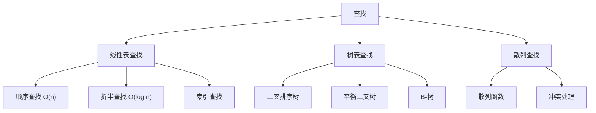
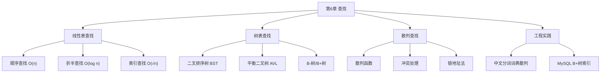

# 第 6 章　查找

> **本章目标**：掌握各种**查找**算法——从最朴素的顺序查找，到高效的折半查找、二叉排序树、平衡树、B-树，最后是"神级"的**散列查找（O(1)）**。
>
> **难度**：★★★★☆　**建议用时**：3～4 天
>
> **本章的核心问题**：**怎么在海量数据中快速找到目标？** 前面学的所有数据结构，最终都是为了解决这个问题。

> **前置知识**：[第 2 章 顺序表/链表](02-线性表.md)（折半查找要求顺序存储）、[第 4 章 二叉树](04-树.md)（**BST/AVL/B-树都是二叉树**）、[第 1 章 复杂度](01-绪论.md)
> **本章重点**：① 折半查找的三个边界条件（6.2.2）② BST 的中序有序性与退化问题（6.3.1）③ 散列表 O(1) 的原理与冲突处理（6.4）
> **本章是"数据结构的归宿"**：把前面所有结构按"查找效率"重新排了一遍

---

## 6.1　基本概念

### 6.1.1　静态查找和动态查找

#### 【一句话概括】

- **静态查找**：只查不改（数据集合固定）
- **动态查找**：边查边改（会插入、删除）

#### 【详细对比】

| | 静态查找 | 动态查找 |
|---|---|---|
| **操作** | 只查找 | 查找 + 插入 + 删除 |
| **数据结构** | 顺序表、有序表 | 二叉排序树、B-树、散列表 |
| **典型算法** | 顺序查找、折半查找 | 树表查找、散列查找 |
| **教材章节** | 6.2 | 6.3、6.4 |

#### 【生活类比】

- **静态查找** = 查一本**纸质字典**（内容不会变）
- **动态查找** = 查**通讯录**（随时可能加人、删人）

### 6.1.2　查找的性能评估 ⭐

#### 【核心指标：平均查找长度 ASL】

**ASL（Average Search Length）= 查找过程中平均比较的次数。**

**公式**：

```
ASL = Σ (Pᵢ × Cᵢ)
      i=1..n

Pᵢ = 查找第 i 个元素的概率（通常假设等概率，Pᵢ = 1/n）
Cᵢ = 找到第 i 个元素需要比较的次数
n  = 元素个数
```

#### 【举例理解】

假设有 5 个元素，用顺序查找：

```
元素: [10, 20, 30, 40, 50]
位置:  1   2   3   4   5

查找 10 → 比较 1 次
查找 20 → 比较 2 次
查找 30 → 比较 3 次
查找 40 → 比较 4 次
查找 50 → 比较 5 次

ASL成功 = (1 + 2 + 3 + 4 + 5) / 5 = 3
```

**记忆**：**ASL 越小，查找越快。**

#### 【ASL成功 vs ASL失败】

- **ASL成功**：查找**存在的**元素，平均比较次数
- **ASL失败**：查找**不存在的**元素，平均比较次数

**为什么失败也要算？**
因为实际中，很多查找是"找不到"的（比如判断一个元素是否在集合里）。失败的开销也要考虑。

### 6.1.3　查找结构分类



| 查找方式 | 前提 | 时间复杂度 |
|---|---|---|
| **顺序查找** | 无 | O(n) |
| **折半查找** | **必须有序 + 顺序存储** | O(log n) |
| **二叉排序树** | 动态维护有序 | 平均 O(log n)，最坏 O(n) |
| **平衡二叉树** | 动态维护平衡 | **O(log n)** |
| **B-树** | 多路平衡树 | O(log n)（适合外存） |
| **散列查找** | 有散列函数 | **O(1)** ★ |

### 【本节自测】

**6-1-1.** 什么是 ASL？它的计算公式是什么？
<details><summary>答案</summary>
<p><strong>ASL（Average Search Length，平均查找长度）</strong>：查找过程中平均需要比较的次数。</p>
<p><strong>公式</strong>：</p><pre><code>ASL = Σ (Pᵢ × Cᵢ)
</code></pre><ul>
<li><code>Pᵢ</code>：查找第 i 个元素的概率（通常假设等概率 = 1/n）</li>
<li><code>Cᵢ</code>：找到第 i 个元素需要的比较次数</li>
</ul>
<p><strong>等概率时的简化公式</strong>：</p><pre><code>ASL = (C₁ + C₂ + ... + Cₙ) / n
</code></pre><p><strong>意义</strong>：ASL 是衡量查找算法效率的核心指标，<strong>越小越好</strong>。</p>
</details>

**6-1-2.** 静态查找和动态查找有什么区别？
<details><summary>答案</summary>
<ul>
<li>
<p><strong>静态查找</strong>：只做查找，<strong>不修改</strong>数据集合。</p>
<ul>
<li>典型：顺序表、有序表的查找</li>
<li>算法：顺序查找、折半查找</li>
</ul>
</li>
<li>
<p><strong>动态查找</strong>：查找的同时可能<strong>插入或删除</strong>元素。</p>
<ul>
<li>典型：二叉排序树、B-树、散列表</li>
<li>需要考虑&quot;维护结构的代价&quot;</li>
</ul>
</li>
</ul>
<p><strong>关键区别</strong>：动态查找的结构<strong>必须支持高效的插入删除</strong>，所以不能用普通数组（数组插入是 O(n)）。</p>
<p><strong>例子</strong>：</p>
<ul>
<li>查一本出版了的字典（内容固定）→ 静态</li>
<li>查一个随时更新的通讯录 → 动态</li>
</ul>
</details>

---

## 6.2　线性表查找

### 6.2.1　顺序查找

#### 【一句话概括】

**从第一个元素开始，一个个往后找，直到找到或找完。**

#### 【生活类比】

在一堆无序的扑克牌里找一张牌——只能一张张翻。

#### 【代码实现】

```cpp
int seqSearch(int a[], int n, int key) {
    // 方法1：普通循环
    for (int i = 0; i < n; i++) {
        if (a[i] == key) return i;    // 找到了，返回下标
    }
    return -1;                         // 没找到
}
```

#### 【哨兵优化】

**把小技巧用上，可以减少一次比较：**

```cpp
int seqSearchWithSentinel(int a[], int n, int key) {
    // 假设数组下标 1..n，a[0] 留作哨兵
    a[0] = key;                        // ★ 把 key 放到 a[0] 作为哨兵
    int i = n;
    while (a[i] != key) i--;           // 不用判断 i>=0 了
    return i;                          // 返回 0 表示没找到
}
```

**为什么能省比较？**

原版每次循环要判断**两个条件**：`i < n` 和 `a[i] != key`。
哨兵版只判断**一个条件**：`a[i] != key`（因为 a[0] 一定是 key，循环必然终止）。

**效率提升**：约一倍（少了一半的判断）。

#### 【ASL 分析】

**查找成功**（等概率）：
```
ASL成功 = (1 + 2 + ... + n) / n = (n+1)/2
```

**直观理解**：平均要找一半的元素。

**例**：n=5 时，ASL = (5+1)/2 = 3

**查找失败**：需要比较 n 次（或 n+1 次，看实现）。

**时间复杂度：O(n)**

#### 【优缺点】

| | 说明 |
|---|---|
| **优点** | ① 对数据**没有要求**（不需要有序）<br>② 适合**链表**（不需要随机访问）<br>③ 实现简单 |
| **缺点** | O(n)，数据量大时很慢 |

### 6.2.2　折半查找（二分查找）⭐

#### 【一句话概括】

**每次排除一半的数据。前提：数据必须有序且能随机访问。**

#### 【生活类比】

**猜数字游戏**：我想一个 1~100 的数，你猜。每次你说一个数，我只告诉你"大了"或"小了"。

**聪明策略**：先猜 50。如果大了，就猜 25；如果小了，就猜 75。**每次排除一半**，最多 7 次就能猜到。

**对比笨策略**：从 1 开始一个个猜，最坏要猜 100 次。

#### 【前提条件】（非常重要）

1. **必须有序**（升序或降序）
2. **必须顺序存储**（数组，能随机访问）

**为什么链表不行？** 因为折半需要"跳到中间位置"，链表要 O(n) 才能走到中间。用链表做折半，效率反而更低。

#### 【算法思路】

```
在有序数组 a[low..high] 中查找 key：
1. mid = (low + high) / 2
2. 如果 a[mid] == key → 找到了
3. 如果 a[mid] > key  → 在左半边找：high = mid - 1
4. 如果 a[mid] < key  → 在右半边找：low = mid + 1
5. 重复直到找到或 low > high
```

#### 【图解】

在 `[5, 13, 19, 21, 37, 56, 64, 75, 80, 88, 92]` 中找 **21**：

```
初始: low=0, high=10, mid=5
     下标: 0   1   2   3   4   5   6   7   8   9   10
       [5, 13, 19, 21, 37, 56, 64, 75, 80, 88, 92]
                          ↑
                         mid=5, a[5]=56

56 > 21 → 在左半边找: high = 4

第2轮: low=0, high=4, mid=2
       [5, 13, 19, 21, 37]
              ↑
             mid=2, a[2]=19

19 < 21 → 在右半边找: low = 3

第3轮: low=3, high=4, mid=3
       [5, 13, 19, 21, 37]
                  ↑
                 mid=3, a[3]=21  ✓ 找到了！
```

**共比较 3 次**。

#### 【代码实现（循环版）】

```cpp
int binarySearch(int a[], int n, int key) {
    int low = 0, high = n - 1;

    while (low <= high) {              // ★ 注意是 <=
        int mid = low + (high - low) / 2;   // ★ 防溢出写法

        if (a[mid] == key) {
            return mid;                // 找到了
        } else if (a[mid] > key) {
            high = mid - 1;            // 在左半边找
        } else {
            low = mid + 1;             // 在右半边找
        }
    }
    return -1;                         // 没找到
}
```

#### 【代码实现（递归版）】

```cpp
int binarySearchRec(int a[], int low, int high, int key) {
    if (low > high) return -1;         // 出口

    int mid = low + (high - low) / 2;

    if (a[mid] == key)      return mid;
    else if (a[mid] > key)  return binarySearchRec(a, low, mid - 1, key);
    else                    return binarySearchRec(a, mid + 1, high, key);
}
```

#### 【⚠ 三个易错点】

**易错点 1：`while (low <= high)` 还是 `while (low < high)`？**

**必须用 `<=`**！因为当 `low == high` 时，区间里还有**一个元素**没检查。

**易错点 2：`mid = (low + high) / 2` 可能溢出**

如果 `low` 和 `high` 都很大（如接近 INT_MAX），`low + high` 会**溢出**变成负数。

**安全写法**：
```cpp
int mid = low + (high - low) / 2;   // ★ 推荐
```

**易错点 3：`high = mid - 1` 还是 `high = mid`？**

**必须用 `mid - 1`**（因为 `a[mid]` 已经比较过了，不需要再包含）。

写成 `high = mid` 会导致**死循环**！

#### 【折半查找的判定树】

**折半查找的过程可以画成一棵"判定树"**：

```
在 [5,13,19,21,37,56,64,75,80,88,92] 中查找（11 个元素）：

                56 (mid=5)
               /          \
          19 (mid=2)      80 (mid=8)
          /        \      /        \
       13(1)    37(4)   64(6)    88(9)
       /         /  \      \       /  \
      5(0)    21(3)      75(7)   92(10)

每个节点上的数字是"比较时选中的中间元素"
```

**从判定树能看出**：
- 树的高度 = **⌊log₂n⌋ + 1**
- 比较次数 = 该节点在树中的**层数**

**上面的树有 4 层，所以最多比较 4 次。**

#### 【ASL 分析】

**查找成功**：ASL ≈ **log₂(n+1) - 1**（近似）

**更精确的计算**：
```
ASL成功 = (每层的节点数 × 该层层数) 之和 / n
```

**例子**（n=11，判定树 4 层）：
```
第1层: 1 个节点 → 1×1 = 1
第2层: 2 个节点 → 2×2 = 4
第3层: 4 个节点 → 4×3 = 12
第4层: 4 个节点 → 4×4 = 16
合计 = 33

ASL成功 = 33 / 11 = 3
```

**时间复杂度：O(log n)**

**直观对比**（注意区分"平均"和"最坏"两个指标）：

| n | 顺序查找 ASL | 折半查找 ASL | 折半查找最坏比较次数 |
|---|---|---|---|
| 100 | 50 | 约 6 | 7 |
| 1000 | 500 | 约 9 | 10 |
| 100万 | 50万 | 约 19 | 20 |

> **ASL（平均查找长度）** ≈ `log₂(n+1) - 1`
> **最坏比较次数** = `⌈log₂(n+1)⌉`（判定树的层数）
>
> 两者差 1 左右，**别把"最坏"当成"平均"**——这是常见混淆点。

**数据量越大，折半查找的优势越明显！**

### 6.2.3　索引查找

#### 【一句话概括】

**先建一个"目录"（索引表），先查目录定位到块，再在块内查。**

#### 【生活类比】

**查一本书**：先看目录找到页码，再翻到那一页。

**如果不看目录**：从第一页翻到最后一页（顺序查找）。

#### 【索引表结构】

对于n个元素的表，分成若干个"块"，每块建一个索引项：

```
索引表（每块 6 个元素，共 3 块）：
┌────────────┬──────────┬──────────┐
│    块号    │ 最大关键字│  起始地址 │
├────────────┼──────────┼──────────┤
│     1      │    22    │    1     │
│     2      │    48    │    7     │
│     3      │    86    │   13     │
└────────────┴──────────┴──────────┘

数据表（分块有序）：
块1: [22, 12, 13,  8,  9, 20]        ← 最大 22
块2: [33, 42, 44, 38, 24, 48]        ← 最大 48
块3: [60, 58, 74, 49, 86, 53]        ← 最大 86
```

**"分块有序"的含义**：
- **块之间**有序（第 1 块的最大值 22 < 第 2 块的最小值 24；第 2 块的最大值 48 < 第 3 块的最小值 49）
- **块内部**可以无序

> **查一个数怎么走**：比如查 44，先在索引表里比大小 → 44 落在 `22 < 44 ≤ 48`，所以去**块 2**；
> 然后在块 2 里顺序查找 → 找到 44（在块内第 3 个位置）。

#### 【查找过程】

1. 先在**索引表**中查找（可以用折半），确定目标在哪个块
2. 再到对应的**块内**查找（用顺序查找）

#### 【ASL 分析】

```
ASL = ASL(索引表) + ASL(块内)

如果索引表用折半、块内用顺序：
ASL ≈ log₂(b) + (s+1)/2

b = 块数，s = 每块元素个数
```

**最优分块**：当 `b = s = √n` 时，ASL 最小 ≈ **√n + 1**

**复杂度：O(√n)** —— 介于顺序查找 O(n) 和折半查找 O(log n) 之间。

#### 【适用场景】

**索引查找适合"块内无序、块间有序"的情况。**

**典型应用**：
- **数据库索引**（B-树索引更是主流）
- **搜索引擎的倒排索引**
- **图书目录**

### 【本节自测】

**6-2-1.** 折半查找的前提条件是什么？为什么链表不能用折半查找？
<details><summary>答案</summary>
<p><strong>两个前提</strong>：</p>
<ol>
<li><strong>数据必须有序</strong>（升序或降序）</li>
<li><strong>必须顺序存储</strong>（能用下标随机访问）</li>
</ol>
<p><strong>链表不能用折半的原因</strong>：
折半查找需要<strong>直接跳到中间位置</strong>（<code>mid = (low+high)/2</code>）。</p>
<ul>
<li><strong>数组</strong>：<code>a[mid]</code> 是 O(1)（一步到位）</li>
<li><strong>链表</strong>：要找到第 mid 个节点，必须从头走 mid 步 → <strong>O(n)</strong></li>
</ul>
<p><strong>结论</strong>：链表用折半查找，总复杂度是 O(n log n)，比顺序查找 O(n) 还慢。</p>
</details>

**6-2-2.** 在有序数组 `[10, 20, 30, 40, 50, 60, 70]` 中查找 60，需要比较几次？画出查找过程。
<details><summary>答案</summary>
<p><strong>需要比较 3 次。</strong></p>
<p><strong>查找过程</strong>：</p><pre><code>数组: [10, 20, 30, 40, 50, 60, 70]
下标:  0   1   2   3   4   5   6&#10;
第1轮: low=0, high=6, mid=(0+6)/2=3
       a[3] = 40 &lt; 60 → 往右找, low = 4&#10;
第2轮: low=4, high=6, mid=(4+6)/2=5
       a[5] = 60 == 60 → 找到了！✓
</code></pre><p><strong>等等，第2轮就找到了，只比较了 2 次。</strong></p>
<p><strong>重新数</strong>：</p>
<ul>
<li>第1次比较：<code>a[3] = 40</code>（40 &lt; 60，往右）</li>
<li>第2次比较：<code>a[5] = 60</code>（找到了）</li>
</ul>
<p><strong>答案：比较 2 次。</strong></p>
<p><strong>注意</strong>：mid 的计算 <code>(0+6)/2 = 3</code>（整数除法，向下取整）。</p>
</details>

**6-2-3.** 折半查找中，为什么 `high = mid - 1` 而不能写成 `high = mid`？
<details><summary>答案</summary>
<p>因为 <strong><code>a[mid]</code> 已经比较过了</strong>，不需要再包含在搜索范围里。</p>
<p><strong>如果写成 <code>high = mid</code></strong>：</p><pre><code>假设 low=0, high=1
  mid = (0+1)/2 = 0
  a[0] != key 且 a[0] &gt; key
  high = mid = 0     ← 没有缩小范围！&#10;
下一轮: low=0, high=0
  mid = 0
  a[0] != key ... 又执行 high = 0
  → 死循环！
</code></pre><p><strong>正确写法</strong>：<code>high = mid - 1</code>，这样每次区间至少缩小 1。</p>
<p><strong>同理</strong>：<code>low</code> 要写成 <code>low = mid + 1</code>，不能是 <code>low = mid</code>。</p>
<p><strong>记忆</strong>：<strong>mid 已经检查过了，排除它！</strong></p>
</details>

**6-2-4.** 有 1000 个元素，顺序查找和折半查找的平均查找长度分别是多少？
<details><summary>答案</summary>
<p><strong>顺序查找</strong>：</p><pre><code>ASL = (n+1)/2 = (1000+1)/2 = 500.5 ≈ 500
</code></pre><p><strong>折半查找</strong>：</p><pre><code>ASL ≈ log₂(n+1) - 1 = log₂(1001) - 1 ≈ 10 - 1 = 9&#10;
（精确值需要画判定树计算，但约等于 9~10）
</code></pre><p><strong>对比</strong>：<strong>500 次 vs 10 次，差 50 倍！</strong></p>
<p><strong>数据量越大，差距越大</strong>：</p>
<table>
<thead>
<tr>
<th>n</th>
<th>顺序</th>
<th>折半</th>
<th>倍数</th>
</tr>
</thead>
<tbody>
<tr>
<td>100</td>
<td>50</td>
<td>7</td>
<td>7</td>
</tr>
<tr>
<td>1000</td>
<td>500</td>
<td>10</td>
<td>50</td>
</tr>
<tr>
<td>10000</td>
<td>5000</td>
<td>14</td>
<td>357</td>
</tr>
<tr>
<td>100万</td>
<td>50万</td>
<td>20</td>
<td>25000</td>
</tr>
</tbody>
</table>
</details>

---

## 6.3　树表查找

### 6.3.1　二叉排序树（BST）⭐

#### 【定义】

**二叉排序树（Binary Sort Tree，也叫二叉搜索树 BST）**，满足：

1. 如果**左子树**非空，则左子树上**所有**节点的值都**小于**根节点的值
2. 如果**右子树**非空，则右子树上**所有**节点的值都**大于**根节点的值
3. 左右子树**也分别是**二叉排序树

#### 【图示】

```
            50
           /  \
         30    70
        /  \   / \
       20  40 60  80

验证：
  50 的左子树 {20,30,40} 都 < 50 ✓
  50 的右子树 {60,70,80} 都 > 50 ✓
  30 的左子树 {20} < 30，右子树 {40} > 30 ✓
  ...
```

#### 【核心性质：中序遍历得到有序序列！】

对上面的树做**中序遍历**：

```
20 30 40 50 60 70 80    ← 升序排列！
```

**这是 BST 最重要的性质**，也是它叫"排序树"的原因。

#### 【查找算法】

```cpp
BTNode* search(BTNode* p, int key) {
    if (p == nullptr) return nullptr;      // 没找到

    if (key == p->data) return p;          // 找到了
    else if (key < p->data) {
        return search(p->left, key);       // 往左找
    } else {
        return search(p->right, key);      // 往右找
    }
}
```

**查找过程**（找 40）：

```
50: 40 < 50 → 往左
30: 40 > 30 → 往右
40: 40 == 40 → 找到了！✓

比较 3 次
```

**这就是"折半查找"的思想，但用树的结构实现。**

#### 【插入算法】

**关键**：新节点总是插在**叶子位置**。

```cpp
void insert(BTNode*& p, int key) {
    if (p == nullptr) {
        p = new BTNode(key);       // ★ 找到空位置，插入
        return;
    }
    if (key < p->data)      insert(p->left, key);
    else if (key > p->data) insert(p->right, key);
    // key == p->data 时，通常不插入（不允许重复）
}
```

**插入过程**（插入 45）：

```
50: 45 < 50 → 往左
30: 45 > 30 → 往右
40: 45 > 40 → 往右
   (40 的右孩子为空) → 插入为 40 的右孩子

结果：
            50
           /  \
         30    70
        /  \   / \
       20  40 60  80
             \
             45
```

#### 【删除算法】（最复杂）

**分三种情况**：

**情况 1：删除的是叶子节点** → 直接删

```
删除 20:              删除后:
       30                  30
      /  \                /  \
     20  40     →           40
```

**情况 2：删除的节点只有一个孩子** → 用孩子替代它

```
删除 30（只有右孩子 40）:
       50                  50
      /  \                /  \
     30  70      →      40   70
       \
       40
```

**情况 3：删除的节点有两个孩子** → 用**中序前驱**或**中序后继**替代

```
删除 50（有两个孩子）:
            50
           /  \
         30    70
        /  \   / \
       20  40 60  80

方法 A：用左子树的最大值（中序前驱）= 40 替代
方法 B：用右子树的最小值（中序后继）= 60 替代

用方法 B（60 替代 50）:
            60
           /  \
         30    70
        /  \     \
       20  40    80
```

**为什么用"中序前驱/后继"？**

因为中序遍历是**升序**的。把 50 换成它的"前一个"（40）或"后一个"（60），中序序列仍然有序。

#### 【ASL 分析：取决于树的形状！】

**最好情况（平衡）**：

```
        50
       /  \
     30    70
    /  \   / \
   20  40 60  80

树高 = 3 → ASL ≈ log₂n
```

**最坏情况（退化成链表）**：

```
50
  \
   60
     \
      70
        \
         80

树高 = 4（n=4）→ ASL ≈ (n+1)/2（和顺序查找一样！）
```

**这就是"二叉排序树"的问题**：插入顺序不好，会退化成链表。

**例子**：按 `1, 2, 3, 4, 5` 的顺序插入，得到的是一棵右斜树。

**解决方案**：**平衡二叉树**（6.3.2）！

### 6.3.2　平衡二叉树（AVL 树）⭐

#### 【定义】

**平衡二叉树（AVL 树）**：任意节点的**左右子树高度差**（平衡因子）的绝对值 **不超过 1**。

**平衡因子（BF）** = 左子树高度 - 右子树高度

**AVL 树要求：BF ∈ {-1, 0, 1}**

#### 【图示】

```
AVL 树（每个节点 BF ∈ {-1,0,1}）:
        50 (BF=0)
       /  \
    30(0)  70(0)
    /  \   / \
  20(0)40 60  80

非 AVL 树（50 的 BF = -1 - 2 = ... 不，看下面的例子）:
        50 (BF=1)
       /
     30 (BF=1)
     /
   20 (BF=1)
   
结点 50 的左子树高 2，右子树高 0 → BF = 2 > 1 → 不是 AVL
```

#### 【为什么需要 AVL 树】

因为**普通 BST 会退化**。AVL 树通过**旋转**保持平衡，保证**树高始终是 O(log n)**。

**查找、插入、删除都是 O(log n)**（最坏情况也是！）

#### 【四种旋转操作】（核心）

当插入导致某个节点的 BF 变成 ±2 时，需要旋转。

**① LL 型（左左）→ 右旋**

新节点插在"左子树的左子树"上。

```
      A (BF=2)
     /
    B (BF=1)
   /
  C

右旋后:
      B
     / \
    C   A
```

**② RR 型（右右）→ 左旋**

```
  A (BF=-2)
   \
    B (BF=-1)
     \
      C

左旋后:
      B
     / \
    A   C
```

**③ LR 型（左右）→ 先左旋再右旋**

```
    A (BF=2)
   /
  B (BF=-1)
   \
    C

第1步（对 B 左旋）:
    A
   /
  C
 /
B

第2步（对 A 右旋）:
      C
     / \
    B   A
```

**④ RL 型（右左）→ 先右旋再左旋**

```
  A (BF=-2)
   \
    B (BF=1)
   /
  C

第1步（对 B 右旋）:
  A
   \
    C
     \
      B

第2步（对 A 左旋）:
      C
     / \
    A   B
```

#### 【记忆口诀】

```
LL 型 → 右旋
RR 型 → 左旋
LR 型 → 先左后右
RL 型 → 先右后左

（"L"和"R"指的是"从失衡节点往下走两步的方向"）
```

**更简单的记忆**：**哪边重，就往反方向转；折线型就分两步转。**

#### 【AVL 树的高度】

n 个节点的 AVL 树，高度约为 **1.44 log₂(n+2)**

**对比**：
- 普通 BST 最坏高度：**n**（退化）
- AVL 树高度：**O(log n)**（稳定）

**这就是 AVL 树的价值**：**无论怎么插入，都保证 O(log n) 的查找效率。**

### 6.3.3　B-树

#### 【为什么需要 B-树】

**问题**：前面讲的都是"内存"里的查找。但数据存在**磁盘**上时，情况完全不同。

**磁盘的特点**：
- **读取慢**（机械寻道 + 旋转延迟，约 10 毫秒）
- **按"块"读取**（一次读 4KB 或更多，读 1 字节和读 4KB 时间差不多）

**关键洞察**：既然读一次磁盘很贵，那就要**一次多读一点**，**减少读磁盘的次数**。

**所以需要"多路"的树——一次比较多个值，树高更低。**

#### 【B-树的定义】

**m 阶 B-树**满足：

1. 每个节点**最多**有 **m** 个孩子（m-1 个关键字）
2. **根节点**至少有 **2** 个孩子（除非它本身就是叶子）
3. 其他非叶节点至少有 **⌈m/2⌉** 个孩子
4. 所有叶子节点都在**同一层**（完全平衡！）
5. 节点内的关键字**有序**排列

#### 【3 阶 B-树示例】

```
                  [ 30 | 60 ]
                 /     |     \
         [10|20]    [40|50]    [70|80|90]

每个节点：
- 根节点有 2 个关键字（30, 60），3 个孩子
- 叶子节点有 2~3 个关键字
- 所有叶子在同一层 ✓
```

#### 【B-树的查找】

**在节点内查找**（因为节点内有序，可以折半），然后**下降到对应的子树**。

**查找 50**：

```
根节点 [30|60]:
  50 在 30 和 60 之间 → 走中间的孩子

[40|50]:
  50 == 50 → 找到了 ✓

只读了 2 个节点（2 次磁盘 I/O）！
```

**对比**：如果用二叉树，可能需要读 20 多个节点（20 多次磁盘 I/O）。

#### 【B-树的高度】

**m 阶 B-树，n 个关键字，高度 h 满足**：

```
h ≤ log_⌈m/2⌉((n+1)/2) + 1
```

**实际意义**：m 越大，树越矮。

**例子**：m=1000 时，n=10 亿的 B-树，高度只有 **3 层**！

**也就是说，查找 10 亿条记录，只需要 3 次磁盘 I/O。** 这就是 B-树在数据库中的威力。

#### 【B-树的插入和删除】

**插入**：找到位置插入，如果节点"满了"（超过 m-1 个关键字），就**分裂**（中间关键字上移）。

**删除**：删除后如果节点"太少"（少于 ⌈m/2⌉-1 个关键字），就**借**（向兄弟借）或**合并**。

> 这两个操作比较复杂，但**思想很简单**：保持"所有叶子在同一层"和"节点关键字数量在合理范围"这两个性质。

#### 【B+ 树】（B-树的变种，数据库实际用的）

| | B-树 | B+ 树 |
|---|---|---|
| **数据存放** | 所有节点都存数据 | **只有叶子存数据**，内部节点只存索引 |
| **叶子链表** | 无 | **叶子之间用链表相连**（支持范围查询） |
| **查找** | 可能在内部节点找到 | **必须走到叶子** |
| **应用** | —— | **MySQL InnoDB 索引** |

**B+ 树的优势**：
1. **内部节点不存数据** → 同样大小的节点能存更多索引 → 树更矮
2. **叶子链表** → 范围查询（`WHERE age BETWEEN 20 AND 30`）非常快

**这就是为什么 MySQL 用 B+ 树而不是 B-树。**

### 6.3.4　STL 中的树表：set 和 map

#### 【set：有序集合】

```cpp
#include <set>
set<int> s;

s.insert(3);
s.insert(1);
s.insert(2);

// 自动有序！
for (int x : s) cout << x << " ";   // 1 2 3

// 查找 O(log n)
if (s.find(2) != s.end()) cout << "找到了 2" << endl;

// 删除
s.erase(1);

// 大小
cout << s.size() << endl;   // 2
```

**底层实现**：**红黑树**（一种自平衡二叉搜索树）。

**特点**：
- 元素**自动去重**（不会有两个相同的元素）
- **自动排序**
- 插入、删除、查找都是 **O(log n)**

#### 【map：键值对（字典）】

```cpp
#include <map>
map<string, int> score;

score["张三"] = 92;
score["李四"] = 85;
score["王五"] = 78;

// 按 key 自动排序（字典序）
for (auto& kv : score) {
    cout << kv.first << ": " << kv.second << endl;
}

// 查找
auto it = score.find("李四");
if (it != score.end()) {
    cout << "李四的成绩: " << it->second << endl;
}

// 访问不存在的 key 会插入默认值
cout << score["赵六"] << endl;   // 0（int 的默认值）
```

**`map` vs `unordered_map`**：

| | `map` | `unordered_map` |
|---|---|---|
| **底层** | 红黑树（平衡 BST） | **散列表** |
| **是否有序** | 有序（按 key） | 无序 |
| **查找** | O(log n) | **平均 O(1)** ★ |
| **适用** | 需要有序遍历 | 只关心查找速度 |

**选择建议**：
- 需要**按 key 排序遍历** → `map`
- 只关心**查找速度** → `unordered_map`

### 【本节自测】

**6-3-1.** 二叉排序树的中序遍历有什么特点？为什么？
<details><summary>答案</summary>
<p><strong>中序遍历得到的是升序序列。</strong></p>
<p><strong>原因</strong>：BST 的性质是&quot;左子树 &lt; 根 &lt; 右子树&quot;，而中序遍历的顺序正好是&quot;左 → 根 → 右&quot;，所以输出的顺序天然是<strong>从小到大</strong>。</p>
<p><strong>例子</strong>：</p><pre><code>        50
       /  \
     30    70
    /  \   / \
   20  40 60  80&#10;
中序遍历: 20 30 40 50 60 70 80  ✓ 升序
</code></pre><p><strong>应用</strong>：</p>
<ul>
<li>判断一棵二叉树是不是 BST（中序是否有序）</li>
<li>输出排序结果（BST 排序，O(n) 遍历）</li>
</ul>
</details>

**6-3-2.** 二叉排序树在什么情况下会退化成链表？怎么解决？
<details><summary>答案</summary>
<p><strong>退化情况</strong>：当插入的元素<strong>已经有序</strong>时。</p>
<p><strong>例子</strong>：按 <code>1, 2, 3, 4, 5</code> 的顺序插入：</p><pre><code>1
 \
  2
   \
    3
     \
      4
       \
        5&#10;
树高 = 5 = n，退化成链表！
</code></pre><p><strong>后果</strong>：</p>
<ul>
<li>查找变成 <strong>O(n)</strong>（和顺序查找一样慢）</li>
<li>完全失去了 BST 的优势</li>
</ul>
<p><strong>解决方案</strong>：<strong>平衡二叉树（AVL 树）</strong></p>
<ul>
<li>每次插入后检查平衡因子</li>
<li>如果不平衡（|BF| &gt; 1）就<strong>旋转</strong></li>
<li>保证树高始终是 O(log n)</li>
</ul>
<p><strong>其他方案</strong>：</p>
<ul>
<li><strong>红黑树</strong>（放宽平衡条件，旋转次数更少，实际用得更多）</li>
<li><strong>Treap</strong>（树 + 堆）</li>
<li><strong>Splay 树</strong>（自适应）</li>
</ul>
</details>

**6-3-3.** AVL 树的四种旋转分别是什么？各针对什么情况？
<details><summary>答案</summary>
<table>
<thead>
<tr>
<th>类型</th>
<th>场景</th>
<th>操作</th>
</tr>
</thead>
<tbody>
<tr>
<td><strong>LL</strong></td>
<td>插入在&quot;左子树的左子树&quot;，导致左重</td>
<td><strong>右旋</strong></td>
</tr>
<tr>
<td><strong>RR</strong></td>
<td>插入在&quot;右子树的右子树&quot;，导致右重</td>
<td><strong>左旋</strong></td>
</tr>
<tr>
<td><strong>LR</strong></td>
<td>插入在&quot;左子树的右子树&quot;（折线）</td>
<td><strong>先左旋，再右旋</strong></td>
</tr>
<tr>
<td><strong>RL</strong></td>
<td>插入在&quot;右子树的左子树&quot;（折线）</td>
<td><strong>先右旋，再左旋</strong></td>
</tr>
</tbody>
</table>
<p><strong>记忆口诀</strong>：</p>
<ul>
<li><strong>直线型</strong>（LL/RR）→ <strong>一次旋转</strong>（往反方向转）</li>
<li><strong>折线型</strong>（LR/RL）→ <strong>两次旋转</strong>（先转成直线，再转）</li>
</ul>
<p><strong>图示记忆</strong>：</p><pre><code>LL:        RR:        LR:         RL:
   A          A          A           A
  /            \        /             \
 B              B      B               B
/                \      \             /
C                  C      C         C&#10;
右旋          左旋      先左后右     先右后左
</code></pre><p><strong>关键</strong>：旋转后要<strong>保持 BST 的中序有序性</strong>（这是旋转必须满足的约束）。</p>
</details>

**6-3-4.** 为什么数据库中用 B-树/B+ 树，而不是二叉排序树？
<details><summary>答案</summary>
<p>因为<strong>磁盘 I/O 才是瓶颈</strong>，而 B-树能<strong>大幅减少磁盘读取次数</strong>。</p>
<p><strong>关键对比</strong>：</p>
<table>
<thead>
<tr>
<th></th>
<th>二叉树</th>
<th>B-树（m=1000）</th>
</tr>
</thead>
<tbody>
<tr>
<td>10 亿数据的树高</td>
<td><strong>约 30 层</strong></td>
<td><strong>约 3 层</strong></td>
</tr>
<tr>
<td>查找读取的节点数</td>
<td>30 个</td>
<td><strong>3 个</strong></td>
</tr>
<tr>
<td>磁盘 I/O 次数</td>
<td>30 次</td>
<td><strong>3 次</strong></td>
</tr>
</tbody>
</table>
<p><strong>为什么 B-树更矮？</strong>
因为每个节点能存<strong>多个关键字</strong>（m-1 个），一次比较就能排除更多的数据。</p>
<p><strong>为什么&quot;少读磁盘&quot;这么重要？</strong></p><pre><code>内存访问：约 100 纳秒
磁盘访问：约 10 毫秒（慢了 10 万倍！）
</code></pre><p>所以设计外存数据结构时，<strong>一切以&quot;减少磁盘 I/O&quot;为目标</strong>。</p>
<p><strong>B+ 树更进一步</strong>：</p>
<ul>
<li>内部节点只存索引，不存数据 → 同样大小的节点能存更多索引 → 树更矮</li>
<li>叶子有链表 → 范围查询快</li>
</ul>
<p><strong>这就是 MySQL InnoDB 用 B+ 树的原因。</strong></p>
</details>

---

## 6.4　散列查找（哈希表）⭐⭐

### 6.4.1　散列技术

#### 【一句话概括】

**散列 = 用"函数"直接算出元素应该存在哪里。**

#### 【核心思想】

**传统查找**：把数据和"位置"的关系记录下来（数组下标、树的分支）。

**散列查找**：用**散列函数 H(key)** 直接算出存储位置。

```
存储位置 = H(key)
```

**举例**：

```
H(key) = key % 10    （除留余数法）

存 25 → 位置 = 25 % 10 = 5
存 37 → 位置 = 37 % 10 = 7
存 42 → 位置 = 42 % 10 = 2

查找 37 → 算 H(37) = 7 → 直接去位置 7 找 → O(1)！
```

**这就是 O(1) 查找的秘密**：不需要比较，直接**算出**位置。

#### 【生活类比】

**图书馆的书架编号**：
- 传统方式：按购买顺序摆放，找书要一本本翻（O(n)）
- 散列方式：用"书名首字母 + 序号"编号，直接走到对应书架（O(1)）

**再比如**：你的快递柜
- 快递员用你的手机号后 4 位算出一个柜子号
- 你取件时输入手机号，柜子直接打开（不用一个个找）

#### 【散列表（哈希表）】

**散列表**：用散列技术存储数据的**一维数组**。

```cpp
int table[10];    // 散列表，大小 10
```

**散列过程分两步**：
1. **存储**：用 `H(key)` 算出地址，把记录放进去
2. **查找**：用同一个 `H(key)` 算出地址，直接访问

#### 【⚠ 冲突（碰撞）】

**问题**：不同的 key 可能算出**相同的地址**！

```
H(key) = key % 10

H(25) = 5
H(35) = 5    ← 冲突！两个都想到位置 5
```

**这叫"冲突"或"碰撞"。**

**结论**：**冲突几乎无法避免**（因为 key 的取值空间通常远大于表的大小）。

**所以散列技术要解决两个问题**：
1. **设计好的散列函数**（让冲突尽量少）
2. **设计冲突处理方法**（冲突了怎么办）

### 6.4.2　散列函数设计

#### 【设计原则】

1. **计算简单**（不能太复杂，否则失去 O(1) 的意义）
2. **值域在表长范围内**（算出的地址必须合法）
3. **分布均匀**（让 key 均匀分布，减少冲突）

#### 【常用散列函数】

**① 除留余数法** ★ 最常用

```
H(key) = key % p
```

**p 的选择很关键**：
- **最好取"小于表长的最大质数"**
- **不要取 2 的幂**（因为 `key % 2^k` 只取低 k 位，分布不均）

**例子**：
```
表长 100 → 取 p = 97（小于 100 的最大质数）
H(100) = 100 % 97 = 3
H(197) = 197 % 97 = 3    ← 冲突（但比 p=100 时的冲突少）
```

**② 直接定址法**

```
H(key) = a × key + b
```

**特点**：不会冲突，但要求 key 的分布连续。
**适用**：key 范围小且连续（如学号 1~100）。

**③ 数字分析法**

分析 key 的每一位，**选取分布均匀的几位**作为地址。

```
学号: 2018010101
       2018010102
       2018010103
       ...
       
发现前 6 位都一样，后 3 位变化 → 取后 3 位
```

**④ 平方取中法**

先平方，再取中间几位。

```
key = 1234
1234² = 1522756
取中间 3 位 → 227

（平方后中间位受所有位影响，分布更均匀）
```

**⑤ 折叠法**

把 key 分成几段，相加。

```
key = 123456789
分成 123, 456, 789
相加 = 1368
取后 3 位 → 368
```

### 6.4.3　冲突处理

#### 【方法 1：开放定址法】

**思路**：冲突了就**找下一个空位**。

**① 线性探测法**

```
H_i = (H(key) + i) % m     (i = 0, 1, 2, ...)
```

**例子**（表长 11，`H(key) = key % 11`）：

```
依次插入: 47, 7, 29, 11, 16, 92, 22, 8, 3

47 → 47%11 = 3 → 位置3
7  → 7%11 = 7  → 位置7
29 → 29%11 = 7 → 冲突！→ 探测位置8 → 空 → 放位置8
11 → 11%11 = 0 → 位置0
16 → 16%11 = 5 → 位置5
92 → 92%11 = 4 → 位置4
22 → 22%11 = 0 → 冲突！→ 探测位置1 → 空 → 放位置1
8  → 8%11 = 8  → 冲突！→ 位置9 → 空 → 放位置9
3  → 3%11 = 3  → 冲突！→ 位置4 有 92 → 位置5 有 16 → ... → 位置10 → 空 → 放位置10

最终:
下标: 0   1   2   3   4   5   6   7   8   9   10
     [11][22][ ][47][92][16][ ][7][29][8][3]
```

**线性探测的问题：堆积（聚集）**

```
连续的位置被占用，导致后续冲突的元素要探测很久。

比如上面：【47,92,16】占了 3,4,5，【29,8,3】占了 8,9,10
找 3 时要探测 3→4→5→...→10，探测了 8 次！
```

**② 二次探测法**

```
H_i = (H(key) ± i²) % m
```

**例子**：`+1², -1², +2², -2², +3², ...`

**优点**：避免"堆积"（探测位置跳跃，不会连续占满）。

**③ 伪随机探测法**

```
H_i = (H(key) + 伪随机数序列) % m
```

#### 【方法 2：链地址法（拉链法）】★ 更常用

**思路**：把冲突的元素挂成**链表**。

```
散列表（表长 11，H(key) = key % 11）:
[0] → 11 → 22 → ∧
[1] → ∧
[2] → ∧
[3] → 47 → ∧
[4] → 92 → ∧
[5] → 16 → ∧
[6] → ∧
[7] → 7 → 29 → ∧
[8] → 8 → ∧
[9] → ∧
[10] → 3 → ∧
```

**优点**：
- **不会堆积**（冲突的元素各挂各的链）
- **删除方便**（直接从链表摘掉）
- **表可以"装满"**（不像开放定址法需要留空位）

**缺点**：
- 需要额外的指针空间
- 链表过长时退化成 O(n)

**这是实际工程中最常用的方法**（Java 的 HashMap、C++ 的 unordered_map 都用它）。

#### 【方法 3：再散列法】

冲突了换个**散列函数**重算：

```
H₁(key) 冲突 → 用 H₂(key)
```

#### 【开放定址 vs 链地址 对比】

| | 开放定址 | 链地址 |
|---|---|---|
| **额外空间** | 无 | 需要指针 |
| **堆积问题** | 有 | 无 ✓ |
| **删除** | 麻烦（要标记"墓碑"） | 方便 ✓ |
| **装载因子** | 必须 < 1 | 可以 > 1 |
| **缓存友好** | 好（连续内存） | 差（指针跳转） |

### 6.4.4　常用的散列函数

（6.4.2 已介绍，这里补充**实际工程中**常用的）

| 场景 | 方法 |
|---|---|
| **整数** | `key % p`（p 取质数） |
| **字符串** | BKDR、ELF、DJB 等 |
| **Java String** | `s[0]*31^(n-1) + s[1]*31^(n-2) + ...` |
| **通用** | MurmurHash、CityHash |

**字符串哈希的例子**（BKDR）：

```cpp
unsigned int BKDRHash(const string& s) {
    unsigned int seed = 131;    // 常用 31, 131, 1313, 13131...
    unsigned int hash = 0;
    for (char c : s) {
        hash = hash * seed + c;
    }
    return hash;
}
```

**思路**：把字符串当成"131 进制数"。

```
"abc" → 'a'*131² + 'b'*131 + 'c'
```

#### 【装载因子（负载因子）】

```
装载因子 α = 表中元素个数 / 表长
```

**α 越大，冲突越多**：
- α 接近 1：冲突严重，查找变慢
- α 太小：浪费空间

**经验值**：
- **开放定址法**：α 控制在 **0.5~0.75**
- **链地址法**：α 可以到 **1 或更高**

**动态扩容**：当 α 超过阈值时，**扩大表长并重新散列**（rehash）。

**这就是 `unordered_map` 会自动扩容的原因。**

#### 【ASL 分析】

**散列查找的 ASL 取决于装载因子 α**：

- **平均查找长度 ≈ 1 + α/2**（开放定址）
- **平均查找长度 ≈ 1 + α**（链地址）

**关键**：**与 n 无关**，只与 α 有关！

**所以散列查找是 O(1)**（平均情况，α 是常数）。

**最坏情况**：所有 key 都冲突 → O(n)。

### 【本节自测】

**6-4-1.** 什么是散列冲突？为什么冲突难以避免？
<details><summary>答案</summary>
<p><strong>散列冲突</strong>：不同的 key 通过散列函数算出了<strong>相同的地址</strong>。</p>
<p><strong>例子</strong>：</p><pre><code>H(key) = key % 10
H(25) = 5
H(35) = 5    ← 冲突
</code></pre><p><strong>为什么难以避免？</strong></p>
<p>因为 <strong>key 的取值空间通常远大于表的大小</strong>：</p>
<ul>
<li>假设 key 是 32 位整数：有 2³² ≈ 42 亿种可能</li>
<li>但散列表长可能只有 1000</li>
</ul>
<p><strong>根据鸽巢原理</strong>：42 亿个 key 映射到 1000 个位置，<strong>必然有大量冲突</strong>。</p>
<p><strong>所以散列技术必须解决两件事</strong>：</p>
<ol>
<li>设计<strong>好的散列函数</strong>（减少冲突的概率）</li>
<li>设计<strong>冲突处理方法</strong>（冲突了怎么办）</li>
</ol>
</details>

**6-4-2.** 除留余数法中，为什么 p 最好取质数？
<details><summary>答案</summary>
<p>因为<strong>取质数能让散列值分布更均匀，减少冲突</strong>。</p>
<p><strong>反例</strong>（p 取合数）：</p><pre><code>表长 10，取 p = 10
H(key) = key % 10&#10;
如果 key 都是偶数（如 2,4,6,8,12,14...）：
  H(2) = 2
  H(4) = 4
  H(6) = 6
  H(8) = 8
  H(12) = 2    ← 冲突
  H(14) = 4    ← 冲突&#10;
结果：只用到了偶数位置，奇数位置全空！
</code></pre><p><strong>正例</strong>（p 取质数）：</p><pre><code>表长 10，取 p = 7（质数）
H(key) = key % 7&#10;
H(2) = 2
H(4) = 4
H(6) = 6
H(8) = 1    ← 分布到奇数位置了
H(12) = 5
H(14) = 0
→ 分布更均匀
</code></pre><p><strong>为什么？</strong> 因为质数与大多数数互质，取模后的分布更&quot;随机&quot;。</p>
<p><strong>具体建议</strong>：</p>
<ul>
<li>取<strong>小于表长的最大质数</strong></li>
<li><strong>避免 2 的幂</strong>（因为 <code>key % 2^k</code> 只取最低 k 位，高位信息全丢失）</li>
</ul>
</details>

**6-4-3.** 线性探测法的"堆积"问题是什么？怎么解决？
<details><summary>答案</summary>
<p><strong>堆积（聚集）</strong>：多个冲突的元素连续占用一片位置，导致后续查找要探测很多次。</p>
<p><strong>例子</strong>：</p><pre><code>插入 47 → 位置3
插入 92 → H(92)=4 → 位置4
插入 16 → H(16)=5 → 位置5
...
现在 3,4,5 都被占了&#10;
再插入 3 → H(3)=3 → 冲突 → 探测4（有）→ 探测5（有）→ 探测6（空）→ 放6&#10;
查找 3 时要探测 4 次！
</code></pre><p><strong>后果</strong>：ASL 变大，效率下降。</p>
<p><strong>解决办法</strong>：</p>
<ol>
<li>
<p><strong>二次探测法</strong>：<code>H_i = (H(key) ± i²) % m</code> —— 探测位置跳跃，不会连续占满</p>
</li>
<li>
<p><strong>伪随机探测</strong>：用随机序列决定探测位置</p>
</li>
<li>
<p><strong>链地址法</strong>（更好）：冲突元素挂成链表，各挂各的，<strong>根本不会堆积</strong></p>
</li>
</ol>
<p><strong>实际工程中</strong>：链地址法（拉链法）更常用，因为它彻底避免了堆积问题。</p>
</details>

**6-4-4.** 什么是装载因子？它如何影响散列表的性能？
<details><summary>答案</summary>
<p><strong>装载因子 α = 表中元素个数 / 表长</strong></p>
<p><strong>影响</strong>：</p>
<ul>
<li><strong>α 越大</strong> → 冲突越多 → 查找越慢</li>
<li><strong>α 越小</strong> → 冲突越少 → 查找越快，但<strong>浪费空间</strong></li>
</ul>
<p><strong>ASL 与 α 的关系</strong>（近似公式）：</p>
<table>
<thead>
<tr>
<th>方法</th>
<th>成功查找 ASL</th>
</tr>
</thead>
<tbody>
<tr>
<td>线性探测</td>
<td>≈ (1 + 1/(1-α)) / 2</td>
</tr>
<tr>
<td>链地址</td>
<td>≈ 1 + α/2</td>
</tr>
</tbody>
</table>
<p><strong>α = 0.5 时</strong>：</p>
<ul>
<li>线性探测：约 1.5 次比较</li>
<li>链地址：约 1.25 次比较</li>
</ul>
<p><strong>α = 0.9 时</strong>：</p>
<ul>
<li>线性探测：约 5.5 次比较（性能急剧下降）</li>
<li>链地址：约 1.45 次</li>
</ul>
<p><strong>实际选择</strong>：</p>
<ul>
<li><strong>开放定址法</strong>：α 保持在 <strong>0.5~0.75</strong></li>
<li><strong>链地址法</strong>：α 可以到 <strong>1</strong> 甚至更高</li>
</ul>
<p><strong>动态扩容</strong>：超过阈值就<strong>扩大表长 + 重新散列</strong>（这是 unordered_map 的机制）。</p>
<p><strong>重要结论</strong>：<strong>散列查找的 O(1) 是以&quot;装载因子是常数&quot;为前提的。</strong> 如果 α 失控，就退化成 O(n)。</p>
</details>

---

## 6.5　工程实践和思考

> **对照教材**：徐雅静等《数据结构与算法》第 6.5 节（第 227～234 页）。
> 前面学了顺序查找、折半查找、树表查找和散列查找，这一节看两个**真实工业界最经典的查找落地案例**：① 搜索引擎与自然语言处理里的**中文分词词典**；② 互联网后端天天打交道的 **MySQL 数据库索引**。

### 【问题 1】自然语言处理的基本问题——中文分词

#### 1. 什么是中文分词？核心瓶颈在哪？

英文句子里单词之间天然有空格（`I love data structures`），而**中文句子是连在一起的汉字串**。把连续汉字序列切分成有意义的词语序列，叫做**中文分词**（Chinese Word Segmentation）。它是搜索引擎倒排索引、机器翻译、智能问答等 NLP 系统的第一步。

```
原始中文句子: "南京市长江大桥"
切分方案 A:   "南京市 / 长江大桥"   ✓（合理）
切分方案 B:   "南京 / 市长 / 江大桥" ✗（语义歧义）
```

工程中最基础也最常用的一类方法是**基于词典的字符串匹配**（机械分词），按扫描方向和取词长短分为四种：

| 策略 | 扫描方向 | 匹配原则 |
|---|---|---|
| **正向最大匹配（FMM）** | 从左向右 | 优先匹配词典里**最长**的词 |
| **逆向最大匹配（RMM）** | 从右向左 | 优先匹配词典里**最长**的词（中文实测歧义率比 FMM 更低） |
| 正向 / 逆向最小匹配 | 左→右 / 右→左 | 优先匹配最短的词 |

**正向最大匹配（FMM）示例**（设词典最长词长为 4）：

```
句子: "中华人民共和国成立了"
① 截前 4 字 "中华人民" → 查词典：在不在？在！切出 "中华人民"
   （若最大词长设 7，则一次查出 "中华人民共和国"）
② 剩下的 "共和国成" → 查词典：不在 → 缩短为 "共和国" → 在！切出 "共和国"
③ 继续向后推进，直到整个句子切分完毕
```

> **核心性能瓶颈**：一篇文章要切分几万字，每切一个词都要截取多个候选子串，反复问同一个问题——**「这个汉字串在不在包含几十万词的词典里？」**
> 如果用顺序查找，查一次扫几十万条词，系统直接卡死；必须用**散列表**做到近乎 $O(1)$ 的词典查找！

---

#### 2. 方案 1：GB2312 一级字库首字完美散列 + 拉链法（教材经典方案）

**思路**：先按词语的**第一个汉字**把词典分桶，同一个首字开头的词挂在一条链表上（拉链法）。

**关键背景（GB2312 编码）**：
- GB2312 中每个汉字占 **2 个字节**（高字节 = 区码 + 160，低字节 = 位码 + 160）。
- **一级字库**（按汉语拼音排序的常用字，位于 16～55 区）恰好共有 **3755 个汉字**：
  - 高字节 $\ge 176$（十六进制 `0xB0`）
  - 低字节 $\in [161, 254]$（十六进制 `0xA1`～`0xFE`，每区 94 个字）

**首字完美散列公式**：

$$H(\text{汉字}) = (\text{高字节} - 176) \times 94 + (\text{低字节} - 161)$$

**为什么称它为“完美散列”？** 因为它把 3755 个一级汉字**一对一、零冲突、零空余**地恰好映射到下标 `0 ~ 3754`：

- 第 1 个字 `"啊"`：GB2312 编码 `0xB0A1`（高字节 `176`，低字节 `161`）
  $$H(\text{"啊"}) = (176 - 176) \times 94 + (161 - 161) = 0$$
- 最后 1 个字 `"座"`：GB2312 编码 `0xD7F9`（高字节 `215`，低字节 `249`）
  $$H(\text{"座"}) = (215 - 176) \times 94 + (249 - 161) = 39 \times 94 + 88 = 3754$$

**存储结构示意**：

```
首字散列表（长 3755，按首字 O(1) 直达）
下标 0    ("啊") ──▶ ["啊哈"] ──▶ ["啊呀"] ──▶ NULL
...
下标 3616 ("中") ──▶ ["中国"] ──▶ ["中文"] ──▶ ["中心"] ──▶ ... ──▶ NULL
...
下标 3754 ("座") ──▶ ["座位"] ──▶ ["座谈会"] ──▶ NULL
```

- **优点**：索引数组极小（仅 3755 个指针），首字定位 $O(1)$ 无冲突。
- **缺点**：① 仅覆盖 GB2312 一级字库，生僻字/二级字需要额外兜底；② **拉链不均匀**——像 `"一"`、`"不"`、`"大"`、`"中"` 这种高频首字下面可能挂着几百上千个词，顺着链表线性比对会变慢。

---

#### 3. 方案 2：1MB 大散列表 + 20-bit 分组异或散列（大规模词典优化）

当词典规模膨胀到 **60 万词** 时，只按首字哈希会导致单条链表过长，必须直接对**整个词语**做散列！

**① 表长与内存空间估算（教材核心计算）**：
- 词典词数 $N = 60\text{ 万}$，为把冲突压到最低，设定装填因子 $\alpha = 0.6$：
  $$\text{散列表长 } M = \frac{60\text{ 万}}{0.6} = 100\text{ 万} \approx 2^{20} \text{（1048576，对应 20 bit 地址）}$$
- **总内存开销**：
  - 散列表指针数组（每槽 4 字节）：$1000000 \times 4\text{ B} = 4,000,000\text{ B}$
  - 60 万个词节点（平均每词约 11 字节，含字符串与链表指针）：$600000 \times 11\text{ B} = 6,600,000\text{ B}$
  - 合计：$10,600,000\text{ B} \approx \mathbf{10.1\text{ MB}}$ —— 在现代计算机里完全可以常驻内存！

**② 20-bit 分组异或散列函数**：
- 观察 GB2312 编码：每个汉字占 2 字节，且**每个字节的最高位恒为 `1`**（用于和最高位为 `0` 的 ASCII 字符区分）。这个恒为 `1` 的最高位不携带任何信息。
- **构造方法**：
  1. 去掉每个字节的最高位 `1` → 每字节剩 7 bit，**每个汉字剩 14 bit**；
  2. 把整个词的所有有效 bit 依次拼接成一串二进制位流；
  3. 每 **20 bit** 切为一组（最后一组不足 20 bit 则低位/高位补 `0`）；
  4. 将所有 20-bit 分组做**按位异或（XOR）**，直接得到一个 20-bit 整数（范围 $0 \sim 2^{20}-1$）作为散列地址！

```
示例：一个 2 字词（共 4 字节）
  每字节去掉最高位 1 → 4 × 7 = 28 bit 有效信息
  切成 20-bit 分组：
    第 1 组 (20 bit):  b0 b1 b2 ... b19
    第 2 组 ( 8 bit):  b20 ... b27 + 000000000000 (补 12 个 0)
                       ──────────────────────────────────────
    按位异或 (XOR)  →  20-bit 散列地址（直接落入 0 ~ 1048575）
```

- **惊人的实测效果（教材数据）**：在包含 **31 万词**的真实汉语词典上实测，平均查找一个词只需要比较 **1.21 次**！几乎是完美的 $O(1)$！

---

#### 4. 方案 3：用 C++ STL `map<wchar_t, set<wstring>>` 实现词典

在工程快速开发中，如果你不想手动处理 GB2312 字节位运算和拉链内存管理，可以直接用 C++ STL 现成的**红黑树容器**组合实现（教材 p.229-230 思路）：

- 外层 **`map<wchar_t, set<wstring>>`**：以词语的**首字**（宽字符 `wchar_t`）作为键；
- 内层 **`set<wstring>`**：把所有同首字的词放进一个**有序集合**（底层也是红黑树），查同首字词从链表的 $O(L)$ 降到 $O(\log L)$！

```cpp
#include <iostream>
#include <map>
#include <set>
#include <string>
using namespace std;

class Dict {
private:
    // 外层 key = 首字，value = 以该首字开头的所有词构成的有序集合
    map<wchar_t, set<wstring>> dict;

public:
    // 插入一个词：先按首字找到对应 set，再插入整词
    void insert(const wstring& word) {
        if (word.empty()) return;
        dict[word[0]].insert(word);
    }

    // 判断一个词是否在词典中
    bool exist(const wstring& word) const {
        if (word.empty()) return false;
        auto it = dict.find(word[0]);        // ① 先查首字是否存在
        if (it == dict.end()) return false;
        return it->second.find(word) != it->second.end(); // ② 再在 set 中查找整词
    }
};
```

**三种中文分词词典方案对比**：

| 方案 | 核心数据结构 | 查找性能 | 内存与编码支持 | 适用场景 |
|---|---|---|---|---|
| **方案 1** | GB2312 首字完美散列 + 拉链 | 首字 $O(1)$，链上 $O(L)$ | 极省内存，仅一级字库 | 内存受限的小型词典 |
| **方案 2** | 1MB 大散列表 + 20-bit 异或 | 实测平均 **1.21 次比较**（近 $O(1)$） | 约 10.1 MB（60 万词） | 高并发/大规模专业分词引擎 |
| **方案 3** | STL `map<wchar_t, set<wstring>>` | $O(\log K + \log L)$ | 支持 Unicode 宽字符，开发最快 | 业务系统快速落地、免手写维护 |

---

### 【问题 2】数据库索引结构（以 MySQL 为例）

#### 1. 索引的本质是什么？

数据库表里可能有几千万行记录，它们分散存放在磁盘上，**物理地址并不连续**。如果没有索引，执行一条：

```sql
SELECT * FROM student WHERE id = 20260088;
```

数据库只能把整张表从头到尾扫一遍（**全表扫描 = 顺序查找 $O(n)$**），千万行数据一次查询可能要十几秒。

**索引（Index）的本质**：数据库在原始数据之外，**额外维护一种满足高效查找算法的数据结构**（以某种方式指向数据记录）。
- 就像书本最前面的**目录**：虽然目录多占了几页纸（额外空间），而且改书页码时要顺带改目录（增删改有维护开销），但找某一节的速度从“翻整本书”变成了“秒定位”！

---

#### 2. 面试必问：为什么数据库用 B-/B+ 树，而不用 BST / 红黑树？

核心原因只有一个：**内存访问和磁盘 I/O 的速度量级完全不同！**

| 维度 | 内存（RAM） | 机械/固态磁盘（外存） |
|---|---|---|
| 访问方式 | 随机存取，无机械寻道延迟 | 需磁盘 I/O（比内存慢 **几百～上千倍**） |
| 读写粒度 | 按字节 / 缓存行（64B） | **按磁盘页（Page，通常 4KB；InnoDB 默认 16KB）整页预读**（利用空间局部性原理） |
| 性能瓶颈 | CPU 比较次数 | **磁盘 I/O 次数 = 查找树的高度！** |

**对比一下 1000 万条数据的树高**：
- **二叉树（BST / AVL / 红黑树）**：每个节点只存 1 个关键字、最多 2 个孩子 → 树很“瘦高”，1000 万数据的红黑树高达 $\log_2(10^7) \approx \mathbf{24}$ 层 → 最坏需要 **24 次磁盘 I/O**！而且每个节点数据量很小，读一整页 4KB 进来大部分空间都浪费了。
- **B+ 树**：每个节点专门设计成**恰好塞满一整页**（一页能存上千个键值和子指针，即扇出 $m \sim 1000$），并且**非叶节点不存完整数据、只存索引键**，使得单页能容纳更多键！
  - 3 层 B+ 树即可轻松容纳 $1000^2 \times \text{每页记录数} \ge \mathbf{1000\text{ 万}}$ 条数据！
  - **树高仅 3～4 层 → 最多 3～4 次磁盘 I/O**（且根节点常驻内存，实际往往只要 2～3 次）！

> **补充追问：为什么不用散列表（Hash）当数据库默认主索引？**
> 散列表只支持等值查询（`WHERE id = 100`），**无法高效支持范围查询**（`WHERE id BETWEEN 100 AND 200`、`>`、`<`）和排序（`ORDER BY`）。而 **B+ 树所有叶子节点按关键字有序并用链表串联**，定位到起点后顺着叶子链表一扫到底，范围查询极快！

---

#### 3. 面试必考：MyISAM vs InnoDB 索引实现对比 ⭐

MySQL 最著名的两大存储引擎 **MyISAM** 和 **InnoDB** 都使用 **B+ 树**作为索引结构，但**叶子节点 `data` 域存的东西完全不同**！

```
================ ① MyISAM：非聚集索引（索引与数据物理分离） ================

  【主索引 B+ 树 (.MYI)】                  【表数据文件 (.MYD)】
        [  15  |  56  ]                    物理地址 0x07: (15, "张三", 90)
        /      |       \                   物理地址 0x2A: (18, "李四", 85)
  [15|0x07] [18|0x2A] ... ──(按物理地址)──▶ 物理地址 0x9F: (56, "王五", 92)
       ↑ 叶节点存的是"数据记录的物理地址"
  【辅助索引 B+ 树 (.MYI)】结构与主索引完全相同，叶节点也存"物理地址"！


================ ② InnoDB：聚集索引（表数据本身就是主键 B+ 树） ================

  【主键索引 B+ 树 (.ibd)】                【辅助索引 B+ 树（如按 name 建）】
        [  15  |  56  ]                          [ "李四" | "张三" ]
        /      |       \                          /              \
  [15 | "张三", 90]  [56 | "王五", 92]      ["李四" | id=18]  ["张三" | id=15]
       ↑ 叶节点直接存"完整数据行"！                    ↑ 叶节点存的是"主键值"！
                                                      │
         按辅助索引查 name="张三" 需要【回表】：        │
         第 1 遍：查辅助索引 B+ 树 → 拿到主键 id=15 ────┘
         第 2 遍：拿 id=15 查主键 B+ 树 → 取出完整记录 (15, "张三", 90)
```

**MyISAM vs InnoDB 核心对比表**：

| 对比项 | MyISAM（非聚集索引） | InnoDB（聚集索引，MySQL 默认引擎） |
|---|---|---|
| **索引与数据存储** | 索引文件（`.MYI`）与数据文件（`.MYD`）**物理分离** | **表数据文件本身就是按主键组织的 B+ 树** |
| **主键索引叶节点** | 存数据记录的**物理地址** | 直接存**完整的数据记录** |
| **辅助索引叶节点** | 存数据记录的**物理地址**（与主索引无结构差异） | 存对应记录的**主键值** |
| **主键要求** | 可以没有主键 | **必须有主键**（未显式指定时自动选唯一非空列，或自动生成 6 字节隐含主键） |
| **辅助索引查询** | 查 1 遍 B+ 树 + 按物理地址取数据 | 先查辅助索引拿主键，再查主键索引取整行（**查两遍 = 回表**） |

---

#### 4. 从底层结构推导出的两条黄金工程优化规范

理解了 InnoDB 的聚集索引和辅助索引结构，就能一眼看懂互联网大厂 MySQL 建表规范背后的**第一性原理**：

1. **InnoDB 不宜用过长字段（如 UUID 字符串、长身份证号/文本）作主键**
   - **原因**：因为**每一棵辅助索引的叶子节点都要存一份主键值**！主键字段越长，整张表的所有辅助索引就会成倍膨胀，既占磁盘空间，又导致单页能装的键变少、树变高、磁盘 I/O 变多。
2. **推荐使用单调自增整型（如 `BIGINT AUTO_INCREMENT`）作主键**
   - **原因**：由于 InnoDB 数据文件本身就是按主键排序的 B+ 树：
     - 用**单调自增主键**插入新记录时，永远追加在最右侧叶节点末尾，填满就顺滑地开一页新叶节点，**几乎不搬移已有数据**；
     - 用**无序随机主键**（如随机 UUID）插入时，每次都要往 B+ 树中间硬塞，频繁触发**页分裂（Page Split）**、大量记录搬移和磁盘空间碎片，写入吞吐量断崖式下降！

---

### 【本节自测】

**6-5-1.** 按 GB2312 一级字库首字完美散列公式 $H(\text{汉字}) = (\text{高字节} - 176) \times 94 + (\text{低字节} - 161)$，已知某汉字编码高字节为 `177`（`0xB1`）、低字节为 `162`（`0xA2`），它会被映射到散列表的哪个下标？如果有很多词都以这个字开头，方案 1 怎么处理冲突，有什么局限？
<details><summary>答案</summary>
<p><strong>散列地址计算</strong>：</p>
<pre><code>H = (177 - 176) × 94 + (162 - 161) = 1 × 94 + 1 = 95
</code></pre>
<p>它会映射到下标 <strong>95</strong>。</p>
<p><strong>同首字词的处理与局限</strong>：</p>
<ul>
<li><strong>处理方式</strong>：采用<strong>拉链法</strong>，把所有以该字开头的词挂在下标 95 对应的单链表（或有序表）上。</li>
<li><strong>局限性</strong>：① 仅覆盖 GB2312 一级字库（3755 字），生僻字无法直接映射；② 高频首字（如“一”“中”“大”）后面的链表会非常长，退化为链上线性查找，因此大规模词典（如 60 万词）更适合改用 <strong>1MB 大散列表 + 20-bit 分组异或</strong> 对整词做散列。</li>
</ul>
</details>

**6-5-2.** 为什么 MySQL 数据库索引选择 B+ 树，而不是内存里常用的二叉排序树（BST）或红黑树？
<details><summary>答案</summary>
<p><strong>核心原因：磁盘 I/O 远慢于内存，必须把查找树的高度压到最低。</strong></p>
<ul>
<li><strong>硬件特性</strong>：内存随机访问无机械延迟，而磁盘 I/O 慢几百上千倍，且操作系统按<strong>磁盘页（通常 4KB / 16KB）</strong>整页预读（局部性原理）。</li>
<li><strong>树高对比</strong>：1000 万条数据时，红黑树（二叉树）高达约 <strong>24 层</strong>，最坏需要 24 次磁盘 I/O；而 B+ 树一个节点正好塞满一整页键值（且非叶节点不存完整数据），1000 万数据树高仅 <strong>3～4 层</strong>，最多只需 3～4 次磁盘 I/O。</li>
<li><strong>额外优势</strong>：B+ 树所有叶子节点有序相连，天然高效支持 <code>BETWEEN</code>、<code>&gt;</code>、<code>ORDER BY</code> 等范围查询（这一点也胜过散列表）。</li>
</ul>
</details>

**6-5-3.** 在 MySQL InnoDB 引擎中，按非主键列（辅助索引）查询完整记录为什么通常比按主键查询慢？基于 InnoDB 的索引结构，建表设计主键时有哪两条核心建议？
<details><summary>答案</summary>
<p><strong>为什么辅助索引查询通常更慢（回表）</strong>：</p>
<ul>
<li>InnoDB 采用<strong>聚集索引</strong>：主键索引 B+ 树的叶节点直接存<strong>完整数据记录</strong>，按主键查只需遍历 <strong>1 遍</strong> B+ 树。</li>
<li><strong>辅助索引</strong>的叶节点存的是<strong>主键值</strong>而不是物理地址，因此按辅助索引查完整记录时，必须先查辅助索引 B+ 树拿到主键值，再拿主键值查一次主键 B+ 树才能取出整行——这个查两遍索引的过程称为<strong>回表</strong>。</li>
</ul>
<p><strong>建表设计主键的两条黄金建议</strong>：</p>
<ol>
<li><strong>主键不宜过长</strong>：因为所有辅助索引的叶节点都要保存主键值，主键过长会让所有辅助索引整体臃肿，增加 I/O。</li>
<li><strong>优先使用单调自增主键</strong>：避免随机插入导致 B+ 树中间节点频繁发生<strong>页分裂</strong>和数据搬移，保持高写入性能与紧凑存储。</li>
</ol>
</details>

---

## 💻 手写代码实战工坊（折半查找 + BST 删双子节点 + 拉链法哈希表）

> **为什么需要这个工坊？** 第 6 章理论看着很清晰，但一上手写代码最容易卡在三个地方：**二分边界死循环、BST 递归返回值忘接回导致断链、哈希表负数取模越界**。下面我们用**纯 `int` + `struct`（无模板）**，严格按四步法从空白文件推导到可运行代码！

### 工坊 A：折半查找（安全中点与闭区间收敛）

#### ① 【画图定状态】

始终锁定**闭区间 `[low, high]`**（目标如果存在，就一定在 `low` 到 `high` 之间，两端都包含）：

```
数组 a: [  8,  14,  23,  37,  45,  56,  68  ]   找 target = 23
下标:      0    1    2    3    4    5    6
          ↑low            ↑mid            ↑high

情况 1: a[mid] == target  ──▶ 直接返回 mid ✓
情况 2: a[mid] <  target  ──▶ mid 及左边都不可能，收缩为 [mid+1, high] → low = mid + 1
情况 3: a[mid] >  target  ──▶ mid 及右边都不可能，收缩为 [low, mid-1]  → high = mid - 1
```

#### ② 【中文拆步骤】

1. 初始化闭区间左右边界：`low = 0`，`high = n - 1`。
2. 只要区间还不空（`low <= high`，注意 `low == high` 时区间里还有 1 个元素，必须检查！），就循环。
3. 用防溢出公式算中点：`mid = low + (high - low) / 2`。
4. 拿 `a[mid]` 和 `target` 比：相等返回 `mid`；太小就让 `low = mid + 1`；太大就让 `high = mid - 1`。循环结束还没找到就返回 `-1`。

#### ③ 【逐句翻译成 C++】

```cpp
int binarySearch(const int a[], int n, int target) {
    int low = 0, high = n - 1;          // 闭区间 [low, high]

    while (low <= high) {               // ★ 必须是 <=：当 low == high 时还剩最后一个元素没查
        int mid = low + (high - low) / 2; // ★ 等价于 (low+high)/2，但绝不会因 low+high 超过 INT_MAX 溢出

        if (a[mid] == target) {
            return mid;                 // 命中，返回下标
        } else if (a[mid] < target) {
            low = mid + 1;              // ★ +1 保证区间严格缩小，杜绝死循环
        } else {
            high = mid - 1;             // ★ -1 保证区间严格缩小，杜绝死循环
        }
    }
    return -1;                          // 区间为空，查找失败
}
```

---

### 工坊 B：BST 删除节点（重点攻克“双子节点”）

#### ① 【画图定状态】

设节点定义如下：

```cpp
struct BSTNode {
    int key;
    BSTNode* left;
    BSTNode* right;
};
```

删掉值为 `x` 的节点时，先按 BST 规则向左或向右递归找到它，找到后只有 **3 种形态**：

```
【情形 1：叶子】      【情形 2：只有一个孩子】       【情形 3：左右孩子都有 ★】
      30                     30                            50  ← 要删 50
     /  \                   /  \                          /  \
   NULL NULL              NULL  40                      30    70
                                                             /  \
直接 delete 并返回 NULL   保存孩子 40，delete 30，           60    80
                          返回 40 给父节点接上！             ↑
                                                  ① 找右子树最左节点 succ = 60（中序后继）
                                                  ② 把 60 抄到根位置：root->key = 60
                                                  ③ 递归去右子树把原来的 60 删掉（60 必无左孩子！）
```

#### ② 【中文拆步骤】

1. **空树出口**：如果 `root == nullptr`，说明没找到 `x`，直接返回 `nullptr`。
2. **定位目标（关键：接住返回值！）**：
   - `x < root->key` → `root->left = bstDelete(root->left, x);`
   - `x > root->key` → `root->right = bstDelete(root->right, x);`
3. **命中 `root->key == x`，分三种情况处理**：
   - 没左孩子（同时涵盖叶子节点）：记下 `rightChild = root->right`，`delete root`，返回 `rightChild`；
   - 没右孩子：记下 `leftChild = root->left`，`delete root`，返回 `leftChild`；
   - 左右孩子都在：顺着 `root->right` 一直往左走到头找到最小后继 `succ`，把 `root->key = succ->key`，然后 `root->right = bstDelete(root->right, succ->key)`！
4. 返回当前子树的根 `root`。

#### ③ 【逐句翻译成 C++】

```cpp
BSTNode* bstDelete(BSTNode* root, int x) {
    if (root == nullptr) return nullptr;        // 1. 递归出口：没找到

    if (x < root->key) {
        root->left = bstDelete(root->left, x);  // 2a. 去左子树删，★ 必须把新左根接回 root->left！
    } else if (x > root->key) {
        root->right = bstDelete(root->right, x);// 2b. 去右子树删，★ 必须把新右根接回 root->right！
    } else {
        // 3. 找到目标节点 root
        if (root->left == nullptr) {            // 情形 1 & 2a：无左孩子（叶子也走这里）
            BSTNode* r = root->right;           // ★ 先把右孩子存下来，再 delete root
            delete root;
            return r;
        }
        if (root->right == nullptr) {           // 情形 2b：无右孩子
            BSTNode* l = root->left;
            delete root;
            return l;
        }
        // 情形 3：左右孩子都在 → 找右子树的最小节点（一路向左）
        BSTNode* succ = root->right;
        while (succ->left != nullptr) {
            succ = succ->left;
        }
        root->key = succ->key;                  // ★ 用后继的值覆盖当前节点
        root->right = bstDelete(root->right, succ->key); // ★ 删掉右子树中重复的 succ
    }
    return root;
}
```

---

### 工坊 C：拉链法哈希表（支持负数 key 的安全取模）

#### ① 【画图定状态】

```
桶数组 buckets[cap]（长度 cap = 7，初始全为 nullptr）
  buckets[0] ──▶ nullptr
  buckets[1] ──▶ [key=8, val=100] ──▶ [key=1, val=20] ──▶ nullptr
  buckets[2] ──▶ nullptr
  ...
  buckets[5] ──▶ [key=-2, val=99] ──▶ nullptr
                  ↑ 负数安全取模: ((-2 % 7) + 7) % 7 = (-2 + 7) % 7 = 5 ✓
```

#### ② 【中文拆步骤】

1. **安全哈希函数**：C++ 中负数取模（如 `-2 % 7`）得到的是 `-2`（负下标直接越界！），必须写成 `((key % cap) + cap) % cap` 才能保证结果恒在 `[0, cap - 1]`。
2. **插入 / 更新 `put(key, val)`**：先算桶号 `idx`，遍历 `buckets[idx]` 链表——如果已经存在相同的 `key`，直接覆盖更新 `val` 返回；如果遍历完都没找到，就**头插法**新建节点挂到 `buckets[idx]` 表头。
3. **查找 `get(key, outVal)`**：算桶号 `idx`，顺着 `buckets[idx]` 链表找 `p->key == key`，找到写入 `outVal` 返回 `true`，走到 `nullptr` 返回 `false`。

#### ③ 【逐句翻译成 C++】

```cpp
struct HashNode {
    int key;
    int val;
    HashNode* next;
};

struct HashTable {
    HashNode** buckets;
    int cap;

    // ★ 安全取模：无论 key 是正、负还是 0，结果都严格落在 [0, cap-1]
    int hashIndex(int key) const {
        return ((key % cap) + cap) % cap;
    }

    void put(int key, int val) {
        int idx = hashIndex(key);
        // 第 1 步：先查该桶链表里是否已有 key，有则原地更新
        for (HashNode* p = buckets[idx]; p != nullptr; p = p->next) {
            if (p->key == key) {
                p->val = val;
                return;
            }
        }
        // 第 2 步：不存在则头插法新建节点（O(1) 插入）
        HashNode* node = new HashNode{key, val, buckets[idx]};
        buckets[idx] = node;
    }

    bool get(int key, int& outVal) const {
        int idx = hashIndex(key);
        for (HashNode* p = buckets[idx]; p != nullptr; p = p->next) {
            if (p->key == key) {
                outVal = p->val;
                return true;
            }
        }
        return false;
    }
};
```

#### ④ 【动手闯关入口】

纸上推导完，立刻到训练场亲手把这几个函数敲出来并跑自动评测！

- **实战文件**：`labs/10_查找与哈希表/lab10_todo.cpp`（涵盖折半查找、`lowerBound`、BST 增查删、拉链法哈希表）
- **一键评测命令**（在 `labs/` 目录下执行）：

```powershell
python judge.py 10
```

---

## 🩺 本章高频 Bug 排错诊所

> 下面 4 段代码都是初学者写第 6 章作业时**最高频踩坑的真实病例**。先别急着展开答案，自己当一次“代码医生”找找茬！

### 病例 1：二分查找一跑就卡死（死循环）

```cpp
int binarySearchBug(const int a[], int n, int target) {
    int low = 0, high = n - 1;
    while (low <= high) {
        int mid = low + (high - low) / 2;
        if (a[mid] == target) return mid;
        else if (a[mid] < target) low = mid;    // ← 找找这里有什么问题？
        else high = mid - 1;
    }
    return -1;
}
```

<details><summary>点我看诊断与修复</summary>
<p><strong>错误原因</strong>：闭区间 <code>[low, high]</code> 下，分支写成了 <code>low = mid</code> 而不是 <code>low = mid + 1</code>。</p>
<p><strong>运行后果</strong>：当区间收缩到只剩 1 个元素（<code>low == high</code>）且 <code>a[mid] &lt; target</code>，或只剩 2 个元素（<code>high == low + 1</code>，此时 <code>mid == low</code>）且 <code>a[mid] &lt; target</code> 时，<code>low = mid</code> 让 <code>low</code> 纹丝不动，循环条件永远为真，程序彻底<strong>死循环超时</strong>！</p>
<p><strong>正确修复</strong>：既然 <code>a[mid]</code> 已经比较过且不等于 <code>target</code>，就绝不可能是答案，两侧边界都必须严格跳过 <code>mid</code>：</p>
<pre><code class="language-cpp">if (a[mid] == target) return mid;
else if (a[mid] &lt; target) low = mid + 1;   // ✓ 严格缩小左边界
else high = mid - 1;                       // ✓ 严格缩小右边界
</code></pre>
</details>

### 病例 2：BST 插入了半天，打印出来还是空树 / 少节点

```cpp
BSTNode* bstInsertBug(BSTNode* root, int x) {
    if (root == nullptr) {
        return new BSTNode{x, nullptr, nullptr};
    }
    if (x < root->key) {
        bstInsertBug(root->left, x);    // ← 找找这里少了什么？
    } else if (x > root->key) {
        bstInsertBug(root->right, x);   // ← 还有这里！
    }
    return root;
}
```

<details><summary>点我看诊断与修复</summary>
<p><strong>错误原因</strong>：递归调用 <code>bstInsertBug</code> 返回了新建的子树根指针，但<strong>忘了把返回值赋回 <code>root-&gt;left</code> / <code>root-&gt;right</code></strong>！（同样的坑在 <code>bstDelete</code> 里更常见！）</p>
<p><strong>运行后果</strong>：新节点确实用 <code>new</code> 造出来了，但父节点的 <code>left</code> / <code>right</code> 依然是 <code>nullptr</code>，新节点彻底挂空——不仅树里找不到它，还造成了<strong>内存泄漏</strong>！删除时若忘接返回值，父节点还会变成指向已释放内存的<strong>野指针</strong>，随后崩溃。</p>
<p><strong>正确修复</strong>：用返回值更新左右孩子指针（或者改用指针引用 <code>BSTNode*&amp; root</code>）：</p>
<pre><code class="language-cpp">if (x &lt; root-&gt;key) {
    root-&gt;left = bstInsert(root-&gt;left, x);    // ✓ 把可能变化的新子树根接回父节点
} else if (x &gt; root-&gt;key) {
    root-&gt;right = bstInsert(root-&gt;right, x);  // ✓ 同上
}
</code></pre>
</details>

### 病例 3：BST 删双子节点后，中序遍历多出一个重复值（或右子树整片消失）

```cpp
// 命中 root->key == x 且左右孩子都存在时：
BSTNode* succ = root->right;
while (succ->left != nullptr) {
    succ = succ->left;
}
root->key = succ->key;
// 写到这里就 return root; 了！（或者干脆 delete succ; 却没改 succ 父节点的指针）
return root;
```

<details><summary>点我看诊断与修复</summary>
<p><strong>错误原因</strong>：只把右子树最小节点 <code>succ</code> 的值抄到了 <code>root</code>，却<strong>忘了从右子树中删掉 <code>succ</code> 节点</strong>（另一种常见错法是直接 <code>delete succ</code> 却没把 <code>succ</code> 的右孩子接回它父节点，导致野指针和丢失 <code>succ-&gt;right</code> 子树！）。</p>
<p><strong>运行后果</strong>：若忘了删 <code>succ</code>，树里会出现两个相同的 <code>succ-&gt;key</code>，破坏 BST 唯一性与节点计数；若粗暴 <code>delete succ</code>，<code>succ</code> 的父节点会指向已释放内存，下次遍历直接<strong>段错误崩溃</strong>。</p>
<p><strong>正确修复</strong>：直接复用 <code>bstDelete</code> 去右子树安全删除 <code>succ-&gt;key</code>（因为 <code>succ</code> 一定没有左孩子，递归进去必定命中简单的情形 1 或 2，自动把 <code>succ-&gt;right</code> 接回父节点！）：</p>
<pre><code class="language-cpp">BSTNode* succ = root-&gt;right;
while (succ-&gt;left != nullptr) {
    succ = succ-&gt;left;
}
root-&gt;key = succ-&gt;key;
root-&gt;right = bstDelete(root-&gt;right, succ-&gt;key); // ✓ 安全删除替代节点并接回其右子树
</code></pre>
</details>

### 病例 4：哈希表插入负数 key 时程序瞬间崩溃

```cpp
int hashIndexBug(int key, int cap) {
    return key % cap;   // 当 key = -15, cap = 13 时返回什么？
}
```

<details><summary>点我看诊断与修复</summary>
<p><strong>错误原因</strong>：在 C / C++ 中，取模运算符 <code>%</code> 的结果符号与<strong>被除数（<code>key</code>）相同</strong>！当 <code>key = -15, cap = 13</code> 时，<code>-15 % 13 == -2</code>，而不是数学意义上的 <code>11</code>。</p>
<p><strong>运行后果</strong>：紧接着执行 <code>buckets[-2]</code>，访问数组负下标造成<strong>越界读写</strong>，轻则数据莫名被改坏，重则触发 <strong>Segmentation Fault 崩溃</strong>。</p>
<p><strong>正确修复</strong>：先取模把范围压到 <code>[-(cap-1), cap-1]</code>，再加一个 <code>cap</code> 转正，最后再模一次 <code>cap</code>（对正数、0、负数全适用）：</p>
<pre><code class="language-cpp">int hashIndex(int key, int cap) {
    return ((key % cap) + cap) % cap;   // ✓ -15 % 13 = -2 → (-2+13) % 13 = 11
}
</code></pre>
</details>

---

## 6.6　本章小结

### 【知识地图】



### 【必背清单】

| 内容 | 重要度 |
|---|---|
| **ASL 的定义和公式** | ★★★★★ |
| 顺序查找 ASL = (n+1)/2 | ★★★★☆ |
| **折半查找的前提（有序 + 顺序存储）** | ★★★★★ |
| 折半查找的高 = ⌊log₂n⌋+1 | ★★★★☆ |
| 折半查找 mid 计算、边界条件 | ★★★★★ |
| **BST 的中序遍历是升序** | ★★★★★ |
| BST 删除的三种情况 | ★★★★☆ |
| **BST 会退化成链表** | ★★★★★ |
| AVL 树的四种旋转 | ★★★★★ |
| B-树的特点（多路、所有叶子同层） | ★★★★☆ |
| B-树高度公式 | ★★★☆☆ |
| **散列查找 O(1) 的原理** | ★★★★★ |
| 除留余数法（p 取质数） | ★★★★★ |
| **冲突处理方法（线性探测、链地址）** | ★★★★★ |
| 装载因子的概念 | ★★★★☆ |

### 【查找性能总览】

| 查找方法 | 时间复杂度 | 前提 | 适用 |
|---|---|---|---|
| 顺序查找 | O(n) | 无 | 无序表、链表 |
| 折半查找 | **O(log n)** | 有序 + 顺序存储 | 静态有序表 |
| 索引查找 | O(√n) | 分块有序 | 分块数据 |
| **BST** | 平均 O(log n)<br>最坏 O(n) | 动态维护 | 动态数据 |
| **AVL** | **O(log n)** | 动态维护平衡 | 动态数据 |
| B-树 | O(log n) | —— | **外存（磁盘）** |
| **散列表** | **O(1)** ★ | 好的散列函数 | 快速查找 |

### 【本章自测·综合卷】

**综 1.** 在有序数组 `[8, 14, 23, 37, 45, 56, 68, 79, 91]` 中折半查找 23，需要比较几次？
<details><summary>答案</summary>
<p><strong>需要比较 3 次。</strong></p>
<p><strong>查找过程</strong>：</p><pre><code>数组: [8, 14, 23, 37, 45, 56, 68, 79, 91]
下标:  0   1   2   3   4   5   6   7   8&#10;
第1轮: low=0, high=8, mid=(0+8)/2=4
       a[4] = 45 &gt; 23 → 往左找: high = 3&#10;
第2轮: low=0, high=3, mid=(0+3)/2=1
       a[1] = 14 &lt; 23 → 往右找: low = 2&#10;
第3轮: low=2, high=3, mid=(2+3)/2=2
       a[2] = 23 == 23 → 找到了！✓
</code></pre><p><strong>答案：3 次</strong></p>
<p><strong>如果找 8</strong>（最左边）：</p><pre><code>mid=4 (45) &gt; 8 → high=3
mid=1 (14) &gt; 8 → high=0
mid=0 (8) == 8 → 找到
共 3 次
</code></pre><p><strong>如果找 91</strong>（最右边）：</p><pre><code>mid=4 (45) &lt; 91 → low=5
mid=6 (68) &lt; 91 → low=7
mid=7 (79) &lt; 91 → low=8
mid=8 (91) == 91 → 找到
共 4 次&#10;
（注意：找最右边的可能比找中间的多比较一次）
</code></pre>
</details>

**综 2.** 给定散列函数 `H(key) = key % 13`，表长 13。依次插入 `{18, 31, 14, 41, 27, 5}`，用**线性探测法**处理冲突，画出最终的散列表。
<details><summary>答案</summary>
<p><strong>散列表</strong>：</p><pre><code>下标:  0   1   2   3   4   5   6   7   8   9   10  11  12
      [ ][ ][ ][ ][ ][5][18][31][14][41][27][ ][ ]
</code></pre><p><strong>插入过程</strong>：</p>
<table>
<thead>
<tr>
<th>插入</th>
<th>H(key)</th>
<th>冲突情况</th>
<th>最终位置</th>
</tr>
</thead>
<tbody>
<tr>
<td>18</td>
<td>18%13 = <strong>5</strong></td>
<td>无</td>
<td><strong>5</strong></td>
</tr>
<tr>
<td>31</td>
<td>31%13 = <strong>5</strong></td>
<td>冲突 → 探测 6（空）</td>
<td><strong>6</strong></td>
</tr>
<tr>
<td>14</td>
<td>14%13 = <strong>1</strong></td>
<td>无</td>
<td><strong>1</strong></td>
</tr>
<tr>
<td>41</td>
<td>41%13 = <strong>2</strong></td>
<td>无</td>
<td><strong>2</strong></td>
</tr>
<tr>
<td>27</td>
<td>27%13 = <strong>1</strong></td>
<td>冲突 → 探测 2（有41）→ 探测 3（空）</td>
<td><strong>3</strong></td>
</tr>
<tr>
<td>5</td>
<td>5%13 = <strong>5</strong></td>
<td>冲突 → 探测 6（有31）→ 探测 7（空）</td>
<td><strong>7</strong></td>
</tr>
</tbody>
</table>
<p><strong>最终散列表</strong>：</p><pre><code>下标:  0   1   2   3   4   5   6   7   8   9   10  11  12
      [ ][14][41][27][ ][18][31][ 5][ ][ ][ ][ ][ ]
</code></pre><p><strong>验证</strong>：</p>
<ul>
<li>位置 1: 14 ✓（14%13=1，直接放）</li>
<li>位置 2: 41 ✓（41%13=2，直接放）</li>
<li>位置 3: 27 ✓（27%13=1 冲突，探测到 3）</li>
<li>位置 5: 18 ✓（18%13=5，直接放）</li>
<li>位置 6: 31 ✓（31%13=5 冲突，探测到 6）</li>
<li>位置 7: 5 ✓（5%13=5 冲突，探测 6 再冲突，探测到 7）</li>
</ul>
<p><strong>注意线性探测的&quot;堆积&quot;现象</strong>：位置 5,6,7 连续被占，这就是堆积。后面再来一个 <code>H(key)=5</code> 的元素，就要探测到位置 8 了。</p>
</details>

**综 3.** 依次插入 `{45, 24, 53, 12, 37, 93}` 到一棵初始为空的二叉排序树，画出结果，并求查找成功的 ASL。
<details><summary>答案</summary>
<p><strong>BST 结构</strong>：</p><pre><code>        45
       /  \
     24    53
    /  \     \
   12  37    93
</code></pre><p><strong>插入过程</strong>：</p><pre><code>45 → 根
24 → 24 &lt; 45 → 45 的左孩子
53 → 53 &gt; 45 → 45 的右孩子
12 → 12 &lt; 45 → 左，12 &lt; 24 → 24 的左孩子
37 → 37 &lt; 45 → 左，37 &gt; 24 → 24 的右孩子
93 → 93 &gt; 45 → 右，93 &gt; 53 → 53 的右孩子
</code></pre><p><strong>各节点的比较次数</strong>：</p>
<table>
<thead>
<tr>
<th>节点</th>
<th>比较次数</th>
<th>说明</th>
</tr>
</thead>
<tbody>
<tr>
<td>45</td>
<td>1</td>
<td>根</td>
</tr>
<tr>
<td>24</td>
<td>2</td>
<td>45→24</td>
</tr>
<tr>
<td>53</td>
<td>2</td>
<td>45→53</td>
</tr>
<tr>
<td>12</td>
<td>3</td>
<td>45→24→12</td>
</tr>
<tr>
<td>37</td>
<td>3</td>
<td>45→24→37</td>
</tr>
<tr>
<td>93</td>
<td>3</td>
<td>45→53→93</td>
</tr>
</tbody>
</table>
<p><strong>ASL成功</strong> = (1 + 2 + 2 + 3 + 3 + 3) / 6 = 14/6 ≈ <strong>2.33</strong></p>
</details>

**综 4.** 什么是平衡二叉树？它解决了什么问题？
<details><summary>答案</summary>
<p><strong>平衡二叉树（AVL 树）</strong>：任意节点的<strong>左右子树高度差的绝对值不超过 1</strong>。</p>
<p>即：平衡因子 BF = 左子树高 - 右子树高 ∈ {-1, 0, 1}</p>
<p><strong>解决的问题</strong>：<strong>普通 BST 会退化成链表</strong>。</p>
<p><strong>退化例子</strong>：按 <code>1,2,3,4,5</code> 顺序插入</p><pre><code>1
 \
  2
   \
    3
     \
      4
       \
        5&#10;
树高 = 5 = n → 查找 O(n)，和顺序查找一样慢
</code></pre><p><strong>AVL 的解决方案</strong>：插入后检查平衡因子，如果 |BF| &gt; 1 就<strong>旋转</strong>。</p>
<p><strong>效果</strong>：</p>
<table>
<thead>
<tr>
<th></th>
<th>普通 BST</th>
<th>AVL 树</th>
</tr>
</thead>
<tbody>
<tr>
<td>最坏树高</td>
<td><strong>n</strong></td>
<td><strong>O(log n)</strong></td>
</tr>
<tr>
<td>最坏查找</td>
<td>O(n)</td>
<td><strong>O(log n)</strong></td>
</tr>
</tbody>
</table>
<p><strong>代价</strong>：插入/删除时要维持平衡（旋转操作），但仍是 O(log n)。</p>
</details>

**综 5.** 为什么散列表的查找是 O(1)？什么情况下会退化成 O(n)？
<details><summary>答案</summary>
<p><strong>为什么是 O(1)</strong>：</p>
<p>因为散列查找<strong>不需要比较</strong>，而是<strong>用函数直接算出位置</strong>：</p><pre><code>位置 = H(key)    ← 一次运算，与 n 无关
</code></pre><p><strong>对比</strong>：</p>
<ul>
<li>顺序查找：要比较 n 次</li>
<li>折半查找：要比较 log n 次</li>
<li><strong>散列查找：算一次，直接到位置</strong> ★</li>
</ul>
<p><strong>什么情况下退化成 O(n)</strong>：</p>
<ol>
<li><strong>散列函数设计差</strong>：大量 key 映射到同一个位置</li>
</ol><pre><code>极端例子：H(key) = 0（所有 key 都到位置 0）
→ 所有元素都堆在一个位置 → 查找要遍历整个链表 → O(n)
</code></pre><ol start="2">
<li><strong>装载因子 α 过大</strong>：冲突概率急剧上升</li>
</ol><pre><code>α = 0.9 时，开放定址法的 ASL 约 5.5
继续增大，性能崩溃
</code></pre><ol start="3">
<li><strong>恶意构造的 key</strong>：攻击者知道你的散列函数，故意构造冲突的 key</li>
</ol><pre><code>这就是&quot;哈希碰撞攻击&quot;（HashDoS）
解决办法：用带随机种子的散列函数
</code></pre><p><strong>结论</strong>：散列的 O(1) 是<strong>平均情况</strong>，前提是&quot;散列函数好 + 装载因子合理&quot;。</p>
</details>

---

## 【本章代码文件】

| 文件 | 内容 |
|---|---|
| `code/06_顺序与折半查找.cpp` | 顺序查找（含哨兵）+ 折半查找（循环/递归）+ ASL 计算 |
| `code/06_二叉排序树.cpp` | BST 的插入、查找、删除、中序遍历 |
| `code/06_散列表.cpp` | 除留余数法 + 线性探测 + 链地址法 + 性能对比 |
| `labs/10_查找与哈希表/lab10_todo.cpp` | **手写实战第 10 关**：折半查找、`lowerBound`、BST 增查删、拉链法哈希表（支持负 key） |

**编译运行**：
```bash
g++ code/06_二叉排序树.cpp -o demo && ./demo
g++ code/06_散列表.cpp -o demo2 && ./demo2
```

**手写闯关自动评测**（在 `labs/` 目录下运行）：
```powershell
python judge.py 10
```

---

**下一章**：[第 7 章 排序](07-排序.md) —— 把一堆数据排好序的所有方法。
