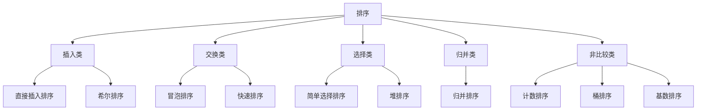
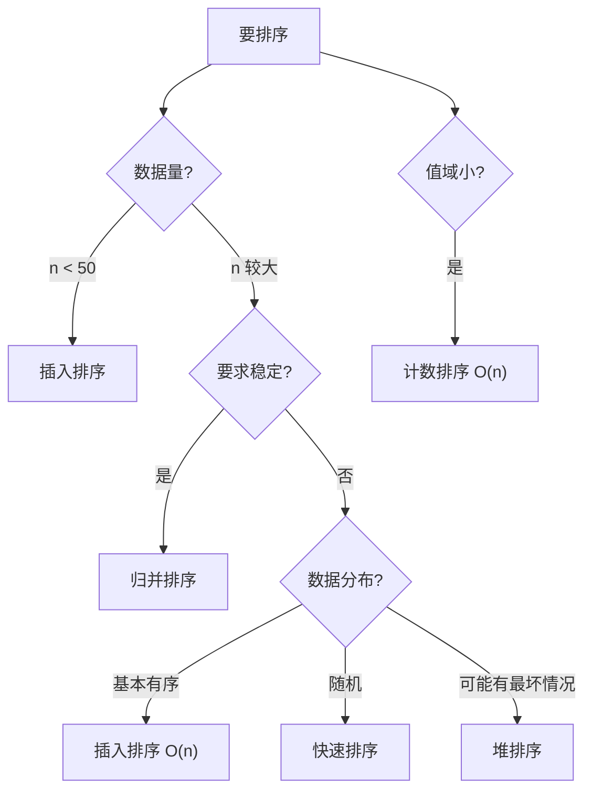
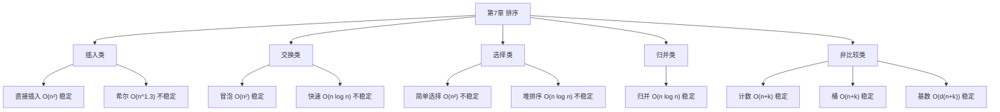
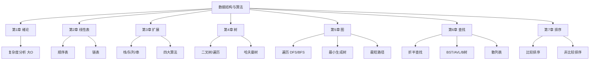

# 第 7 章　排序

> **本章目标**：掌握各种**排序**算法——插入、交换、选择、归并、基数，并理解它们的**时间复杂度、空间复杂度和稳定性**。
>
> **难度**：★★★★☆　**建议用时**：3～4 天
>
> **本章是全书最"实用"的一章。** 排序是计算机中最基础的操作之一，几乎所有系统都离不开它。

> **前置知识**：[第 1 章 大 O 记法](01-绪论.md)（本章几乎每个结论都是复杂度对比）、[第 4 章 完全二叉树](04-树.md)（**堆排序的"堆"就是完全二叉树**）、[第 3 章 分治](03-线性表的扩展.md)（归并/快排都是分治）
> **本章重点**：① **十大排序算法的复杂度与稳定性总表**（7.1，务必背下）② 快排的分区过程（7.3.2）③ 堆排序的建堆（7.3.3）
> **速查**：[速查表·表7 排序算法](速查表.md)（面试前必看）
> **本章直接应用**：第 6 章的查找算法大多**要求数据已排序**

---

## 7.1　基本概念

### 【一句话概括】

**排序 = 把一组数据按某种规则排成有序序列。**

### 【生活类比】

- 按身高排队
- 按成绩排名
- 按价格从低到高筛选商品

### 【几个核心术语】

| 术语 | 含义 |
|---|---|
| **关键字（Key）** | 排序依据的那个数据项 |
| **升序（递增）** | 从小到大 |
| **降序（递减）** | 从大到小 |
| **稳定排序** | 相等元素的**相对顺序不变** |
| **不稳定排序** | 相等元素的相对顺序**可能改变** |

### 【⭐ 稳定性：本章最重要的概念之一】

**什么是稳定性？**

假设有两个学生，成绩都是 85 分，但姓名不同：

```
原始数据: [("张三",85), ("李四",85), ("王五",90)]

按成绩升序排序后:
稳定排序 → [("张三",85), ("李四",85), ("王五",90)]
          （张三仍在李四前面）

不稳定排序 → [("李四",85), ("张三",85), ("王五",90)]
            （顺序可能颠倒，看算法实现）
```

**为什么稳定性重要？**

**多关键字排序**时，稳定性决定结果对不对。

**例子**：先按"姓名"排，再按"成绩"排。

```
原始: [(张三,80), (李四,90), (王五,80)]

第1步：按姓名排 → [(李四,90), (王五,80), (张三,80)]

第2步：按成绩排（用稳定排序）→ [(王五,80), (张三,80), (李四,90)]
        王五和张三都是80分，保持第1步的姓名顺序（王五在张三前）

如果用不稳定排序：可能是 [(张三,80), (王五,80), (李四,90)]
                 姓名顺序就乱了！
```

**结论**：**需要多级排序时，必须用稳定排序。**

### 【排序算法分类】



### 【性能指标】

评价排序算法看三个维度：

1. **时间复杂度**：比较次数 + 移动次数
2. **空间复杂度**：需要多少额外空间
3. **稳定性**：相等元素是否保持相对顺序

### 【本章算法总览表】（⭐ 建议背下来）

| 算法 | 平均时间 | 最好 | 最坏 | 空间 | 稳定性 |
|---|---|---|---|---|---|
| **直接插入排序** | O(n²) | **O(n)** | O(n²) | O(1) | **稳定** ✓ |
| **希尔排序** | O(n^1.3) | **O(n log n)** | O(n²) | O(1) | **不稳定** ✗ |
| **冒泡排序** | O(n²) | **O(n)** | O(n²) | O(1) | **稳定** ✓ |
| **快速排序** | **O(n log n)** | O(n log n) | **O(n²)** | O(log n) | **不稳定** ✗ |
| **简单选择排序** | O(n²) | O(n²) | O(n²) | O(1) | **不稳定** ✗ |
| **堆排序** | **O(n log n)** | O(n log n) | **O(n log n)** | O(1) | **不稳定** ✗ |
| **归并排序** | **O(n log n)** | O(n log n) | **O(n log n)** | **O(n)** | **稳定** ✓ |
| **计数排序** | O(n+k) | O(n+k) | O(n+k) | O(n+k) | **稳定** ✓ |
| **桶排序** | O(n+k) | O(n+k) | O(n²) | O(n+k) | **稳定** ✓ |
| **基数排序** | O(d(n+k)) | —— | —— | O(n+k) | **稳定** ✓ |

**几个关键记忆点**：
- **时间稳定在 O(n log n) 的**：快速排序（平均）、堆排序、归并排序
- **最坏仍是 O(n log n) 的**：**堆排序**、**归并排序**（快排最坏是 O(n²)）
- **稳定的**：插入、冒泡、归并、计数、桶、基数
- **不稳定的**：希尔、快排、选择、堆排
- **空间 O(1) 的**：插入、希尔、冒泡、选择、堆排
- **空间 O(log n) 的**：快速排序（递归栈的深度）
- **需要 O(n) 额外空间的**：归并、计数、桶、基数

### 【⚠ 稳定性记忆口诀】

```
稳定：插入、冒泡、归并、计数、桶、基数
       （"插入冒泡归并"最常考）

不稳定：希尔、快排、选择、堆排
        （"快 选 堆 希" —— 快选一堆（希））
```

**记忆技巧**：
- **快速排序**：因为"快"是跳跃式交换，会打乱相对顺序
- **选择排序**：因为"选"的时候要跨越中间元素交换
- **堆排序**：因为"堆"的调整是跳跃的
- **希尔排序**：因为"希尔"是分组跳跃，上面的插入法保不住

### 【本节自测】

**7-1-1.** 什么是排序的"稳定性"？为什么它重要？
<details><summary>答案</summary>
<p><strong>稳定性</strong>：排序后，<strong>相等元素的相对顺序保持不变</strong>。</p>
<p><strong>例子</strong>：</p><pre><code>原始: [(张三,85), (李四,85)]
稳定排序 → [(张三,85), (李四,85)]  ← 顺序没变
不稳定   → [(李四,85), (张三,85)]  ← 顺序变了
</code></pre><p><strong>为什么重要？</strong></p>
<p>因为<strong>多关键字排序</strong>依赖稳定性。</p>
<p><strong>场景</strong>：先按学号排，再按成绩排。</p><pre><code>第1步：按学号排 → 学号小的在前
第2步：按成绩排（稳定）→ 同分的保持第1步的学号顺序
</code></pre><p>如果第2步用了不稳定排序，同分学生的学号顺序就乱了。</p>
<p><strong>实际应用</strong>：Excel 的多列排序、数据库的 <code>ORDER BY a, b</code>（a 优先，b 次之）。</p>
</details>

**7-1-2.** 下面哪些排序算法是稳定的？（直接插入、希尔、冒泡、快速、简单选择、堆、归并）
<details><summary>答案</summary>
<p><strong>稳定的</strong>：</p>
<ul>
<li>✓ <strong>直接插入排序</strong></li>
<li>✓ <strong>冒泡排序</strong></li>
<li>✓ <strong>归并排序</strong></li>
</ul>
<p><strong>不稳定的</strong>：</p>
<ul>
<li>✗ 希尔排序（分组跳跃）</li>
<li>✗ 快速排序（远距离交换）</li>
<li>✗ 简单选择排序（跨越交换）</li>
<li>✗ 堆排序（堆调整跳跃）</li>
</ul>
<p><strong>记忆口诀</strong>：</p><pre><code>稳定三兄弟：插入、冒泡、归并
不稳定四人组：快、选、堆、希
</code></pre>
</details>

**7-1-3.** 为什么"堆排序"和"归并排序"被认为比"快速排序"更"可靠"？
<details><summary>答案</summary>
<p>因为<strong>它们的最坏时间复杂度仍然是 O(n log n)</strong>，而快速排序最坏会退化到 <strong>O(n²)</strong>。</p>
<table>
<thead>
<tr>
<th>算法</th>
<th>平均</th>
<th><strong>最坏</strong></th>
</tr>
</thead>
<tbody>
<tr>
<td>快速排序</td>
<td>O(n log n)</td>
<td><strong>O(n²)</strong> ⚠</td>
</tr>
<tr>
<td>堆排序</td>
<td>O(n log n)</td>
<td><strong>O(n log n)</strong> ✓</td>
</tr>
<tr>
<td>归并排序</td>
<td>O(n log n)</td>
<td><strong>O(n log n)</strong> ✓</td>
</tr>
</tbody>
</table>
<p><strong>为什么快排最坏会退化？</strong></p>
<p>快排依赖&quot;轴值（pivot）选择&quot;。如果每次选到的轴值都是<strong>最大或最小</strong>的，划分就极度不平衡（一边 0 个，一边 n-1 个）。</p>
<p><strong>最坏情况</strong>：数组<strong>已经有序</strong>且轴值取第一个元素：</p><pre><code>[1, 2, 3, 4, 5] 选 1 作轴值
→ 划分成 [] 和 [2,3,4,5]
→ 再选 2，划分成 [] 和 [3,4,5]
→ ... 递归 n 层，每层比较 n 次 → O(n²)
</code></pre><p><strong>所以</strong>：</p>
<ul>
<li>快排<strong>平均最快</strong>（常数因子小），但<strong>最坏有风险</strong></li>
<li>堆排/归并<strong>最坏也稳定</strong>，但常数因子大一些</li>
</ul>
<p><strong>实际选择</strong>：</p>
<ul>
<li>一般用 <code>std::sort</code>（通常是优化过的快排/内省排序）</li>
<li>要求<strong>最坏性能有保证</strong> → 堆排序</li>
<li>要求<strong>稳定</strong> → 归并排序</li>
</ul>
</details>

---

## 7.2　简单排序

> **对照教材**：徐雅静等《数据结构与算法》第 7.2 节（第 239～244 页），包含三种时间复杂度为 $O(n^2)$ 的基础排序：**起泡排序、直接插入排序、简单选择排序**。

> **⚠ 读教材第 7 章必看：教材 `r[1..n]`（`r[0]` 作哨兵/暂存）vs 工程 `a[0..n-1]` 下标对照表**
>
> 教材第 7 章的代码全部采用 **1-based 数组 `r[1..n]`**，把 `r[0]` 专门空出来当**暂存单元或监视哨**；而平时刷题、C++ 工程和本笔记大部分代码采用 **0-based 数组 `a[0..n-1]`**。看书和手写代码前先对照这张表，彻底告别“下标差 1”迷茫！
>
> | 对比项 | 教材写法（`r[1..n]`，1-based） | 工程/刷题写法（`a[0..n-1]`，0-based） |
> |---|---|---|
> | **数据存放范围** | `r[1]` ～ `r[n]`（数组长度需开 `n + 1`） | `a[0]` ～ `a[n - 1]`（数组长度开 `n`） |
> | **暂存 / 哨兵单元** | 直接复用 `r[0]`（如 `r[0] = r[i]`） | 单独开局部变量 `int key = a[i];` / `int pivot = a[low];` |
> | **起泡排序边界** | `bound = exchange;`，循环 `i = 1 .. bound - 1` | `bound = lastSwap;`，循环 `j = 0 .. bound - 1` |
> | **直接插入排序哨兵** | `r[0] = r[i]; for (j=i-1; r[0]<r[j]; j--)`（无需 `j>=1` 判断） | `while (j >= 0 && a[j] > key)`（必须带 `j >= 0` 防越界） |
> | **简单选择排序** | 外层 `i = 1..n-1`，内层 `j = i+1..n` | 外层 `i = 0..n-2`，内层 `j = i+1..n-1` |
> | **堆排序父子下标** | 左孩子 `2*i`、右孩子 `2*i+1`、最后非叶 `n/2` | 左孩子 `2*i+1`、右孩子 `2*i+2`、最后非叶 `n/2 - 1` |
> | **快排 / 归并初始调用** | `quickSort(r, 1, n)` | `quickSort(a, 0, n - 1)` |

### 7.2.1　起泡排序（冒泡排序）

#### 【一句话概括】

**相邻两个元素比较，大的往后"冒"，一趟下来最大的就排到最后。**

#### 【生活类比】

**水里的气泡**：大的气泡浮得快（冒到水面），小的留在下面。

#### 【算法思路】

```
第1趟：从头到尾，相邻两两比较，大的往后换
       结果：最大的元素"冒"到了最后

第2趟：对前 n-1 个元素重复
       结果：第二大的到了倒数第二

...

重复 n-1 趟
```

#### 【图解】

对 `[5, 3, 8, 1]` 排序：

```
第1趟（目标：把最大的 8 冒到最后）:
  [5, 3, 8, 1]
   5>3? 是 → 交换 → [3, 5, 8, 1]
   5>8? 否 → 不动
   8>1? 是 → 交换 → [3, 5, 1, 8]
                        ↑ 8 到位了

第2趟（在前 3 个里找最大）:
  [3, 5, 1 | 8]
   3>5? 否
   5>1? 是 → 交换 → [3, 1, 5, 8]
                      ↑ 5 到位了

第3趟:
  [3, 1 | 5, 8]
   3>1? 是 → 交换 → [1, 3, 5, 8]
                    ↑ 3 到位了

最终: [1, 3, 5, 8] ✓
```

#### 【代码实现（`swapped` 标志优化版）】

```cpp
void bubbleSort(int a[], int n) {
    for (int i = 0; i < n - 1; i++) {          // 共 n-1 趟

        bool swapped = false;                   // ★ 优化标志

        for (int j = 0; j < n - 1 - i; j++) {   // 每趟比较到 n-1-i
            if (a[j] > a[j + 1]) {
                swap(a[j], a[j + 1]);           // 大的往后换
                swapped = true;
            }
        }

        // ★ 一趟下来没交换，说明已经有序，提前结束
        if (!swapped) break;
    }
}
```

#### 【关键优化 1：`swapped` 标志】

**为什么需要它？**

如果没有这个标志，即使数组已经有序，也要跑完 n-1 趟。

**例子**：`[1, 2, 3, 4, 5]` 已经有序

```
第1趟：比较 4 次，没有交换
  没有 swapped 标志 → 继续第 2、3、4 趟（浪费）
  有 swapped 标志 → 检测到没交换，立即结束 ✓
```

**这就是**冒泡排序最好情况是 O(n) 的原因。

#### 【关键优化 2：教材 `pos` 最后交换位置版（教材 p.240～241）】

`swapped` 标志只能判断“整趟有没有发生交换”，但教材给出了一个**更强一层的优化**：**记住本趟最后一次发生交换的位置 `pos`（教材中变量名为 `exchange` / `bound`）**！

**为什么更强？** 如果本趟最后一次交换发生在下标 `pos` 和 `pos+1` 之间，说明 **`pos+1` 之后的所有元素都已经完全有序且比前面都大**！下一趟不需要每次只把边界减 1，而是**直接把无序区边界缩到 `pos`**！

**图解威力**（对尾部已经有序的 `[3, 1, 2, 4, 5, 6]`）：

```
第 1 趟（bound = 5）:
  j=0: 3>1 换 → [1, 3, 2, 4, 5, 6]  pos = 0
  j=1: 3>2 换 → [1, 2, 3, 4, 5, 6]  pos = 1
  j=2: 3<4 不换
  j=3: 4<5 不换
  j=4: 5<6 不换
  本趟结束：最后一次交换在 pos = 1！
  → 说明 [2, 3, 4, 5, 6] 里下标 2~5 全部已就位，下一趟直接设 bound = 1！

第 2 趟（bound = 1，只比较 j=0 一次！）:
  j=0: 1<2 不换 → pos 保持 0 → 立即结束！
  （普通 swapped 版第 2 趟还要傻傻比较到 j=3，pos 版直接跳过整段有序尾巴！）
```

```cpp
// 工程 0-based 写法（等价于教材 p.241 的 bound/exchange 优化版）
void bubbleSortPos(int a[], int n) {
    int bound = n - 1;                          // 当前无序区的右边界
    while (bound > 0) {
        int pos = 0;                            // ★ 记录本趟最后一次发生交换的下标
        for (int j = 0; j < bound; j++) {
            if (a[j] > a[j + 1]) {
                swap(a[j], a[j + 1]);
                pos = j;                        // ★ 更新最后交换位置
            }
        }
        bound = pos;                            // ★ 若没发生交换，pos==0 直接结束循环；
                                                //   若发生过交换，边界直接缩到 pos！
    }
}
```

> **对应教材写法提示**：教材使用 `r[1..n]`，`exchange` 初始设为 `n`（即 `bound`），每次交换令 `pos = j`，内层循环结束令 `exchange = pos`，`while (exchange != 0)` ——思想与上面完全一致，既包含了“无交换立即提前结束”，又顺带完成了“跳过尾部有序段”！

#### 【复杂度分析】

| 情况 | 比较次数 | 交换次数 | 时间复杂度 |
|---|---|---|---|
| **最好**（已有序） | n-1 | 0 | **O(n)** ★ |
| **最坏**（逆序） | n(n-1)/2 | n(n-1)/2 | O(n²) |
| **平均** | n(n-1)/2 | n²/4 | O(n²) |

**空间复杂度：O(1)**

**稳定性：稳定** ✓

**为什么稳定？** 因为交换条件是 `a[j] > a[j+1]`（严格大于）。相等时不交换，保持原顺序。

---

### 7.2.2　直接插入排序

#### 【一句话概括】

**像打扑克牌理牌——每张新牌插到已排好的牌里的正确位置。**

#### 【生活类比】

**摸扑克牌**：
1. 手里已有几张**排好序**的牌
2. 摸到一张新牌，从右往左找，插到合适的位置
3. 重复

#### 【算法思路】

```
把数组分成两部分：
[已排序区] [未排序区]

每次从未排序区取第一个元素，插入到已排序区的正确位置
```

#### 【图解】

```
初始: [5] | 13, 19, 21, 37
      ↑已排  ↑未排

第1趟（插入 13）:
  13 > 5，放在 5 后面
  [5, 13] | 19, 21, 37

第2趟（插入 19）:
  19 > 13，放在最后
  [5, 13, 19] | 21, 37

第3趟（插入 21）:
  [5, 13, 19, 21] | 37

第4趟（插入 37）:
  [5, 13, 19, 21, 37]
```

**再看一个需要移动的例子**（插入 21 到 `[5, 13, 19, 37]`）：

```
待插入 21，从右往左比：
  37 > 21 → 37 后移一格
  19 < 21 → 找到位置！插在 19 后面

过程示意:
  [5, 13, 19, 37, 21]    21 暂存
  [5, 13, 19, 37, 37]    ← 37 后移
  [5, 13, 19, 21, 37]    ← 21 插入
```

#### 【代码实现】

```cpp
void insertionSort(int a[], int n) {
    for (int i = 1; i < n; i++) {
        int key = a[i];         // ★ 待插入的元素（先存起来）
        int j = i - 1;

        // 从右往左找位置，同时把比 key 大的元素后移
        while (j >= 0 && a[j] > key) {
            a[j + 1] = a[j];    // ★ 后移
            j--;
        }
        a[j + 1] = key;         // ★ 插入到正确位置
    }
}
```

#### 【逐行理解】

```cpp
int key = a[i];             // ① 把 a[i] 保存起来（因为它会被覆盖）
while (j >= 0 && a[j] > key) {
    a[j + 1] = a[j];        // ② 比 key 大的元素整体后移一格
    j--;
}
a[j + 1] = key;             // ③ 循环停止时，j+1 就是正确位置
```

**为什么是 `a[j+1] = key` 而不是 `a[j] = key`？**

因为循环结束时，`j` 已经指向了"第一个不比 key 大的元素"，所以插入位置是 `j+1`。

#### 【对照教材 p.242：`r[0]` 监视哨（哨兵）写法】

教材代码利用数组空出的 `r[0]` 单元，实现了**一举两得**的哨兵优化：

```cpp
// 教材版（数据存在 r[1..n]，r[0] 既当暂存变量，又当监视哨）
void insertSortTextbook(int r[], int n) {
    for (int i = 2; i <= n; i++) {
        r[0] = r[i];                    // ★ ① 暂存待插元素  ② 在下标 0 放哨兵！
        int j = i - 1;
        for (; r[0] < r[j]; j--) {      // ★ 不用再写 j >= 1！因为到 j==0 时 r[0] < r[0] 必为假！
            r[j + 1] = r[j];            // 记录后移
        }
        r[j + 1] = r[0];                // 插入到正确位置
    }
}
```

- **哨兵的妙处**：在工程版里，内层 `while` 每走一步都要判断**两个条件**（`j >= 0` 防越界 **且** `a[j] > key`）；而教材把待插值放在 `r[0]` 后，即使它比前面所有数都小，向左扫到 `j == 0` 时遇到 `r[0] < r[0]` 必定为假自动停下——**每次内层循环省掉一次下标越界判断**！

#### 【复杂度分析】

| 情况 | 比较次数 | 移动次数 | 时间复杂度 |
|---|---|---|---|
| **最好**（已经有序） | n-1 | 0 | **O(n)** ★ |
| **最坏**（逆序） | n(n-1)/2 | n(n-1)/2 | O(n²) |
| **平均** | n²/4 | n²/4 | **O(n²)** |

**空间复杂度：O(1)**（只用了一个临时变量 key）

**稳定性：稳定** ✓

**为什么稳定？** 因为 `while (a[j] > key)` 用的是 **`>`** 而不是 `>=`。遇到**相等**的元素就停下，不会把 key 插到它前面。

#### 【适用场景】

**数据量小**或**基本有序**时，插入排序很快（接近 O(n)）。

**实际应用**：很多排序库在数据量小于某个阈值（如 16）时，会切换到插入排序。

---

### 7.2.3　简单选择排序

> **对照教材**：徐雅静等《数据结构与算法》第 7.2.3 节（第 243～244 页，图 7-9）。

#### 【一句话概括】

**每趟从无序区里“选出最小的元素”，直接和无序区第一个位置交换，一趟定一个位置。**

#### 【生活类比】

**体育老师按身高整队**：
1. 扫一眼还没站队的所有同学，记住**最矮**的那个人（只用眼睛看，先不折腾人来回换位）；
2. 一眼扫完，直接把最矮的同学叫到队尾站好；
3. 对剩下的人重复，直到全班站好。

#### 【算法思路】

```
把数组分成两部分：
[已排序区 0..i-1] | [未排序区 i..n-1]

第 i 趟（i = 0, 1, ..., n-2）：
  1. 先假设无序区第 1 个就是最小的：minIdx = i
  2. 遍历 j = i+1 .. n-1，只要发现 a[j] < a[minIdx]，就只更新下标 minIdx = j（绝不中途交换！）
  3. 扫完后，如果 minIdx != i，把 a[i] 和 a[minIdx] 交换一次 → 最小值归位！
```

#### 【图解：教材图 7-9 示例 `[49, 27, 65, 97, 76, 13, 38]` 逐趟演示】

```
初始序列: [49, 27, 65, 97, 76, 13, 38]

第 1 趟（i=0，在 [49, 27, 65, 97, 76, 13, 38] 找最小）:
  最小是 13（下标 5），与 a[0]=49 交换
  → [13 | 27, 65, 97, 76, 49, 38]

第 2 趟（i=1，在 [27, 65, 97, 76, 49, 38] 找最小）:
  最小是 27（下标 1），已在位，不交换！
  → [13, 27 | 65, 97, 76, 49, 38]

第 3 趟（i=2，在 [65, 97, 76, 49, 38] 找最小）:
  最小是 38（下标 6），与 a[2]=65 交换
  → [13, 27, 38 | 97, 76, 49, 65]

第 4 趟（i=3，在 [97, 76, 49, 65] 找最小）:
  最小是 49（下标 5），与 a[3]=97 交换
  → [13, 27, 38, 49 | 76, 97, 65]

第 5 趟（i=4，在 [76, 97, 65] 找最小）:
  最小是 65（下标 6），与 a[4]=76 交换
  → [13, 27, 38, 49, 65 | 97, 76]

第 6 趟（i=5，在 [97, 76] 找最小）:
  最小是 76（下标 6），与 a[5]=97 交换
  → [13, 27, 38, 49, 65, 76 | 97]

最终结果: [13, 27, 38, 49, 65, 76, 97] ✓（共 6 趟，仅发生 5 次交换！）
```

#### 【代码实现：0-based 工程版 vs 教材 `r[1..n]` 版对照】

**① 0-based 工程版（推荐平时手写）**：

```cpp
void selectionSort(int a[], int n) {
    for (int i = 0; i < n - 1; i++) {           // 共 n-1 趟，每趟定一个最小元素
        int minIdx = i;                         // ★ 先假设 a[i] 最小
        for (int j = i + 1; j < n; j++) {
            if (a[j] < a[minIdx]) {
                minIdx = j;                     // ★ 只记录最小值的下标，不在这里交换！
            }
        }
        if (minIdx != i) {
            swap(a[i], a[minIdx]);              // ★ 每趟最多交换 1 次
        }
    }
}
```

**② 教材 `r[1..n]` 版（教材 p.244，`r[0]` 作交换暂存）**：

```cpp
void selectSortTextbook(int r[], int n) {
    for (int i = 1; i < n; i++) {               // 1-based：i 从 1 到 n-1
        int index = i;
        for (int j = i + 1; j <= n; j++) {      // j 从 i+1 到 n
            if (r[j] < r[index]) index = j;
        }
        if (index != i) {                       // 借用 r[0] 完成交换
            r[0] = r[i];
            r[i] = r[index];
            r[index] = r[0];
        }
    }
}
```

#### 【复杂度分析】

| 指标 | 数值 / 复杂度 | 说明 |
|---|---|---|
| **比较次数** | **恒为 $\frac{n(n-1)}{2}$** | 无论原数组有序还是逆序，每趟都必须扫完整个无序区才能确定最小值 |
| **交换次数** | 最少 $0$ 次，**最多 $n - 1$ 次** | 每趟最多换 1 次（记录极大、搬移开销高时显著优于冒泡和插入！） |
| **最好 / 最坏 / 平均时间** | **全部是 $O(n^2)$** | 时间复杂度**与初始序列排列无关** |
| **空间复杂度** | **$O(1)$** | 原地排序 |
| **稳定性** | **不稳定 ✗** | 存在远距离交换 |

#### 【⚠ 为什么简单选择排序是不稳定的？】

**经典最小反例**：`[5a, 5b, 2]`（`5a` 和 `5b` 关键字相等，原本 `5a` 在 `5b` 前面）

```
初始:   [5a, 5b, 2]
         ↑        ↑
第 1 趟：找到最小元素 2（下标 2），直接和下标 0 的 5a 交换！
结果:   [2,  5b, 5a]
             ↑   ↑
        5a 直接被甩到了 5b 后面！相等元素的相对顺序彻底颠倒 ✗
```

**本质原因**：选择排序不是只交换相邻元素，而是**跨过中间元素做远距离交换**，一旦被换走的元素后面恰好有与它相等的元素，稳定性就会被破坏。

#### 【简单排序三兄弟横向对比】

| 对比维度 | 起泡排序（冒泡） | 直接插入排序 | 简单选择排序 |
|---|---|---|---|
| **最好情况** | **$O(n)$**（加优化） | **$O(n)$** | $O(n^2)$ |
| **平均 / 最坏** | $O(n^2)$ | $O(n^2)$ | $O(n^2)$ |
| **移动/交换次数** | 多（最多 $n(n-1)/2$ 次交换） | 中（最多 $n(n-1)/2$ 次后移） | **极少（最多 $n-1$ 次交换）** ★ |
| **稳定性** | **稳定** ✓ | **稳定** ✓ | **不稳定** ✗ |
| **各自亮点** | 教学直观、`pos` 优化跳有序尾 | 基本有序 / 小数据（$n < 16$）极快 | 数据记录体积庞大、移动成本高时最省搬移 |

---

### 【本节自测】

**7-2-1.** 冒泡排序的 `swapped` 标志有什么作用？不加会怎样？教材的 `pos` 优化又进一步改进了什么？
<details><summary>答案</summary>
<p><strong>作用</strong>：检测数组是否已经有序，<strong>提前结束</strong>排序。</p>
<p><strong>不加标志的后果</strong>：
即使数组已经有序，也要跑完所有 n-1 趟 → <strong>最好情况仍是 O(n²)</strong>。</p>
<p><strong>加了标志后</strong>：
第一趟如果没有任何交换，说明已经有序，立即 break → <strong>最好情况 O(n)</strong>。</p>
<p><strong>例子</strong>：<code>[1, 2, 3, 4, 5]</code></p><pre><code>不加标志：
  第1趟：比较 4 次，无交换
  第2趟：比较 3 次，无交换
  第3趟：比较 2 次
  第4趟：比较 1 次
  总计 10 次比较（O(n²)）&#10;
加了标志：
  第1趟：比较 4 次，无交换 → swapped=false → break
  总计 4 次比较（O(n)）
</code></pre>
<p><strong>教材 <code>pos</code> 优化的进一步提升</strong>：记录本趟<strong>最后一次发生交换的位置 <code>pos</code></strong>，下一趟直接把无序区边界缩到 <code>pos</code>——既能做到无交换时 <code>pos==0</code> 立即结束，又能直接跳过尾部已经排好序的一整段元素。</p>
</details>

**7-2-2.** 直接插入排序在什么情况下效率最高？时间复杂度是多少？
<details><summary>答案</summary>
<p><strong>在数据已经&quot;基本有序&quot;（或完全有序）时效率最高。</strong></p>
<ul>
<li><strong>最好情况</strong>（已经有序）：<strong>O(n)</strong>
<ul>
<li>每次只需比较 1 次（<code>a[j] &gt; key</code> 立刻为 false）</li>
<li>不需要移动任何元素</li>
</ul>
</li>
<li><strong>最坏情况</strong>（完全逆序）：O(n²)
<ul>
<li>每次都要比较到最前面，移动 i 次</li>
</ul>
</li>
</ul>
<p><strong>原因</strong>：插入排序的&quot;工作量&quot;取决于<strong>逆序对的数量</strong>。已经有序时逆序对为 0，所以只需 O(n) 的扫描。</p>
<p><strong>实际应用</strong>：很多标准库的排序在数据量小（&lt; 16）时切换到插入排序，因为它常数小、对有序数据特别快。</p>
</details>

**7-2-3.** 用直接插入排序对 `[5, 3, 8, 1]` 排序，写出每一趟的结果。
<details><summary>答案</summary>
<pre><code>初始: [5 | 3, 8, 1]
      （5 是已排序区）&#10;
第1趟（插入 3）:
  3 &lt; 5 → 5 后移 → [_, 5, 8, 1] → 3 插入 → [3, 5 | 8, 1]&#10;
第2趟（插入 8）:
  8 &gt; 5 → 8 位置不变 → [3, 5, 8 | 1]&#10;
第3趟（插入 1）:
  1 &lt; 8 → 8 后移
  1 &lt; 5 → 5 后移
  1 &lt; 3 → 3 后移
  → [_, 3, 5, 8] → 1 插入 → [1, 3, 5, 8]&#10;
最终: [1, 3, 5, 8]
</code></pre><p><strong>比较次数</strong>：1 + 1 + 3 = 5 次
<strong>移动次数</strong>：1 + 0 + 3 = 4 次</p>
</details>

**7-2-4.** 简单选择排序在数组“已经完全有序”时时间复杂度是多少？它和冒泡/插入相比最大的优势是什么？
<details><summary>答案</summary>
<p><strong>即使数组已经完全有序，简单选择排序的时间复杂度依然是 O(n²)！</strong></p>
<ul>
<li><strong>原因</strong>：每一趟为了确认“谁是无序区最小值”，都必须把剩下所有元素扫一遍，总比较次数<strong>恒为 n(n-1)/2</strong>，与初始是否有序无关。</li>
<li><strong>最大优势</strong>：<strong>交换（移动）次数极少</strong>——每趟最多只交换 1 次，总交换次数不超过 <strong>n - 1 次</strong>（已有序时为 0 次）。当每个元素是体积很大的结构体（交换代价极高）时，简单选择排序的搬移开销远低于冒泡和插入。</li>
</ul>
</details>

**7-2-5.** 为什么简单选择排序是不稳定的？请给出一个包含 3 个元素的最小反例并说明。
<details><summary>答案</summary>
<p>因为简单选择排序每趟把最小元素和无序区首位做<strong>远距离跨元素交换</strong>，可能把原本靠前的相等元素直接甩到后面。</p>
<p><strong>最小反例</strong>：<code>[5a, 5b, 2]</code></p>
<pre><code>初始: [5a, 5b, 2]   （5a 在 5b 前面）
第1趟: 选出最小值 2（下标 2），与下标 0 的 5a 交换
结果: [2, 5b, 5a]   （5a 跑到了 5b 后面，相对顺序改变 ✗）
</code></pre>
<p><strong>结论</strong>：虽然它和插入/冒泡同属简单排序，但只有插入和冒泡稳定，<strong>简单选择排序不稳定</strong>（口诀：不稳定四人组「快、选、堆、希」）。</p>
</details>

---

## 7.3　复杂排序

> **对照教材**：徐雅静等《数据结构与算法》第 7.3 节（第 245～257 页）。这一节进入能突破 $O(n^2)$ 瓶颈的高效排序：**希尔排序、快速排序、堆排序、归并排序**，以及工程上直接调用的 **STL 排序算法**。

### 7.3.1　希尔排序（缩小增量排序）

#### 【一句话概括】

**希尔排序 = 分组 + 插入排序，逐步缩小分组间隔。**

#### 【为什么需要希尔排序】

**插入排序的问题**：如果一个小元素在很靠后的位置，它要"一步一步"慢慢挪到前面，移动次数很多。

```
例子: [9, 8, 7, 6, 5, 4, 3, 2, 1, 0]
      要把 0 挪到最前面，需要移动 9 次！
```

**希尔排序的思路**：**先用大间隔让元素"大步跳"，快速接近最终位置；再逐步缩小间隔精细调整。**

#### 【生活类比】

**整理书架**：
1. 先**粗略地**把书按大类分开（大间隔）
2. 再在每类里**细致地**排序（小间隔）
3. 最后整体微调

比"从第一本开始一本本插"快得多。

#### 【算法思路】

**核心：增量序列（gap）**

```
第1趟：gap = n/2，把相隔 gap 的元素分成一组，组内插入排序
第2趟：gap = n/4，...
...
最后一趟：gap = 1（就是普通插入排序）
```

#### 【图解】

以 `[49, 38, 65, 97, 76, 13, 27, 49]` 为例（n=8）：

**第1趟：gap = 4**

分成 4 组（同组元素下标相差 4）：

```
下标:  0   1   2   3   4   5   6   7
      [49, 38, 65, 97, 76, 13, 27, 49]

组1: a[0]=49, a[4]=76   → 排序后: 49, 76
组2: a[1]=38, a[5]=13   → 排序后: 13, 38
组3: a[2]=65, a[6]=27   → 排序后: 27, 65
组4: a[3]=97, a[7]=49   → 排序后: 49, 97

结果: [49, 13, 27, 49, 76, 38, 65, 97]
```

**第2趟：gap = 2**

```
下标:  0   1   2   3   4   5   6   7
      [49, 13, 27, 49, 76, 38, 65, 97]

组1（下标 0,2,4,6）: 49, 27, 76, 65 → 排序: 27, 49, 65, 76
组2（下标 1,3,5,7）: 13, 49, 38, 97 → 排序: 13, 38, 49, 97

结果: [27, 13, 49, 38, 65, 49, 76, 97]
```

**第3趟：gap = 1**（普通插入排序）

```
[27, 13, 49, 38, 65, 49, 76, 97]
→ [13, 27, 38, 49, 49, 65, 76, 97]  ✓ 完成
```

**注意**：经过前两趟，数组已经**基本有序**了，所以最后的插入排序很快。

#### 【代码实现】

```cpp
void shellSort(int a[], int n) {
    // 增量序列：n/2, n/4, ..., 1
    for (int gap = n / 2; gap > 0; gap /= 2) {

        // 对每个分组做插入排序
        for (int i = gap; i < n; i++) {
            int key = a[i];
            int j = i - gap;

            while (j >= 0 && a[j] > key) {
                a[j + gap] = a[j];     // ★ 移动的步长是 gap
                j -= gap;
            }
            a[j + gap] = key;
        }
    }
}
```

**对比插入排序的代码**：

| | 插入排序 | 希尔排序 |
|---|---|---|
| 外层 | 无 | **多了 gap 循环** |
| 步长 | 1 | **gap** |

**希尔排序就是把插入排序的所有 "1" 换成 "gap"。**

#### 【复杂度分析】

**时间复杂度**：**取决于增量序列**！

| 增量序列 | 时间复杂度 |
|---|---|
| n/2, n/4, ..., 1 | O(n²)（最坏） |
| Hibbard 序列 | O(n^1.5) |
| Sedgewick 序列 | O(n^1.3) |

**教材的说法**：时间复杂度在 **O(n²) 和 O(n log₂n) 之间**。

**空间复杂度：O(1)**

**稳定性：不稳定** ✗

**为什么不稳定？**

因为**分组时，相等的元素可能被分到不同的组**，跨组的移动会破坏它们原本的相对顺序。

**经过验证的反例**：`[2, 1ᴀ, 1ʙ, 1ᴄ]`（三个 1 用上标区分，原本 A 在 B 前），gap 序列 `2, 1`

```
初始: [2, 1ᴀ, 1ʙ, 1ᴄ]   ← 1ᴀ 在下标 1，1ʙ 在下标 2

第1趟 gap=2：
  组1（下标 0, 2）: (2, 1ʙ)  → 2 > 1ʙ，交换 → 1ʙ, 2
  组2（下标 1, 3）: (1ᴀ, 1ᴄ) → 相等，不动

  数组变为: [1ʙ, 1ᴀ, 2, 1ᴄ]
             ↑ 1ʙ 从下标 2 跳到了下标 0，**跨过了 1ᴀ**！

第2趟 gap=1（普通插入排序）：
  [1ʙ, 1ᴀ, 2, 1ᴄ]
  插入 1ᴀ：1ᴀ vs 1ʙ 相等 → 不动
  插入 2：不动
  插入 1ᴄ：1ᴄ < 2 → 2 后移 → [1ʙ, 1ᴀ, 1ᴄ, 2]

最终: [1ʙ, 1ᴀ, 1ᴄ, 2]   ← 1ʙ 跑到了 1ᴀ 前面，顺序反了 ✗
```

**问题的根源**：gap=2 那一步，`1ʙ` 跨越了 `1ᴀ`（它们原本相邻），破坏了相对顺序。而之后的 gap=1 插入排序**无法恢复**（因为它只比较相邻元素，`1ʙ` 和 `1ᴀ` 已经隔着位置了）。

**考试记忆**：**希尔排序不稳定**。原因和快排、选择排序、堆排序一样——**都存在"远距离移动"**（相比之下，插入排序和冒泡排序只交换相邻元素，所以稳定）。

### 7.3.2　快速排序 ⭐ 最重要

#### 【一句话概括】

**选一个"基准值"，把数组分成"小于它的"和"大于它的"两半，再分别递归。**

#### 【生活类比】

**整理一堆书**：
1. 随便抽一本书当"标准"（基准）
2. 比它薄的放左边，比它厚的放右边
3. 对左边那一堆、右边那一堆**重复**上述过程

**分而治之**，比一本本比较快得多。

#### 【算法思路】

```
1. 从数组中选一个元素作为"轴值/基准"（pivot）
2. 分区（Partition）：把小于基准的放左边，大于基准的放右边
3. 递归：对左右两个子数组分别快排
```

**关键在"分区"这一步。**

#### 【分区过程详解】

以 `[49, 38, 65, 97, 76, 13, 27]` 为例，选第一个元素 **49** 作基准：

**方法：双指针（左右交替扫描）**

```
初始: [49, 38, 65, 97, 76, 13, 27]
       ↑low                    ↑high
       基准 = 49

第1步：从右往左找"小于 49"的
  27 < 49 ✓ → 把 27 放到 low 位置
  [27, 38, 65, 97, 76, 13, _]   low 后移到 1

第2步：从左往右找"大于 49"的
  38 < 49，跳过
  65 > 49 ✓ → 把 65 放到 high 位置
  [27, 38, _, 97, 76, 13, 65]   high 前移到 5

第3步：从右往左找"小于 49"的
  13 < 49 ✓ → 13 放到 low 位置
  [27, 38, 13, 97, 76, _, 65]   low 后移到 3

第4步：从左往右找"大于 49"的
  97 > 49 ✓ → 97 放到 high 位置
  [27, 38, 13, _, 76, 97, 65]   high 前移到 4

第5步：low=3, high=4
  从右往左：76 > 49，跳过，high 前移到 3
  low == high → 停止

第6步：把基准 49 放到 low=high 位置
  [27, 38, 13, 49, 76, 97, 65]
                ↑ 基准到位了！

左边都 < 49 ✓，右边都 > 49 ✓
```

**然后递归处理 `[27, 38, 13]` 和 `[76, 97, 65]`。**

#### 【代码实现】

```cpp
// 分区函数：返回基准的最终位置
int partition(int a[], int low, int high) {
    int pivot = a[low];        // ★ 选第一个元素作基准

    while (low < high) {
        // 从右往左找小于 pivot 的
        while (low < high && a[high] >= pivot) high--;
        a[low] = a[high];      // ★ 放到左边

        // 从左往右找大于 pivot 的
        while (low < high && a[low] <= pivot) low++;
        a[high] = a[low];      // ★ 放到右边
    }

    a[low] = pivot;            // ★ 基准归位
    return low;
}

// 快速排序
void quickSort(int a[], int low, int high) {
    if (low >= high) return;   // 出口：只剩 0 或 1 个元素

    int pivotPos = partition(a, low, high);

    quickSort(a, low, pivotPos - 1);    // 递归左半
    quickSort(a, pivotPos + 1, high);   // 递归右半
}
```

#### 【复杂度分析】

| 情况 | 时间复杂度 | 说明 |
|---|---|---|
| **最好** | O(n log n) | 每次划分都很均匀 |
| **平均** | **O(n log n)** ★ | 实际表现最好 |
| **最坏** | **O(n²)** ⚠ | 每次划分极不均匀 |

**空间复杂度：O(log n)**（递归栈的深度，平均）

**稳定性：不稳定** ✗

#### 【⚠ 什么情况会退化到 O(n²)？】

**当数组已经有序，且基准选第一个元素时。**

**例子**：`[1, 2, 3, 4, 5]`，选 1 作基准

```
划分: [] 和 [2,3,4,5]      ← 左边空，右边 n-1 个
再划分: [] 和 [3,4,5]
再划分: [] 和 [4,5]
...

递归深度 = n（而不是 log n）
每层比较 n 次
→ O(n²)
```

**解决方案**：
1. **随机选基准**（随机化快排）
2. **三数取中**（取首、中、尾的中位数作基准）
3. **小区间用插入排序**

**现代实现**：`std::sort` 用的是 **内省排序（Introsort）**——快排 + 堆排 + 插入排序的组合，保证最坏也是 O(n log n)。

#### 【快排为什么快？】

**"快"体现在两方面**：
1. **比较和移动的距离远**：一次交换可能跨越半个数组，效率高
2. **常数因子小**：相比堆排、归并，快排的常数最小

**实测**：随机数据下，快排通常比堆排快 2~3 倍。

### 7.3.3　堆排序

#### 【先理解"堆"】

**堆（Heap）** = 一种**完全二叉树**，满足：

- **大顶堆**：每个节点的值 **≥** 其孩子（根最大）
- **小顶堆**：每个节点的值 **≤** 其孩子（根最小）

**大顶堆示例**：
```
        90
       /  \
     70    80
    /  \   /
   40  60 50

验证：90 > 70, 90 > 80, 70 > 40, 70 > 60, 80 > 50 ✓
```

**关键：堆是用"数组"存储的！**（利用完全二叉树的性质）

```
数组: [90, 70, 80, 40, 60, 50]
下标:  0   1   2   3   4   5

关系（下标 i）:
  左孩子 = 2i + 1
  右孩子 = 2i + 2
  父节点 = (i-1) / 2
```

#### 【算法思路】

```
1. 把数组建成一个大顶堆（堆顶是最大值）
2. 把堆顶（最大值）和最后一个元素交换 → 最大值到位
3. 对剩下的 n-1 个元素重新调整成堆
4. 重复 2、3，直到全部有序
```

#### 【两个核心操作】

**① 向下调整（siftDown / heapify）**

**作用**：把某个节点"下沉"到合适位置，恢复堆的性质。

```cpp
void siftDown(int a[], int n, int i) {
    while (true) {
        int largest = i;
        int left  = 2 * i + 1;
        int right = 2 * i + 2;

        // 找出"自己、左孩子、右孩子"中最大的
        if (left < n && a[left] > a[largest]) largest = left;
        if (right < n && a[right] > a[largest]) largest = right;

        if (largest == i) break;    // 自己最大，不用调整了

        swap(a[i], a[largest]);     // 和最大的孩子交换
        i = largest;                // 继续往下检查
    }
}
```

**图示**（对 `i=0` 向下调整）：

```
        40              70
       /  \     →      /  \
     70    80        40    80      ← 40 又比左孩子小？
    /  \            /  \
   60  50          60  50

继续调整:
        70              70
       /  \     →      /  \
     60    80        60    80
    /  \            /  \
   40  50          40  50   ← 40 是叶子了，停止
```

**② 建堆（Build Heap）**

**从最后一个非叶节点开始，依次向下调整。**

```cpp
void buildHeap(int a[], int n) {
    // 最后一个非叶节点的下标 = n/2 - 1
    for (int i = n / 2 - 1; i >= 0; i--) {
        siftDown(a, n, i);
    }
}
```

**为什么从 `n/2 - 1` 开始？**
因为下标 > n/2-1 的节点都是**叶子**（没有孩子），不需要调整。

#### 【完整堆排序】

```cpp
void heapSort(int a[], int n) {
    // ① 建堆（O(n)）
    buildHeap(a, n);

    // ② 依次取出堆顶，放到末尾
    for (int i = n - 1; i > 0; i--) {
        swap(a[0], a[i]);       // 堆顶（最大）换到末尾
        siftDown(a, i, 0);      // 对剩余部分重新调整
    }
}
```

#### 【图解完整过程】

对 `[4, 6, 8, 5, 9]` 排序：

```
第1步：建堆
  从最后的非叶节点（下标 5/2-1 = 1）开始

  初始数组: [4, 6, 8, 5, 9]
  对应的树:
         4
        / \
       6   8
      / \
     5   9

  调整 i=1（值 6）: 6 < 9 → 交换
         4
        / \
       9   8
      / \
     5   6

  调整 i=0（值 4）: 4 < 9 → 交换，4 继续下沉
         9
        / \
       4   8
      / \
     5   6
     
  4 < 6 → 交换
         9
        / \
       6   8
      / \
     5   4

  堆建成: [9, 6, 8, 5, 4]

第2步：排序
  交换 a[0] 和 a[4]: [4, 6, 8, 5 | 9]     9 到位
  调整前4个成堆: [8, 6, 4, 5 | 9]
  
  交换 a[0] 和 a[3]: [5, 6, 4 | 8, 9]     8 到位
  调整: [6, 5, 4 | 8, 9]
  
  交换 a[0] 和 a[2]: [4, 5 | 6, 8, 9]     6 到位
  调整: [5, 4 | 6, 8, 9]
  
  交换 a[0] 和 a[1]: [4 | 5, 6, 8, 9]     5 到位
  
  结果: [4, 5, 6, 8, 9] ✓
```

#### 【复杂度分析】

| 阶段 | 复杂度 |
|---|---|
| 建堆 | **O(n)** |
| 每次取堆顶 + 调整 | O(log n)，共 n 次 → O(n log n) |
| **总计** | **O(n log n)** |

**关键优势**：**最好、最坏、平均都是 O(n log n)**（不像快排会退化）。

**空间复杂度：O(1)**（原地排序）

**稳定性：不稳定** ✗

### 7.3.4　归并排序

#### 【一句话概括】

**把数组一分为二，分别排序，再合并成一个有序数组。**

#### 【生活类比】

**两队已排好序的学生合并成一队**：
- 两队各自有序
- 每次比较两队排头的学生，矮的先进新队

#### 【算法思路】

```
1. 分（Divide）：把数组从中间一分为二
2. 治（Conquer）：递归排序左半和右半
3. 合（Combine）：把两个有序数组合并成一个有序数组
```

**这是典型的"分治法"。**

#### 【图解】

```
[49, 38, 65, 97, 76, 13, 27]

分:
[49, 38, 65] [97, 76, 13, 27]
[49] [38, 65]   [97, 76] [13, 27]
[49] [38] [65]  [97] [76] [13] [27]

合:
[38, 49] [65]   [76, 97] [13, 27]
[38, 49, 65]    [13, 27, 76, 97]

[13, 27, 38, 49, 65, 76, 97]  ✓
```

#### 【合并两个有序数组】

这是**核心操作**：

```
左数组: [38, 49, 65]
右数组: [13, 27, 76, 97]

i=0, j=0
  38 vs 13 → 13 小 → 取 13, j++
  38 vs 27 → 27 小 → 取 27, j++
  38 vs 76 → 38 小 → 取 38, i++
  49 vs 76 → 49 小 → 取 49, i++
  65 vs 76 → 65 小 → 取 65, i++（i 到底了）
  左取完 → 把右边剩下的都放进去: 76, 97

结果: [13, 27, 38, 49, 65, 76, 97] ✓
```

#### 【代码实现】

```cpp
// 合并两个有序区间 [low..mid] 和 [mid+1..high]
void merge(int a[], int low, int mid, int high, int temp[]) {
    int i = low, j = mid + 1, k = low;

    // ① 两边都有元素时，取较小的
    while (i <= mid && j <= high) {
        if (a[i] <= a[j]) {         // ★ <= 保证稳定
            temp[k++] = a[i++];
        } else {
            temp[k++] = a[j++];
        }
    }

    // ② 把剩下的直接复制过去
    while (i <= mid)  temp[k++] = a[i++];
    while (j <= high) temp[k++] = a[j++];

    // ③ 复制回原数组
    for (int t = low; t <= high; t++) {
        a[t] = temp[t];
    }
}

void mergeSort(int a[], int low, int high, int temp[]) {
    if (low >= high) return;        // 出口：0 或 1 个元素

    int mid = low + (high - low) / 2;

    mergeSort(a, low, mid, temp);       // 排左半
    mergeSort(a, mid + 1, high, temp);  // 排右半
    merge(a, low, mid, high, temp);     // 合并
}
```

#### 【⚠ 为什么归并排序稳定？】

因为合并时用了 **`a[i] <= a[j]`**（小于等于）。

当两边元素**相等**时，**优先取左边**的，这样就能保持原来的相对顺序。

**如果写成 `a[i] < a[j]`**，相等时会取右边，就**不稳定**了。

**这是一个细节，但很重要。**

#### 【复杂度分析】

| 指标 | 值 |
|---|---|
| **时间复杂度** | **O(n log n)**（最好、最坏、平均都一样） |
| **空间复杂度** | **O(n)**（需要额外数组） |
| **稳定性** | **稳定** ✓ |

**为什么是 O(n log n)？**

- **分**：每次分成两半，共 log n 层
- **合**：每层合并 n 个元素
- 总计：**n × log n**

**为什么需要 O(n) 空间？** 因为合并时需要**临时数组**存放结果。

#### 【归并 vs 快排】

| | 归并排序 | 快速排序 |
|---|---|---|
| 平均时间 | O(n log n) | O(n log n) |
| **最坏时间** | **O(n log n)** ✓ | **O(n²)** ⚠ |
| 空间 | **O(n)** ⚠ | O(log n) ✓ |
| 稳定性 | **稳定** ✓ | 不稳定 ✗ |
| 实际速度 | 稍慢（要额外空间和复制） | **更快**（常数小） |

**选择**：
- 要求**稳定** → 归并
- 要求**最坏性能有保证** → 归并
- 一般情况 → 快排（更快）
- 内存紧张 → 快排

#### 【重要应用：外部排序】

**归并排序是"外排序"的基础！**

**问题**：数据量太大，内存装不下（比如 100GB 数据，只有 8GB 内存）。

**解法**：
1. 把 100GB 分成 13 个 8GB 的块
2. 每块在内存里排序，写回磁盘
3. **多路归并**：把这 13 个有序文件合并成一个

**这就是数据库、大数据系统处理海量数据的核心方法。**

### 7.3.5　STL 中常用的排序算法

```cpp
#include <iostream>
#include <algorithm>
#include <vector>
using namespace std;

int main() {
    vector<int> v = {5, 2, 8, 1, 9};

    // ---------- ① sort：最常用 ----------
    sort(v.begin(), v.end());               // 升序
    // sort(v.begin(), v.end(), greater<int>());  // 降序

    // ---------- ② stable_sort：稳定排序 ----------
    stable_sort(v.begin(), v.end());        // 保证稳定

    // ---------- ③ 自定义比较函数 ----------
    sort(v.begin(), v.end(), [](int a, int b) {
        return a > b;                       // 降序
    });

    // ---------- ④ 部分排序 ----------
    // 只排序前 3 个
    partial_sort(v.begin(), v.begin() + 3, v.end());

    // ---------- ⑤ 找第 k 小的元素（O(n)） ----------
    nth_element(v.begin(), v.begin() + 2, v.end());
    cout << "第 3 小的元素: " << v[2] << endl;

    // ---------- ⑥ 反向 ----------
    reverse(v.begin(), v.end());

    // ---------- ⑦ 是否已排序 ----------
    cout << is_sorted(v.begin(), v.end()) << endl;

    // ---------- ⑧ 二分查找（要求已排序） ----------
    if (binary_search(v.begin(), v.end(), 5)) {
        cout << "找到了 5" << endl;
    }

    // ---------- ⑨ lower_bound / upper_bound ----------
    // 在有序区间中找第一个 >= x 的位置
    auto it = lower_bound(v.begin(), v.end(), 5);
}
```

#### 【`sort` 的底层实现】

**`std::sort` 用的是"内省排序（Introsort）"**：
- 主体是**快速排序**
- 当递归太深（可能退化）时，切换成**堆排序**
- 当区间很小时（< 16），切换成**插入排序**

**这样结合了三者的优点**：快排的平均速度 + 堆排的最坏保证 + 插入排序的小数据优势。

**所以 `std::sort` 的时间复杂度是 O(n log n)（有保证）**，而且很快。

#### 【`sort` vs `stable_sort`】

| | `sort` | `stable_sort` |
|---|---|---|
| 稳定性 | 不稳定 | **稳定** |
| 速度 | **更快** | 稍慢 |
| 空间 | O(log n) | O(n) |
| 底层 | 内省排序 | 归并排序 |

**选择**：需要保持相等元素顺序时用 `stable_sort`。

### 【本节自测】

**7-3-1.** 希尔排序为什么要"先大间隔、后小间隔"？直接用间隔 1 不行吗？
<details><summary>答案</summary>
<p><strong>直接用间隔 1 就是普通插入排序</strong>，希尔排序的价值就在于&quot;先用大间隔&quot;。</p>
<p><strong>大间隔的作用</strong>：让元素<strong>大步跳跃</strong>，快速接近最终位置。</p>
<p><strong>例子</strong>：</p><pre><code>[9, 8, 7, 6, 5, 4, 3, 2, 1, 0]&#10;
如果用插入排序（gap=1）：
  0 要从最后挪到最前面，需要移动 9 次！&#10;
如果用希尔排序：
  第1趟 gap=5: 
    组(0,5): 9, 4 → 4, 9
    组(1,6): 8, 3 → 3, 8
    组(2,7): 7, 2 → 2, 7
    组(3,8): 6, 1 → 1, 6
    组(4,9): 5, 0 → 0, 5
    结果: [4, 3, 2, 1, 0, 9, 8, 7, 6, 5]&#10;
    0 一下子从位置 9 跳到位置 4 了！（一次移动跨 5 格）
</code></pre><p><strong>核心思想</strong>：<strong>大间隔让&quot;远距离的元素&quot;快速接近目标，减少总的移动次数。</strong></p>
<p><strong>最后用 gap=1</strong>：此时数组已经<strong>基本有序</strong>，插入排序只需 O(n) 时间。</p>
<p><strong>总效果</strong>：比纯插入排序快很多。</p>
</details>

**7-3-2.** 为什么希尔排序是不稳定的？
<details><summary>答案</summary>
<p>因为<strong>分组排序时，相等的元素可能被分到不同的组，导致相对顺序改变</strong>。</p>
<p><strong>原理</strong>：</p>
<ul>
<li>希尔排序按 gap 分组，<strong>只有下标相差 gap 的元素才会被比较</strong></li>
<li>如果两个相等的元素<strong>不在同一组</strong>，它们之间<strong>没有比较</strong>，就可能被别的元素&quot;隔开&quot;</li>
<li>后续的排序可能改变它们的相对顺序</li>
</ul>
<p><strong>关键</strong>：普通插入排序稳定，是因为它<strong>只和相邻的已排序元素比较</strong>（<code>a[j] &gt; key</code> 遇到相等就停）。</p>
<p>而希尔排序<strong>跨越了距离</strong>，破坏了&quot;相邻性&quot;，所以不稳定。</p>
<p><strong>记忆</strong>：<strong>只要算法做了&quot;远距离交换/移动&quot;，就可能不稳定</strong>（希尔、快排、选择、堆排都是这个原因）。</p>
</details>

**7-3-3.** 快速排序什么情况会退化到 O(n²)？怎么避免？
<details><summary>答案</summary>
<p><strong>退化情况</strong>：<strong>每次划分都极不均匀</strong>（一边 0 个，一边 n-1 个）。</p>
<p><strong>最常见的原因</strong>：数组<strong>已经有序</strong>，且基准选第一个（或最后一个）元素。</p>
<p><strong>例子</strong>：<code>[1, 2, 3, 4, 5]</code>，选 1 作基准</p><pre><code>划分: [] 和 [2,3,4,5]
再划分: [] 和 [3,4,5]
再划分: [] 和 [4,5]
...
递归深度 = n，每层比较 n 次 → O(n²)
</code></pre><p><strong>避免方法</strong>：</p>
<ol>
<li><strong>随机化基准</strong>：随机选一个位置作为基准<pre><code class="language-cpp">int r = low + rand() % (high - low + 1);
swap(a[low], a[r]);
</code></pre></li>
<li><strong>三数取中</strong>：取首、中、尾三个数的中位数作基准<pre><code class="language-cpp">// 避免选到极值
</code></pre></li>
<li><strong>小区间用插入排序</strong>：当子数组很小时（&lt; 16），插入排序更快</li>
</ol>
<p><strong>现代实现</strong>：<code>std::sort</code> 用<strong>内省排序</strong>，递归过深时自动切换到<strong>堆排序</strong>，保证 O(n log n)。</p>
</details>

**7-3-4.** 堆排序为什么最坏也是 O(n log n)？
<details><summary>答案</summary>
<p>因为<strong>堆排序的操作次数是固定的</strong>，不受输入数据分布的影响。</p>
<p><strong>两个阶段</strong>：</p>
<ol>
<li><strong>建堆</strong>：从 <code>n/2-1</code> 开始向下调整，总代价 <strong>O(n)</strong>
<ul>
<li>直觉：虽然每层节点数多，但下层节点调整的深度浅，总计是 O(n)</li>
</ul>
</li>
<li><strong>排序</strong>：n-1 次&quot;取堆顶 + 调整&quot;，每次 O(log n)，总计 <strong>O(n log n)</strong></li>
</ol>
<p><strong>关键</strong>：无论输入是否有序，<strong>堆的结构和调整过程都是一样的</strong>，所以：</p>
<ul>
<li>最好：O(n log n)</li>
<li>平均：O(n log n)</li>
<li><strong>最坏：O(n log n)</strong> ✓</li>
</ul>
<p><strong>对比快排</strong>：快排的复杂度<strong>依赖划分是否均匀</strong>，所以最坏会退化。堆排序<strong>不依赖</strong>输入分布。</p>
<p><strong>代价</strong>：堆排序的<strong>常数因子较大</strong>（跳跃访问内存，缓存不友好），实际比快排慢。</p>
</details>

**7-3-5.** 归并排序的 `if (a[i] <= a[j])` 中，为什么用 `<=` 而不是 `<`？
<details><summary>答案</summary>
<p><strong>为了保持稳定性。</strong></p>
<p><strong>分析</strong>：</p>
<ul>
<li>当 <code>a[i] == a[j]</code> 时（两边元素相等）</li>
<li>用 <code>&lt;=</code>：<strong>取左边</strong>的 <code>a[i]</code> → 左边元素（原本靠前）保持在前面 ✓ <strong>稳定</strong></li>
<li>用 <code>&lt;</code>：相等时走 else 分支，<strong>取右边</strong>的 <code>a[j]</code> → 右边元素跑到前面 ✗ <strong>不稳定</strong></li>
</ul>
<p><strong>例子</strong>：</p><pre><code>左: [2a, 5]    （2a 在原数组中位置更靠前）
右: [2b, 3]    （2b 在原数组中位置更靠后）&#10;
用 &lt;=:
  2a vs 2b → 相等，取左边 2a → [2a]
  5 vs 2b → 2b 小 → [2a, 2b]
  ... → [2a, 2b, 3, 5]  ✓ 2a 在 2b 前（保持原顺序）&#10;
用 &lt;:
  2a vs 2b → 相等，走 else，取 2b → [2b]
  2a vs 3 → 2a 小 → [2b, 2a]
  ... → [2b, 2a, 3, 5]  ✗ 顺序反了
</code></pre><p><strong>结论</strong>：<strong>归并排序的稳定性，就藏在这个 <code>&lt;=</code> 里。</strong></p>
<p><strong>这是本章最&quot;细&quot;的一个考点，也是最容易失分的地方。</strong></p>
</details>

---

## 7.4　非比较的排序算法

### 【先理解"比较排序"的局限】

前面所有的排序（插入、冒泡、快排、堆排、归并）都是**基于比较**的。

**信息论的下界**：任何基于比较的排序，最坏情况**至少要比较 Ω(n log n) 次**。

**为什么？**
- n 个元素有 **n!** 种排列
- 每次比较只能得到"是"或"否"两个结果（1 位信息）
- 要区分 n! 种情况，至少需要 **log₂(n!) ≈ n log₂n** 次比较

**所以想突破 O(n log n)，必须"不比较"——直接用值算位置！**

**这就是"非比较排序"的思想。**

### 7.4.1　计数排序

#### 【一句话概括】

**统计每个值出现了几次，然后按值的大小直接放回数组。**

#### 【算法思路】

```
1. 找出数组中的最大值 max 和最小值 min
2. 开一个计数数组 count[min..max]
3. 遍历原数组，统计每个值出现的次数
4. 按顺序，把值填回原数组
```

#### 【图解】

对 `[4, 2, 2, 8, 3, 3, 1]` 排序：

```
第1步：找范围
  max = 8, min = 1

第2步：统计次数
  值:  1  2  3  4  5  6  7  8
 次数: 1  2  2  1  0  0  0  1

第3步：按顺序填回
  1 出现 1 次 → 放 1 个
  2 出现 2 次 → 放 2 个
  3 出现 2 次 → 放 2 个
  4 出现 1 次 → 放 1 个
  8 出现 1 次 → 放 1 个

结果: [1, 2, 2, 3, 3, 4, 8] ✓
```

#### 【代码实现】

```cpp
void countingSort(int a[], int n) {
    if (n <= 0) return;

    // ① 找最大最小值
    int maxVal = a[0], minVal = a[0];
    for (int i = 1; i < n; i++) {
        maxVal = max(maxVal, a[i]);
        minVal = min(minVal, a[i]);
    }

    int range = maxVal - minVal + 1;

    // ② 统计次数
    vector<int> count(range, 0);
    for (int i = 0; i < n; i++) {
        count[a[i] - minVal]++;
    }

    // ③ 前缀和（为了"稳定"）
    for (int i = 1; i < range; i++) {
        count[i] += count[i - 1];
    }

    // ④ 从后往前填充（保证稳定）
    vector<int> output(n);
    for (int i = n - 1; i >= 0; i--) {
        int idx = a[i] - minVal;
        output[count[idx] - 1] = a[i];
        count[idx]--;
    }

    // ⑤ 复制回原数组
    for (int i = 0; i < n; i++) a[i] = output[i];
}
```

#### 【复杂度分析】

| 指标 | 值 |
|---|---|
| **时间复杂度** | **O(n + k)**（k 是值的范围） |
| **空间复杂度** | O(n + k) |
| **稳定性** | **稳定** ✓ |

**为什么是 O(n + k)？**
- 统计次数：O(n)
- 填充：O(n)
- 遍历范围：O(k)

**⚠ 当 k 很大时会退化**：
```
如果数组是 [1, 1000000]，k = 100万，但 n = 2
→ 要开 100 万个计数器，但只用了 2 个
→ 极度浪费！
```

**适用场景**：**值的范围很小**（比如年龄、分数、状态码）。

### 7.4.2　桶排序

#### 【一句话概括】

**把数据分到若干个"桶"里，每个桶内部单独排序，再依次取出。**

#### 【生活类比】

**把一堆硬币分类**：
1. 准备几个盒子（桶），分别标上"1角""5角""1元"
2. 把硬币按面值扔进对应的盒子
3. 每个盒子内部整理一下
4. 按顺序把所有盒子倒出来

#### 【算法思路】

```
1. 根据数据范围，划分若干个"桶"
2. 把每个元素分配到对应的桶里
3. 每个桶内部排序（用插入排序等）
4. 按桶的顺序，把所有元素输出
```

#### 【图解】

对 `[29, 25, 3, 49, 9, 37, 21, 43]` 排序（用 5 个桶，范围 0~49）：

```
桶的范围: [0-9] [10-19] [20-29] [30-39] [40-49]

分配:
  29 → 桶2
  25 → 桶2
  3  → 桶0
  49 → 桶4
  9  → 桶0
  37 → 桶3
  21 → 桶2
  43 → 桶4

桶内:
  桶0: [3, 9]
  桶1: []
  桶2: [29, 25, 21]  → 排序 → [21, 25, 29]
  桶3: [37]
  桶4: [49, 43]      → 排序 → [43, 49]

输出: [3, 9, 21, 25, 29, 37, 43, 49] ✓
```

#### 【复杂度分析】

| 指标 | 值 |
|---|---|
| **平均时间** | **O(n + k)**（k 是桶数） |
| **最坏时间** | **O(n²)**（所有数据挤在一个桶里） |
| **空间** | O(n + k) |
| **稳定性** | **稳定** ✓（桶内用稳定排序时） |

**最坏情况**：如果**所有元素都落到同一个桶**，桶内排序就退化成了 O(n²)。

**关键**：**桶的划分要均匀**。

**适用场景**：数据**分布均匀**时效果最好。

### 7.4.3　基数排序

#### 【一句话概括】

**按"个位、十位、百位..."依次排序，每一轮用"分配+收集"。**

#### 【生活类比】

**整理扑克牌**：
1. 先按**花色**分成 4 堆
2. 每堆内部按**数字**排好
3. 合并

或者更准确地说：像**按学号排序**——先按最后一位分堆，再按倒数第二位，以此类推。

#### 【算法思路】（以十进制为例）

```
1. 从最低位（个位）开始
2. 按该位的值，把元素分配到 0~9 这 10 个"桶"
3. 按桶的顺序收集回来
4. 移到下一位（十位、百位...）
5. 重复直到所有位都处理完
```

#### 【图解】

对 `[170, 45, 75, 90, 802, 24, 2, 66]` 排序：

**第1趟：按个位分配**

```
170 → 个位 0 → 桶0
45  → 个位 5 → 桶5
75  → 个位 5 → 桶5
90  → 个位 0 → 桶0
802 → 个位 2 → 桶2
24  → 个位 4 → 桶4
2   → 个位 2 → 桶2
66  → 个位 6 → 桶6

桶0: [170, 90]
桶1: []
桶2: [802, 2]
桶3: []
桶4: [24]
桶5: [45, 75]
桶6: [66]
桶7~9: []

收集: [170, 90, 802, 2, 24, 45, 75, 66]
```

**第2趟：按十位分配**

```
170 → 十位 7 → 桶7
90  → 十位 9 → 桶9
802 → 十位 0 → 桶0
2   → 十位 0 → 桶0
24  → 十位 2 → 桶2
45  → 十位 4 → 桶4
75  → 十位 7 → 桶7
66  → 十位 6 → 桶6

桶0: [802, 2]
桶2: [24]
桶4: [45]
桶6: [66]
桶7: [170, 75]
桶9: [90]

收集: [802, 2, 24, 45, 66, 170, 75, 90]
```

**第3趟：按百位分配**

```
802 → 百位 8 → 桶8
2   → 百位 0 → 桶0
24  → 百位 0 → 桶0
45  → 百位 0 → 桶0
66  → 百位 0 → 桶0
170 → 百位 1 → 桶1
75  → 百位 0 → 桶0
90  → 百位 0 → 桶0

桶0: [2, 24, 45, 66, 75, 90]
桶1: [170]
桶8: [802]

收集: [2, 24, 45, 66, 75, 90, 170, 802] ✓ 完成！
```

#### 【⚠ 为什么基数排序是对的？】

**关键**：**每一趟都必须是"稳定"的分配和收集。**

因为**高位排序后，低位的顺序会保留**。这样最终结果就是正确的。

**反过来说**：如果某一趟不稳定，低位的信息就丢失了，结果就错了。

#### 【代码实现】

```cpp
void radixSort(int a[], int n) {
    const int BASE = 10;

    // 找最大值，确定最大位数
    int maxVal = *max_element(a, a + n);

    // 对每一位进行分配和收集
    for (int exp = 1; maxVal / exp > 0; exp *= 10) {
        vector<int> buckets[BASE];

        // ① 分配：按当前位放入桶
        for (int i = 0; i < n; i++) {
            int digit = (a[i] / exp) % BASE;
            buckets[digit].push_back(a[i]);
        }

        // ② 收集：按桶的顺序取回（★ 保证稳定）
        int idx = 0;
        for (int b = 0; b < BASE; b++) {
            for (int x : buckets[b]) {
                a[idx++] = x;
            }
        }
    }
}
```

#### 【复杂度分析】

| 指标 | 值 |
|---|---|
| **时间复杂度** | **O(d × (n + k))** |
| **空间复杂度** | O(n + k) |
| **稳定性** | **稳定** ✓ |

- **d**：最大位数
- **k**：基数（十进制是 10）

**什么时候快？** 当 d 很小（数字位数少）时，接近 O(n)。

**什么时候慢？** 当数字很大（位数很多）时，d 会很大。

#### 【应用场景】

- **整数排序**（尤其是范围大但位数少的）
- **定长字符串排序**（如身份证号、电话号码）
- **教材 7.5 的"电话号码排序"**！

### 【两种方式：LSD vs MSD】

| | LSD（最低位优先） | MSD（最高位优先） |
|---|---|---|
| **顺序** | 个位 → 十位 → 百位 | 百位 → 十位 → 个位 |
| **是否需要稳定** | **必须稳定** | 递归分组，不需要 |
| **教材采用** | ✓ | —— |

**本笔记讲的是 LSD**（最常用，也最简单）。

### 【本节自测】

**7-4-1.** 为什么基于比较的排序无法突破 O(n log n)？
<details><summary>答案</summary>
<p>因为<strong>信息论给出了下界</strong>。</p>
<p><strong>推导</strong>：</p>
<ol>
<li>n 个元素共有 <strong>n!</strong> 种排列</li>
<li>每次比较只有两个结果（&quot;大于&quot;或&quot;小于&quot;），提供 <strong>1 位</strong>信息</li>
<li>要区分 n! 种情况，至少需要 <strong>log₂(n!)</strong> 次比较</li>
<li>由斯特林公式：<strong>log₂(n!) ≈ n log₂ n</strong></li>
</ol>
<p><strong>所以</strong>：任何基于比较的排序，最坏情况下至少要比较 <strong>Ω(n log n)</strong> 次。</p>
<p><strong>想突破这个下界，就必须&quot;不比较&quot;</strong> —— 直接用元素的值算出位置（计数、桶、基数排序）。</p>
<p><strong>这就是非比较排序的价值</strong>：它们的复杂度是 O(n + k)，不受这个下界约束（因为它们不做比较）。</p>
</details>

**7-4-2.** 计数排序在什么情况下会变得很差？
<details><summary>答案</summary>
<p><strong>当数据的&quot;值域范围 k 远大于元素个数 n&quot;时</strong>。</p>
<p><strong>例子</strong>：</p><pre><code>数组: [1, 1000000]    （n = 2，但范围 k = 1000000）&#10;
计数排序要开一个 100 万大小的计数数组
→ 内存浪费，时间也浪费在遍历这 100 万上
</code></pre><p><strong>对比</strong>：</p>
<ul>
<li><strong>计数排序</strong>：O(n + k) = O(2 + 1000000) ≈ 100 万</li>
<li><strong>快速排序</strong>：O(2 log 2) ≈ 2</li>
</ul>
<p><strong>结论</strong>：<strong>计数排序适合&quot;值域小&quot;的场景</strong>（如年龄 0~150、成绩 0~100、状态码 0~10）。</p>
<p><strong>如果值域很大</strong>：</p>
<ul>
<li>用<strong>基数排序</strong>（把大数拆成多位，每位的范围很小）</li>
<li>或改用<strong>比较排序</strong></li>
</ul>
</details>

**7-4-3.** 为什么基数排序每一趟必须"稳定"？
<details><summary>答案</summary>
<p>因为<strong>高位排序后，需要保留低位已经排好的顺序</strong>。</p>
<p><strong>原理</strong>：</p>
<ul>
<li>第 1 趟按<strong>个位</strong>排序 → 数组按个位有序</li>
<li>第 2 趟按<strong>十位</strong>排序 → <strong>如果稳定</strong>，十位相同的元素会<strong>保持个位的顺序</strong></li>
<li>第 3 趟按<strong>百位</strong>排序 → 百位相同的保持&quot;十位+个位&quot;的顺序</li>
</ul>
<p><strong>如果不稳定会怎样？</strong></p>
<p>用一个<strong>最小的反例</strong> <code>[10, 11]</code> 就能看清：</p><pre><code>数据: [10, 11]&#10;
第1趟（按个位分配）:
  10 → 个位 0 → 桶0
  11 → 个位 1 → 桶1
  桶0=[10]   桶1=[11]
  收集（按桶 0~9 顺序）: [10, 11]     ← 个位已有序&#10;
第2趟（按十位分配）:
  10 → 十位 1 → 桶1
  11 → 十位 1 → 桶1
  桶1 = [10, 11]   ← 如果稳定，这里保持第1趟的顺序
  收集: [10, 11]   ✓ 正确&#10;
但如果第2趟不稳定（收集时桶内顺序被打乱）:
  桶1 里变成 [11, 10]
  收集: [11, 10]   ✗ 结果错了！11 &gt; 10 却排在前面
</code></pre><p><strong>关键在哪里</strong>：第 2 趟里，10 和 11 的<strong>十位相同（都是 1）</strong>，落进了同一个桶。
它们最终谁在前、谁在后，<strong>完全依赖第 1 趟留下的顺序能不能被保住</strong>——而这正是&quot;稳定性&quot;的作用。</p>
<blockquote>
<p><strong>反过来验证一下</strong>：如果第 1 趟不稳定会怎样？
10 的个位是 0、11 的个位是 1，<strong>它们落进不同的桶</strong>（桶0 和桶1），
收集时桶的顺序是固定的（先桶0后桶1），所以这一趟不受影响。
<strong>真正依赖稳定性的，是&quot;落到同一个桶&quot;的那些元素。</strong></p>
</blockquote>
<p><strong>这就是为什么基数排序必须用稳定的分配与收集。</strong></p>
<p><strong>记忆</strong>：<strong>基数排序的正确性，完全依赖于每趟的稳定性。</strong></p>
</details>

---

## 7.5　工程实践和思考

### 【问题 1】电话号码排序

**问题**：一堆电话号码（11 位数字），怎么快速排序？

**为什么不能用普通整数排序？**
电话号码是 11 位，最大约 1.8 × 10^11，**超出了 int 范围**（约 2.1 × 10⁹）。

**解法 1：用 long long**

```cpp
long long phone[100000];
sort(phone, phone + n);
```

**解法 2：用字符串排序**

```cpp
string phone[100000];
sort(phone, phone + n);   // 按字典序，因为长度相同，等价于按数值排
```

**解法 3（教材推荐）：基数排序** ★

电话号码是**定长 11 位**的数字，非常适合基数排序！

```
按最后一位分配 → 收集
按倒数第二位分配 → 收集
...
按第一位分配 → 收集

共 11 趟，每趟 O(n)
总复杂度 O(11n) ≈ O(n)
```

**对比**：
| 方法 | 复杂度 | 说明 |
|---|---|---|
| 普通快排 | O(n log n) | 需要转成 long long |
| **基数排序** | **O(11n) ≈ O(n)** | 不需要转换，直接按位处理 |

**基数排序的优势**：**线性时间**，而且**不需要把字符串转成数字**。

### 【问题 2】大数据下的排序问题

**问题**：1TB 的数据，但只有 16GB 内存，怎么排序？

**答案：外部排序（External Sorting）**

```
第1步：分块排序
  把 1TB 分成 64 个 16GB 的块
  每块读进内存，用快排排好，写回磁盘
  → 得到 64 个有序文件

第2步：多路归并
  用 64 路的归并，把 64 个有序文件合并成一个
  每次只需要在内存里保留 64 个文件的"当前最小元素"
```

**这就是"归并排序"在"外存"场景的应用！**

**为什么用归并而不用快排？**
- 归并是**顺序访问**（适合磁盘的块读取）
- 快排是**随机访问**（磁盘随机读很慢）

**实际应用**：
- **数据库的 `ORDER BY`**（数据量大时）
- **Hadoop MapReduce 的 sort 阶段**
- **Linux 的 `sort` 命令**（处理超大文件）

**优化技巧**：
1. **置换选择**：生成更长的初始有序段（减少归并趟数）
2. **败者树**：多路归并时，快速找到最小值（从 O(k) 降到 O(log k)）

### 【问题 3】如何选择排序算法？⭐

#### 【决策流程】



#### 【具体建议】

| 场景 | 推荐算法 | 原因 |
|---|---|---|
| **数据量很小（n < 50）** | 插入排序 | 常数小，简单 |
| **基本有序** | 插入排序 | O(n) |
| **一般情况** | **快速排序** | 平均最快 |
| **要求稳定** | **归并排序** | 唯一的稳定 O(n log n) |
| **要求最坏 O(n log n)** | 堆排序 / 归并 | 快排会退化 |
| **值域小** | 计数排序 | O(n) |
| **内存紧张** | 堆排序 | O(1) 空间 |
| **数据量大到内存装不下** | 外部归并排序 | 顺序访问 |

#### 【教材给的建议】

> 若 n 较小（如 n ≤ 50），采用直接插入排序。
> 若 n 较大，采用快速排序。
> 若递归层次过深，采用堆排序。
> 若要求稳定，采用归并排序。

**这正是 `std::sort` 的策略**（内省排序）。

### 【本节自测】

**7-5-1.** 为什么大数据排序要用"归并"而不是"快排"？
<details><summary>答案</summary>
<p>因为<strong>归并适合磁盘的顺序访问，而快排需要随机访问</strong>。</p>
<p><strong>磁盘访问的特点</strong>：</p>
<ul>
<li><strong>顺序读取</strong>：很快（比如 500 MB/s）</li>
<li><strong>随机读取</strong>：很慢（每次寻道约 10 毫秒）</li>
</ul>
<p><strong>两种算法的访问模式</strong>：</p>
<table>
<thead>
<tr>
<th></th>
<th>访问模式</th>
</tr>
</thead>
<tbody>
<tr>
<td><strong>快速排序</strong></td>
<td>需要<strong>随机访问</strong>（划分时跳跃地交换元素）</td>
</tr>
<tr>
<td><strong>归并排序</strong></td>
<td><strong>顺序访问</strong>（从头到尾扫一遍合并）</td>
</tr>
</tbody>
</table>
<p><strong>在大数据（外存）场景</strong>：</p>
<ul>
<li>快排的随机访问会导致大量磁盘寻道 → 极慢</li>
<li>归并的顺序访问充分利用磁盘的块读取能力 → 快</li>
</ul>
<p><strong>另外</strong>：归并天然适合&quot;分块 + 多路合并&quot;的模式，这是外排序的标准做法。</p>
<p><strong>结论</strong>：<strong>内存排序用快排，外存排序用归并。</strong></p>
</details>

**7-5-2.** 电话号码（11 位数字）排序，为什么基数排序特别合适？
<details><summary>答案</summary>
<p>因为<strong>电话号码是&quot;定长 11 位&quot;的，位数固定且不大</strong>。</p>
<p><strong>基数排序的复杂度</strong>：O(d × (n + k))</p>
<ul>
<li>d = 11（位数）</li>
<li>k = 10（十进制基数）</li>
</ul>
<p><strong>所以复杂度是 O(11 × (n + 10)) ≈ O(n)</strong> —— <strong>线性时间！</strong></p>
<p><strong>对比其他方法</strong>：</p>
<table>
<thead>
<tr>
<th>方法</th>
<th>复杂度</th>
<th>问题</th>
</tr>
</thead>
<tbody>
<tr>
<td>转成 long long 再快排</td>
<td>O(n log n)</td>
<td>需要转换，11 位数字接近 long long 上限</td>
</tr>
<tr>
<td>字符串排序</td>
<td>O(n log n × 11)</td>
<td>每次比较要逐字符比</td>
</tr>
<tr>
<td><strong>基数排序</strong></td>
<td><strong>O(11n) ≈ O(n)</strong></td>
<td><strong>最优</strong>，不需要转换</td>
</tr>
</tbody>
</table>
<p><strong>额外优势</strong>：</p>
<ul>
<li>直接对<strong>字符串</strong>操作，不需要解析成数字</li>
<li><strong>稳定</strong>（如果需要保持原始顺序）</li>
</ul>
<p><strong>这就是教材用&quot;电话号码&quot;举例的原因</strong>：它完美展示了基数排序&quot;定长、位数少&quot;的适用场景。</p>
</details>

**7-5-3.** 如果要求"稳定"且"最坏 O(n log n)"，应该用哪个排序算法？
<details><summary>答案</summary>
<p><strong>归并排序</strong>（或 <code>stable_sort</code>）。</p>
<p><strong>分析各个候选</strong>：</p>
<table>
<thead>
<tr>
<th>算法</th>
<th>稳定</th>
<th>最坏 O(n log n)</th>
<th>满足</th>
</tr>
</thead>
<tbody>
<tr>
<td>快速排序</td>
<td>✗</td>
<td>✗（O(n²)）</td>
<td>✗</td>
</tr>
<tr>
<td>堆排序</td>
<td>✗</td>
<td>✓</td>
<td>✗</td>
</tr>
<tr>
<td><strong>归并排序</strong></td>
<td><strong>✓</strong></td>
<td><strong>✓</strong></td>
<td><strong>✓</strong></td>
</tr>
<tr>
<td>插入排序</td>
<td>✓</td>
<td>✗（O(n²)）</td>
<td>✗</td>
</tr>
</tbody>
</table>
<p><strong>只有归并排序同时满足两个条件。</strong></p>
<p><strong>代价</strong>：需要 O(n) 的额外空间。</p>
<p><strong>实际使用</strong>：</p><pre><code class="language-cpp">#include &lt;algorithm&gt;
stable_sort(v.begin(), v.end());    // 就是归并排序
</code></pre><p><strong>注意</strong>：<code>stable_sort</code> 在内存充足时用归并，内存不足时可能退化（某些实现）。</p>
</details>

---

## 💻 手写代码实战工坊（快排划分 + 堆排 siftDown + 归并合并四步推导）

> **为什么需要这个工坊？** 面试和期末考试里，“手写排序”有绝对的三巨头：**快速排序、堆排序、归并排序**。这三段代码都短小精悍，却处处藏着边界陷阱（差 1、全相等死循环、忘缩堆大小、忘拷回原数组）。下面全部用**纯 `int` 数组（无模板）**，严格按四步法从零推导！

### 工坊 A：快速排序划分（`partition` 挖坑填数法 + 递归框架）

#### ① 【画图定状态】

先把 `a[low]` 抠出来存进 `pivot`，此时 `low` 位置变成一个**空坑**：

```
数组区间 a[low..high]，基准 pivot = a[low] = 49：

初始（坑在 low）: [ 坑(49),  38,  65,  97,  76,  13,  27 ]
                    ↑low                               ↑high

① high 往左找 < 49 的数 → 找到 27 → 填入左坑 low，此时坑转移到了 high！
                  [ 27,      38,  65,  97,  76,  13,  坑 ]
                    ↑low                               ↑high

② low 往右找 > 49 的数 → 跳过 27, 38 → 找到 65 → 填入右坑 high，坑又转移到了 low！
                  [ 27,      38,  坑,  97,  76,  13,  65 ]
                                  ↑low                 ↑high

③ 反复交替，直到 low == high 相遇 → 把 pivot=49 填回最后的坑 a[low]！
                  [ 27,  38,  13, | 49 |, 76,  97,  65 ]
                   └──都 <= 49──┘  ↑归位  └──都 >= 49──┘
```

#### ② 【中文拆步骤】

1. **递归出口**（绝不能忘！）：如果 `low >= high`（区间里只剩 0 或 1 个元素），直接 `return`。
2. **挖坑**：保存 `pivot = a[low]`，外层大循环 `while (low < high)`。
3. **交替填坑**：
   - 先从右往左找第一个 `< pivot` 的元素：`while (low < high && a[high] >= pivot) high--;`（注意必须是 `>=`，保证遇到相等元素指针能移动，不卡死！），把 `a[high]` 填进左坑 `a[low]`；
   - 再从左往右找第一个 `> pivot` 的元素：`while (low < high && a[low] <= pivot) low++;`，把 `a[low]` 填进右坑 `a[high]`。
4. **基准归位并分治**：循环结束时 `low == high`，执行 `a[low] = pivot` 返回 `low`；随后分别递归排序 `[low, pivotPos - 1]` 和 `[pivotPos + 1, high]`（**基准已在最终位置，不再参与递归**！）。

#### ③ 【逐句翻译成 C++】

```cpp
int partition(int a[], int low, int high) {
    int pivot = a[low];                                 // 1. 挖出最左元素当基准，low 变成空坑

    while (low < high) {
        while (low < high && a[high] >= pivot) high--;  // ★ 必须带 low<high 且用 >=（防越界、防全相等死循环）
        a[low] = a[high];                               // 用右边的较小值填左坑（此时 high 变新坑）

        while (low < high && a[low] <= pivot) low++;    // ★ 必须带 low<high 且用 <=
        a[high] = a[low];                               // 用左边的较大值填右坑（此时 low 变新坑）
    }

    a[low] = pivot;                                     // 2. low == high 时基准精准归位
    return low;
}

void quickSort(int a[], int low, int high) {
    if (low >= high) return;                            // ★ 首行递归出口：0 或 1 个元素直接停
    int pivotPos = partition(a, low, high);
    quickSort(a, low, pivotPos - 1);                    // ★ 左区间不含 pivotPos
    quickSort(a, pivotPos + 1, high);                   // ★ 右区间不含 pivotPos
}
```

---

### 工坊 B：堆排序核心下沉（`siftDown` + 建堆 + 逐个归位）

#### ① 【画图定状态】

始终记住 **0-based 大顶堆**的三条铁律和排序时的分区边界：

```
对下标 i：左孩子 = 2*i + 1，右孩子 = 2*i + 2，最后一个非叶节点 = n/2 - 1

排序过程中的数组状态（第 k 趟，当前堆有效大小 heapSize = i）：
  [   大顶堆区间 a[0 .. i-1]   |   已排好的有序后缀 a[i .. n-1]   ]
    ↑                            ↑
    a[0] 永远是无序区最大值       刚把 a[0] 换到 a[i]，以后绝不能再动 a[i..n-1]！
```

#### ② 【中文拆步骤】

1. **写好 `siftDown(a, heapSize, i)`**（让下标 `i` 在有效范围 `[0, heapSize - 1]` 内一路下沉）：
   - 算出 `left = 2*i + 1`、`right = 2*i + 2`；
   - 在 `i`、`left`（需 `< heapSize`）、`right`（需 `< heapSize`）三者中挑最大值下标 `largest`；
   - 如果 `largest == i`，说明当前节点已比两个孩子都大，直接 `break`；
   - 否则交换 `a[i]` 与 `a[largest]`，并让 `i = largest` 继续往下沉！
2. **原地建大顶堆**：从最后一个非叶节点 `i = n/2 - 1` 倒着遍历到 `0`，逐个调用 `siftDown(a, n, i)`。
3. **逐个把最大值甩到末尾**：`i` 从 `n - 1` 倒着走到 `1`：
   - 交换堆顶 `a[0]` 和当前堆尾 `a[i]`（最大值正式归位！）；
   - **把有效堆大小缩成 `i`**，调用 `siftDown(a, i, 0)` 修复剩下的前 `i` 个元素！

#### ③ 【逐句翻译成 C++】

```cpp
// 在有效堆范围 [0, heapSize-1] 内，把节点 i 向下调整恢复大顶堆
void siftDown(int a[], int heapSize, int i) {
    while (true) {
        int largest = i;
        int left = 2 * i + 1;
        int right = 2 * i + 2;

        if (left < heapSize && a[left] > a[largest])   largest = left;   // ★ 先判越界 < heapSize
        if (right < heapSize && a[right] > a[largest]) largest = right;

        if (largest == i) break;                // ★ 自己已是最大，下沉结束
        swap(a[i], a[largest]);
        i = largest;                            // 沿着被换下来的位置继续往下检查
    }
}

void heapSort(int a[], int n) {
    // 1. 自底向上建大顶堆（O(n)）
    for (int i = n / 2 - 1; i >= 0; i--) {
        siftDown(a, n, i);
    }
    // 2. 每次把堆顶最大值换到末尾 a[i]，然后只对前 i 个元素重新下沉
    for (int i = n - 1; i > 0; i--) {
        swap(a[0], a[i]);
        siftDown(a, i, 0);                      // ★ 第二个参数必须是 i，绝不能写成 n！
    }
}
```

---

### 工坊 C：归并排序合并（`merge` 双指针 + 拷回原数组）

#### ① 【画图定状态】

当左半 `a[low..mid]` 和右半 `a[mid+1..high]` 各自已经排好序时，用三个下标 `i`、`j`、`k` 同步推进：

```
原数组 a:  [ ... | 38,  49,  65 | 13,  27,  76,  97 | ... ]
                  ↑low      ↑mid ↑mid+1         ↑high
                  ↑i             ↑j

临时数组 temp:   [ 13,  27,  38,  49,  65,  76,  97 ]
                  ↑k=low                        ↑high

最后一步（绝不能忘！）：把 temp[low..high] 原封不动拷回 a[low..high]！
```

#### ② 【中文拆步骤】

1. **递归分治**：如果 `low >= high` 直接返回；算安全中点 `mid = low + (high - low) / 2`；先递归排左半 `[low, mid]`，再递归排右半 `[mid + 1, high]`，最后调用 `merge`。
2. **双指针比较合并**：`i = low`，`j = mid + 1`，`k = low`。只要左右都没扫完（`i <= mid && j <= high`），若 `a[i] <= a[j]`（**必须用 `<=` 保稳定！**）就取 `a[i++]` 写入 `temp[k++]`，否则取 `a[j++]`。
3. **收尾残余元素**：把左边或右边还没抄完的尾巴直接抄进 `temp`。
4. **整段拷回原数组**：`for (int t = low; t <= high; t++) a[t] = temp[t];`（**起止下标是 `low..high`，不是 `0..n-1`！**）。

#### ③ 【逐句翻译成 C++】

```cpp
void mergeRange(int a[], int low, int mid, int high, int temp[]) {
    int i = low, j = mid + 1, k = low;          // ★ temp 同步从 low 开始写，方便一会儿直接按同下标拷回

    while (i <= mid && j <= high) {
        if (a[i] <= a[j]) temp[k++] = a[i++];   // ★ <= 保证相等时优先取左边，维持排序稳定性
        else              temp[k++] = a[j++];
    }
    while (i <= mid)  temp[k++] = a[i++];       // 左边若有剩余，全部接上
    while (j <= high) temp[k++] = a[j++];       // 右边若有剩余，全部接上

    for (int t = low; t <= high; t++) {         // ★ 必须把合并好的结果拷回原数组 a[low..high]！
        a[t] = temp[t];
    }
}

void mergeSortRec(int a[], int low, int high, int temp[]) {
    if (low >= high) return;
    int mid = low + (high - low) / 2;
    mergeSortRec(a, low, mid, temp);
    mergeSortRec(a, mid + 1, high, temp);
    mergeRange(a, low, mid, high, temp);
}
```

#### ④ 【动手闯关入口】

看懂三巨头的每一步边界后，立刻进训练场把第 7 章所有核心排序亲手写一遍并接受边界用例的“魔鬼拷打”！

- **实战文件**：`labs/11_手写核心排序/lab11_todo.cpp`（涵盖冒泡优化、直接插入、简单选择、希尔、快排、堆排、归并；内置空数组、单元素、逆序、全相等数组全套评测！）
- **一键评测命令**（在 `labs/` 目录下执行）：

```powershell
python judge.py 11
```

---

## 🩺 本章高频 Bug 排错诊所

> 下面 4 段代码都是初学者手写第 7 章排序时**一写就踩雷的真实病例**。试着先靠自己肉眼排雷，再展开诊断！

### 病例 1：快排一遇到全相等数组 `[5, 5, 5, 5]` 就超时死循环 / 栈溢出

```cpp
int partitionBug(int a[], int low, int high) {
    int pivot = a[low];
    while (low < high) {
        while (low < high && a[high] > pivot) high--;  // ← 注意这里写成了严格 >
        a[low] = a[high];
        while (low < high && a[low] < pivot) low++;    // ← 注意这里写成了严格 <
        a[high] = a[low];
    }
    a[low] = pivot;
    return low;
}

void quickSortBug(int a[], int low, int high) {
    // 顺便检查：如果忘了写 if (low >= high) return; 会怎样？
    int p = partitionBug(a, low, high);
    quickSortBug(a, low, p - 1);
    quickSortBug(a, p + 1, high);
}
```

<details><summary>点我看诊断与修复</summary>
<p><strong>错误原因（两处致命坑）</strong>：</p>
<ul>
<li><strong>坑 ①</strong>：内层 <code>while</code> 条件写成了严格 <code>a[high] &gt; pivot</code> 和 <code>a[low] &lt; pivot</code>！当数组里有重复元素（例如 <code>[5, 5, 5, 5]</code>）时，<code>a[high] == pivot</code> 且 <code>a[low] == pivot</code>，两个内层循环一步都不走，<code>low</code> 和 <code>high</code> 永远原地踏步，外层 <code>while (low &lt; high)</code> 彻底<strong>死循环</strong>！</li>
<li><strong>坑 ②</strong>：如果 <code>quickSort</code> 漏掉了首行 <code>if (low &gt;= high) return;</code>，递归永远不会停，迅速触发<strong>栈溢出崩溃（Stack Overflow）</strong>。</li>
</ul>
<p><strong>正确修复</strong>：首行必须有出口，且内层扫描条件必须带等号（<code>&gt;=</code> 与 <code>&lt;=</code>）：</p>
<pre><code class="language-cpp">int partition(int a[], int low, int high) {
    int pivot = a[low];
    while (low &lt; high) {
        while (low &lt; high &amp;&amp; a[high] &gt;= pivot) high--; // ✓ 相等时继续跳过，确保指针推进
        a[low] = a[high];
        while (low &lt; high &amp;&amp; a[low] &lt;= pivot) low++;   // ✓ 同上
        a[high] = a[low];
    }
    a[low] = pivot;
    return low;
}

void quickSort(int a[], int low, int high) {
    if (low &gt;= high) return;                           // ✓ 递归出口
    int p = partition(a, low, high);
    quickSort(a, low, p - 1);
    quickSort(a, p + 1, high);
}
</code></pre>
</details>

### 病例 2：堆排序跑完结果全乱套，最大值老是赖在前面不走

```cpp
void heapSortBug(int a[], int n) {
    for (int i = n / 2 - 1; i >= 0; i--) {
        siftDown(a, n, i);
    }
    for (int i = n - 1; i > 0; i--) {
        swap(a[0], a[i]);
        siftDown(a, n, 0);   // ← 睁大眼睛看第二个参数！
    }
}
```

<details><summary>点我看诊断与修复</summary>
<p><strong>错误原因</strong>：把堆顶最大值换到末尾 <code>a[i]</code> 之后，调用 <code>siftDown</code> 时有效堆大小<strong>忘了缩小成 <code>i</code></strong>，依然传入了整个数组长度 <code>n</code>！</p>
<p><strong>运行后果</strong>：<code>siftDown</code> 以为 <code>a[i..n-1]</code> 那些已经排好序的最大值仍然在堆里，下沉调整时又把刚辛辛苦苦换到末尾的最大值当成“最大孩子”<strong>重新拽回堆顶</strong>，整个排序结果彻底乱套！</p>
<p><strong>正确修复</strong>：每归位一个元素，有效堆大小减 1，传入 <code>i</code>（对应未排序前缀 <code>a[0..i-1]</code>）：</p>
<pre><code class="language-cpp">for (int i = n - 1; i &gt; 0; i--) {
    swap(a[0], a[i]);
    siftDown(a, i, 0);   // ✓ 只调整前 i 个元素，绝不碰已经排好的 a[i..n-1]
}
</code></pre>
</details>

### 病例 3：归并排序跑完原数组纹丝不动（或者前面排好的全变成 0）

```cpp
void mergeBug(int a[], int low, int mid, int high, int temp[]) {
    int i = low, j = mid + 1, k = low;
    while (i <= mid && j <= high) {
        if (a[i] <= a[j]) temp[k++] = a[i++];
        else              temp[k++] = a[j++];
    }
    while (i <= mid)  temp[k++] = a[i++];
    while (j <= high) temp[k++] = a[j++];
    // 写到这里就结束了！（或者误写成 for (int t = 0; t <= high; t++) a[t] = temp[t];）
}
```

<details><summary>点我看诊断与修复</summary>
<p><strong>错误原因</strong>：归并结果全部写进了临时数组 <code>temp[low..high]</code>，却<strong>忘了拷回原数组 <code>a[low..high]</code></strong>！（另一种常见变体是拷贝循环从 <code>t = 0</code> 开始写到 <code>high</code>，结果把 <code>temp[0..low-1]</code> 里的旧垃圾值覆盖进了 <code>a[0..low-1]</code>！）</p>
<p><strong>运行后果</strong>：如果忘拷回，上一层递归合并时读到的 <code>a</code> 还是完全未排序的原数据，最终整个数组纹丝不动；如果从 <code>0</code> 拷到 <code>high</code>，则会把已经排好的左半区全部覆写损坏。</p>
<p><strong>正确修复</strong>：合并完毕后，精准地把 <code>[low, high]</code> 这一段从 <code>temp</code> 拷回 <code>a</code>：</p>
<pre><code class="language-cpp">for (int t = low; t &lt;= high; t++) {
    a[t] = temp[t];   // ✓ 只拷回本次合并的区间 [low, high]
}
</code></pre>
</details>

### 病例 4：把“简单选择排序”写成了每比一次就疯狂交换

```cpp
void selectionSortBug(int a[], int n) {
    for (int i = 0; i < n - 1; i++) {
        for (int j = i + 1; j < n; j++) {
            if (a[j] < a[i]) {
                swap(a[i], a[j]);   // ← 每次发现更小就立刻交换？
            }
        }
    }
}
```

<details><summary>点我看诊断与修复</summary>
<p><strong>错误原因</strong>：把简单选择排序的核心思想“<strong>内层循环只记录最小元素下标 <code>minIdx</code>，扫描结束后再交换 1 次</strong>”，错写成了每次发现 <code>a[j] &lt; a[i]</code> 就立刻 <code>swap</code>！</p>
<p><strong>运行后果</strong>：虽然结果看起来也是升序，但彻底丢掉了简单选择排序最大的优势——<strong>总交换次数从“最多 n-1 次”暴增到最坏 O(n²) 次</strong>，在考试中写这种版本会被直接判定为“不是标准简单选择排序”（且如果题目要求统计交换次数会直接出错）。</p>
<p><strong>正确修复</strong>：用 <code>minIdx</code> 记录最小值位置，内层循环只做比较不交换，退出内层循环后再最多交换 1 次：</p>
<pre><code class="language-cpp">void selectionSort(int a[], int n) {
    for (int i = 0; i &lt; n - 1; i++) {
        int minIdx = i;
        for (int j = i + 1; j &lt; n; j++) {
            if (a[j] &lt; a[minIdx]) minIdx = j;   // ✓ 只记下标
        }
        if (minIdx != i) swap(a[i], a[minIdx]); // ✓ 每趟最多换 1 次
    }
}
</code></pre>
</details>

---

## 7.6　本章小结

### 【知识地图】



### 【必背总表】⭐⭐⭐

| 算法 | 平均 | 最好 | 最坏 | 空间 | 稳定性 |
|---|---|---|---|---|---|
| 直接插入 | O(n²) | **O(n)** | O(n²) | O(1) | **稳定** ✓ |
| 希尔 | O(n^1.3) | **O(n log n)** | O(n²) | O(1) | 不稳定 ✗ |
| 冒泡 | O(n²) | **O(n)** | O(n²) | O(1) | **稳定** ✓ |
| 快速 | **O(n log n)** | O(n log n) | **O(n²)** | O(log n) | 不稳定 ✗ |
| 简单选择 | O(n²) | O(n²) | O(n²) | O(1) | 不稳定 ✗ |
| 堆排序 | **O(n log n)** | O(n log n) | **O(n log n)** | O(1) | 不稳定 ✗ |
| 归并 | **O(n log n)** | O(n log n) | **O(n log n)** | **O(n)** | **稳定** ✓ |
| 计数 | **O(n+k)** | O(n+k) | O(n+k) | O(n+k) | **稳定** ✓ |
| 桶 | O(n+k) | O(n+k) | O(n²) | O(n+k) | **稳定** ✓ |
| 基数 | **O(d(n+k))** | —— | —— | O(n+k) | **稳定** ✓ |

### 【必背判断】

| 问题 | 答案 |
|---|---|
| 哪些是稳定的？ | 插入、冒泡、归并、计数、桶、基数 |
| 哪些最坏仍是 O(n log n)？ | 堆排序、归并排序 |
| 哪些最好情况是 O(n)？ | 插入排序、冒泡排序 |
| 哪些空间是 O(1)？ | 插入、希尔、冒泡、选择、堆排 |
| 哪些需要 O(n) 空间？ | 归并、计数、桶、基数 |
| 哪个平均最快？ | 快速排序（常数小） |
| 哪个最"稳"（时间）？ | 堆排序、归并排序 |
| 哪个是外排序的基础？ | 归并排序 |

### 【本章自测·综合卷】

**综 1.** 对 `[49, 38, 65, 97, 76, 13, 27, 49]` 分别用冒泡、插入、快速排序，写出第一趟的结果。
<details><summary>答案</summary>
<p><strong>冒泡排序（第一趟，把最大的 97 冒到最后）</strong>：</p><pre><code>[49, 38, 65, 97, 76, 13, 27, 49]
49&gt;38 → 换: [38, 49, 65, 97, 76, 13, 27, 49]
49&gt;65? 否
65&gt;97? 否
97&gt;76 → 换: [38, 49, 65, 76, 97, 13, 27, 49]
97&gt;13 → 换: [38, 49, 65, 76, 13, 97, 27, 49]
97&gt;27 → 换: [38, 49, 65, 76, 13, 27, 97, 49]
97&gt;49 → 换: [38, 49, 65, 76, 13, 27, 49, 97]&#10;
第一趟结果: [38, 49, 65, 76, 13, 27, 49, 97]
                                  ↑ 97 到位
</code></pre><p><strong>直接插入排序（第 1 趟，插入 38）</strong>：</p><pre><code>[49 | 38, 65, 97, 76, 13, 27, 49]
38 &lt; 49 → 49 后移 → 38 插入
[38, 49 | 65, 97, 76, 13, 27, 49]
</code></pre><p><strong>快速排序（第一趟划分，以 49 为基准）</strong>：</p><pre><code>[49, 38, 65, 97, 76, 13, 27, 49]
 基准 = 49&#10;
从右往左找 &lt; 49: 49 不小于（相等，跳过）→ 27 &lt; 49 ✓
  27 放到左边: [27, 38, 65, 97, 76, 13, _, 49]
从左往右找 &gt; 49: 38 不大于 → 65 &gt; 49 ✓
  65 放到右边: [27, 38, _, 97, 76, 13, 65, 49]
从右往左找 &lt; 49: 13 &lt; 49 ✓
  13 放到左边: [27, 38, 13, 97, 76, _, 65, 49]
从左往右找 &gt; 49: 97 &gt; 49 ✓
  97 放到右边: [27, 38, 13, _, 76, 97, 65, 49]
从右往左: 76 &gt; 49，跳过 → low==high&#10;
基准归位: [27, 38, 13, 49, 76, 97, 65, 49]
                      ↑ 49 到位&#10;
第一趟结果: [27, 38, 13, 49, 76, 97, 65, 49]
左边都 ≤ 49，右边都 ≥ 49
</code></pre><p><strong>注意</strong>：快排的划分结果<strong>取决于具体实现</strong>（基准选择、扫描顺序），可能有差异。</p>
</details>

**综 2.** 已知待排序序列为 `[46, 79, 56, 38, 40, 84]`，用**堆排序**排序，写出建堆后的结果和前两趟排序的结果。
<details><summary>答案</summary>
<p><strong>建堆（大顶堆）</strong>：</p><pre><code>初始数组: [46, 79, 56, 38, 40, 84]
对应的树（下标 0-based）:
        46(0)
       /     \
    79(1)    56(2)
    /   \    /
 38(3) 40(4) 84(5)&#10;
从最后一个非叶节点 i = 6/2-1 = 2 开始:&#10;
调整 i=2（值 56）:
  孩子: 84(下标5)
  84 &gt; 56 → 交换
        46
       /     \
    79        84
    /  \      /
  38   40   56&#10;
调整 i=1（值 79）:
  孩子: 38(下标3), 40(下标4)
  79 &gt; 38, 79 &gt; 40 → 不用调整
        46
       /     \
    79        84
    /  \      /
  38   40   56&#10;
调整 i=0（值 46）:
  孩子: 79(下标1), 84(下标2)
  最大的孩子是 84 → 交换 46 和 84
        84
       /     \
    79        46
    /  \      /
  38   40   56&#10;
  46 继续下沉：孩子是 56（下标5）
  56 &gt; 46 → 交换
        84
       /     \
    79        56
    /  \      /
  38   40   46&#10;
建堆后数组: [84, 79, 56, 38, 40, 46]
</code></pre><p><strong>第 1 趟</strong>：把堆顶（84）和末尾交换，然后调整前 5 个</p><pre><code>交换: [46, 79, 56, 38, 40 | 84]    84 到位&#10;
调整前5个成堆（46 从堆顶下沉）:
  46 的孩子们: 79(下标1), 56(下标2) → 最大是 79 → 交换
  [79, 46, 56, 38, 40 | 84]
  46 落到下标 1，它的孩子是 38(下标3), 40(下标4)
  46 &gt; 38 且 46 &gt; 40 → 不用再沉，停
  [79, 46, 56, 38, 40 | 84]&#10;
第1趟结果: [79, 46, 56, 38, 40, 84]
</code></pre><blockquote>
<p><strong>⚠ 这里特别容易错</strong>：46 换到下标 1 后，它的孩子是 38 和 40。
<strong>46 比这两个孩子都大，所以必须停下</strong>——下沉的条件是&quot;孩子比自己大&quot;，
而不是&quot;还有孩子就继续换&quot;。很多同学在这里多换一次，堆就被破坏了。</p>
</blockquote>
<p><strong>第 2 趟</strong>：交换堆顶和末尾（前 5 个的末尾）</p><pre><code>交换: [40, 46, 56, 38 | 79, 84]    79 到位&#10;
调整前4个:
  40 的孩子们: 46(下标1), 56(下标2) → 最大是 56 → 交换
  [56, 46, 40, 38 | 79, 84]
  40 落到下标 2（已是叶子）→ 停&#10;
第2趟结果: [56, 46, 40, 38, 79, 84]
</code></pre><p><strong>后续</strong>（完整排序）：</p><pre><code>第3趟: 交换 56 和 38 → [38, 46, 40 | 56, 79, 84]
       调整: 38 的孩子 46, 40 → 最大 46 → 换 → [46, 38, 40 | 56, 79, 84]&#10;
第4趟: 交换 46 和 40 → [40, 38 | 46, 56, 79, 84]
       调整: 40 的孩子 38 → 40 &gt; 38 → 停 → [40, 38 | 46, 56, 79, 84]&#10;
第5趟: 交换 40 和 38 → [38 | 40, 46, 56, 79, 84]&#10;
最终: [38, 40, 46, 56, 79, 84] ✓
</code></pre>
</details>

**综 3.** 判断对错：
① 快速排序是稳定的
② 归并排序需要 O(n) 额外空间
③ 堆排序最坏是 O(n²)
④ 希尔排序是稳定的
⑤ 基数排序是稳定的
<details><summary>答案</summary>
<table>
<thead>
<tr>
<th>判断</th>
<th>正误</th>
<th>说明</th>
</tr>
</thead>
<tbody>
<tr>
<td>① 快排稳定</td>
<td><strong>错</strong> ✗</td>
<td>快排是<strong>不稳定</strong>的（远距离交换）</td>
</tr>
<tr>
<td>② 归并需要 O(n) 空间</td>
<td><strong>对</strong> ✓</td>
<td>合并时需要临时数组</td>
</tr>
<tr>
<td>③ 堆排最坏 O(n²)</td>
<td><strong>错</strong> ✗</td>
<td>堆排最坏也是 <strong>O(n log n)</strong></td>
</tr>
<tr>
<td>④ 希尔稳定</td>
<td><strong>错</strong> ✗</td>
<td>希尔是<strong>不稳定</strong>的（分组跳跃）</td>
</tr>
<tr>
<td>⑤ 基数稳定</td>
<td><strong>对</strong> ✓</td>
<td>基数排序是<strong>稳定</strong>的（依赖每趟稳定）</td>
</tr>
</tbody>
</table>
<p><strong>记忆</strong>：</p>
<ul>
<li><strong>稳定</strong>：插入、冒泡、归并、计数、桶、基数</li>
<li><strong>不稳定</strong>：快、选、堆、希</li>
</ul>
</details>

**综 4.** 为什么说"快速排序是最实用的排序算法，但也是最危险的"？
<details><summary>答案</summary>
<p><strong>&quot;最实用&quot;</strong>：</p>
<ul>
<li><strong>平均速度最快</strong>（常数因子小，缓存友好）</li>
<li>原地排序（额外空间 O(log n)，只是递归栈）</li>
<li>是 <code>std::sort</code> 的主体</li>
</ul>
<p><strong>&quot;最危险&quot;</strong>：</p>
<ul>
<li><strong>最坏情况会退化到 O(n²)</strong></li>
<li>退化条件很常见：<strong>数组已有序 + 基准选首元素</strong></li>
</ul>
<p><strong>实际风险场景</strong>：</p><pre><code>攻击者可以构造&quot;让快排退化&quot;的输入（哈希碰撞攻击的变体）
→ 让服务器 CPU 跑满 → DoS 攻击
</code></pre><p><strong>解决方案</strong>：</p>
<ol>
<li><strong>随机化基准</strong>（随机化快排）</li>
<li><strong>三数取中</strong></li>
<li><strong>内省排序</strong>（Introsort）：递归过深时切换到堆排序</li>
</ol>
<p><strong>这就是 <code>std::sort</code> 的做法</strong>：它保证最坏也是 O(n log n)。</p>
<p><strong>结论</strong>：</p>
<ul>
<li><strong>理论上的启发</strong>：一个算法&quot;平均好&quot;不等于&quot;最坏也好&quot;</li>
<li><strong>工程上的启发</strong>：生产环境的排序算法必须考虑最坏情况</li>
</ul>
</details>

**综 5.** 有 1000 万个整数要排序，值的范围是 0~100。应该用什么排序算法？
<details><summary>答案</summary>
<p><strong>用计数排序</strong>（或桶排序）。</p>
<p><strong>理由</strong>：</p>
<ul>
<li><strong>值的范围很小</strong>（0~100，只有 101 种可能）</li>
<li><strong>数据量很大</strong>（1000 万）</li>
</ul>
<p><strong>复杂度对比</strong>：</p>
<table>
<thead>
<tr>
<th>算法</th>
<th>复杂度</th>
<th>计算</th>
</tr>
</thead>
<tbody>
<tr>
<td>快速排序</td>
<td>O(n log n)</td>
<td>10⁷ × 24 ≈ <strong>2.4 亿次</strong></td>
</tr>
<tr>
<td><strong>计数排序</strong></td>
<td><strong>O(n + k)</strong></td>
<td>10⁷ + 101 ≈ <strong>1000 万次</strong></td>
</tr>
</tbody>
</table>
<p><strong>计数排序快 24 倍！</strong></p>
<p><strong>实现</strong>：</p><pre><code class="language-cpp">int count[101] = {0};
for (int x : data) count[x]++;
int idx = 0;
for (int v = 0; v &lt;= 100; v++) {
    for (int k = 0; k &lt; count[v]; k++) {
        data[idx++] = v;
    }
}
</code></pre><p><strong>额外优势</strong>：</p>
<ul>
<li>计数数组只占 101 个 int（404 字节）</li>
<li>稳定（如果用前缀和版本）</li>
</ul>
<p><strong>结论</strong>：<strong>当值域范围远小于数据量时，计数排序是最优选择。</strong></p>
<p><strong>如果值的范围是 0~10 亿呢？</strong> 那就用<strong>基数排序</strong>（按位拆分，每位的范围小）。</p>
</details>

---

## 【本章代码文件】

| 文件 | 内容 |
|---|---|
| `code/07_插入与希尔排序.cpp` | 直接插入排序 + 希尔排序（含每趟过程） |
| `code/07_交换类排序.cpp` | 冒泡排序（含优化）+ 快速排序（含分区过程） |
| `code/07_选择与堆排序.cpp` | 简单选择排序 + 堆排序（含建堆过程） |
| `code/07_归并排序.cpp` | 归并排序（含合并过程 + 外部排序思想） |
| `code/07_非比较排序.cpp` | 计数排序 + 桶排序 + 基数排序 |
| `code/07_排序综合对比.cpp` | 所有算法的性能实测对比 |
| `labs/11_手写核心排序/lab11_todo.cpp` | **手写实战第 11 关**：冒泡优化、直接插入、简单选择、希尔、快排、堆排、归并全套手写评测 |

**编译运行**：
```bash
g++ code/07_排序综合对比.cpp -o demo && ./demo
```

**手写闯关自动评测**（在 `labs/` 目录下运行）：
```powershell
python judge.py 11
```

---

## 【全书总结】

恭喜你学完了整整 7 章！让我们回顾一下整本书的知识体系：



### 【最后的建议】

1. **手写代码**：链表、树的遍历、快排、二分，这几样必须能默写出来。
2. **画图**：树和图的问题，先画出来再说。
3. **算复杂度**：看到算法要能立刻估算时间和空间。
4. **多做题**：光看不动手，等于没学。
5. **联系实际**：想想你用的软件里哪些地方用了这些数据结构。

**数据结构是"内功"，算法是"招式"。内功扎实了，招式自然能灵活运用。**

祝学习顺利！

---

## 🎓 学完之后的下一步

你刚走完了整本书。建议按这个顺序收尾：

| 步骤 | 做什么 | 去哪 |
|---|---|---|
| **① 闯关实练** | 通关全部 **12 个手写代码关卡**（`python judge.py all` 全绿通关！） | [labs/README.md](labs/README.md) |
| **② 系统复习** | 把全书结论压缩过一遍（1 小时能过完） | [速查表.md](速查表.md) |
| **③ 面试冲刺** | 速查表底部的「面试高频 20 问」自测清单 | [速查表.md](速查表.md#面试高频-20-问自测清单) |
| **④ 补语法短板** | 彻底搞懂教材里的 `throw` 异常和 `template<class T>` 模板写法 | [附录A 异常处理](附录A-异常处理.md) / [附录B 模板](附录B-模板.md) |
| **⑤ 重跑示例** | 每个 `.cpp` 亲手编译运行一遍，改参数观察变化 | [code/README.md](code/README.md) |
| **⑥ 自我检验** | 不看笔记，能否答出总目录的学习自检清单 | [README.md](README.md) |

**三个推荐的收尾练习**：

1. **手写默写**：链表反转、二叉树三序遍历、快排、折半查找——这四样不看答案写出来
2. **横向对比**：把"顺序表 vs 链表""Prim vs Kruskal""Dijkstra vs Floyd"各写一段对比说明
3. **串联知识**：用一句话说清"为什么第 5 章 BFS 需要第 3 章的队列"

**如果你要开始刷题**：建议从「数组/链表/二叉树/排序」四类入手，因为它们直接对应第 2、4、7 章——**你笔记里已经有全部工具了**。
