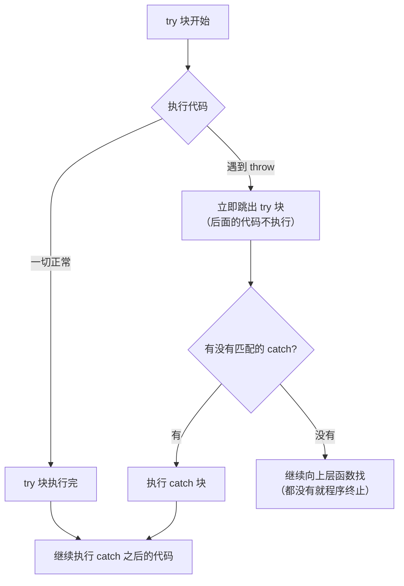

# 附录 A　异常处理（教材附录1）

> **为什么需要这一章？**
> 教材正文里大量出现 `throw "查找位置非法";` 这类写法，但很多同学看到会卡住："这是什么？为什么不是 `cout` 打印错误？"
>
> 这一章补齐这块**语法空白**。学完你就明白：为什么数据结构代码喜欢用 `throw`，以及它和 `cout << "错误"` 到底差在哪。

---

## A.1　先看问题：错误怎么"报告"？

### 【场景】

写一个顺序表，要取第 i 个元素。但如果 `i` 越界了怎么办？

**方案 1：打印错误 + 返回特殊值**

```cpp
int Get(int i) {
    if (i < 1 || i > length) {
        cout << "位置非法！" << endl;
        return -1;              // 用一个特殊值表示"出错"
    }
    return data[i - 1];
}
```

**这个方案有什么问题？**

1. **调用者可能忘了检查返回值**
   ```cpp
   int x = list.Get(100);   // 返回 -1
   int y = x * 2;           // -2，但调用者根本不知道出错了
   ```
2. **`-1` 可能是合法数据**（比如你的表里真的存了 -1）
3. **出错后程序继续跑**，带着错误数据一路往下，最后崩在别的地方

**方案 2：抛出异常**

```cpp
int Get(int i) {
    if (i < 1 || i > length) {
        throw "查找位置非法";   // ★ 抛出异常
    }
    return data[i - 1];
}
```

**这就对了**——出错就"喊出来"，**不往下走了**，直到有人来处理。

### 【本节自测】

**A.1-1.** 方案 1（打印错误 + 返回 `-1`）有哪三个问题？
<details><summary>点我看答案</summary>
<ol>
<li><strong>调用者可能忘了检查返回值</strong> —— 拿到 <code>-1</code> 还继续算，程序带着错误数据往下跑</li>
<li><strong><code>-1</code> 可能是合法数据</strong> —— 如果表里真的存了 <code>-1</code>，就分不清&quot;这是数据&quot;还是&quot;这是错误&quot;</li>
<li><strong>出错后程序继续跑</strong> —— 错误被埋起来，最后崩在离现场很远的地方，极难排查</li>
</ol>
<p><strong>一句话</strong>：这个方案<strong>没法强制调用者面对错误</strong>。</p>
</details>

**A.1-2.** 用 `throw` 替代 `return -1`，最本质的改进是什么？
<details><summary>点我看答案</summary>
<p><strong>最本质的改进：错误&quot;藏不住了&quot;。</strong></p>
<ul>
<li>用 <code>-1</code>：调用者<strong>可以</strong>不看、不问，程序照常往下跑</li>
<li>用 <code>throw</code>：错误被抛出去后<strong>必须</strong>有人接，否则程序直接终止</li>
</ul>
<p><strong>所以 <code>throw</code> 把&quot;要不要处理错误&quot;从一个可选动作，变成了强制动作。</strong></p>
<p>顺便还解决了两件事：</p>
<ul>
<li>返回值干净了（不用拿 <code>-1</code> 兼职当错误码）</li>
<li>错误信息能带更多内容（<code>throw &quot;插入位置非法&quot;</code> 比 <code>return -1</code> 说得清楚）</li>
</ul>
</details>

---

## A.2　异常处理的三个关键字

| 关键字 | 作用 | 类比 |
|---|---|---|
| **`throw`** | **抛出**异常（报告错误） | 拉响警报 |
| **`try`** | **尝试**执行可能出错的代码 | 划定"警戒区" |
| **`catch`** | **捕获**并处理异常 | 接到警报后灭火 |

### 【最小示例】

```cpp
#include <iostream>
using namespace std;

int divide(int a, int b) {
    if (b == 0) {
        throw "除数不能为 0";      // ① 抛出
    }
    return a / b;
}

int main() {
    try {                          // ② 尝试
        cout << divide(10, 2) << endl;   // 正常：5
        cout << divide(10, 0) << endl;   // 出错：抛异常
        cout << "这一行不会执行" << endl;  // ← 被跳过
    } catch (const char* msg) {    // ③ 捕获
        cout << "捕获到异常：" << msg << endl;
    }

    cout << "程序继续执行" << endl;  // ← 异常处理后，后续代码照常跑
    return 0;
}
```

**输出**：
```
5
捕获到异常：除数不能为 0
程序继续执行
```

### 【执行流程图】



### 【三个关键理解】

**① `throw` 之后的代码不会执行**

```cpp
throw "错误";
cout << "这行永远不执行";   // 死代码
```

**② `catch` 是按类型匹配的**

```cpp
try {
    throw 42;              // 抛出一个 int
} catch (const char* s) {  // 想接字符串？匹配不上！
    ...
} catch (int n) {          // ★ 这个才匹配
    cout << "收到 int：" << n << endl;
}
```

**③ 没人 `catch` 会怎样？** → **程序直接终止**（崩溃）。

### 【本节自测】

**A.2-1.** `throw`、`try`、`catch` 各自的作用是什么？用"火警"打比方说明。
<details><summary>点我看答案</summary>
<table>
<thead>
<tr>
<th>关键字</th>
<th>作用</th>
<th>火警类比</th>
</tr>
</thead>
<tbody>
<tr>
<td><code>throw</code></td>
<td><strong>抛出</strong>异常（报告错误）</td>
<td>拉响警报</td>
</tr>
<tr>
<td><code>try</code></td>
<td><strong>尝试</strong>执行可能出错的代码</td>
<td>划定&quot;警戒区&quot;</td>
</tr>
<tr>
<td><code>catch</code></td>
<td><strong>捕获</strong>并处理异常</td>
<td>接到警报后灭火</td>
</tr>
</tbody>
</table>
<p><strong>三者是一套配合动作</strong>：<code>try</code> 圈出危险区域 → 出事就 <code>throw</code> → <code>catch</code> 接住处理。</p>
</details>

**A.2-2.** 下面代码能捕获到异常吗？为什么？
```cpp
try {
    throw 42;
} catch (const char* s) {
    cout << "捕获到了" << endl;
}
```
<details><summary>点我看答案</summary>
<p><strong>不能捕获到，程序会直接终止。</strong></p>
<p><strong>原因</strong>：<code>catch</code> 是<strong>按类型匹配</strong>的。抛出的 <code>42</code> 是 <code>int</code> 类型，而 <code>catch (const char* s)</code> 只想接 <code>const char*</code>（字符串）——<strong>类型对不上，接不住</strong>。</p>
<p><strong>改法</strong>（任选其一）：</p><pre><code class="language-cpp">// 改法1：把 catch 的类型改成 int
catch (int n) { cout &lt;&lt; &quot;捕获到：&quot; &lt;&lt; n &lt;&lt; endl; }&#10;
// 改法2：抛的时候就抛字符串
throw &quot;出错了&quot;;
</code></pre><p><strong>要点</strong>：<strong><code>throw</code> 抛什么类型，<code>catch</code> 就得接什么类型。</strong></p>
</details>

**A.2-3.** 下面代码会输出什么？
```cpp
try {
    cout << "1" << endl;
    throw "错误";
    cout << "2" << endl;
} catch (const char* e) {
    cout << "3" << endl;
}
cout << "4" << endl;
```
<details><summary>点我看答案</summary>
<p>输出：</p><pre><code>1
3
4
</code></pre><p><strong>逐行分析</strong>：</p>
<ul>
<li>输出 <code>1</code> ✓</li>
<li><code>throw &quot;错误&quot;</code> → <strong>立即跳出 <code>try</code> 块</strong></li>
<li><code>cout &lt;&lt; &quot;2&quot;</code> → <strong>不执行</strong>（被 throw 跳过了）</li>
<li><code>catch</code> 匹配成功 → 输出 <code>3</code></li>
<li><code>cout &lt;&lt; &quot;4&quot;</code> → 在 <code>try</code> 之外，正常执行 → 输出 <code>4</code></li>
</ul>
<p><strong>关键</strong>：<strong><code>throw</code> 之后的代码一律不执行</strong>，连 <code>try</code> 块内也不行。</p>
</details>

---

## A.3　为什么要用异常，而不是 `cout` 打印错误？

| | `cout` 打印错误 | `throw` 异常 |
|---|---|---|
| **调用者能否忽略** | **能**（忘了看返回值就完了） | **不能**（必须处理，否则程序终止） |
| **错误能否"向上传递"** | 要一层层手动传返回值 | **自动向上传播**，直到有人接住 |
| **返回值和错误码是否混淆** | 容易混（-1 是错误还是数据？） | **完全分离**，不污染返回值 |
| **出错后代码是否继续** | 继续（可能带着错误数据） | **立即中断**该路径 |

### 【关键优势：错误会自动"向上找"】

**场景**：`main` → `A()` → `B()` → `C()`，`C` 里出错了。

**用 cout**：`C` 打印完错误，`B`、`A` 都不知道，照常往下跑。

**用 throw**：
```cpp
void C() { throw "C 出错了"; }       // 抛出
void B() { C(); }                     // B 不处理 → 自动传给 A
void A() { B(); }                     // A 不处理 → 自动传给 main
int main() {
    try { A(); }
    catch (const char* e) {           // ★ main 接住
        cout << "在 main 里捕获：" << e << endl;
    }
}
```

**运行结果**：
```
在 main 里捕获：C 出错了
```

**`C` 抛出的异常，一路穿过 `B`、`A`，最后在 `main` 被捕获。** 中间不需要写任何传递代码——这就是异常"自动向上传播"的威力。

### 【本节自测】

**A.3-1.** 说出 `throw` 相比 `cout` 打印错误的至少三条优势。
<details><summary>点我看答案</summary>
<table>
<thead>
<tr>
<th></th>
<th><code>cout</code> 打印错误</th>
<th><code>throw</code> 异常</th>
</tr>
</thead>
<tbody>
<tr>
<td><strong>调用者能否忽略</strong></td>
<td><strong>能</strong>（忘了看返回值就完了）</td>
<td><strong>不能</strong>（不处理程序就终止）</td>
</tr>
<tr>
<td><strong>错误能否向上传递</strong></td>
<td>要一层层手动传返回值</td>
<td><strong>自动向上传播</strong>，直到有人接住</td>
</tr>
<tr>
<td><strong>返回值和错误码是否混淆</strong></td>
<td>容易混（-1 是错误还是数据？）</td>
<td><strong>完全分离</strong>，不污染返回值</td>
</tr>
<tr>
<td><strong>出错后代码是否继续</strong></td>
<td>继续（可能带着错误数据）</td>
<td><strong>立即中断</strong>该路径</td>
</tr>
</tbody>
</table>
<p><strong>最该记住的一条</strong>：<strong><code>throw</code> 无法被忽略，<code>cout</code> 可以被忽略。</strong></p>
</details>

**A.3-2.** `main` → `A()` → `B()` → `C()`，`C` 里 `throw` 了一个异常，但 `A`、`B`、`C` 都没写 `try`。最后这个异常会在哪里被处理？
<details><summary>点我看答案</summary>
<p><strong>会一直向上传到 <code>main</code>，在 <code>main</code> 的 <code>catch</code> 里被处理</strong>（如果 <code>main</code> 里写了 <code>try/catch</code>）。</p>
<p><strong>关键理解</strong>：异常<strong>不关心中间经过了几层函数</strong>。<code>C</code> 抛出后，先在 <code>C</code> 里找有没有 <code>catch</code> → 没有就退到 <code>B</code> → 还没有就退到 <code>A</code> → 再退到 <code>main</code>。<strong>谁先有匹配的 <code>catch</code>，谁处理。</strong></p>
<p><strong>如果一路到顶都没人接</strong> → <strong>程序直接终止</strong>（调用 <code>std::terminate</code>）。</p>
<p><strong>这就是&quot;栈展开&quot;</strong>：异常向上传递时，沿途各层的局部变量会被自动销毁（所以 <code>new</code> 出来的内存如果没有 RAII 保护，就会泄漏）。</p>
</details>

**A.3-3.** 判断：用 `cout` 打印错误信息，也是一种"处理了错误"的方式。
<details><summary>点我看答案</summary>
<p><strong>错。</strong> 打印 ≠ 处理。</p>
<p><strong>打印错误</strong>只是&quot;告诉人一声&quot;，<strong>程序仍然带着错误状态继续往下跑</strong>。比如：</p><pre><code class="language-cpp">int x = list.Get(100);   // 内部打印了&quot;位置非法&quot;，返回 -1
int y = x * 2;           // 调用者根本不知道出错了，继续算 → -2
</code></pre><p>**真正的&quot;处理&quot;**应该是：<strong>明确地决定接下来怎么办</strong>——是中止、是返回、是换个方式重试。而 <code>throw</code> 强制你把这件事做掉。</p>
<p><strong>一句话</strong>：<strong><code>cout</code> 是&quot;打印了事&quot;，<code>throw</code> 是&quot;强制报告&quot;。</strong></p>
</details>

---

## A.4　数据结构代码里的实际用法

### 【顺序表的完整异常处理版】

```cpp
template <class T>
class SeqList {
private:
    T*  data;
    int maxSize;
    int length;

public:
    SeqList(int size = 100) {
        maxSize = size;
        data = new T[maxSize];
        length = 0;
    }
    ~SeqList() { delete[] data; }

    // 插入：可能出错的地方都 throw
    void Insert(int i, T x) {
        if (length == maxSize) {
            throw "表已满，无法插入";          // ★ 抛异常
        }
        if (i < 1 || i > length + 1) {
            throw "插入位置非法";              // ★ 抛异常
        }
        for (int j = length; j >= i; j--) {
            data[j] = data[j - 1];
        }
        data[i - 1] = x;
        length++;
    }

    // 删除
    T Delete(int i) {
        if (i < 1 || i > length) {
            throw "删除位置非法";
        }
        T x = data[i - 1];
        for (int j = i - 1; j < length - 1; j++) {
            data[j] = data[j + 1];
        }
        length--;
        return x;
    }
};
```

**调用方**：

```cpp
int main() {
    SeqList<int> list(5);

    try {
        list.Insert(1, 10);
        list.Insert(2, 20);
        list.Insert(100, 30);      // ← 位置非法，会抛异常
        cout << "这行不会执行" << endl;
    }
    catch (const char* msg) {
        cout << "操作失败：" << msg << endl;
    }

    cout << "程序没有崩溃，继续运行" << endl;
    return 0;
}
```

**输出**：
```
操作失败：插入位置非法
程序没有崩溃，继续运行
```

> **对比教材的写法**：教材在这里用 `throw`（有些版本用 `cout` 或返回 `false`）。
> **你要知道的是**：`throw` 是"标准做法"，它能保证**错误不会被忽略**。

### 【链表里的用法】

```cpp
template <class T>
T LinkList<T>::Delete(int i) {
    Node<T>* p = Get(i - 1);
    if (p == nullptr || p->next == nullptr) {
        throw "删除位置非法";        // ★ 链表为空或位置越界
    }
    Node<T>* q = p->next;
    T x = q->data;
    p->next = q->next;
    delete q;
    return x;
}
```

**为什么链表更需要异常？**

因为链表的错误**更隐蔽**：
- 访问空指针会**直接崩溃**（段错误）
- 用 `throw` 提前检查，能给出**清楚的错误说明**，而不是一个莫名其妙的崩溃

### 【本节自测】

**A.4-1.** 顺序表的 `Insert` 里，哪两种情况会抛异常？分别对应什么错误？
<details><summary>点我看答案</summary>
<pre><code class="language-cpp">void Insert(int i, T x) {
    if (length == maxSize)     throw &quot;表已满，无法插入&quot;;   // ① 容量不足
    if (i &lt; 1 || i &gt; length+1) throw &quot;插入位置非法&quot;;       // ② 位置越界
    ...
}
</code></pre><table>
<thead>
<tr>
<th>情况</th>
<th>异常信息</th>
<th>含义</th>
</tr>
</thead>
<tbody>
<tr>
<td><code>length == maxSize</code></td>
<td><code>&quot;表已满，无法插入&quot;</code></td>
<td>数组空间用完了</td>
</tr>
<tr>
<td><code>i &lt; 1</code> 或 <code>i &gt; length+1</code></td>
<td><code>&quot;插入位置非法&quot;</code></td>
<td>位置越界</td>
</tr>
</tbody>
</table>
<p><strong>为什么是 <code>length + 1</code> 而不是 <code>length</code>？</strong></p>
<p>因为插入可以在<strong>表尾之后</strong>进行。表里有 <code>length</code> 个元素时，合法的插入位置是 <code>1</code> 到 <code>length+1</code>（插在最后）。</p>
<p><strong>对比</strong>：删除时合法位置只有 <code>1</code> 到 <code>length</code>——<strong>你不能删除一个不存在的位置</strong>。</p>
</details>

**A.4-2.** 为什么链表里用异常，比顺序表里更有必要？
<details><summary>点我看答案</summary>
<p><strong>因为链表的错误更隐蔽、后果更严重。</strong></p>
<p>对比一下&quot;忘记检查越界&quot;的后果：</p>
<table>
<thead>
<tr>
<th></th>
<th>顺序表</th>
<th>链表</th>
</tr>
</thead>
<tbody>
<tr>
<td>越界访问</td>
<td>读到<strong>垃圾数据</strong>（可能不崩溃，更难发现）</td>
<td><strong>解引用空指针 → 段错误直接崩溃</strong></td>
</tr>
<tr>
<td>出错表现</td>
<td>数据悄悄变错，很久后才发现</td>
<td>程序当场崩溃，但<strong>不知道哪里错了</strong></td>
</tr>
</tbody>
</table>
<p>链表的 <code>p-&gt;next</code> 如果 <code>p</code> 是空指针，<strong>当场崩溃</strong>。而用 <code>throw</code> 提前拦住：</p><pre><code class="language-cpp">if (p == nullptr || p-&gt;next == nullptr) {
    throw &quot;删除位置非法&quot;;     // ★ 给出一句人话
}
</code></pre><p><strong>拿到的是一句&quot;删除位置非法&quot;，而不是一个无头崩溃。</strong> 这就是&quot;防御式编程&quot;的价值——<strong>在危险操作之前先检查</strong>。</p>
</details>

**A.4-3.** 下面这段调用代码会输出什么？
```cpp
SeqList<int> list(5);
try {
    list.Insert(1, 10);
    list.Insert(2, 20);
    list.Insert(100, 30);      // ← 位置非法
    cout << "这行会执行吗" << endl;
} catch (const char* msg) {
    cout << "操作失败：" << msg << endl;
}
cout << "程序继续" << endl;
```
<details><summary>点我看答案</summary>
<p>输出：</p><pre><code>操作失败：插入位置非法
程序继续
</code></pre><p><strong>逐步分析</strong>：</p>
<ol>
<li><code>Insert(1, 10)</code> → 正常，表变成 <code>[10]</code></li>
<li><code>Insert(2, 20)</code> → 正常，表变成 <code>[10, 20]</code></li>
<li><code>Insert(100, 30)</code> → 表里只有 2 个元素，合法位置是 <code>1~3</code>，而 <code>100 &gt; 3</code> → <strong>抛异常</strong></li>
<li><code>cout &lt;&lt; &quot;这行会执行吗&quot;</code> → <strong>不执行</strong>（被 throw 跳过）</li>
<li><code>catch</code> 接住 → 输出 <code>操作失败：插入位置非法</code></li>
<li><code>cout &lt;&lt; &quot;程序继续&quot;</code> → 在 <code>try</code> 外 → 输出 <code>程序继续</code></li>
</ol>
<p><strong>要点</strong>：<strong>前两次成功的插入还在，程序没崩溃，只是这次操作失败了。</strong> 这正是异常的用处——<strong>一次失败不影响程序继续运行</strong>。</p>
</details>

---

## A.5　进阶：捕获不同类型的异常

### 【可以抛任何类型】

```cpp
throw 42;                    // int
throw "字符串错误";           // const char*
throw string("string 错误");  // std::string
throw runtime_error("运行时错误");  // 标准异常类
```

### 【多个 catch，按类型分别处理】

```cpp
try {
    // ... 可能抛出不同异常的代码
    throw 100;
}
catch (const char* msg) {
    cout << "字符串异常：" << msg << endl;
}
catch (int code) {
    cout << "整数异常，错误码：" << code << endl;
}
catch (...) {                  // ★ 万能捕获（catch all）
    cout << "未知异常" << endl;
}
```

**`catch (...)` 的用途**：兜底。**放在所有 catch 的最后**，捕获任何漏网的异常。

### 【标准异常类：更专业的做法】

C++ 标准库提供了一批异常类，**比自己抛字符串更规范**：

```cpp
#include <stdexcept>

try {
    throw std::out_of_range("索引越界");      // 越界
    // throw std::invalid_argument("参数非法"); // 参数错误
    // throw std::runtime_error("运行时错误");  // 一般运行时错误
}
catch (const std::exception& e) {            // ★ 基类引用能接住所有标准异常
    cout << "标准异常：" << e.what() << endl;  // what() 返回说明
}
```

**常用标准异常类**：

| 异常类 | 用途 |
|---|---|
| `std::invalid_argument` | 参数不合法 |
| `std::out_of_range` | 索引越界 |
| `std::length_error` | 超出最大长度 |
| `std::runtime_error` | 一般运行时错误 |
| `std::bad_alloc` | 内存分配失败（`new` 失败时自动抛出） |

> **小白建议**：初学阶段用 `throw "错误信息"` 就够了（教材风格）。
> 等你接触更大的项目，再改用标准异常类——那是"更专业"的做法。

### 【本节自测】

**A.5-1.** `catch (...)` 是什么？应该放在哪里？
<details><summary>点我看答案</summary>
<p><code>catch (...)</code> 是<strong>万能捕获</strong>（catch all）——不管抛出的是什么类型，它都能接住。</p>
<p><strong>必须放在所有 <code>catch</code> 的最后</strong>：</p><pre><code class="language-cpp">try {
    ...
} catch (const char* msg) {   // ① 先接字符串
    ...
} catch (int code) {          // ② 再接整数
    ...
} catch (...) {               // ③ 最后兜底 ← 必须放最后
    cout &lt;&lt; &quot;未知异常&quot; &lt;&lt; endl;
}
</code></pre><p><strong>为什么必须放最后？</strong> 因为 <code>catch</code> 是<strong>从上往下</strong>依次匹配的——谁先匹配上谁处理。如果把 <code>catch (...)</code> 放在前面，后面那些具体的 <code>catch</code> 就<strong>永远轮不到</strong>了。</p>
<p><strong>而且这件事编译器会直接拦下来</strong>——<code>catch (...)</code> 不是最后一项时，GCC 报<strong>编译错误</strong>：</p><pre><code>error: '...' handler must be the last handler for its try block
</code></pre><p>也就是说，<strong>这条规则由编译器强制执行，你连写错都写不进去</strong>（除非加 <code>-fpermissive</code>，但那只是把错误降级成警告，行为依然不对）。</p>
<p><strong>它的用途</strong>：兜底，保证&quot;再奇怪的类型也有人接&quot;，程序不至于直接崩。</p>
</details>

**A.5-2.** 下面代码哪个 `catch` 会执行？
```cpp
try {
    throw std::out_of_range("索引越界");
} catch (const std::exception& e) {
    cout << "A：" << e.what() << endl;
} catch (...) {
    cout << "B：未知异常" << endl;
}
```
<details><summary>点我看答案</summary>
<p><strong>执行第一个，输出 <code>A：索引越界</code>。</strong></p>
<p><strong>原因</strong>：<code>std::out_of_range</code> <strong>继承自</strong> <code>std::exception</code>。而 <code>catch</code> 匹配时<strong>允许基类接住派生类</strong>——所以 <code>const std::exception&amp;</code> 能接住 <code>out_of_range</code>。</p>
<p><strong>这是 C++ 异常处理的常用技巧</strong>：</p><pre><code class="language-cpp">catch (const std::exception&amp; e) {   // 一个 catch 接住所有标准异常
    cout &lt;&lt; e.what() &lt;&lt; endl;       // what() 返回具体的错误说明
}
</code></pre><p><strong>注意两个细节</strong>：</p>
<ol>
<li>用<strong>引用</strong> <code>&amp;</code>（不是值），避免对象切片</li>
<li>用 <strong><code>const</code></strong>，因为处理异常时通常不需要改它</li>
</ol>
<p><strong>顺序</strong>：具体的派生类 <code>catch</code> 要写在基类前面。如果把 <code>catch (const std::exception&amp;)</code> 写在 <code>catch (const std::out_of_range&amp;)</code> 前面，后者就永远轮不到了。</p>
<blockquote>
<p><strong>⚠ 和 <code>catch (...)</code> 的区别（实测过）</strong>：</p>
<ul>
<li><code>catch (...)</code> 不在最后 → <strong>编译错误</strong>，程序根本编不出来</li>
<li>基类 <code>catch</code> 写在派生类前面 → <strong>只是警告</strong>（GCC 的 <code>-Wexceptions</code>），代码能编译能运行，但<strong>派生类的 <code>catch</code> 永远不会被执行</strong></li>
</ul>
<p>后者更危险——因为它<strong>不报错</strong>，你以为写对了，实际那段 <code>catch</code> 是死代码。</p>
</blockquote>
</details>

**A.5-3.** `throw 42;` 和 `throw std::runtime_error("出错了");` 相比，后者好在哪里？
<details><summary>点我看答案</summary>
<p><strong>后者更好，理由有三条</strong>：</p>
<table>
<thead>
<tr>
<th></th>
<th><code>throw 42</code></th>
<th><code>throw std::runtime_error(&quot;出错了&quot;)</code></th>
</tr>
</thead>
<tbody>
<tr>
<td><strong>能否带说明</strong></td>
<td>只有一个数字，<strong>不知道什么意思</strong></td>
<td><code>what()</code> 能返回 <code>&quot;出错了&quot;</code>，<strong>一看就懂</strong></td>
</tr>
<tr>
<td><strong>能否分类捕获</strong></td>
<td>只能靠 <code>catch(int)</code> 精确匹配</td>
<td>可以用 <code>catch (const std::exception&amp;)</code> <strong>统一接住</strong></td>
</tr>
<tr>
<td><strong>是否规范</strong></td>
<td>抛裸类型，接收方要猜</td>
<td>标准库类型，<strong>团队协作有共识</strong></td>
</tr>
</tbody>
</table>
<p><strong>最实际的好处是第二条</strong>：用标准异常类，调用方可以<strong>只写一个 <code>catch</code></strong> 就接住所有标准异常：</p><pre><code class="language-cpp">catch (const std::exception&amp; e) {
    cerr &lt;&lt; &quot;出错了：&quot; &lt;&lt; e.what() &lt;&lt; endl;
}
</code></pre><p>而如果大家都抛裸类型（<code>int</code>、<code>const char*</code> 混着来），调用方就得写一堆 <code>catch</code> 去猜。</p>
<p><strong>不过</strong>：教材里大量用 <code>throw &quot;字符串&quot;</code>，因为<strong>简单直观</strong>。初学阶段跟着教材走没问题，知道有更规范的写法即可。</p>
</details>

---

## A.6　⚠ 常见误区

### 【误区 1：`try` 块包得越大越好】

```cpp
// ❌ 不好：一整段都包起来，出错时不知道具体哪里错了
try {
    // ... 100 行代码 ...
} catch (...) { }
```

```cpp
// ✓ 好：只包"可能出错"的少数几行
list.Insert(1, 10);
try {
    list.Insert(100, 30);   // 只有这行可能出错
} catch (const char* msg) {
    cout << "插入失败：" << msg << endl;
}
```

**原则**：**`try` 包的范围要精确**——只包真正可能抛异常的那几行。

### 【误区 2：捕获了却不处理】

```cpp
// ❌ 最糟的写法：捕获了什么都不做
try {
    riskyOperation();
} catch (...) {
    // 什么都不写 ← 错误被"吞掉"了，问题更难排查！
}
```

**这叫"吞异常"**，比崩溃还糟糕——因为**问题被隐藏了**。

**正确做法**：至少打印出来
```cpp
catch (const std::exception& e) {
    cerr << "错误：" << e.what() << endl;   // cerr 是标准错误输出
}
```

### 【误区 3：用异常做"正常流程控制"】

```cpp
// ❌ 不好：用异常判断"表是不是满了"
try {
    list.Insert(...);
} catch (...) {
    cout << "表满了" << endl;
}
```

异常**很慢**（涉及栈展开），**不适合当 if 用**。

```cpp
// ✓ 好：正常判断用 if，异常只留给"真正的意外"
if (list.isFull()) {
    cout << "表满了" << endl;
} else {
    list.Insert(...);
}
```

### 【误区 4：析构函数里抛异常】

```cpp
~SeqList() {
    throw "析构出错";   // ❌ 危险！可能导致程序直接终止
}
```

**不要在析构函数里抛异常**（C++ 的规则，会导致 `std::terminate`）。

### 【本节自测】

**A.6-1.** 下面两种写法，哪种更好？为什么？
```cpp
// 写法甲
try {
    list.Insert(1, 10);
    list.Insert(2, 20);
    list.Insert(100, 30);
    list.Print();
} catch (...) { }

// 写法乙
list.Insert(1, 10);
list.Insert(2, 20);
try {
    list.Insert(100, 30);
} catch (const char* msg) {
    cerr << "插入失败：" << msg << endl;
}
```
<details><summary>点我看答案</summary>
<p><strong>写法乙更好</strong>，因为写法甲犯了<strong>两个</strong>错误：</p>
<table>
<thead>
<tr>
<th>问题</th>
<th>写法甲</th>
<th>写法乙</th>
</tr>
</thead>
<tbody>
<tr>
<td><strong><code>try</code> 范围</strong></td>
<td>包了 4 行，出错时<strong>不知道是哪行出的</strong></td>
<td>只包可能出错的那 1 行，<strong>定位精准</strong></td>
</tr>
<tr>
<td><strong><code>catch</code> 处理</strong></td>
<td>空的，<strong>错误被吞掉</strong></td>
<td>打印出来，<strong>问题看得见</strong></td>
</tr>
</tbody>
</table>
<p><strong>原则</strong>：</p>
<ul>
<li><strong><code>try</code> 要精确包裹</strong> —— 只包真正可能抛异常的代码</li>
<li><strong><code>catch</code> 必须处理</strong> —— 至少打印出来，绝不静默吞掉</li>
</ul>
<p><strong>&quot;吞异常&quot;为什么比崩溃还糟？</strong> 崩溃至少告诉你&quot;这里出问题了&quot;；吞掉异常，程序带着错误状态继续跑，最后崩在别处——<strong>排查难度成倍上升</strong>。</p>
</details>

**A.6-2.** 判断：下面用异常判断"表是否已满"，写法对吗？为什么？
```cpp
try {
    list.Insert(1, 10);
} catch (const char* msg) {
    cout << "表满了" << endl;
}
```
<details><summary>点我看答案</summary>
<p><strong>不对。</strong> 这是&quot;<strong>用异常做正常流程控制</strong>&quot;。</p>
<p><strong>问题在于</strong>：&quot;表满&quot;是一个<strong>正常会发生的情况</strong>（不是意外）。用异常处理它有两个坏处：</p>
<ol>
<li><strong>慢</strong> —— 抛异常涉及<strong>栈展开</strong>，开销远大于一次 <code>if</code> 判断</li>
<li><strong>语义错</strong> —— 异常应该留给&quot;真正的意外&quot;，滥用会让代码难以理解</li>
</ol>
<p><strong>正确写法</strong>：</p><pre><code class="language-cpp">if (list.isFull()) {
    cout &lt;&lt; &quot;表满了&quot; &lt;&lt; endl;
} else {
    list.Insert(1, 10);
}
</code></pre><p><strong>判断标准</strong>（很重要）：</p>
<ul>
<li><strong>可预见的正常分支</strong> → 用 <code>if</code></li>
<li><strong>不该发生、或难以就地处理的错误</strong> → 用 <code>throw</code></li>
</ul>
<p><strong>对比</strong>：<code>Insert</code> 里检查&quot;位置越界&quot;用 <code>throw</code> 是合理的——因为那是<strong>调用方的错误</strong>，不是正常流程。</p>
</details>

**A.6-3.** 为什么不能在析构函数里抛异常？
<details><summary>点我看答案</summary>
<p><strong>因为 C++ 规定：如果异常在&quot;栈展开过程中&quot;再次抛出，程序会直接调用 <code>std::terminate</code> 终止。</strong></p>
<p><strong>什么叫&quot;栈展开过程中&quot;？</strong> 假设发生了两件事：</p>
<ol>
<li>某处抛出了异常 → 开始<strong>栈展开</strong>（沿途销毁局部对象）</li>
<li>栈展开要销毁某个对象 → 调用它的<strong>析构函数</strong></li>
<li><strong>而这个析构函数又抛了一个新异常</strong> ← 这就是&quot;异常中抛异常&quot;</li>
</ol>
<p>此时 C++ 无法决定该处理哪一个异常，只能<strong>直接终止程序</strong>。</p>
<p><strong>正确做法</strong>：析构函数里<strong>只做清理，不报错</strong>。如果真的遇到问题，记下来或忽略：</p><pre><code class="language-cpp">~SeqList() {
    delete[] data;      // ✓ 只做清理，不抛异常
}
</code></pre><p><strong>记忆</strong>：<strong>析构函数里永远不要 <code>throw</code>。</strong></p>
</details>

---

## A.7　本章自测·综合卷

**A-1.** 下面代码的输出是什么？
```cpp
try {
    cout << "A" << endl;
    throw "出错了";
    cout << "B" << endl;
} catch (const char* msg) {
    cout << "C" << endl;
}
cout << "D" << endl;
```
<details><summary>点我看答案</summary>
<p>输出：</p><pre><code>A
C
D
</code></pre><p><strong>逐行分析</strong>：</p>
<ul>
<li><code>cout &lt;&lt; &quot;A&quot;</code> → 输出 A ✓</li>
<li><code>throw &quot;出错了&quot;</code> → 抛异常，<strong>立即跳出 try 块</strong></li>
<li><code>cout &lt;&lt; &quot;B&quot;</code> → <strong>不执行</strong>（被 throw 跳过了）</li>
<li><code>catch</code> 匹配成功 → 输出 C</li>
<li><code>cout &lt;&lt; &quot;D&quot;</code> → 在 try 之外，正常执行 → 输出 D</li>
</ul>
<p><strong>关键</strong>：<strong><code>throw</code> 后面的代码不会执行。</strong></p>
</details>

**A-2.** 用 `throw` 和用 `cout` 打印错误，最主要的区别是什么？
<details><summary>点我看答案</summary>
<p><strong>最主要的区别：<code>throw</code> 无法被忽略，<code>cout</code> 可以被忽略。</strong></p>
<table>
<thead>
<tr>
<th></th>
<th>cout</th>
<th>throw</th>
</tr>
</thead>
<tbody>
<tr>
<td>调用者能否忽略</td>
<td><strong>能</strong>（忘了看返回值就完了）</td>
<td><strong>不能</strong>（不处理程序就终止）</td>
</tr>
<tr>
<td>错误传播</td>
<td>要一层层手动传</td>
<td><strong>自动向上传播</strong></td>
</tr>
<tr>
<td>出错后</td>
<td>继续执行（带着错误数据）</td>
<td><strong>立即中断</strong></td>
</tr>
</tbody>
</table>
<p><strong>一句话</strong>：<strong><code>throw</code> 是&quot;强制报告&quot;，<code>cout</code> 是&quot;打印了事&quot;。</strong></p>
<p><strong>实际影响</strong>：用 <code>cout</code>，一个粗心的调用者可能让程序带着错误数据跑很久，最后崩在毫不相干的地方——极难排查。</p>
</details>

**A-3.** 下面代码有什么问题？怎么改？
```cpp
try {
    // 100 行代码
    riskyOperation();
    // 又 50 行代码
} catch (...) {
}
```
<details><summary>点我看答案</summary>
<p><strong>两个问题</strong>：</p>
<ol>
<li><strong><code>try</code> 块范围太大</strong>：150 行都包起来，出错时不知道具体哪一行出的问题</li>
<li><strong><code>catch(...)</code> 里什么都不做</strong>：异常被&quot;吞掉&quot;，问题被隐藏</li>
</ol>
<p><strong>改法</strong>：</p><pre><code class="language-cpp">// ① 只包可能出错的那几行
try {
    riskyOperation();
} catch (const std::exception&amp; e) {
    // ② 至少打印出来
    cerr &lt;&lt; &quot;操作失败：&quot; &lt;&lt; e.what() &lt;&lt; endl;
    // ③ 视情况决定：继续？返回？重新抛出？
}
</code></pre><p><strong>原则</strong>：</p>
<ul>
<li><strong><code>try</code> 精确包裹</strong>（只包可能出错的代码）</li>
<li><strong><code>catch</code> 必须处理</strong>（至少记录日志，绝不静默吞掉）</li>
</ul>
</details>

**A-4.** 为下面的函数加上异常处理（越界时抛异常）：
```cpp
int Get(int i) {
    return data[i - 1];
}
```
<details><summary>点我看答案</summary>
<pre><code class="language-cpp">template &lt;class T&gt;
T SeqList&lt;T&gt;::Get(int i) {
    if (i &lt; 1 || i &gt; length) {
        throw &quot;查找位置非法&quot;;      // ★ 越界检查
    }
    return data[i - 1];
}
</code></pre><p><strong>要点</strong>：</p>
<ol>
<li>检查<strong>两个边界</strong>：<code>i &lt; 1</code>（太小）和 <code>i &gt; length</code>（太大）</li>
<li>用 <code>throw</code> 而不是 <code>return -1</code>（避免和合法数据混淆）</li>
<li>检查通过后才真正访问 <code>data[i-1]</code></li>
</ol>
<p><strong>调用方必须处理</strong>：</p><pre><code class="language-cpp">try {
    int x = list.Get(100);
} catch (const char* msg) {
    cout &lt;&lt; &quot;获取失败：&quot; &lt;&lt; msg &lt;&lt; endl;
}
</code></pre>
</details>

**A-5.** 判断：异常处理会让程序变慢，所以应该尽量少用。
<details><summary>点我看答案</summary>
<p><strong>半对半错。</strong></p>
<ul>
<li><strong>对的部分</strong>：<strong>抛出和捕获</strong>异常确实有开销（栈展开），所以<strong>不要用异常做正常的流程控制</strong>。</li>
<li><strong>错的部分</strong>：<strong>不抛异常的时候，<code>try</code> 块几乎没有开销</strong>——现代编译器对 <code>try/catch</code> 做了优化，只要没真正抛异常，性能影响可以忽略。</li>
</ul>
<p><strong>正确理解</strong>：</p>
<ul>
<li><strong>&quot;异常路径&quot;慢</strong> → 所以别用异常当 <code>if</code> 用</li>
<li><strong>&quot;正常路径&quot;不慢</strong> → 所以可以放心地写 <code>try/catch</code> 来保护可能出错的操作</li>
</ul>
<p><strong>判断标准</strong>：</p><pre><code class="language-cpp">// ❌ 用异常判断&quot;表满&quot;（这是正常情况，不是意外）
if (list.isFull()) { ... }        // ✓ 应该这样&#10;
// ✓ 用异常处理&quot;索引越界&quot;（这是真正的错误）
if (i &lt; 1 || i &gt; length) throw ...;  // ✓ 合理
</code></pre>
</details>

---

## A.8　与教材正文的联系

学完本章，回看教材正文里那些 `throw`，就都懂了：

| 位置 | 代码 | 含义 |
|---|---|---|
| 第 2 章 顺序表 Get | `throw "查找位置非法"` | 索引越界 |
| 第 2 章 顺序表 Insert | `throw "表已满"` | 容量不足 |
| 第 2 章 顺序表 Insert | `throw "插入位置非法"` | 位置越界 |
| 第 2 章 单链表 Insert | `throw "插入位置非法"` | 前驱节点为空 |
| 第 2 章 单链表 Delete | `throw "删除位置非法"` | 节点不存在 |

**它们的共同点**：**在"访问非法内存之前"就拦住错误**。

**如果不用异常会怎样？**
```cpp
int x = data[i - 1];   // 如果 i 越界，这里读到垃圾数据，甚至崩溃
```

**用了异常**：
```cpp
if (i < 1 || i > length) throw "...";  // 提前拦住，给出清晰错误
int x = data[i - 1];                    // 到这里一定是安全的
```

> **这就是"防御式编程"**：**在危险操作之前先检查**，而不是等出事了再处理。

### 【本节自测】

**A.8-1.** 教材第 2 章的 `Get` 里写了 `throw "查找位置非法";`。这句代码到底在防什么？
<details><summary>点我看答案</summary>
<p><strong>在防&quot;越界访问内存&quot;。</strong></p>
<p><code>Get(i)</code> 的本质是 <code>return data[i-1];</code>。如果 <code>i</code> 越界：</p>
<ul>
<li><code>i</code> 太小（如 <code>0</code>）→ 访问 <code>data[-1]</code>，读到<strong>数组前面的内存</strong></li>
<li><code>i</code> 太大（如 <code>100</code>，但表里只有 5 个元素）→ 读到<strong>数组后面的内存</strong></li>
</ul>
<p>这两种都是<strong>非法内存访问</strong>：轻则读到垃圾数据（程序悄悄出错），重则直接崩溃。</p><pre><code class="language-cpp">if (i &lt; 1 || i &gt; length) throw &quot;查找位置非法&quot;;   // ★ 提前拦住
int x = data[i - 1];                             // 到这里一定安全
</code></pre><p><strong>关键</strong>：<code>throw</code> 写在<strong>访问内存之前</strong>，所以危险操作根本不会被执行。</p>
</details>

**A.8-2.** 教材里这几个 `throw` 分别在防什么？连一连：
```
① throw "表已满"           A. 前驱节点为空
② throw "插入位置非法"      B. 容量不够
③ throw "删除位置非法"      C. 位置越界
④ 单链表 Insert 的 throw   D. 节点不存在
```
<details><summary>点我看答案</summary>
<pre><code>① 表已满          → B. 容量不够
② 插入位置非法     → C. 位置越界
③ 删除位置非法     → D. 节点不存在
④ 单链表 Insert    → A. 前驱节点为空
</code></pre><p><strong>补充说明</strong>：</p>
<ul>
<li>① 是<strong>空间</strong>不够（数组开满了）</li>
<li>②③ 是<strong>位置</strong>不合法（越界）</li>
<li>④ 链表的 <code>Insert(i)</code> 要先找到第 <code>i-1</code> 个节点，如果那个节点不存在（表太短），就没法插入</li>
</ul>
<p><strong>共同点</strong>：<strong>都在&quot;访问非法内存之前&quot;拦住错误。</strong></p>
</details>

**A.8-3.** 什么是"防御式编程"？用 `Get` 举例说明。
<details><summary>点我看答案</summary>
<p><strong>防御式编程 = 在危险操作之前先检查，而不是等出事了再补救。</strong></p>
<p><strong>用 <code>Get</code> 对比</strong>：</p><pre><code class="language-cpp">// ❌ 不防御：直接访问，越界了才知道
int Get(int i) {
    return data[i - 1];        // i 越界 → 读到垃圾数据，甚至崩溃
}&#10;
// ✓ 防御：先检查，确认安全再访问
int Get(int i) {
    if (i &lt; 1 || i &gt; length) {
        throw &quot;查找位置非法&quot;;   // 提前拦住，给出清晰错误
    }
    return data[i - 1];        // 到这里一定是安全的
}
</code></pre><p><strong>核心思想</strong>：<strong>把&quot;检查&quot;放在&quot;危险动作&quot;前面</strong>。</p>
<p><strong>为什么值得？</strong> 崩溃现场往往离出错点很远（错误数据一路传下去，最后在别处崩）。<strong>提前检查 = 在出事的第一现场报错</strong>，排查成本天差地别。</p>
</details>

---

## A.9　本章小结

| 知识点 | 掌握标准 |
|---|---|
| `throw` / `try` / `catch` 三个关键字 | 知道各自作用，能写出最小示例 |
| 执行流程 | 能说清"throw 之后的代码为什么不执行" |
| `catch` 的类型匹配 | 知道"抛什么类型就接什么类型"，接不上会传播到外层 |
| 异常 vs cout | 能说出 3 条区别 |
| 自动向上传播 | 能画出"异常穿过多个函数被 main 捕获"的流程 |
| 数据结构中的应用 | 看懂教材里的 `throw` 语句 |
| 多个 `catch` 的顺序 | 知道"具体在前、兜底在后"，以及 `catch (...)` 必须在最后 |
| 标准异常类 | 知道 `std::exception` 能接住所有标准异常，`what()` 取说明 |
| 四个常见误区 | 记住"try 要精确、catch 要处理、别当 if 用、析构别抛" |

**配套代码**：[`code/附录_异常处理.cpp`](code/附录_异常处理.cpp) —— 包含所有例子的完整可运行版本。

---

**返回**：[总目录](README.md) | **相关章节**：[第 2 章 线性表](02-线性表.md)（顺序表/链表的异常使用）
